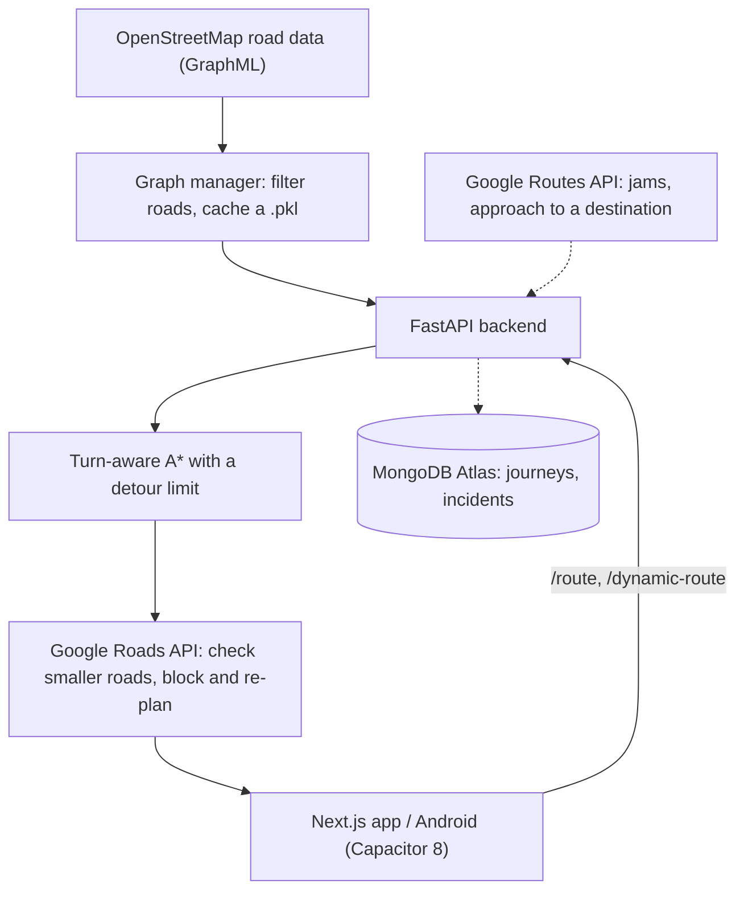

# Design and Empirical Evaluation of a Two-Wheeler-Aware Routing Framework for Urban Road Networks

[](https://nextjs.org/)
[](https://fastapi.tiangolo.com/)
[](https://capacitorjs.com/)
[](https://python.org/)
[](https://www.openstreetmap.org/)
[](https://www.mongodb.com/atlas)
[](LICENSE)

An end-to-end, graph-theoretic two-wheeler navigation system and empirical research framework tailored for densely populated cities with high mixed-traffic volumes, evaluated on the road network of Bengaluru, India (308,643 vertices, 740,822 directed edges).

---

## ⚠️ Known Issues

This is a **prototype**. Check a route before relying on it, and always follow road signs and local access rules.

### 1. Road choice is not smart enough yet
* Routes are not always the road a local rider would take. They can use narrow or awkward lanes, or miss a better road.
* Road preference comes from **fixed weights per road type**. Nothing is learned from real rides, and road width, surface quality and signals are not considered.
* Live traffic is limited: jams are only known **along Google's own route** for the trip. Congestion elsewhere is not seen.
* Travel times are estimates from typical speeds and **do not include live traffic**. "Fastest" mode compares these estimates.

### 2. Some roads in a route might not exist
* The road network comes from OpenStreetMap data, which can be **outdated or wrong**. A route can include a road that is not there, is blocked, or cannot be ridden. This has happened in testing.
* The Google road check reduces this but **does not remove it**:
  * a wrong road within 25 m of a real one can still pass;
  * tertiary and larger roads are not checked;
  * if Google cannot be asked, the route is returned unchecked (the response says `unavailable`);
  * the strict limit may also block a road that is real;
  * it cannot tell whether a road is gated, private or closed.

### 3. A route may stop short of the destination
* Campuses, apartments, defence areas and other gated places often have no road the app may use. The route then ends outside.
* The map file used in development has **no `highway=service` roads**, so many internal lanes are missing from it.
* When no road is near the destination, the route ends where Google's route approaches it. That is not guaranteed to be an entrance, and it **has not yet been confirmed on real trips**.

### 4. Speed
* The road index is rebuilt on **every server start** (about 50 s on the development PC). Until `[Index] Road index ready` appears, pins snap to the nearest junction and routes can be worse.
* Dynamic routes can be slow, especially long ones that need the Google road check.

### 5. Testing
* Automated tests use fake or stand-in versions of Google and the phone. The current version still needs **testing on a phone and on real roads**.

---

> **About the research sections:** the Abstract, Mathematical Foundations and Benchmarks below summarise the project's **research paper**. The running code differs in places: its A\* lower bound is calculated from the active cost table (not a fixed 0.80), living streets cost 0.95, the flyover discount is off by default, a traffic jam costs 2× (not 25×), and no API endpoint uses the alternative route generator. See [How the current code works](#️-how-the-current-code-works).

---

## 📑 Abstract

Vehicle-focused commercial navigation systems (e.g., Google Maps, Waze) heavily prioritize major arterial corridors. In cities such as Bengaluru, where two-wheelers comprise a dominant share of vehicular traffic alongside cars and heavy vehicles, routing all classes onto identical major roads exacerbates urban congestion. This research presents a routing system specifically tailored to two-wheelers to achieve decentralized route distribution. 

The framework integrates:
1. **Turn-aware, state-expanded $A^*$ search** that models directional change penalties directly during edge relaxation.
2. **Road-class impedance hierarchy** that favors collector, residential, and secondary links over congested arterials.
3. **Dual-mode search**: *Shortest Mode* (reproducible static cost-aware) and *Dynamic Mode* (live-traffic bottleneck evasion via Google Routes API and MongoDB Atlas route snapshot persistence).
4. **Perpendicular-offset alternative route generator** producing topologically distinct candidate corridors under strict detour ($\varepsilon \le 1.20$) and edge-overlap ($\gamma \le 0.70$) thresholds.

**Key Experimental Findings:**
* Across **25 real-world Bengaluru corridors** (Experiment E), the generator yielded valid topologically diverse alternatives on **88.0% of corridors** ($22/25$), with a mean pairwise Jaccard diversity of **$0.5605$**.
* When benchmarked against **Yen’s $K$-Shortest Paths**, the offset method achieved significantly superior topological corridor separation (mean Jaccard diversity **$0.58$ vs. $0.35$**; edge overlap **$0.44$ vs. $0.53$**).
* Field validation using **five GPS tracks recorded over three days** confirmed high spatial consistency (mean cross-day deviation of $3.4\text{ m}$ AM / $2.9\text{ m}$ PM) and validated dynamic real-time rerouting responsiveness.

---

## 🏛️ How the current code works



| Area | Behaviour |
| :--- | :--- |
| **Shortest** | Distance, with turn costs (25 m for 60° or more, 8 m for 30–60°). |
| **Dynamic** | Prefers inner roads (primary 2.2, residential 1.0), but is never longer than **15% or 300 m** over the most direct route, whichever allows more. |
| **Traffic** | A jammed road costs 2×, so short traffic is ridden through. Reported incidents cost much more. |
| **Roads removed** | `private`, `no`, military, emergency-only and permit-only roads, and paths vehicles cannot use. |
| **Start or end only** | Service, destination-only, customer, delivery and `permissive` roads: never used as a shortcut. |
| **Pins** | Snap to the nearest road segment, respecting one-way streets. |
| **Google road check** | Roads below tertiary are tested at 3 or more points (25 m tolerance). A rejected road is blocked and the route planned again, up to 5 rounds. |
| **Far destinations** | If no road is within 50 m, the route ends where Google's route last follows a public road. |

---

## 🔬 Mathematical & Algorithmic Foundations

### 1. State-Expanded Turn Cost Model
Standard vertex-based search cannot penalize turns without topological expansion. Search states are modeled as directed edges $s = (u, v)$, representing arrival at vertex $v$ from $u$. A transition from state $(u, v)$ to $(v, w)$ carries cost:

$$c\big((u, v) \to (v, w)\big) = c_\mu(v, w) + P_{\text{turn}}(u, v, w)$$

Where:
* $c_\mu(v, w) = \ell(v, w) \cdot \mu(v, w)$ is the impedance-weighted edge cost.
* $\ell$ is physical edge length (meters).
* $\mu(v, w)$ is the inverted road-class multiplier:
  * Motorways / Trunk: $3.00 - 4.00$
  * Primary arterials: $2.00 - 2.20$
  * Secondary roads: $1.40 - 1.50$
  * Tertiary collectors: $1.10 - 1.15$
  * Residential / Unclassified: $1.00$
  * Living streets: $0.90 - 0.95$
  * Roundabouts: $0.95$ | Bridges: $0.80$
* $P_{\text{turn}}$ evaluates angular deflection $\Delta\theta \in [0^\circ, 180^\circ]$ between inbound and outbound azimuths:
  $$P_{\text{turn}} = \begin{cases} 25.0\text{ m}, & \Delta\theta \ge 60^\circ \\ 8.0\text{ m}, & 30^\circ \le \Delta\theta < 60^\circ \\ 0.0\text{ m}, & \Delta\theta < 30^\circ \end{cases}$$

### 2. Admissible & Consistent Heuristic
The global minimum multiplier across all network edges is $\mu_{\min} = 0.80$. The goal-directed heuristic function:

$$h(v) = 0.80 \cdot d_{\text{Haversine}}(v, t)$$

is strictly **admissible** and **consistent** under the spherical triangle inequality, guaranteeing that the first extraction of target state $(\cdot, t)$ from the priority queue is mathematically optimal.

### 3. Perpendicular-Offset Alternative Generation
Standard $K$-shortest path algorithms (e.g., Yen) produce near-identical paths with minor block detours. Our algorithm generates laterally displaced waypoints along the chord connecting origin $O = (\varphi_O, \lambda_O)$ and destination $D = (\varphi_D, \lambda_D)$:

1. Forward azimuth $\beta = \text{atan2}\left(\sin\Delta\lambda \cos\varphi_D, \, \cos\varphi_O\sin\varphi_D - \sin\varphi_O\cos\varphi_D\cos\Delta\lambda\right) \pmod{360^\circ}$.
2. Chord base points $p_b(\alpha)$ at fractions $\alpha \in \{0.33, 0.50, 0.67\}$.
3. Perpendicular displacement $\beta_\perp \in \{\beta + 90^\circ, \beta - 90^\circ\}$ across lateral distances $d \in \{150\text{ m}, 300\text{ m}\}$.
4. 12 generated waypoints are snapped to the graph and stitched via independent $A^*$ runs: $P_w = (O \to w) \oplus (w \to D)$.
5. Candidates must satisfy four sequential rejection filters:
   * **Connectivity**: Path is continuous.
   * **Duplicate Suppression**: Vertex sequence is unique.
   * **Detour Bound**: $\varepsilon(P_w) = \frac{\text{dist}(P_w)}{\text{dist}(P_0)} \le 1.20$
   * **Edge Overlap Bound**: $\gamma(P_w, P_0) = \frac{\sum_{e \in E(P_w) \cap E(P_0)} \ell(e)}{\sum_{e \in E(P_w)} \ell(e)} \le 0.70$
6. Survivors sorted by ascending impedance cost; top $K = 3$ returned.

### 4. Length-Weighted Jaccard Route Diversity
Topological corridor separation is measured using length-weighted edge overlap:

$$J(P_i, P_j) = \frac{\sum_{e \in E(P_i) \cap E(P_j)} \ell(e)}{\sum_{e \in E(P_i) \cup E(P_j)} \ell(e)}, \quad \mathcal{D} = 1 - \frac{1}{\binom{N}{2}} \sum_{i < j} J(P_i, P_j)$$

---

## 📊 Empirical Benchmarks (Summary from Paper)

### Experiment E1: Performance Across 25 Bengaluru Corridors
| Class | Corridors ($n$) | Valid Alternatives Found | Reached $K = 3$ | Mean Alternatives | Mean Diversity ($\mathcal{D}$) |
| :--- | :---: | :---: | :---: | :---: | :---: |
| **Short** ($< 5\text{ km}$) | 7 | 6 (85.7%) | 5 | 2.43 | **0.622** |
| **Medium** ($5 - 10\text{ km}$) | 10 | 8 (80.0%) | 5 | 1.90 | **0.530** |
| **Long** ($> 10\text{ km}$) | 8 | 8 (100%) | 4 | 2.50 | **0.545** |
| **Overall** | **25** | **22 (88.0%)** | **14 (56.0%)** | **2.24** | **0.561** |

*Mean detour ratio: 1.046; Mean edge overlap: 0.496 across 56 accepted alternative paths.*

### Comparison Against Yen's $K$-Shortest Paths
| Metric | Perpendicular Offset (Our Method) | Filtered Yen | Raw Yen |
| :--- | :---: | :---: | :---: |
| **Topological Diversity ($\mathcal{D}$)** | **0.58** | 0.35 | 0.13 |
| **Mean Overlap with Primary** | **0.44** | 0.53 | 0.93 |
| **Duplicate Path Rate** | **0%** | Filtered 323 paths | ~90% near-duplicates |

---

## 📱 The App

Built with **Next.js 15**, **Tailwind CSS** and **Capacitor 8** (Android).

* **Search or press and hold** the map to choose a place; a plain tap selects nothing.
* **Turn banner and voice guidance** (the phone's text-to-speech on Android).
* **Speed, arrival time and distance left**, rerouting when you leave the route.
* **2D map** with heading-up or north-up compass and a Re-center button.
* **Trip completed card**, then back to the start screen.
* **Incident reporting** for crashes, hazards, flooding and construction.

---

## 🚀 Getting Started

### Prerequisites
* Node.js 20+ and Python 3.11+
* Android Studio / SDK (for the APK)
* Google Maps Platform keys with **Maps JavaScript, Places, Geocoding, Routes and Roads** APIs enabled
* The road data file `Data Assets/bengaluru_roads_extended.graphml` (too large for GitHub)

### Settings (`.env` in the project root; never commit it)

| Name | Purpose |
| :--- | :--- |
| `GOOGLE_PLACES_API_KEY` | Place search |
| `GOOGLE_MAPS_API_KEY` | Routes API |
| `GOOGLE_ROADS_API_KEY` | Roads API (optional; falls back to the keys above) |
| `MONGODB_URI` | Optional: journeys and incidents |
| `NEXT_PUBLIC_GOOGLE_MAPS_KEY` | Map in the app |
| `NEXT_PUBLIC_GOOGLE_MAP_ID` | Optional: your styled vector Map ID |
| `NEXT_PUBLIC_API_BASE` | Backend address the app calls (set **before** building) |
| `ENABLE_ROAD_VERIFY` | `false` turns off the Google road check |
| `ENABLE_GOOGLE_ARRIVAL` | `false` turns off the Google approach for far destinations |

The road check and the approach lookup use **paid Google API calls**.

### Backend

```bash
git clone https://github.com/itsgeneric/BLRMap_Prototype.git
cd BLRMap_Prototype
git switch main-backend
python -m venv venv
source venv/bin/activate          # Windows: venv\Scripts\activate
pip install -r requirements.txt
python api_server.py --no-reload  # port 8000, docs at /docs
```

The first start builds `Data Assets/bengaluru_graph.smart.pkl` from the GraphML file. Later starts load that file. It is rebuilt automatically when the road rules change. Wait for `[Index] Road index ready` before testing routes.

**Using an existing, older `.pkl`** (keeps the road rules it was built with; back it up first, and check it loads with `Fast binary load complete`):

```bash
GRAPH_PKL_PATH="Data Assets/bengaluru_graph.pkl" GRAPH_FILE_PATH="do-not-rebuild" python api_server.py --no-reload
```

### Web app

```bash
npm install
npm run dev                       # http://localhost:3000
```

### Android APK

Put `NEXT_PUBLIC_API_BASE=http://<backend address>:8000` in `.env.production.local`. On a phone, `127.0.0.1` means the phone itself.

```bash
npm run build
npx cap sync android
cd android
./gradlew assembleDebug           # Windows: .\gradlew.bat assembleDebug
# APK: android/app/build/outputs/apk/debug/app-debug.apk
```

### Tests

```bash
python -m unittest discover -s tests -t .      # backend
node --test "tests/frontend/*.test.ts"          # app (Node 23.6+, tested on 26)
node tests/ui/layout.e2e.mjs                    # browser layout and full ride; run `npm run build` first
```

The browser check needs Edge or Chrome and uses a stand-in backend (set `BACKEND_PORT` if port 8000 is busy, and build with the matching `NEXT_PUBLIC_API_BASE`). Some backend tests only run against a live server.

---

## 📂 Project Structure

```text
app/  components/  hooks/  lib/     # Next.js app
android/                            # Capacitor Android project
api_server.py                       # FastAPI endpoints
core/config.py                      # road weights and settings
routing/
  graph_manager.py                  # load and filter the road graph
  algorithms.py                     # A*, turn costs, turn instructions
  snapping.py                       # pins on roads, route planning
  smart.py                          # detour limit
  access.py                         # start/end-only roads
  arrival.py                        # destinations with no road beside them
  landmarks.py                      # faster A* lower bounds
  edge_blacklist.py                 # blocked roads
services/external_api.py            # Google Places, Routes and Roads
database/                           # MongoDB
tests/                              # backend, app and browser tests
```

---

## 📖 Citation

If you use this framework or methodology in your research, please cite our paper:

```bibtex
@article{two_wheeler_routing_bengaluru2026,
  title={Design and Empirical Evaluation of a Two-Wheeler-Aware Routing Framework for Urban Road Networks},
  author={Anirudh, R and Shwetha, M D and Vikhyath, K B and Akshath, G and Kumar, A Nikhil and Chiranandan, T M},
  journal={Department of Computer Science and Engineering, BNM Institute of Technology},
  address={Bengaluru, India},
  year={2026}
}
```

---

## 📜 License

This project is licensed under the [MIT License](LICENSE) — feel free to use and extend for academic and research purposes.
