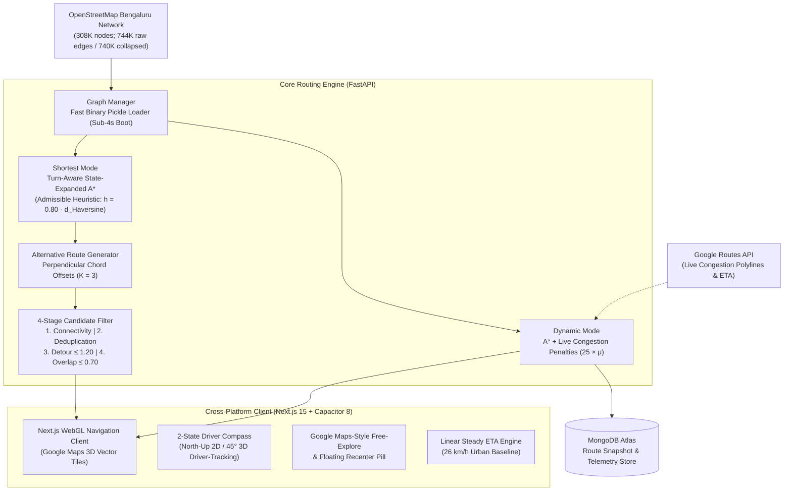

# Design and Empirical Evaluation of a Two-Wheeler-Aware Routing Framework for Urban Road Networks

[](https://nextjs.org/)
[](https://fastapi.tiangolo.com/)
[](https://capacitorjs.com/)
[](https://python.org/)
[](https://www.openstreetmap.org/)
[](https://www.mongodb.com/atlas)
[](LICENSE)

An end-to-end, graph-theoretic two-wheeler navigation system and empirical research framework tailored for densely populated cities with high mixed-traffic volumes, evaluated on the road network of Bengaluru, India (308,643 vertices, 740,822 directed edges).

---

---

## 📑 Abstract

Vehicle-focused commercial navigation systems (e.g., Google Maps, Waze) heavily prioritize major arterial corridors. In cities such as Bengaluru, where two-wheelers comprise a dominant share of vehicular traffic alongside cars and heavy vehicles, routing all classes onto identical major roads exacerbates urban congestion. This research presents a routing system specifically tailored to two-wheelers to achieve decentralized route distribution. 

The framework integrates:
1. **Turn-aware, state-expanded $A^*$ search** that models directional change penalties directly during edge relaxation.
2. **Road-class impedance hierarchy** that favors collector, residential, and secondary links over congested arterials.
3. **Dual-mode search**: *Shortest Mode* (reproducible static cost-aware) and *Dynamic Mode* (live-traffic bottleneck evasion via Google Routes API and MongoDB Atlas route snapshot persistence).
4. **Perpendicular-offset alternative route generator** producing topologically distinct candidate corridors under strict detour ($\varepsilon \le 1.20$) and edge-overlap ($\gamma \le 0.70$) thresholds.

**Key Experimental Findings:**
* Across **25 real-world Bengaluru corridors** (Experiment E), the generator yielded valid topologically diverse alternatives on **88.0% of corridors** ($22/25$), with a mean pairwise Jaccard diversity of **$0.5605$**.
* When benchmarked against **Yen’s $K$-Shortest Paths**, the offset method achieved significantly superior topological corridor separation (mean Jaccard diversity **$0.58$ vs. $0.35$**; edge overlap **$0.44$ vs. $0.53$**).
* Field validation using **five GPS tracks recorded over three days** confirmed high spatial consistency (mean cross-day deviation of $3.4\text{ m}$ AM / $2.9\text{ m}$ PM) and validated dynamic real-time rerouting responsiveness.

---

## 🏛️ System Architecture



---

## 🔬 Mathematical & Algorithmic Foundations

### 1. State-Expanded Turn Cost Model
Standard vertex-based search cannot penalize turns without topological expansion. Search states are modeled as directed edges $s = (u, v)$, representing arrival at vertex $v$ from $u$. A transition from state $(u, v)$ to $(v, w)$ carries cost:

$$c\big((u, v) \to (v, w)\big) = c_\mu(v, w) + P_{\text{turn}}(u, v, w)$$

Where:
* $c_\mu(v, w) = \ell(v, w) \cdot \mu(v, w)$ is the impedance-weighted edge cost.
* $\ell$ is physical edge length (meters).
* $\mu(v, w)$ is the inverted road-class multiplier:
  * Motorways / Trunk: $3.00 - 4.00$
  * Primary arterials: $2.00 - 2.20$
  * Secondary roads: $1.40 - 1.50$
  * Tertiary collectors: $1.10 - 1.15$
  * Residential / Unclassified: $1.00$
  * Living streets: $0.90 - 0.95$
  * Roundabouts: $0.95$ | Bridges: $0.80$
* $P_{\text{turn}}$ evaluates angular deflection $\Delta\theta \in [0^\circ, 180^\circ]$ between inbound and outbound azimuths:
  $$P_{\text{turn}} = \begin{cases} 25.0\text{ m}, & \Delta\theta \ge 60^\circ \\ 8.0\text{ m}, & 30^\circ \le \Delta\theta < 60^\circ \\ 0.0\text{ m}, & \Delta\theta < 30^\circ \end{cases}$$

### 2. Admissible & Consistent Heuristic
The global minimum multiplier across all network edges is $\mu_{\min} = 0.80$. The goal-directed heuristic function:

$$h(v) = 0.80 \cdot d_{\text{Haversine}}(v, t)$$

is strictly **admissible** and **consistent** under the spherical triangle inequality, guaranteeing that the first extraction of target state $(\cdot, t)$ from the priority queue is mathematically optimal.

### 3. Perpendicular-Offset Alternative Generation
Standard $K$-shortest path algorithms (e.g., Yen) produce near-identical paths with minor block detours. Our algorithm generates laterally displaced waypoints along the chord connecting origin $O = (\varphi_O, \lambda_O)$ and destination $D = (\varphi_D, \lambda_D)$:

1. Forward azimuth $\beta = \text{atan2}\left(\sin\Delta\lambda \cos\varphi_D, \, \cos\varphi_O\sin\varphi_D - \sin\varphi_O\cos\varphi_D\cos\Delta\lambda\right) \pmod{360^\circ}$.
2. Chord base points $p_b(\alpha)$ at fractions $\alpha \in \{0.33, 0.50, 0.67\}$.
3. Perpendicular displacement $\beta_\perp \in \{\beta + 90^\circ, \beta - 90^\circ\}$ across lateral distances $d \in \{150\text{ m}, 300\text{ m}\}$.
4. 12 generated waypoints are snapped to the graph and stitched via independent $A^*$ runs: $P_w = (O \to w) \oplus (w \to D)$.
5. Candidates must satisfy four sequential rejection filters:
   * **Connectivity**: Path is continuous.
   * **Duplicate Suppression**: Vertex sequence is unique.
   * **Detour Bound**: $\varepsilon(P_w) = \frac{\text{dist}(P_w)}{\text{dist}(P_0)} \le 1.20$
   * **Edge Overlap Bound**: $\gamma(P_w, P_0) = \frac{\sum_{e \in E(P_w) \cap E(P_0)} \ell(e)}{\sum_{e \in E(P_w)} \ell(e)} \le 0.70$
6. Survivors sorted by ascending impedance cost; top $K = 3$ returned.

### 4. Length-Weighted Jaccard Route Diversity
Topological corridor separation is measured using length-weighted edge overlap:

$$J(P_i, P_j) = \frac{\sum_{e \in E(P_i) \cap E(P_j)} \ell(e)}{\sum_{e \in E(P_i) \cup E(P_j)} \ell(e)}, \quad \mathcal{D} = 1 - \frac{1}{\binom{N}{2}} \sum_{i < j} J(P_i, P_j)$$

---

## 📊 Empirical Benchmarks (Summary from Paper)

### Experiment E1: Performance Across 25 Bengaluru Corridors
| Class | Corridors ($n$) | Valid Alternatives Found | Reached $K = 3$ | Mean Alternatives | Mean Diversity ($\mathcal{D}$) |
| :--- | :---: | :---: | :---: | :---: | :---: |
| **Short** ($< 5\text{ km}$) | 7 | 6 (85.7%) | 5 | 2.43 | **0.622** |
| **Medium** ($5 - 10\text{ km}$) | 10 | 8 (80.0%) | 5 | 1.90 | **0.530** |
| **Long** ($> 10\text{ km}$) | 8 | 8 (100%) | 4 | 2.50 | **0.545** |
| **Overall** | **25** | **22 (88.0%)** | **14 (56.0%)** | **2.24** | **0.561** |

*Mean detour ratio: 1.046; Mean edge overlap: 0.496 across 56 accepted alternative paths.*

### Comparison Against Yen's $K$-Shortest Paths
| Metric | Perpendicular Offset (Our Method) | Filtered Yen | Raw Yen |
| :--- | :---: | :---: | :---: |
| **Topological Diversity ($\mathcal{D}$)** | **0.58** | 0.35 | 0.13 |
| **Mean Overlap with Primary** | **0.44** | 0.53 | 0.93 |
| **Duplicate Path Rate** | **0%** | Filtered 323 paths | ~90% near-duplicates |

---

## 📱 Mobile Client & UI Engineering

The frontend is an Android navigation application built using **Next.js 15**, **Tailwind CSS**, and **Capacitor 8**, featuring:
* **Interactive 3D Vector Maps**: Powered by Google Maps JavaScript API with customizable dark/light night-mode JSON styling.
* **Google Maps-Style Free-Explore & Floating `[ ⌖ Re-center ]`**: Instant touch/pan unlocking without abrupt camera snapping; gliding re-center back onto the driver with 45° perspective at zoom 18.
* **Two-State Driver Compass**: Toggle seamlessly between flat 2D North-Up (`north_up`) and 3D rider travel direction (`heading_up`).
* **Linear Urban ETA Calculation**: Replaces erratic instantaneous speed divisions with a calibrated 26 km/h urban baseline that eliminates ETA fluctuations at traffic lights.
* **Live Community Incident Reporting**: Rider reporting for road hazards, slowdowns, waterlogging/flooding, and construction.

---

## 🚀 Getting Started & Setup

### Prerequisites
* **Node.js**: v18.18+ or v20+
* **Python**: 3.10+
* **Android Studio & SDK**: API level 33+ (for Android builds)
* **OpenStreetMap Bengaluru Graph**: `Data Assets/bengaluru_graph.pkl` (pre-compiled binary graph)

---

### 1. Backend Server Setup

```bash
# Clone repository
git clone https://github.com/itsgeneric/BLRMap_Prototype.git
cd BLRMap_Prototype

# Create virtual environment
python -m venv venv
# On Windows:
venv\Scripts\activate
# On Linux/macOS:
source venv/bin/activate

# Install dependencies
pip install fastapi uvicorn osmnx networkx scipy numpy httpx "pymongo[srv]" python-dotenv

# Configure environment variables (.env)
cp .env.example .env

# Run FastAPI server (sub-4s fast binary graph load)
python api_server.py
```
*The backend will be available at `http://localhost:8000` (Docs: `http://localhost:8000/docs`).*

---

### 2. Frontend & Android Mobile Setup

```bash
# Install frontend dependencies
npm install

# Run development server
npm run dev
```
*Open `http://localhost:3000` to view the web client.*

#### Compiling Android APK
```bash
# Build static export
npm run build

# Sync assets to Capacitor Android project
npx cap sync android

# Build debug APK using Gradle
cd android
./gradlew assembleDebug    # On Windows: .\gradlew.bat assembleDebug
cd ..

# Output APK generated at:
# android/app/build/outputs/apk/debug/app-debug.apk
```

---

## 📂 Project Repository Structure

```text
BLRMap_Prototype/
├── app/                        # Next.js 15 App Router pages & layouts
│   ├── page.tsx                # Main navigation dashboard
│   ├── layout.tsx              # Root HTML/metadata layout
│   └── globals.css             # Tailwind CSS & UI animations
├── components/                 # Reusable React components
│   ├── Map/
│   │   ├── GoogleMapContainer.tsx # Map viewport, polyline rendering, touch handling
│   │   └── SearchBar.tsx       # Origin/Destination geocoding autocompletion
│   └── Navigation/
│       ├── NavigationFooter.tsx # Turn-by-turn guidance, ETA & Re-center button
│       └── IncidentReportModal.tsx # Road hazard & flood reporting modal
├── routing/                    # Core Python Graph Engine
│   ├── graph_manager.py        # Sub-4s binary PKL deserialization & spatial indexing
│   ├── astar.py                # Turn-aware state-expanded A* implementation
│   ├── cost_model.py           # Road-class impedance weights & angular penalties
│   └── alternative_generator.py # Perpendicular-offset chord waypoint generator
├── Data Assets/                # Graph and boundary assets (OSM cache)
├── android/                    # Capacitor 8 native Android project files
├── api_server.py               # FastAPI endpoints (/two-wheeler-route, /incidents)
├── capacitor.config.json       # Native Capacitor bridge configuration
└── README.md                   # Comprehensive project documentation
```

---

## 📖 Citation

If you use this framework or methodology in your research, please cite our paper:

```bibtex
@article{two_wheeler_routing_bengaluru2026,
  title={Design and Empirical Evaluation of a Two-Wheeler-Aware Routing Framework for Urban Road Networks},
  author={Anirudh, R and Shwetha, M D and Vikhyath, K B and Akshath, G and Kumar, A Nikhil and Chiranandan, T M},
  journal={Department of Computer Science and Engineering, BNM Institute of Technology},
  address={Bengaluru, India},
  year={2026}
}
```

---

## 📜 License

This project is licensed under the [MIT License](LICENSE) — feel free to use and extend for academic and research purposes.
