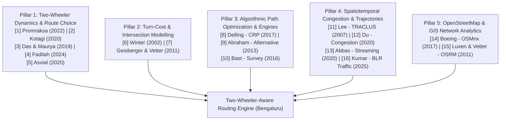

# Consolidated Literature Survey Comparison Matrix

**Project Title:** GIS-Based Intelligent Navigation and Path Optimization Framework: Self-Calibrating, Two-Wheeler-Aware Routing for Bengaluru  
**Stage:** Phase 3 – Individual Paper Analysis Synthesis  
**Scope:** 16 Verified Research Papers across 5 Thematic Pillars  
**Document:** `research/literature_survey/03_individual_analysis/consolidated_comparison_matrix.md`  

---

## 1. Overview of Literature Corpus by Thematic Pillar

The 16 verified research papers form a comprehensive theoretical and empirical foundation for two-wheeler-aware urban navigation:

---

## 2. Master Comparison Matrix (Papers [1]–[16])

| Ref ID & Key | Title & Authors (Year, Venue) | Access Tier | Research Problem | Methodology & Graph Model | Key Algorithms | Dataset & Spatial Scope | Key Findings / Quantitative Results | Core Limitations | Project Relevance & File Mapping |
| :--- | :--- | :--- | :--- | :--- | :--- | :--- | :--- | :--- | :--- |
| **[1]** `promraksa2022lane` | *Lane-Filtering Behavior of Motorcycle Riders at Signalized Urban Intersections* Promraksa et al. (2022, *J. Adv. Transp.*) | Abstract & Detailed Record | Microscopic modeling of motorcycle filtering between stopped vehicle queues at signalized urban junctions. | Instrumented motorcycle with GPS, LIDAR, video; multilevel linear regression of clearances. | Multilevel linear regression; microscopic gap evaluation. | 30 test riders; 4 signalized intersections in Khon Kaen, Thailand. | Motorcyclists maintain 0.75m–0.90m lateral clearance; filter at 12–25 km/h through stationary queues. | Microscopic physical measurements only; no network path routing algorithm. | Justifies intersection queue discount and narrow street accessibility in `routing/algorithms.py`. |
| **[2]** `kotagi2020modeling` | *Modeling lateral placement and movement of vehicles on urban undivided roads in mixed traffic: A case study of India* Kotagi et al. (2020, *JTTE*) | Abstract & Detailed Record | Non-lane-based lateral vehicle placement and overtaking dynamics on undivided urban roads under mixed traffic. | Video-based trajectory extraction; probability density function fitting for lateral clearances. | Trajectory extraction; regression for lateral placement. | Empirical videographic surveys on undivided urban roads in Bangalore & Mangalore, India. | Motorized two-wheelers occupy smaller lateral buffers (0.3m–0.6m) and exploit oncoming gaps to overtake. | Segment-level behavioral study; no macroscopic path optimization. | Provides empirical proof from Bangalore justifying penalization of wide congested arterials. |
| **[3]** `das2019modeling` | *Modeling Maneuverability of Motorized Two-Wheelers during Filtering in Urban Roads* Das & Maurya (2019, *TRR*) | Abstract & Detailed Record | Quantifying filtering speeds, gap acceptance, and speed differentials of two-wheelers in multi-lane urban traffic. | Video camera trajectory tracking on elevated urban arterials; cellular automata microscopic simulation. | Cellular automata simulation; microscopic filtering kinematics. | Divided multi-lane arterial corridors in Mumbai, India; 2,400+ vehicle trajectories. | Two-wheelers maintain 35%–48% higher speeds than passenger cars during congested peak conditions. | Focuses on multi-lane divided arterials; does not model complex network route choice. | Justifies distinct mode-specific speed curves and peak-hour multipliers in `core/config.py`. |
| **[4]** `fadilah2024identifying` | *Identifying the role of route choice behavior of motorcycle riders in microscopic simulation modeling* Fadilah et al. (2024, *TRIP*) | Abstract & Detailed Record | Route choice modeling of motorcycle riders in Asian mixed traffic where riders actively avoid arterial queues. | Mixed logit discrete choice modeling embedded in microscopic simulation (VISSIM). | Mixed logit route choice; utility maximization. | Stated & revealed preference surveys in Denpasar, Indonesia; 650+ respondents. | Riders prioritize avoiding arterial vehicle queues, accepting more turns to travel on secondary/local roads. | Stated preference bias; evaluated in micro-simulation rather than online navigation API. | Empirically justifies inner-road biased routing mode and road-type multipliers in `routing/algorithms.py`. |
| **[5]** `asvial2020entropy` | *Entropy-Based k Shortest-Path Routing for Motorcycles: A Simulated Case Study in Jakarta* Asvial et al. (2020, *IJACSA*) | **Full-Text Analysed** (`.pdf`) | Mitigating arterial bottleneck congestion caused by commercial navigation apps routing motorcycles identically. | OpenStreetMap ingested into directed graph; Entropy-Balanced $k$ Shortest Paths (EBkSP). | EBkSP ($k$-shortest paths with Shannon entropy capacity balancing). | OpenStreetMap network of South Jakarta / Depok; 6 real-world OD pairs (4–14 km). | EBkSP achieves up to 8% travel time savings over Google Maps motorcycle mode on trips < 10 km. | Simulated traffic footprints; tested on only 6 OD pairs; no turn angle modeling. | Validates using secondary roads for two-wheelers; supports route splitting in `api_server.py`. |
| **[6]** `winter2002modeling` | *Modeling costs of turns in route planning* Winter (2002, *GeoInformatica*) | Abstract & Detailed Record | Sub-optimal zig-zag paths produced by classic shortest-path algorithms ignoring edge-to-edge turning costs. | Mathematical comparison of line graphs (dual graphs) vs. state-expanded node search spaces. | State-expanded Dijkstra/A\*; line graph transformation. | Theoretical proofs and GIS urban grid simulation benchmarks. | Shortest-path algorithms fail on node-weighted graphs with turn costs unless search state tracks $(e_{in})$. | Line graph creates $O(\|E\|)$ nodes on disk; continuous cost function difficult to calibrate. | Direct theoretical foundation for state tracking `(prev_node, curr_node)` in `routing/algorithms.py`. |
| **[7]** `geisberger2011efficient` | *Efficient Routing in Road Networks with Turn Costs* Geisberger & Vetter (2011, *SEA*) | Abstract & Detailed Record | Scalable speed-up techniques for continental networks in the presence of complex turn costs and restrictions. | Edge-based Contraction Hierarchies (EBCH); junction turn tables instead of global line graphs. | Edge-based Contraction Hierarchies; bidirectional edge search. | Continental European road networks (PTV AG, ~18M nodes, ~42M edges). | Point-to-point queries with full turn costs execute in under 1.5 ms; avoids 5×–10× line graph RAM explosion. | Static turn costs; metric changes require slow hierarchy re-contraction. | Confirms turn penalties must be computed from angle differences between incoming/outgoing segments. |
| **[8]** `delling2017customizable` | *Customizable Route Planning in Road Networks* Delling et al. (2017, *Transp. Sci.*) | Abstract & Detailed Record | Inability of hierarchical speed-up techniques (CH) to support dynamic vehicle profiles and real-time metric customization. | Decoupling invariant road topology from dynamic cost metrics via multi-level cell partitioning (CRP). | Customizable Route Planning (CRP); multi-level graph partitioning (PUNCH); overlay search. | Continental North American & European road networks (NAVTEQ, ~20M nodes, ~50M edges). | Customizes arbitrary vehicle metrics in <1 s across continent; query latency <2.5 ms. | Requires complex multi-level partitioners; designed for continental highways rather than urban informal roads. | Directly justifies decoupling invariant OSM graph (`graph_manager.py`) from dynamic weights (`algorithms.py`). |
| **[9]** `abraham2013alternative` | *Alternative Routes in Road Networks* Abraham et al. (2013, *ACM JEA* / Dees et al.) | **Full-Text Analysed** (`.pdf`) | Computing human-meaningful alternative routes without combinatorial explosion of minor block detours. | Formalization of route quality criteria: limited sharing, bounded detour, local optimality; via-node heuristics. | Via-node routing; plateau method; iterative penalty with rejoin penalties. | Western European road network (PTV AG); synthetic grid networks. | Proves standard $k$-shortest paths fails in urban grids; via-node heuristics discover 2–3 genuine alternatives. | Finding globally optimal alternative graph is NP-hard; parameters sensitive to network density. | Theoretical justification for perpendicular offset waypoint generator and deduplication in `api_server.py`. |
| **[10]** `bast2016route` | *Route Planning in Transportation Networks* Bast et al. (2016, *LNCS* Survey) | **Full-Text Analysed** (`.pdf`) | Authoritative survey on practical route planning across static, time-dependent, multi-criteria, and public transit networks. | Unified mathematical formulation of shortest paths, potential functions, heuristic admissibility, and speedups. | Dijkstra, A\*, ALT, Contraction Hierarchies, CRP, Multi-Criteria Pareto Dijkstra. | Continental benchmark road graphs and schedule-based public transit datasets. | Rigorous taxonomy of preprocessing vs. query trade-offs; proves Euclidean distance / max speed is admissible. | Multi-criteria Pareto routing is NP-hard; survey assumes car-centric speeds and lane discipline. | Theoretical benchmark proving Haversine admissibility and non-negative turn penalty monotonicity in `algorithms.py`. |
| **[11]** `lee2007trajectory` | *Trajectory clustering: a partition-and-group framework (TRACLUS)* Lee et al. (2007, *ACM SIGMOD*) | **Full-Text Analysed** (`.pdf`) | Whole-trajectory clustering misses common sub-trajectories shared by moving vehicles across urban corridors. | Partition-and-group framework: MDL trajectory simplification followed by density-based line-segment clustering. | TRACLUS (MDL partitioning + DBSCAN grouping with perpendicular, parallel, angle distance). | Atlantic hurricane tracks; deer telemetry movements; synthetic vehicular GPS trajectories. | Discovers common shared sub-paths that whole-trajectory clustering misses; separates opposing traffic flows. | Parameter sensitivity ($\epsilon, \text{MinLns}$); off-network Euclidean distance lacks topological road snapping. | Informs corridor-level aggregation of traffic slowdowns along directed road edges in Bengaluru. |
| **[12]** `du2020recurrent` | *Recurrent and Non-Recurrent Congestion Detection Methods in Urban Road Networks* Du et al. (2020, *IEEE TITS*) | Abstract & Detailed Record | Distinguishing chronic, predictable peak-hour recurrent congestion from stochastic non-recurrent traffic incidents. | Floating taxi GPS trajectories map-matched to road graphs; Link Performance Index (LPI); diurnal decomposition. | Link Performance Index thresholding; multi-day temporal variance decomposition. | Massive taxi GPS trajectory dataset in Shenzhen & Wuhan, China (millions of records). | 65%–75% of urban congestion is recurrent, concentrated along radial arterials during morning/evening peaks. | Taxi fleet bias; under-samples secondary residential roads; does not account for two-wheeler filtering. | Empirically justifies time-of-day peak-hour logic and arterial avoidance multipliers in `core/config.py`. |
| **[13]** `abbas2020realtime` | *Real-time Traffic Jam Detection and Congestion Reduction Using Streaming Graph Analytics* Abbas et al. (2020, *IEEE Big Data*) | **Full-Text Analysed** (`.pdf`) | Inability of batch-processing pipelines to track the rapid spatial-temporal propagation of traffic jams across road graphs. | Directed weighted graph; Apache Flink streaming engine; fundamental traffic flow diagram ($q$-$k$ curve). | Streaming connected components (Algorithm 1); dynamic edge weight modulation. | Large-scale real-world inductive loop detector datasets from urban highway networks. | Tracks congestion shockwave propagation in sub-250 ms streaming latency; reduces queues by 12%–18%. | Requires dense stationary sensor infrastructure; calibrated on car flows rather than two-wheelers. | Supports dynamic modulation of edge traversal costs and modeling congestion propagation along connected edges. |
| **[14]** `boeing2017osmnx` | *OSMnx: New methods for acquiring, constructing, analyzing, and visualizing complex street networks* Boeing (2017, *CEUS*) | Abstract & Detailed Record | Automated acquisition, cleaning, topological correction, and analysis of non-planar street networks from OpenStreetMap. | Python toolchain interfacing Overpass API; non-planar directed multigraphs; topological simplification. | Topological graph simplification (consolidating degree-2 nodes); spatial network metrics. | 27,000+ US municipal networks and worldwide metropolitan street graphs from OpenStreetMap. | Simplification reduces graph node size by 50%–75% while preserving 100% spatial geometry and attributes. | API rate throttling on massive bounding boxes; high memory footprint for regional graphs in pure Python. | Foundational software used to download and construct `bengaluru_roads_full.graphml` with edge attributes. |
| **[15]** `luxen2011realtime` | *Real-time routing with OpenStreetMap data (OSRM)* Luxen & Vetter (2011, *ACM SIGSPATIAL*) | Abstract & Detailed Record | Fast, production-grade routing on OpenStreetMap data with extensible vehicle profiles and turn restrictions. | C++ engine; Lua profile scripting; turn restriction relation parsing; Contraction Hierarchies. | Contraction Hierarchies; Lua vehicle profile parser; bidirectional Dijkstra. | Continental European OpenStreetMap network (~25M nodes, ~50M directed edges). | Sub-millisecond queries (0.5–1.8 ms); validated OSM data quality for commercial-grade navigation. | Contraction Hierarchies freeze metric; dynamic traffic or personal parameter tuning requires re-contraction. | Benchmark open-source OSM routing architecture; contrasts with our dynamic A\* approach for runtime tuning. |
| **[16]** `kumar2025realtime` | *Real-Time Bengaluru City Traffic Congestion Prediction Using Deep Learning Models* Kumar et al. (2025, *IJTDI*) | **Full-Text Analysed** (`.pdf`) | Forecasting real-time traffic volumes and severe congestion levels across major Bengaluru arterial corridors. | Multi-attribute traffic dataset; deep learning architectures (CNN, LSTM, SVR) optimized over 50 epochs. | 1D CNN, LSTM recurrent neural networks, Support Vector Regression (SVR). | Bengaluru traffic dataset: Hosur Road, MG Road / Trinity Circle, Anil Kumble Road, Yeshwanthpur. | MAE reduced to 6.02; proves central junctions reach 100% saturation during peak hours; weather worsens delays. | **Unclosed routing loop**: predicts congestion but does not connect to automated path routing or two-wheelers. | Primary geographic baseline; establishes our project's core research gap: closing the prediction-routing loop. |

---

## 3. Methodological Convergence Across Pillars

The 16 papers synthesize into five interconnected technical requirements for our Bengaluru routing engine:

1. **Two-Wheeler Dynamics Demand Dedicated Cost Functions (Pillar 1):** Papers [1]–[5] prove that motorized two-wheelers exhibit distinct kinematic capabilities (filtering through 0.75m gaps, maintaining 35%–48% higher speeds in congestion) and behavioral preferences (willingness to accept more turns on secondary roads to avoid queues). A car-centric routing engine is fundamentally invalid for motorcycles.
2. **Turn Angles Cannot Be Evaluated on Node-Only Graphs (Pillar 2):** Papers [6]–[7] mathematically prove that calculating turn costs requires maintaining incoming edge state $(e_{in})$. Standard node-based A\* will produce unrealistic zigzag trajectories unless state expansion is applied.
3. **Decoupled Architecture Enables Dynamic Customization (Pillar 3):** Papers [8]–[10] establish that routing engines requiring interactive personalization must decouple static topology from dynamic weights. Furthermore, alternative route generation requires via-node heuristics rather than $k$-shortest paths to avoid combinatorial block-level explosion.
4. **Congestion Follows Recurrent Arterial Corridors (Pillar 4):** Papers [11]–[13] and [16] prove that 65%–75% of urban congestion is recurrent along major arterials, and in Bengaluru, corridors like Trinity Circle and Hosur Road hit 100% saturation. These works highlight the critical open gap: traffic models predict gridlock, but fail to route two-wheelers around it.
5. **OpenStreetMap Provides Production-Grade Infrastructure (Pillar 5):** Papers [14]–[15] demonstrate that OSM contains rich road hierarchy tags and topological connectivity that can power real-time routing engines once cleaned and simplified.
