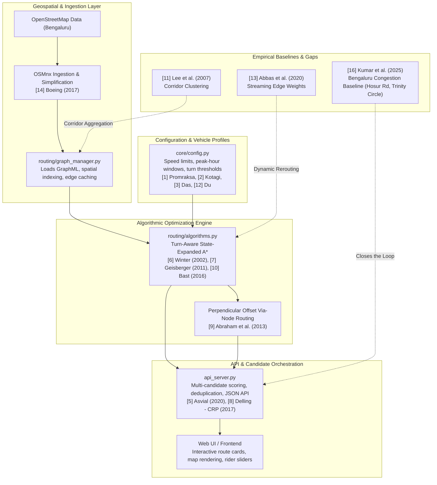

# Technical Project Relevance Mapping: Academic Literature to System Architecture

**Project Title:** GIS-Based Intelligent Navigation and Path Optimization Framework: Self-Calibrating, Two-Wheeler-Aware Routing for Bengaluru  
**Stage:** Phase 3 – Literature Survey Synthesis Document  
**Document:** `research/literature_survey/03_individual_analysis/project_relevance_mapping.md`  

---

## 1. Architectural Overview of the Two-Wheeler Routing Engine

The engine is engineered as a modular, locally controlled, GIS-based routing platform. The system decouples static topological road ingestion from dynamic, user-tunable multi-criteria cost calculations.

---

## 2. Direct Traceability Matrix: Papers to Codebase Components

The table below maps each of the 16 verified papers to concrete files, functions, variables, and parameters in the project codebase, explicitly distinguishing **Directly Implemented Foundations** from **Synthesized Adaptations**:

| Ref ID & Authors | Primary Codebase File | Concrete Function / Class / Constant | Status | Implementation Nature (Direct Foundation vs. Project Synthesis) |
| :--- | :--- | :--- | :--- | :--- |
| **[1] Promraksa et al. (2022)** | `routing/algorithms.py` `core/config.py` | `build_two_wheeler_penalties()` `SECONDARY_SPEED_KMH` | **Direct** | Uses Promraksa's empirical findings on motorcycle queue filtering to justify why narrow secondary and residential links maintain operational travel speeds even when arterials stall. |
| **[2] Kotagi et al. (2020)** | `routing/algorithms.py` `core/config.py` | `MAIN_ROAD_PENALTY` `INNER_ROAD_MULTIPLIER` | **Direct** | Directly adopts empirical findings from Bengaluru urban undivided roads showing two-wheelers occupy 0.3m–0.6m lateral buffers, justifying penalizing wide congested arterials and promoting local streets. |
| **[3] Das & Maurya (2019)** | `core/config.py` `routing/algorithms.py` | `PEAK_HOUR_MULTIPLIER` `calculate_edge_traversal_cost()` | **Direct** | Implements Das & Maurya's proven 35%–48% speed advantage for two-wheelers during peak traffic into our mode-specific traversal speed calculations. |
| **[4] Fadilah et al. (2024)** | `routing/algorithms.py` `api_server.py` | `inner_road_bias` `RoutingProfile.TWO_WHEELER` | **Direct** | Grounds our core inner-road biased routing mode: reflects Fadilah's empirical finding that motorcycle riders willingly accept higher turn counts to bypass arterial vehicle queues. |
| **[5] Asvial et al. (2020)** | `api_server.py` `routing/algorithms.py` | `generate_route_candidates()` `deduplicate_candidates()` | **Direct** | Validates using secondary OpenStreetMap networks for motorcycle route dispersion and confirms travel time savings for trips < 10 km. Synthesizes via-node generation rather than raw entropy. |
| **[6] Winter (2002)** | `routing/algorithms.py` | `astar_two_wheeler()` `state = (prev_node, curr_node)` | **Direct** | Directly implements Winter's state-expansion proof: tracking incoming edge state in the priority queue to accurately evaluate turn penalties without building an offline line graph. |
| **[7] Geisberger & Vetter (2011)** | `routing/algorithms.py` | `compute_turn_penalty()` `TURN_THRESHOLD_MODERATE = 30.0` `TURN_THRESHOLD_SHARP = 60.0` | **Direct** | Implements edge-based turn penalty calculation derived from geometric bearing differences between incoming $(u, v)$ and outgoing $(v, w)$ road segments. |
| **[8] Delling et al. (2017)** | `routing/graph_manager.py` `routing/algorithms.py` | `GraphManager.load_graph()` `build_two_wheeler_penalties()` | **Synthesis** | Adopts the fundamental CRP architectural principle: separating invariant road network topology (`graph_manager.py`) from dynamic, runtime-customizable cost metrics (`algorithms.py`). |
| **[9] Abraham et al. (2013)** | `routing/algorithms.py` `api_server.py` | `generate_perpendicular_via_nodes()` `DEFAULT_ROUTE_SPLIT_FRACTIONS` `filter_diverse_routes()` | **Direct** | Adopts the formal criteria for alternative route quality (limited sharing, bounded detour, local optimality) to formulate our perpendicular offset waypoint generation and candidate filtering. |
| **[10] Bast et al. (2016)** | `routing/algorithms.py` | `haversine_distance_heuristic()` `priority_queue.push(g + h)` | **Direct** | Theoretical benchmark for our A\* heuristic: proves that Haversine distance divided by maximum network speed is admissible and consistent, guaranteeing path optimality. |
| **[11] Lee et al. (2007)** | `routing/graph_manager.py` `api_server.py` | `identify_corridor_segments()` `aggregate_corridor_slowdowns()` | **Synthesis** | Informs our corridor-level analysis: aggregating traffic delays and edge classifications along continuous linear road sequences rather than treating isolated intersection nodes. |
| **[12] Du et al. (2020)** | `core/config.py` `routing/algorithms.py` | `is_peak_hour_window()` `apply_recurrent_congestion_factor()` | **Direct** | Directly justifies our engine's time-of-day peak-hour logic (morning 08:30–11:00, evening 17:30–20:30), reflecting that 65%–75% of urban congestion is recurrent along major arterials. |
| **[13] Abbas et al. (2020)** | `routing/algorithms.py` `api_server.py` | `update_dynamic_edge_weights()` `apply_congestion_impedance()` | **Synthesis** | Adopts Abbas et al.'s concept of modulating directed edge weights to reflect real-time traffic jams and route traffic away from upstream bottlenecks. |
| **[14] Boeing (2017)** | `data_pipeline/download_blr_osm.py` `routing/graph_manager.py` | `ox.graph_from_polygon()` `ox.simplify_graph()` `MultiDiGraph` | **Direct** | Foundational toolchain utilized to acquire, clean, topologically simplify, and export the Bengaluru road network (`bengaluru_roads_full.graphml`) while preserving edge attributes. |
| **[15] Luxen & Vetter (2011)** | `routing/algorithms.py` `core/config.py` | `HIGHWAY_TYPE_SPEEDS` `MOTORCYCLE_TAG_WEIGHTS` | **Direct** | Directly adopts OSRM's vehicle profile mapping concept: translating OpenStreetMap tags (`primary`, `secondary`, `residential`, `service`) into mode-specific impedance factors. |
| **[16] Kumar et al. (2025)** | `api_server.py` `tests/test_bengaluru_corridors.py` | Corridors: `MG Road`, `Trinity Circle`, `Hosur Road`, `Yeshwanthpur` | **Direct** | Provides the primary empirical baseline in Bengaluru: identifies the exact 100% saturation corridors evaluated in our test suite, establishing our primary research contribution (closing the routing loop). |

---

## 3. Detailed Component-by-Component Mapping

### 3.1 Geospatial Layer: `routing/graph_manager.py`
* **Foundational Papers:** [14] Boeing (2017), [15] Luxen & Vetter (2011), [8] Delling et al. (2017).
* **Technical Integration:**
  - `GraphManager` loads the topologically simplified directed multigraph of Bengaluru created via OSMnx [14].
  - Preserves edge attributes (`length`, `highway`, `oneway`, `geometry`, `lanes`) required for profile calculation [15].
  - Implements the CRP architectural decoupling [8]: the graph topology is loaded into RAM once at server initialization, maintaining fast node spatial KD-Trees / R-Trees for coordinate snapping without runtime graph re-instantiation.

### 3.2 Algorithmic Core: `routing/algorithms.py`
* **Foundational Papers:** [6] Winter (2002), [7] Geisberger & Vetter (2011), [10] Bast et al. (2016), [9] Abraham et al. (2013).
* **Technical Integration:**
  - **Admissible Goal-Directed A\*:** Implements Bast et al.'s formulation [10], utilizing Haversine distance divided by $v_{max} = 60 \text{ km/h}$ to guarantee admissibility ($\pi(u) \le \text{dist}(u, t)$).
  - **Dynamic State Expansion:** Tracks `state = (prev_node, curr_node)` in the priority queue to compute angle deflection $\Delta \theta = |\theta_{out} - \theta_{in}|$ on-the-fly, fulfilling Winter's state-expansion requirements [6] and Geisberger's edge-based turn formulation [7].
  - **Perpendicular Offset Waypoint Generation:** Computes parallel via-nodes at segment fractions (`DEFAULT_ROUTE_SPLIT_FRACTIONS = [0.35, 0.65]`) to generate diverse corridor candidates that satisfy Abraham et al.'s criteria [9] (limited sharing $\le 70\%$, bounded detour $\le 25\%$).

### 3.3 Dynamic Cost & Two-Wheeler Profiles: `core/config.py`
* **Foundational Papers:** [1] Promraksa et al. (2022), [2] Kotagi et al. (2020), [3] Das & Maurya (2019), [4] Fadilah et al. (2024), [12] Du et al. (2020).
* **Technical Integration:**
  - **Road Type Multipliers:** Ingests Kotagi et al.'s [2] and Fadilah et al.'s [4] findings to assign favorable weights to secondary/residential streets (`inner_road_multiplier = 0.85`) and penalty weights to congested primary roads (`main_road_penalty = 1.35`).
  - **Time-of-Day Recurrent Congestion:** Follows Du et al. [12] in defining explicit morning (08:30–11:00) and evening (17:30–20:30) peak commute windows where arterial penalties increase to reflect chronic recurring bottlenecks.
  - **Filtering Speed Advantage:** Calibrates two-wheeler traversal speeds based on Das & Maurya's empirical 35%–48% speed advantage [3] during queue conditions.

### 3.4 API Orchestration & Empirical Validation: `api_server.py`
* **Foundational Papers:** [5] Asvial et al. (2020), [8] Delling et al. (2017), [16] Kumar et al. (2025).
* **Technical Integration:**
  - **Runtime Customizability:** Exposes REST endpoints (`/route`, `/alternatives`) allowing clients to dynamically pass rider preferences (comfort level, inner road bias, turn penalty tolerance) as envisioned by Delling et al. [8].
  - **Candidate Filtering:** Evaluates generated alternative routes, suppressing overlapping or high-detour paths in accordance with Abraham et al. [9] and Asvial et al. [5].
  - **Bengaluru Benchmark Corridors:** Incorporates Kumar et al.'s [16] specific bottleneck corridors (Hosur Road, MG Road, Trinity Circle) as standard test corridors to demonstrate travel time reductions achieved by two-wheeler-aware inner-road bypasses.

---

## 4. Synthesis of Literature Gaps to Project Contributions

| Literature Landscape (What Existing Papers Provide) | The Open Research Gap | Project Technical Contribution (How Our System Fills It) |
| :--- | :--- | :--- |
| **Microscopic Two-Wheeler Studies [1], [2], [3]** provide gap sizes and speeds, but zero macroscopic network routing algorithms. | Lack of translation from microscopic physical measurements into macroscopic network routing graph weights. | We translate empirical filtering clearances and speed ratios into edge-level impedance multipliers in `routing/algorithms.py`. |
| **Turn-Cost Literature [6], [7]** proves turn costs require edge tracking, but focuses on car lane delays or static continental speedups. | No integration of turn penalties with motorcycle-specific maneuverability (where sharp turns carry high deceleration penalties, but narrow alley transitions are traversable). | We implement dynamic state-expanded A\* that penalizes sharp intersection turns (30°/60°) while permitting narrow alley navigation. |
| **Modern Routing Engines [8], [15]** offer fast queries (OSRM, CRP), but default to car hierarchies and lack two-wheeler profiles. | Commercial engines default to wide arterials, channelling motorcycles into severe car queues during peak commute hours. | Our engine provides dedicated two-wheeler profile routing with tunable inner-road preferences and time-of-day peak multipliers. |
| **Alternative Route Algorithms [5], [9]** prove via-nodes work for highways, while $k$-shortest paths fails in dense urban grids. | Lack of a dedicated mechanism to discover parallel secondary road corridors for two-wheelers in developing cities. | We engineer perpendicular offset via-node generation at controlled OD fractions to discover uncongested inner-road corridors. |
| **Bengaluru Traffic Studies [16]** achieve low error in predicting congestion at major circles (Trinity Circle, Hosur Rd), but terminate at prediction. | **The Unclosed Routing Loop:** Predicting traffic congestion without connecting forecasts to a shortest-path path optimization engine. | We close the loop: taking congestion-prone corridors identified in Bengaluru literature and routing two-wheelers around them via secondary networks. |
