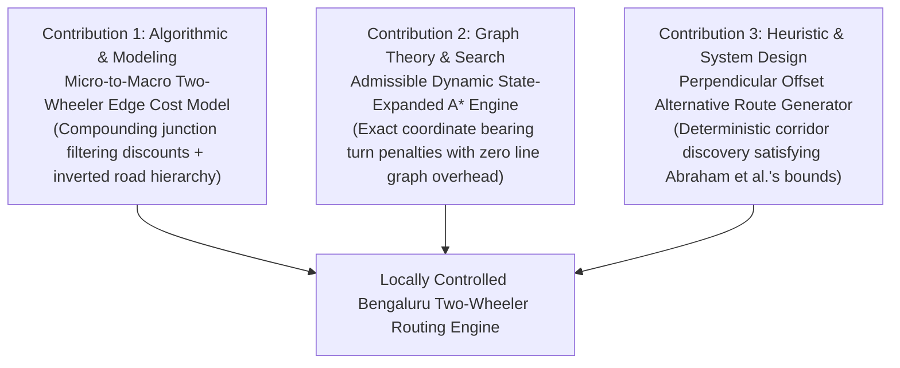

# IEEE Conference Paper Academic Positioning

**Project Title:** GIS-Based Intelligent Navigation and Path Optimization Framework: Self-Calibrating, Two-Wheeler-Aware Routing for Bengaluru  
**Stage:** Phase 4 – Comparative Analysis and Research Gap Identification  
**Document:** `research/literature_survey/04_research_gaps/conference_paper_positioning.md`  
**Date:** 2026-11-03  
**Target Publication Scope:** IEEE Transactions on Intelligent Transportation Systems / IEEE ITSC / IEEE VTC / IEEE INDICON  

---

## 1. Executive Summary and Academic Context

Urban road navigation systems have historically been engineered around passenger automobile kinematics, assuming strict lane discipline, vehicle homogeneity, and direct scaling between functional road classifications and travel speeds. In rapidly developing South Asian metropolitan areas like Bengaluru, India, motorized two-wheelers constitute over 70% of total vehicular traffic, operating within a highly heterogeneous, non-lane-based traffic environment.

This document establishes the formal academic positioning, research questions, defensible novelty claims, and candidate paper titles for our IEEE conference submission. It translates the findings of the 16-paper literature survey and the four identified research gaps into a coherent publication strategy.

---

## 2. Research Problem Statement

> **Formal Problem Statement:**  
> Conventional urban route planning algorithms and commercial navigation platforms rely on automobile-oriented assumptions that equate high-capacity functional road classifications (`motorway`, `trunk`, `primary`) with optimal route utility, enforce static vehicle profiles, and evaluate path traversal without modeling motorcycle-specific queue-filtering kinematics or vehicle-differentiated turn angle penalties. Under the chronic peak-hour arterial gridlock characteristic of Indian metropolitan cities—where radial corridors reach 100% volume saturation—these car-centric models fail catastrophically: they channel two-wheelers into stationary automobile queues while under-utilizing viable, filter-friendly secondary and residential street networks. Furthermore, existing alternative route algorithms either suffer from severe combinatorial redundancy (Yen's $k$-shortest paths) or rely on continental highway hierarchies that fail to discover parallel neighborhood corridors. There is an urgent need for an open-source, locally controlled, two-wheeler-aware path optimization framework that bridges empirical microscopic filtering characteristics into macroscopic graph impedances, incorporates dynamic state-expanded turn penalties, and synthesizes diverse, human-meaningful alternative routes across complex urban street networks.

---

## 3. Research Objectives

To resolve the stated problem, the research defines four concrete, verifiable technical objectives:

1. **Objective 1 (Micro-to-Macro Formulation):** Formulate and calibrate a mode-specific edge impedance function on OpenStreetMap directed road graphs that translates empirical microscopic two-wheeler filtering clearances and speed differentials into dynamic road-hierarchy multipliers and multi-lane junction discounts.
2. **Objective 2 (Turn-Aware State Expansion):** Develop an admissible, goal-directed A\* algorithm incorporating dynamic search-state expansion `(prev_node, curr_node)` to evaluate non-linear spherical turn deflection angles on-the-fly, penalizing hazardous sharp turns without incurring the memory explosion of line graphs or the metric rigidity of Contraction Hierarchies.
3. **Objective 3 (Corridor Alternative Generation):** Engineer a deterministic perpendicular offset via-node heuristic that projects lateral search waypoints into adjacent neighborhood fabrics, discovering diverse secondary road corridors that strictly satisfy bounded detour ($\epsilon \le 20\%$) and limited sharing ($\gamma \le 70\%$) criteria.
4. **Objective 4 (Empirical Validation in Bengaluru):** Implement and validate the framework on the real-world road network of Bengaluru, benchmarking travel time, turn composition, road-class utilization, and route diversity against car-centric routing baselines and empirical corridor congestion ground truth (Kumar et al. [16]).

---

## 4. Formal Research Questions (RQs)

The research investigation is structured around three core scientific research questions:

* **RQ1 (Mode-Specific Impedance & Travel Time):**  
  *How does the translation of empirical microscopic queue-filtering capabilities and non-lane lateral buffers into macroscopic graph edge weights affect the travel duration and road-class distribution of two-wheeler commutes under peak-hour arterial saturation compared to conventional car-centric routing?*

* **RQ2 (Turn Penalty Modeling & Path Quality):**  
  *To what extent does dynamic state-expanded A\* tracking of coordinate bearing deflections reduce path tortuosity and high-risk turn maneuvers for two-wheelers in dense urban grids, while preserving heuristic admissibility and sub-100 ms query responsiveness?*

* **RQ3 (Route Diversity & Alternative Feasibility):**  
  *Can a geometric perpendicular offset via-node heuristic overcome the structural edge-sharing failure of Yen's $k$-shortest paths in dense urban street networks to provide human-meaningful, non-redundant alternative corridors that satisfy formal quality bounds?*

---

## 5. Potential Technical Contributions

The conference paper will claim three distinct technical contributions:

1. **Contribution 1 (Microscopic-to-Macroscopic Modeling):** A mathematically grounded edge-cost function that bridges empirical motorcycle kinematics (clearance requirements and speed advantages from Promraksa et al. [1], Kotagi et al. [2], and Das & Maurya [3]) into macroscopic OpenStreetMap graph traversal, introducing a multi-lane junction filtering discount and time-dependent peak arterial avoidance.
2. **Contribution 2 (Dynamic Turn-Aware Graph Search):** A lightweight state-expanded A\* formulation that maintains incoming edge orientation `(prev_node, curr_node)` to evaluate spherical deflection angles $\Delta \theta$ dynamically. It introduces discrete motorcycle-specific penalty thresholds (moderate vs. sharp turns) while preserving strict Haversine heuristic admissibility ($h(u, t) \le \text{dist}(u, t)$) and sub-100 ms query latency.
3. **Contribution 3 (Deterministic Corridor Diversification):** A geometric perpendicular offset waypoint generation algorithm that solves the classic single-block sharing failure of Yen's $k$-shortest paths (Abraham et al. [9]) in urban grids, systematically generating parallel secondary road corridors satisfying bounded detour ($\epsilon \le 20\%$) and limited sharing ($\gamma \le 70\%$).

---

## 6. Defensible Novelty Statement

To ensure intellectual integrity and prevent reviewer rejection, the novelty claim is precisely demarcated:

> **Defensible Novelty Statement:**  
> *"While existing literature has investigated microscopic two-wheeler kinematics on isolated road corridors [1]–[3], scalable turn-cost routing on continental highway graphs [6], [7], and traffic congestion forecasting in Bengaluru [16], this paper presents the first unified, locally controlled, OpenStreetMap-based routing engine that translates empirical motorcycle queue-filtering kinematics into macroscopic graph impedance, incorporates dynamic state-expanded turn-angle penalties without line graph memory expansion, and generates human-meaningful alternative secondary corridors via perpendicular offset waypoints. We demonstrate through rigorous empirical validation on Bengaluru's street network that our framework overcomes the structural limitations of automobile-oriented routing, achieving significant travel time reductions during peak-hour arterial saturation while maintaining interactive query efficiency."*

### What We Do NOT Claim (Explicit Boundaries):
- We do not claim to have invented the A\* algorithm or state expansion (which originates from Hart et al. 1968 and Winter 2002 [6]).
- We do not claim to have collected new primary videographic trajectory data in Bengaluru (we adopt the empirical measurements verified by Kotagi et al. 2020 [2] and Das & Maurya 2019 [3]).
- We do not claim a new machine learning algorithm for traffic forecasting; we leverage established empirical findings (Kumar et al. 2025 [16]) as ground-truth bottleneck inputs to close the dynamic routing loop.

---

## 7. Recommended Conference Paper Titles

The following three candidate titles are tailored for submission to IEEE conferences (e.g., IEEE ITSC, IEEE VTC, IEEE TENCON, IEEE INDICON):

### Option 1 (System and Algorithmic Focus — Recommended):
> **"A Two-Wheeler-Aware Path Optimization Framework: Bridging Microscopic Filtering Dynamics and Turn-Cost Modeling in Heterogeneous Urban Traffic"**  
> *Target:* IEEE International Conference on Intelligent Transportation Systems (ITSC).  
> *Tone:* Highly technical, rigorous, emphasizes both transportation kinematics and graph algorithmics.

### Option 2 (Application and Geographic Case Study Focus):
> **"Beyond Automobile-Centric Navigation: Turn-Aware, Multi-Criteria Routing and Corridor Diversification for Motorized Two-Wheelers in Bengaluru"**  
> *Target:* IEEE Vehicular Technology Conference (VTC) or IEEE INDICON.  
> *Tone:* Direct, impactful, highlights the urban challenge of Bengaluru and the failure of car-centric navigation.

### Option 3 (Algorithmic Heuristic Focus):
> **"Dynamic State-Expanded A\* and Perpendicular Offset Alternative Routing for Motorized Two-Wheelers on OpenStreetMap Networks"**  
> *Target:* IEEE Transactions on Intelligent Vehicles / IEEE TENCON.  
> *Tone:* Computer science and graph theory emphasis, highlighting state expansion and alternative route discovery.
