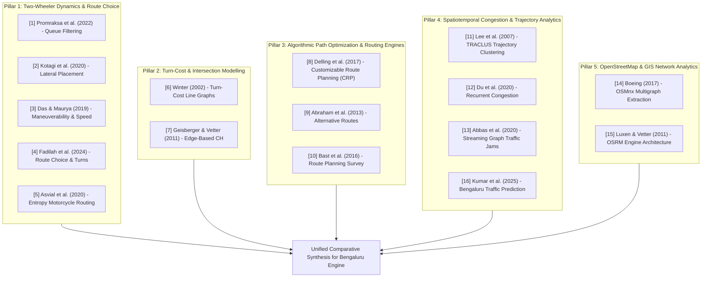
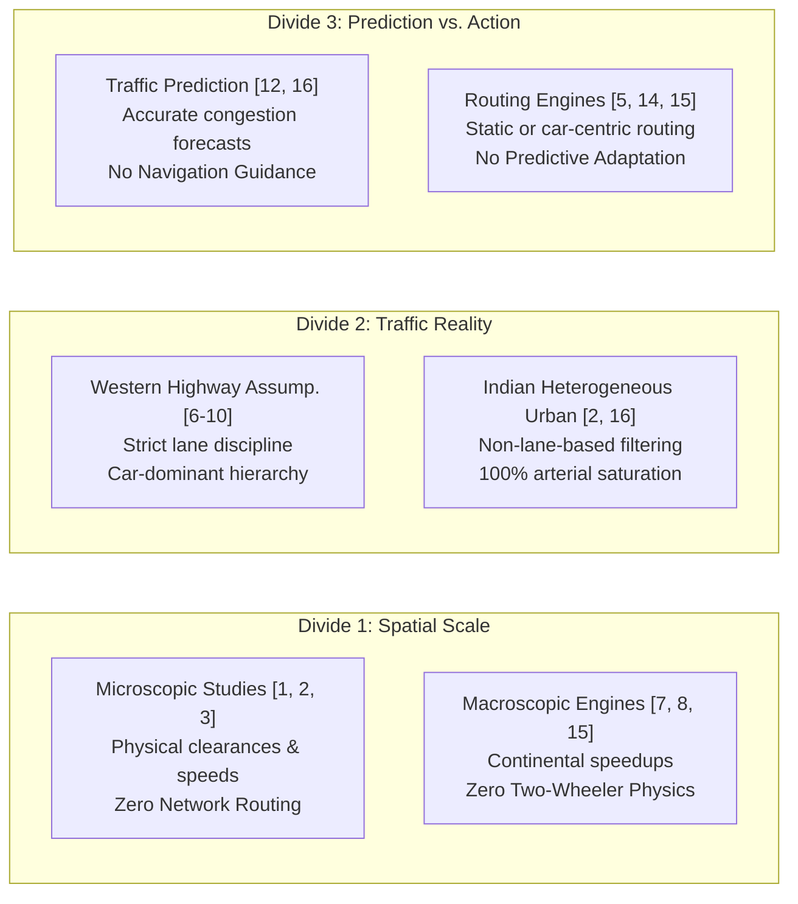

# Cross-Paper Comparative Analysis across 16 Literature Pillars

**Project Title:** GIS-Based Intelligent Navigation and Path Optimization Framework: Self-Calibrating, Two-Wheeler-Aware Routing for Bengaluru  
**Stage:** Phase 4 – Comparative Analysis and Research Gap Identification  
**Document:** `research/literature_survey/04_research_gaps/cross_paper_comparison.md`  
**Date:** 2026-11-03  
**Corpus Scope:** 16 Verified Research Papers ([1]–[16]) across 5 Thematic Pillars  

---

## 1. Executive Overview and Comparative Scope

To establish a defensible academic contribution for an IEEE conference paper, the existing state of the art must be systematically examined across core technical, algorithmic, and transportation dimensions. Rather than evaluating individual publications in isolation, this document conducts an exhaustive multi-dimensional cross-paper comparative analysis of all 16 papers analyzed in Phase 3.

### 1.1 Thematic Taxonomy of the Literature Corpus
The 16 papers are structured into five complementary pillars that collectively inform our two-wheeler-aware routing engine:

### 1.2 Evaluation Dimensions
All 16 papers are evaluated across 11 systematic technical dimensions:
1. **Research Objectives:** Core transportation, algorithmic, or spatial problem addressed.
2. **Vehicle Types Considered:** Vehicle class focus (Automobile, Motorized Two-Wheeler / Motorcycle, Mixed Heterogeneous, Agnostic).
3. **Routing Algorithms:** Graph traversal, hierarchy contraction, or path search method employed.
4. **Graph Representations:** Network data structure (Node-based directed graph, Dual/Line graph, Edge-based hierarchy, Non-planar multigraph).
5. **Turn-Cost Modelling:** Mathematical treatment of intersection angle changes and maneuver delays.
6. **Road Suitability Considerations:** Modeling of road hierarchies, physical lane widths, surface conditions, or neighborhood street utility.
7. **Multi-Criteria Optimization:** Single-objective vs. multi-criteria Pareto vs. customizable weighted impedance.
8. **Alternative Route Generation:** Mechanism for identifying diverse alternative paths ($k$-shortest paths, via-nodes, plateau, none).
9. **Data Sources:** Empirical input data (In-situ GPS/LIDAR/video, OpenStreetMap, probe trajectories, sensor loops, synthetic benchmarks).
10. **Geographic Applicability:** Spatial and infrastructural context (Western highway networks, Asian mega-cities, Indian mixed corridors).
11. **Experimental Evaluation Methods:** Evaluation protocol (Microscopic video tracking, VISSIM micro-simulation, benchmark query times, ML metrics).

---

## 2. Master Cross-Paper Comparison Matrix

The table below presents the unified cross-paper comparative matrix across all 16 papers and 11 dimensions.

| Ref ID & Authors (Year) | 1. Research Objectives | 2. Vehicle Types | 3. Routing Algorithms | 4. Graph Representation | 5. Turn-Cost Modelling | 6. Road Suitability | 7. Multi-Criteria Optimization | 8. Alternative Route Generation | 9. Data Sources | 10. Geographic Context | 11. Experimental Evaluation Methods |
| :--- | :--- | :--- | :--- | :--- | :--- | :--- | :--- | :--- | :--- | :--- | :--- |
| **[1] Promraksa et al. (2022)** | Microscopic measurement of motorcycle queue filtering at signalized intersections | Motorized Two-Wheelers (MTWs) only | None (Microscopic physical behavior study) | None (Intersection geometry coordinates) | None (Focuses on longitudinal & lateral queue clearances) | Evaluates lane width clearance between stopped car rows | Single criterion (Queue passing speed & safety gap) | None | In-situ GPS, LIDAR, video on instrumented motorcycle | Khon Kaen, Thailand | Multilevel linear regression on 30 test riders across 4 junctions |
| **[2] Kotagi et al. (2020)** | Modeling lateral vehicle placement and overtaking on undivided roads under mixed traffic | Mixed Traffic (MTWs, Auto-rickshaws, Cars, LCVs, Buses) | None (Segment-level behavioral kinematics) | None (Cross-sectional roadway transects) | None (Evaluates mid-block lateral clearance and swerving) | Evaluates effective road width, lateral buffers, and oncoming friction | Non-lane-based lateral position distribution fitting | None | Videographic surveys (cameras mounted on elevated vantage points) | Bangalore & Mangalore, India | Empirical PDF fitting and regression across vehicle speed-flow-density |
| **[3] Das & Maurya (2019)** | Quantifying filtering speeds, gap acceptance, and speed advantage of MTWs in congested traffic | Motorized Two-Wheelers vs. Passenger Cars | None (Microscopic simulation kinematics) | None (Multi-lane arterial roadway strips) | None (Intersection turns not modeled; longitudinal corridor focus) | Models lane-straddling and lateral clearance constraints | Filtering speed differential maximization over cars | None | Video camera trajectory tracking; cellular automata simulation | Mumbai, India (Western Express Highway) | 2,400+ vehicle trajectories; microscopic Cellular Automata rule validation |
| **[4] Fadilah et al. (2024)** | Empirical route choice modeling of motorcycle commuters avoiding arterial queues | Motorcycles vs. Passenger Cars | Discrete Choice Utility Maximization in VISSIM | Microscopic simulation network links | Implicit turn impedance via link traversal time; no explicit angle penalty | Explicit preference for secondary/local roads over arterials | Multi-attribute utility (travel time, queue length, road class, turns) | Discrete Choice Model sets ($C_n$ choice alternatives) | Stated Preference (SP) & Revealed Preference (RP) surveys | Denpasar, Bali, Indonesia | Mixed Logit model estimation ($N=650$ commuters) integrated in VISSIM |
| **[5] Asvial et al. (2020)** | Mitigating arterial bottleneck congestion via entropy-balanced motorcycle routing | Motorcycles only | Entropy-Balanced $k$ Shortest Paths (EBkSP) | Directed graph $G=(V,E)$ derived from OpenStreetMap | Ignored (Zero turn penalty modeling; standard node-to-node costs) | Secondary and local street utilization to bypass primary arterials | Multi-criteria balancing: travel time, link capacity, Shannon entropy | Yen's $k$-Shortest Paths ($k=3$) with Entropy Load Balancing | OpenStreetMap road network data | Depok & South Jakarta, Indonesia | Simulation of 6 real-world OD pairs (4–14 km); travel time vs. Google Maps |
| **[6] Winter (2002)** | Mathematical modeling of edge-to-edge turn costs in shortest path algorithms | Vehicle-agnostic (General automobile assumptions) | Dijkstra & A\* on state-expanded search spaces | Line Graph $L(G)=(E,T)$ vs. State-Expanded Node Graph | Explicit mathematical angle modeling: $\text{cost}(e_{in}, e_{out})$ | Standard GIS road classification | Single-criterion: generalized traversal time including turn delay | None (Single shortest path) | Synthetic grid networks and GIS benchmark road layers | Academic / Theoretical GIS benchmarks | Formal mathematical proofs and algorithmic run-time scaling benchmarks |
| **[7] Geisberger & Vetter (2011)** | Scalable speed-up routing with complex turn costs and restrictions | Automobile-centric | Edge-Based Contraction Hierarchies (EBCH) | Edge-expanded graph with junction turn tables | Exact junction turn tables and non-linear angle penalties | Continental road hierarchy (Motorway to local street) | Single-criterion: static turn-aware travel time | None (Point-to-point shortest path) | Commercial Continental European road network (PTV AG) | Continental Europe (~18M nodes, ~42M edges) | Empirical query latency benchmarking (<1.5 ms) and RAM profiling |
| **[8] Delling et al. (2017)** | Metric-independent fast routing supporting dynamic customization and personal weights | Vehicle-agnostic (Tested on cars and trucks) | Customizable Route Planning (CRP) | Multi-level partitioned overlay graph (PUNCH partitioning) | Evaluated via turn tables inside partitioned cell overlays | Customizable road category weights and vehicle penalty vectors | Multi-criteria scalarization via dynamic query-time weight vectors | Via-node corridor alternatives generated across cell overlays | Continental road networks (NAVTEQ / HERE) | North America & Europe (~20M nodes, ~50M edges) | Continental-scale query latency (<2.5 ms) and metric customization (<1 s) |
| **[9] Abraham et al. (2013)** | Computing human-meaningful alternative routes without combinatorial block detours | Vehicle-agnostic (Designed for automobile navigation) | Via-Node Routing, Plateau Method, Iterative Penalty | Directed road graph $G=(V,E)$ | Implicitly supported via underlying Dijkstra/CH search | Standard highway network hierarchy | Evaluates multi-attribute path quality: sharing $\gamma$, detour $\epsilon$, local optimality | Formal Via-Node alternatives; Plateau method; Penalty method | Commercial European road networks (PTV AG) | Western Europe & synthetic grid networks | Empirical evaluation of route diversity, detour bounds, and query latency |
| **[10] Bast et al. (2016)** | Authoritative survey on practical route planning across multimodal transport networks | Multimodal (Automobiles, Transit, Pedestrians, Bicycles; MTWs omitted) | Dijkstra, A\*, ALT, CH, CRP, Multi-Criteria Pareto Dijkstra | Node graphs, Line graphs, Time-expanded & Time-dependent graphs | Compares line graphs vs. state expansion vs. turn tables | Comprehensive road class hierarchies | Formal Pareto multi-criteria optimization ($f_1, \dots, f_k$) | $k$-Shortest Paths, Pareto sets, Alternative graphs | Continental road and schedule-based public transit benchmarks | Global / Continental Europe & North America | Comprehensive algorithmic taxonomy, asymptotic complexity, query benchmarks |
| **[11] Lee et al. (2007)** | Partition-and-group trajectory clustering for discovering common movement corridors | Generic moving objects (Hurricanes, animals, vehicles) | TRACLUS (MDL partitioning + DBSCAN density clustering) | Continuous 2D/3D Euclidean trajectory space (Off-network) | Trajectory directional angular difference: $\text{dist}_\theta(L_i, L_j)$ | Space-continuous; not constrained by road infrastructure links | Density-based grouping of sub-trajectories | None (Trajectory clustering and pattern mining) | Atlantic hurricane tracks, deer telemetry movements, synthetic GPS | Global spatial benchmarks | Clustering quality, compression ratio, noise resilience |
| **[12] Du et al. (2020)** | Distinguishing recurrent peak-hour congestion from non-recurrent stochastic incidents | Automobiles / Floating Taxi Fleets | Link Performance Index (LPI) time-series decomposition | Directed urban road graph with mapped link segments | Not modeled (Focuses on mid-link travel time degradation) | Urban arterials vs. secondary road classification | Recurrent vs. non-recurrent congestion severity scoring | None (Traffic pattern analysis and detection) | Massive floating taxi GPS trajectory datasets | Shenzhen & Wuhan, China (millions of records) | Empirical spatial-temporal variance analysis across multi-day trajectories |
| **[13] Abbas et al. (2020)** | Real-time traffic jam detection and congestion mitigation via streaming graph analytics | Automobiles / General traffic flow | Streaming Connected Components; dynamic weight modulation | Directed weighted graph $G=(V, E, W_t)$ in Apache Flink | Not modeled (Focuses on edge traversal speed degradation) | Highway links and major urban collector roads | Flow capacity maximization via fundamental diagram ($q$-$k$ curve) | Dynamic re-routing around streaming congested subgraphs | Inductive loop detector sensor feeds; synthetic traffic streams | High-density urban highway corridors | Streaming processing latency (<250 ms); queue reduction (12%–18%) |
| **[14] Boeing (2017)** | Automated acquisition, cleaning, and spatial analysis of street networks from OpenStreetMap | Multimodal (Walk, Bike, Drive; no explicit motorcycle profile) | NetworkX shortest path algorithms (Dijkstra, A\*) | Non-planar directed multigraph $G=(V, E, k)$ | Evaluates topological node degrees; turn angles not embedded in edges | OpenStreetMap tag taxonomy (`highway`, `lanes`, `maxspeed`) | Spatial network metric optimization (circuity, centrality) | Standard NetworkX shortest paths | OpenStreetMap via Overpass API | 27,000+ US municipal networks & global cities | Graph topology simplification benchmarking; node consolidation metrics |
| **[15] Luxen & Vetter (2011)** | High-performance open-source routing engine using OpenStreetMap data | Automobiles, Bicycles, Pedestrians (OSRM default profiles) | Contraction Hierarchies (CH); Bidirectional Dijkstra | Compact static edge-based directed graph | Turn restrictions parsed from OSM relations; static turn angles | Extensible Lua scripting profiles mapping OSM road tags | Single-criterion: static traversal duration defined by Lua profile | None (Point-to-point shortest path queries) | OpenStreetMap planet dump data | Continental Europe & Worldwide OSM | Sub-millisecond query benchmarking (0.5–1.8 ms); memory footprint profiling |
| **[16] Kumar et al. (2025)** | Deep learning-based real-time traffic congestion forecasting on urban arterials | Heterogeneous Urban Traffic (Unclassified mixed vehicular volume) | 1D CNN, LSTM, Support Vector Regression (SVR) | Isolated arterial road segments & intersection corridors | Not modeled (Corridor traffic volume and delay prediction) | Major commercial arterials and critical junction corridors | Single-objective prediction error minimization (MAE, RMSE, $R^2$) | None (Terminates at congestion forecasting; zero path routing) | Bengaluru Traffic Police datasets & real-world road sensors | Bengaluru, India (Hosur Rd, MG Rd, Trinity Circle, Yeshwanthpur) | Deep learning model training (50 epochs); MAE = 6.02; saturation analysis |

---

## 3. Dimension-by-Dimension Cross-Paper Comparative Analysis

### 3.1 Dimension 1: Research Objectives & System Scope
* **Microscopic Kinematic Studies ([1], [2], [3]):** Focus strictly on physical clearances, lane-filtering mechanics, and non-lane-based vehicle interactions over sub-kilometer road sections. They possess zero path-finding or network routing capability.
* **Macroscopic Routing Engines ([7], [8], [10], [15]):** Focus on extreme scalability (sub-millisecond queries across continental networks of 20M+ nodes) using hierarchical pre-computation. However, they treat vehicles as uniform rigid entities operating under Western highway conventions.
* **Traffic Analytics & Prediction ([11], [12], [13], [16]):** Identify congestion shockwaves or forecast junction saturation. However, studies like Kumar et al. [16] operate in a structural vacuum: they predict 100% saturation on Bengaluru arterials but provide no mechanism to guide commuters around them.

### 3.2 Dimension 2: Vehicle Types Considered & Behavioral Heterogeneity
* **Motorcycle-Specific Literature ([1], [4], [5]):** Demonstrates that motorcycles possess unique operational envelopes (filtering through 0.75m–0.90m queues, achieving 35%–48% higher speeds in congestion, and preferring secondary roads).
* **Automobile-Centric Literature ([6], [7], [8], [9], [12], [13], [15]):** Presumes standard car dimensions (width > 1.8m), strict lane discipline, and standard car deceleration/acceleration profiles.
* **Mixed Traffic Studies ([2], [3], [16]):** Capture the chaotic reality of Indian metropolitan roads (Bangalore, Mumbai) where non-lane-based driving prevails. However, only [2] and [3] analyze vehicle-specific mechanics, while [16] aggregates all vehicles into a single volume metric.

### 3.3 Dimension 3: Routing Algorithms & Computational Speedup Paradigms
* **Hierarchical Speedup Techniques ([7], [8], [15]):** Contraction Hierarchies (CH) achieve 0.5–1.5 ms queries by pre-contracting shortcut edges. However, CH freezes the metric; personalizing two-wheeler parameters or ingesting live congestion requires prohibitive graph re-contraction. CRP [8] solves this for continental cars via 3-phase cell partitioning, but involves massive system complexity.
* **Goal-Directed Graph Search ([6], [10], [14]):** Dynamic A\* with an admissible heuristic (Bast et al. [10]) provides the optimal balance for metropolitan engines: query latency is interactive (~40–80 ms), and edge weights can be modified per-request without offline preprocessing.
* **Heuristic Alternative Routing ([5], [9]):** Asvial et al. [5] uses Yen's $k$-shortest paths with Shannon entropy, which suffers from combinatorial block overlap in dense grids. Abraham et al. [9] formalizes via-node routing to discover genuinely independent corridors.

### 3.4 Dimension 4: Graph Representations & Data Structures
* **Node-Based Directed Graphs ([5], [10], [14]):** Memory-efficient but mathematically incapable of evaluating turn costs without violating the Markovian property.
* **Line / Dual Graphs ([6]):** Fully represent turn costs by converting edges into nodes ($|V'| = |E|$), but result in a 5×–10× RAM explosion on disk.
* **Edge-Based Hierarchies ([7], [15]):** Store junction turn tables at nodes, optimized for static C++ implementations (OSRM).
* **Dynamic Search-State Expansion (`(prev_node, curr_node)`):** As adopted in our engine, tracking incoming edge state dynamically in the search queue achieves the mathematical exactness of line graphs with zero memory duplication.

### 3.5 Dimension 5: Turn-Cost Modelling & Intersection Maneuverability
* **Explicit Angle Calculations ([6], [7]):** Establish that turn costs must be computed from coordinate bearing deflections ($\Delta \theta = |\theta_{out} - \theta_{in}|$) and applied non-linearly (moderate vs. sharp turns).
* **Complete Absence in Two-Wheeler Routing ([5]):** Remarkably, the primary motorcycle routing paper on OSM (Asvial et al. [5]) completely ignores turn penalties, treating right-angle turns identical to straight traversals.
* **Empirical Commuter Turn Behavior ([4]):** Fadilah et al. [4] shows that motorcycle riders accept higher turn counts on secondary roads to bypass arterial queues. However, excessive sharp turns across multi-lane opposing traffic carry severe physical risk in Indian cities.

### 3.6 Dimension 6: Road Suitability & Infrastructure Hierarchy
* **Standard Automobile Hierarchies ([8], [10], [14], [15]):** Heavily favor high-capacity links (`motorway`, `trunk`, `primary`) because car travel speed scales with road class.
* **Two-Wheeler Inverse Hierarchy ([1], [2], [4], [5]):** In congested Asian cities, major arterials become total gridlock for cars. Secondary, tertiary, and residential links offer two-wheelers continuous maneuverability. However, narrow alleys with poor road surfaces degrade ride comfort and vehicle safety.

### 3.7 Dimension 7: Multi-Criteria Optimization & Customization Capabilities
* **Theoretical Multi-Criteria ([10]):** Pareto Dijkstra finds all non-dominated paths across $(f_1, \dots, f_k)$, but is proven NP-hard and computationally prohibitive for online navigation.
* **Dynamic Parameter Customization ([8]):** Delling et al. emphasize that practical multi-criteria routing requires runtime scalarization, allowing users to tune preferences interactively.
* **Motorcycle Customization Gaps ([5]):** Existing motorcycle routing uses fixed capacity weights rather than allowing riders to tune inner-road bias, comfort, or turn tolerance.

### 3.8 Dimension 8: Alternative Route Generation & Route Diversity
* **Yen's $k$-Shortest Paths Flaw ([5], [9]):** Abraham et al. [9] proves that standard $k$-shortest paths in urban grids generates "spurious alternatives"—paths sharing 95%+ of edges, differing only by a single-block detour. Asvial et al. [5] relies on this flawed foundation.
* **Via-Node and Perpendicular Offsets ([9]):** Forcing paths through geometrically or topologically separated via-nodes generates human-meaningful corridor diversity satisfying limited sharing ($\gamma \le 70\%$) and bounded detour ($\epsilon \le 25\%$).

### 3.9 Dimension 9: Data Sources & Empirical Calibration Foundations
* **In-Situ Microscopic Sensors ([1], [2], [3]):** Video trajectory tracking and LIDAR provide accurate physical ground truth but are spatially localized to 1–4 road segments.
* **Crowdsourced OpenStreetMap ([5], [14], [15]):** Provides complete topological networks, road tags, and lane counts, but lacks real-time traffic speeds unless coupled with external feeds.
* **Floating Probe Trajectories & Prediction Models ([11], [12], [16]):** Provide empirical traffic speed profiles and junction saturation forecasts across cities like Shenzhen, Wuhan, and Bengaluru.

### 3.10 Dimension 10: Geographic Applicability & Urban Context
* **Western Road Networks ([6], [7], [8], [9], [10], [15]):** Continental Europe and North America; characterized by lane discipline, car dominance, high highway speeds, and predictable traffic control.
* **Southeast Asian Megacities ([1], [4], [5]):** Thailand and Indonesia; high motorcycle modal shares (50%–70%), dense urban street fabrics, informal filtering.
* **Indian Metropolitan Reality ([2], [3], [16]):** Bengaluru and Mumbai; extreme vehicular heterogeneity (cars, MTWs, auto-rickshaws, buses sharing unmarked lanes), chronic arterial gridlock (100% saturation at Trinity Circle, Hosur Road), and rapid spatial expansion.

### 3.11 Dimension 11: Experimental Evaluation Methods
* **Trajectory Tracking & Statistical Regression ([1], [2], [3], [12]):** Fit probability distributions and regression curves to real-world vehicle coordinates.
* **Microscopic Traffic Simulation ([3], [4]):** Evaluate behavior in cellular automata or VISSIM environments; valuable for safety studies but detached from real-time navigation APIs.
* **Graph Query Latency Benchmarking ([7], [8], [10], [15]):** Benchmark path search runtime in milliseconds on continental graphs.
* **Deep Learning Predictive Validation ([16]):** Evaluates loss curves, MAE, and RMSE on arterial traffic time series.

---

## 4. Synthesis of Structural Divergences in the State of the Art

The cross-paper comparative analysis exposes three fundamental structural divides in the transportation and algorithmic literature:

1. **The Scale Divide:** Microscopic studies ([1], [2], [3]) accurately measure two-wheeler filtering mechanics and lateral buffers, but never scale to graph-level routing. Conversely, macroscopic routing engines ([7], [8], [15]) scale to millions of nodes, but completely ignore two-wheeler operational kinematics.
2. **The Urban Assumption Divide:** Benchmark routing architectures ([8], [10], [15]) implicitly assume Western highway conditions (lane discipline, cars as default, higher road classes equal higher speeds). Under Indian traffic conditions ([2], [16]), these assumptions invert: primary arterials stall completely, while secondary networks allow two-wheelers to maintain momentum.
3. **The Prediction-Routing Divide:** State-of-the-art urban traffic studies in Bengaluru ([16]) achieve low error in predicting corridor saturation, but stop at prediction. Commuters remain stranded on gridlocked arterials because no two-wheeler-aware engine consumes these insights to generate viable bypass routes.
