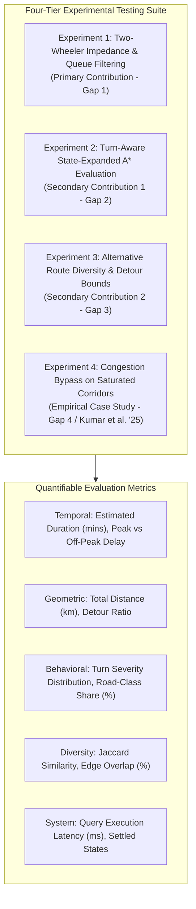

# Experimental Validation Plan

**Project Title:** GIS-Based Intelligent Navigation and Path Optimization Framework: Self-Calibrating, Two-Wheeler-Aware Routing for Bengaluru  
**Stage:** Phase 4 – Comparative Analysis and Research Gap Identification  
**Document:** `research/literature_survey/04_research_gaps/experimental_validation_plan.md`  
**Date:** 2026-11-03  
**Target Publication Scope:** IEEE Conference on Intelligent Transportation Systems (ITSC) / Vehicular Technology Conference (VTC)  

---

## 1. Experimental Methodology and Scientific Principles

The objective of this experimental validation plan is to define a rigorous, reproducible, and verifiable empirical testing suite to evaluate the three recommended research contributions. In compliance with strict academic standards, this plan:
* Establishes clear baseline benchmarks directly derived from existing literature ([5], [6], [9], [10], [15], [16]).
* Formulates falsifiable scientific hypotheses without inventing synthetic numerical improvements.
* Specifies standard, quantitative evaluation metrics across geometric, temporal, behavioral, and computational dimensions.
* Employs real-world road network data from Bengaluru, Karnataka, India, extracted from OpenStreetMap ([14]) and validated against local empirical congestion baselines ([16]).

---

## 2. Experiment 1: Two-Wheeler Mode-Specific Impedance & Queue Filtering (Primary Contribution)

### 2.1 Scientific Hypothesis
Under peak-hour congested traffic conditions, an edge impedance model that incorporates microscopic queue-filtering discounts at multi-lane junctions and selectively penalizes car-clogged primary arterials will yield lower estimated travel times for two-wheelers than standard car-centric routing baselines, by directing vehicles onto uncongested secondary and tertiary street networks.

### 2.2 Baseline Approaches
1. **Baseline 1A (Car-Centric Shortest Path):** Standard Dijkstra/A\* on distance only ($c(e) = \text{length}(e)$).
2. **Baseline 1B (OSRM-Style Functional Road Hierarchy):** Standard static speed hierarchy routing (Luxen & Vetter [15]) where motorways and primary arterials are assigned the highest speeds (50–60 km/h) and residential streets are penalized with low speeds (20–25 km/h).
3. **Baseline 1C (Static Motorcycle Routing - Asvial et al. [5]):** Motorcycle routing on OpenStreetMap with uniform link capacities and zero junction filtering discounts.

### 2.3 Proposed Approach
* **Two-Wheeler-Aware A\* (`two_wheeler_astar`):** Ingests mode-specific multipliers (`main_road_penalty = 1.35`, `inner_road_multiplier = 0.85`), flyover bonuses (`0.8\times`), and multi-lane junction filtering discounts (`apply_filtering_discount` with compounding $0.985$ factor per junction $\ge 2$ lanes, floor $0.85$).

### 2.4 Required Datasets
* High-resolution directed road network of Bengaluru (`bengaluru_roads_extended.graphml` / `bengaluru_roads_full.graphml`) extracted via OSMnx ([14]), containing node coordinates, edge lengths, road classifications, and lane counts.
* Speed profiles and peak-hour congestion multipliers derived from empirical mixed traffic literature ([2], [3], [12]).

### 2.5 Experimental Scenarios & Test Corridors
* **Scenario A (Off-Peak Free-Flow):** Uncongested conditions (midday 13:00–15:00 or late evening 22:00–05:00).
* **Scenario B (Recurrent Peak Commute):** Morning peak (08:30–11:00) and evening peak (17:30–20:30) as identified by Du et al. [12] and Kumar et al. [16].
* **Test Corridors (10 OD Pairs):** Representative arterial commutes across Bengaluru, including:
  - BNMIT (Banashankari) $\to$ MG Road (Central Business District) (~10.5 km)
  - Koramangala 5th Block $\to$ Electronic City Phase 1 via Hosur Road (~14.2 km)
  - Indiranagar 100ft Road $\to$ Whitefield ITPL via Old Airport Road (~15.8 km)
  - Malleshwaram 8th Main $\to$ Yeshwanthpur Junction (~4.5 km)
  - Jayanagar 4th Block $\to$ Manyata Tech Park (~17.5 km)

### 2.6 Measurable Evaluation Metrics
* **Total Route Distance (km):** Absolute length of path.
* **Estimated Travel Time (minutes):** Computed via calibrated speed curves reflecting peak arterial degradation vs. secondary street free-flow.
* **Road-Class Utilization Distribution (%):** Percentage of total trip distance traversing:
  - Arterial/Trunk (`motorway`, `trunk`, `primary`)
  - Intermediate (`secondary`, `tertiary`)
  - Local/Inner (`residential`, `living_street`, `service`, `unclassified`)
* **Filtering Opportunity Count:** Total number of multi-lane junctions traversed where filtering discounts apply.

---

## 3. Experiment 2: Turn-Aware State-Expanded A\* vs. Turn-Agnostic Routing (Secondary Contribution 1)

### 3.1 Scientific Hypothesis
State-expanded goal-directed A\* tracking incoming edge orientation `state = (prev_node, curr_node)` and applying discrete, vehicle-differentiated turn angle penalties will significantly reduce the number of severe, hazardous turns (>60°) and eliminate erratic zigzag paths through secondary street grids, while maintaining interactive web query latency (<100 ms) and strict heuristic admissibility.

### 3.2 Baseline Approaches
1. **Baseline 2A (Turn-Agnostic A\*):** Standard node-based A\* as deployed in Asvial et al. [5] where edge traversal impedance is evaluated without orientation context ($\text{cost}(u, v)$ is independent of how node $u$ was entered).
2. **Baseline 2B (Uniform Linear Turn Penalty):** Node-based turn estimation using average junction delay without angle deflection differentiation.
3. **Baseline 2C (Classic Line Graph Transformation):** Explicit dual graph conversion (Winter [6]) benchmarking graph memory allocation and search frontier expansion.

### 3.3 Proposed Approach
* **State-Expanded Turn-Aware A\* (`two_wheeler_astar`):** Dynamically tracks `(prev_node, curr_node)` in the priority queue. Calculates spherical bearing deflection $\Delta \theta$ via `_turn_angle()` and applies non-linear penalties via `_turn_penalty()`:
  - $\Delta \theta < 30^\circ$: $0.0\text{ s}$ (Straight / gentle curve)
  - $30^\circ \le \Delta \theta < 60^\circ$: $8.0\text{ s}$ (Moderate maneuver)
  - $\Delta \theta \ge 60^\circ$: $25.0\text{ s}$ (Sharp turn / U-turn / opposing traffic cross)
  - Admissible heuristic: Haversine distance divided by `MIN_PENALTY_FLOOR = 0.8`.

### 3.4 Required Datasets
* Dense urban street grid sectors of Bengaluru featuring complex junction topologies:
  - Sector 1: Malleshwaram & Rajajinagar (Planned grid layout with frequent 90° intersections).
  - Sector 2: Chickpet & Majestic (Historic organic street network with irregular narrow alley angles).
  - Sector 3: Jayanagar & Basavanagudi (Mixed boulevard and residential grid system).

### 3.5 Experimental Scenarios
* Execute 100 random origin-destination pairs within each sector (300 queries total) with trip distances ranging from 1.5 km to 6.0 km.
* Compare path geometry, turn composition, and algorithmic runtime between Baseline 2A and the Proposed Approach.

### 3.6 Measurable Evaluation Metrics
* **Total Turn Count per Route:** Number of direction changes with $\Delta \theta \ge 30^\circ$.
* **Turn Severity Breakdown:**
  - Moderate turns ($30^\circ \le \Delta \theta < 60^\circ$)
  - Sharp turns ($\Delta \theta \ge 60^\circ$)
* **Path Tortuosity / Circuity Index:** Ratio of actual network distance to straight-line Euclidean distance:
  $$\tau = \frac{\text{Distance}_{actual}}{\text{Distance}_{euclidean}}$$
* **Number of Search States Settled:** Total states popped from the priority queue before reaching destination (search space efficiency).
* **Algorithmic Execution Latency (ms):** Wall-clock query execution time measured across 300 trials.

---

## 4. Experiment 3: Alternative Route Diversity and Quality Bounds (Secondary Contribution 2)

### 4.1 Scientific Hypothesis
Synthesizing geometric perpendicular offset waypoints at controlled OD segment fractions will discover distinct, human-meaningful secondary road corridors that satisfy Abraham et al.'s formal quality criteria (limited sharing $\le 70\%$, bounded detour $\le 20\%$), outperforming Yen's $k$-shortest paths which suffers from high edge sharing in dense urban grids.

### 4.2 Baseline Approaches
1. **Baseline 3A (Yen's $k$-Shortest Paths):** Classic Yen's algorithm generating $k=3$ and $k=5$ shortest paths on the Bengaluru network (as used in Asvial et al. [5]).
2. **Baseline 3B (Randomized Edge Penalty Method):** Iteratively penalizing traversed edges to force route diversion (Abraham et al. [9]).

### 4.3 Proposed Approach
* **Perpendicular Offset Waypoint Generator (`build_split_route_candidates`):**
  - Chords evaluated at fractions: $f \in \{0.33, 0.50, 0.67\}$.
  - Lateral perpendicular offsets: $d_{lat} \in \{150\text{ m}, 300\text{ m}\}$ at bearing deflections $\theta_{OD} \pm 90^\circ$.
  - Two-leg turn-aware A\* ($s \to v_{via}$ and $v_{via} \to t$).
  - Candidate filtering pass enforcing `DETOUR_TOLERANCE = 1.20` ($\epsilon \le 0.20$) and edge sharing threshold $\gamma \le 0.70$.

### 4.4 Required Datasets
* 25 medium-to-long distance OD pairs (5.0 km to 18.0 km) traversing diverse urban topographies of Bengaluru (radial corridors, ring road connections, and diagonal cross-town journeys).

### 4.5 Measurable Evaluation Metrics
* **Edge Sharing / Overlap Percentage ($\gamma$):** Proportion of road edges shared between candidate alternative $P_{alt}$ and optimal path $P_{opt}$:
  $$\text{Sharing}(P_{alt}, P_{opt}) = \frac{\sum_{e \in P_{alt} \cap P_{opt}} \text{length}(e)}{\text{length}(P_{opt})} \times 100\%$$
* **Jaccard Distance of Edge Sets:**
  $$J(P_{alt}, P_{opt}) = 1 - \frac{|E(P_{alt}) \cap E(P_{opt})|}{|E(P_{alt}) \cup E(P_{opt})|}$$
* **Detour Stretch Factor ($\epsilon$):**
  $$\epsilon = \frac{\text{Length}(P_{alt}) - \text{Length}(P_{opt})}{\text{Length}(P_{opt})}$$
* **Corridor Independence:** Boolean verification of whether $P_{alt}$ utilizes a distinct arterial/secondary corridor spine rather than a single-block diversion.
* **Alternative Generation Latency (ms):** Total wall-clock time required to generate and filter 3 candidate paths.

---

## 5. Experiment 4: Congestion Bypass on Empirically Saturated Corridors (Case Study - Kumar et al. '25 Ground Truth)

### 5.1 Scientific Hypothesis
When real-world peak-hour saturation levels (such as the 100% saturation documented by Kumar et al. [16]) are translated into dynamic graph node impedance, the engine will automatically synthesize viable bypass routes that divert two-wheelers through secondary street corridors, significantly reducing estimated commute delays compared to static routing.

### 5.2 Baseline Approaches
1. **Baseline 4A (Static Unaware Shortest Path):** Continues routing through saturated corridors because edge lengths remain unchanged.
2. **Baseline 4B (Uniform Highway Rerouting):** Commercial car-style rerouting that seeks alternative major arterials (which in Bengaluru are frequently also saturated).

### 5.3 Proposed Approach
* **Dynamic Saturated Corridor Avoidance (`/dynamic-route`):**
  - Ingests Kumar et al.'s [16] exact bottleneck corridors as congested spatial nodes:
    1. *Corridor 1:* Hosur Road (Silk Board to Dairy Circle)
    2. *Corridor 2:* MG Road / Trinity Circle / Anil Kumble Circle
    3. *Corridor 3:* Yeshwanthpur Junction / Tumkur Road
  - Incident edges receive a dynamic congestion penalty ($25.0\times$ multiplier).
  - Evaluates `two_wheeler_astar` with inner-road bias to route through parallel neighborhood corridors.

### 5.4 Measurable Evaluation Metrics
* **Congested Nodes Avoided Count:** Exact number of bottleneck intersection nodes bypassed.
* **Estimated Travel Time Savings (minutes):** Relative to static baseline traversing 100% saturated junctions.
* **Detour Distance Added (km):** Additional physical distance incurred to bypass the congestion.
* **Net Route Efficiency Ratio:** Ratio of time saved (minutes) per additional kilometer traveled:
  $$\eta = \frac{\Delta \text{Time Saved (mins)}}{\Delta \text{Distance Added (km)}}$$

---

## 6. Summary Matrix of Experimental Protocols

| Experiment ID | Primary Research Gap Addressed | Core Independent Variables | Key Dependent Metrics | Primary Baselines | Benchmark Spatial Scope |
| :--- | :--- | :--- | :--- | :--- | :--- |
| **Exp 1: Two-Wheeler Impedance** | Gap 1 (Micro-to-Macro Translation) | Peak vs. Off-Peak time windows; road hierarchy penalties; filtering discounts. | Travel duration (mins), distance (km), road-class share (% primary vs. % secondary). | Baseline 1A (Distance A\*), Baseline 1B (OSRM hierarchy [15]), Baseline 1C (Asvial [5]). | 10 Major Arterial OD pairs across Bengaluru (4–18 km). |
| **Exp 2: Turn-Aware A\*** | Gap 2 (Vehicle-Differentiated Turn Costs) | State-expanded tracking `(u, v)`; discrete turn thresholds (30°, 60°); penalty values. | Turn count, turn severity breakdown (moderate vs. sharp), circuity index, query runtime (ms). | Baseline 2A (Turn-Agnostic A\* [5]), Baseline 2C (Winter Line Graph [6]). | 300 random queries across 3 dense grid sectors (Malleshwaram, Chickpet, Jayanagar). |
| **Exp 3: Alternative Diversity** | Gap 3 (Human-Meaningful Alternatives) | Perpendicular offset distances (150m, 300m); chord split fractions (0.33, 0.5, 0.67). | Edge sharing % ($\gamma$), Jaccard distance, detour ratio ($\epsilon$), candidate generation latency (ms). | Baseline 3A (Yen's $k$-Shortest Paths [5, 9]), Baseline 3B (Iterative Penalty [9]). | 25 Medium/Long OD pairs across Bengaluru (5–18 km). |
| **Exp 4: Congestion Bypass** | Gap 4 (Closing Congestion-to-Routing Loop) | Dynamic congestion node set from Kumar et al. [16]; incident edge penalty ($25\times$). | Congested nodes avoided, travel time saved (mins), detour distance added (km), efficiency ratio $\eta$. | Baseline 4A (Static shortest path), Baseline 4B (Major arterial rerouting). | Kumar et al. [16] empirical corridors (Hosur Rd, Trinity Circle, Yeshwanthpur). |
