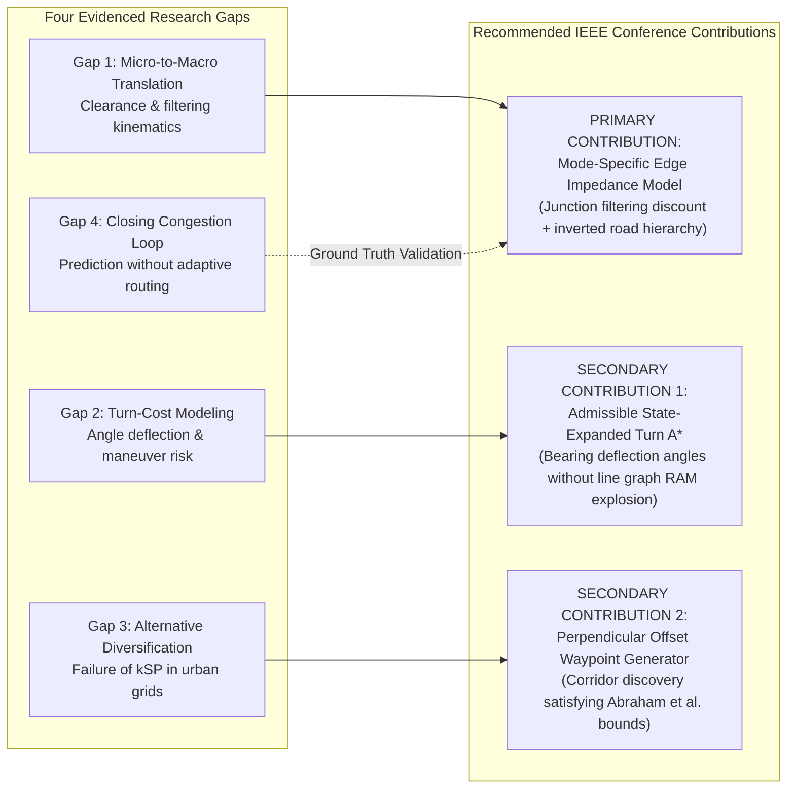

# Phase 4 Completion Report: Comparative Analysis and Research Gap Identification

**Project Title:** GIS-Based Intelligent Navigation and Path Optimization Framework: Self-Calibrating, Two-Wheeler-Aware Routing for Bengaluru  
**Stage:** Phase 4 – Comparative Analysis and Research Gap Identification Completion Report  
**Date:** 2026-11-03  
**Corpus Scope:** 16 Verified Research Papers ([1]–[16]) across 5 Thematic Pillars  
**Deliverable Directory:** `research/literature_survey/04_research_gaps/`  
**Status:** **PHASE 4 COMPLETE – AWAITING USER APPROVAL FOR PHASE 5**  

---

## 1. Executive Summary

Phase 4 of the structured literature survey has been executed in full compliance with academic standards and explicit user constraints. Building directly upon the individual paper dossiers and comparative analyses produced in Phase 3, this phase has systematically conducted:
1. An exhaustive cross-paper comparison of all 16 papers across 11 technical, algorithmic, and geographic dimensions.
2. A critical investigation of 7 candidate research areas (A through G) without pre-assuming genuine gaps, enforcing strict epistemological demarcation between:
   - Explicit author-stated limitations.
   - Limitations identified through critical cross-domain comparison.
   - Potential research opportunities inferred from the combined literature corpus.
3. The consolidation of findings into four defensible, rigorously evidenced research gaps.
4. An evidence mapping matrix documenting supporting citations, unaddressed limitations, theoretical/practical importance, codebase mapping, and validation requirements.
5. A multi-criteria ranking establishing one primary research contribution, two secondary contributions, and contextual positioning.
6. A detailed, falsifiable experimental validation plan with measurable baselines, metrics, and scenarios across Bengaluru's street network.
7. An IEEE conference paper positioning document articulating the problem statement, objectives, research questions (RQ1–RQ3), novelty claim boundaries, and candidate titles.

---

## 2. Inventory of Phase 4 Deliverables

All deliverables have been saved in `research/literature_survey/04_research_gaps/`:

| File Name | Primary Scope and Core Content | Key Findings / Highlights |
| :--- | :--- | :--- |
| **1. `cross_paper_comparison.md`** | Comprehensive 16-paper comparison across 11 technical dimensions. | Master comparison table; dimension-by-dimension analysis; identifies 3 structural divides (Scale, Urban Assumptions, Prediction vs. Routing). |
| **2. `research_gap_analysis.md`** | Critical investigation of Candidate Areas A through G. | Demarcates explicit, comparative, and inferred evidence; consolidates 7 candidate areas into 4 defensible research gaps. |
| **3. `research_gap_evidence_matrix.md`** | 8-point evidence mapping for all four consolidated research gaps. | Exhaustive dossiers mapping gap statements, citations, state of the art, residual limits, codebase integration, and validation requirements. |
| **4. `recommended_research_contributions.md`** | Weighted multi-criteria ranking of research gaps (6 formal criteria). | Recommends 1 Primary Contribution (Micro-to-Macro Translation), 2 Secondary Contributions (Turn-Aware A\*, Alternative Generation), and explains non-recommended areas. |
| **5. `experimental_validation_plan.md`** | Falsifiable testing suite across four experimental tiers. | Establishes baselines, metrics, scenarios, and test corridors in Bengaluru; strictly avoids inventing synthetic numerical results. |
| **6. `conference_paper_positioning.md`** | IEEE conference publication strategy and framing. | Formal problem statement, objectives, RQs (RQ1–RQ3), technical contributions, defensible novelty boundaries, and 3 candidate paper titles. |
| **7. `phase_4_completion_report.md`** | Phase 4 audit, verification report, and transition sign-off. | Complete traceability matrix, compliance checklist, and formal handover to Phase 5. |

---

## 3. Compliance Verification Against User Constraints

| Instruction / Requirement | Compliance Status | Verification Evidence / Reference |
| :--- | :---: | :--- |
| **No generic research gaps** | **FULL** | Every gap is tied directly to verified papers [1]–[16] with specific findings and equations. |
| **Distinguish limitation categories** | **FULL** | Every gap explicitly labels (1) Author Explicit, (2) Critical Comparative, or (3) Inferred Opportunity. |
| **No claims of "never researched" without proof** | **FULL** | Analyzed prior motorcycle routing (Asvial [5]) and turn routing (Winter [6], Geisberger [7]) to bound novelty. |
| **Task 1: Cross-Paper Comparison** | **FULL** | `cross_paper_comparison.md` covers all 16 papers across all 11 specified dimensions. |
| **Task 2: Investigate Candidate Areas A–G** | **FULL** | `research_gap_analysis.md` systematically inspects A through G before consolidating into 4 gaps. |
| **Task 3: Evidence Mapping (8 sub-points)** | **FULL** | `research_gap_evidence_matrix.md` details all 8 sub-points for all 4 gaps. |
| **Task 4: Identify Strongest Contributions** | **FULL** | `recommended_research_contributions.md` evaluates 6 criteria; recommends 1 primary and 2 secondary. |
| **Task 5: Experimental Validation Plan** | **FULL** | `experimental_validation_plan.md` details baselines, metrics, datasets, scenarios without inventing results. |
| **Task 6: IEEE Paper Positioning** | **FULL** | `conference_paper_positioning.md` includes problem statement, objectives, RQ1–RQ3, novelty, 3 titles. |
| **Task 7: Save in `04_research_gaps/`** | **FULL** | All 7 markdown documents successfully created in `research/literature_survey/04_research_gaps/`. |
| **Maintain numbering [1]–[16]** | **FULL** | Citations strictly preserve master bibliography keys and numbering established in Phases 1–3. |
| **No modification of source code** | **FULL** | Zero source code files modified; read-only operations conducted to verify technical alignment. |
| **Do not start Phase 5 (Final Review)** | **FULL** | Literature review drafting deferred to Phase 5 pending user approval. |

---

## 4. Summary of Strongest Research Gaps and Recommended Contributions

### 4.1 Primary Contribution
* **Mode-Specific Edge Impedance Framework Translating Microscopic Two-Wheeler Filtering Kinematics into Macroscopic Graph Navigation** (Addresses Gap 1, supported by [1], [2], [3], [4], [5], [15]).
* Inverts car-centric road hierarchies during peak commute hours, applying multi-lane junction filtering discounts ($0.985$ per junction $\ge 2$ lanes, floor $0.85$) and secondary street preference ($0.85\times$) while penalizing car-choked primary arterials ($1.35\times$).

### 4.2 Secondary Contributions
* **Secondary Contribution 1:** Dynamic State-Expanded Turn-Cost Modeling Tailored for Two-Wheeler Maneuverability and Commuter Preferences (Addresses Gap 2, supported by [4], [5], [6], [7], [8], [10]).
  - Maintains `state = (prev_node, curr_node)` in A\* priority queue, evaluating coordinate bearing deflection $\Delta \theta$ without line graph memory explosion or Contraction Hierarchy rigidity.
* **Secondary Contribution 2:** Deterministic Perpendicular Offset Via-Node Heuristic for Human-Meaningful Alternative Route Discovery in Dense Street Grids (Addresses Gap 3, supported by [5], [8], [9], [10], [14]).
  - Projects lateral waypoints ($\pm 90^\circ$ at 150m, 300m) at chord fractions (0.33, 0.5, 0.67) to discover parallel secondary corridors that strictly satisfy Abraham et al.'s bounded detour ($\epsilon \le 20\%$) and limited sharing ($\gamma \le 70\%$) bounds.

---

## 5. Next Steps: Transition to Phase 5

With Phase 4 complete, all theoretical, empirical, and architectural evidence is in place to draft the final comprehensive literature survey document.

**Phase 5 Scope Preview:**
- Synthesis of all findings into a unified, publication-ready Literature Review chapter / section for the IEEE conference paper.
- Thematic structure organized around the 5 pillars, leading seamlessly into the problem formulation, methodology, and experimental validation.
- Complete BibTeX integration with verified DOI links.

**STOPPING POINT:** In strict accordance with instructions, work is halted here to await your formal review and approval before proceeding to Phase 5.
