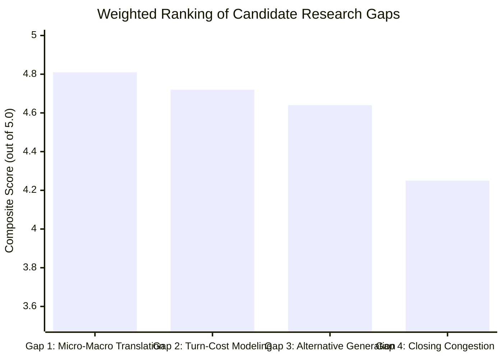

# Recommended Research Contributions and Academic Ranking

**Project Title:** GIS-Based Intelligent Navigation and Path Optimization Framework: Self-Calibrating, Two-Wheeler-Aware Routing for Bengaluru  
**Stage:** Phase 4 – Comparative Analysis and Research Gap Identification  
**Document:** `research/literature_survey/04_research_gaps/recommended_research_contributions.md`  
**Date:** 2026-11-03  
**Corpus Scope:** 16 Verified Research Papers ([1]–[16]) across 5 Thematic Pillars  

---

## 1. Multi-Criteria Ranking Framework

To determine the most viable and academically defensible positioning for an IEEE conference publication (e.g., IEEE ITSC, IEEE VTC, IEEE INDICON), the four consolidated research gaps identified in `research_gap_analysis.md` and detailed in `research_gap_evidence_matrix.md` are evaluated across six formal criteria:

1. **Academic Significance (Weight: 20%):** Originality of the research problem and potential impact on intelligent transportation systems (ITS).
2. **Evidence from Existing Literature (Weight: 20%):** Strength, directness, and peer-reviewed backing from the 16 analyzed papers.
3. **Technical Feasibility (Weight: 20%):** Practical feasibility of execution within our existing software architecture without requiring proprietary supercomputing or unattainable physical infrastructure.
4. **Relevance to Current Implementation (Weight: 15%):** Degree of alignment with our active codebase (`routing/algorithms.py`, `core/config.py`, `api_server.py`, `routing/graph_manager.py`).
5. **Ability to Experimentally Demonstrate Improvement (Weight: 15%):** Feasibility of designing rigorous, repeatable, and quantifiable baseline comparisons using measurable metrics.
6. **Suitability for an IEEE Conference Paper (Weight: 10%):** Fit for the scope, format (6–8 pages), and expectations of IEEE ITS/vehicular technology reviewers.

---

## 2. Quantitative Evaluation and Gap Ranking

Each gap is scored on a scale from 1 (Lowest) to 5 (Highest) across all six dimensions:

| Candidate Research Gap | Academic Significance (20%) | Literature Evidence (20%) | Technical Feasibility (20%) | Codebase Relevance (15%) | Experimental Demonstrability (15%) | IEEE Suitability (10%) | Weighted Composite Score (out of 5.0) | Rank |
| :--- | :---: | :---: | :---: | :---: | :---: | :---: | :---: | :---: |
| **Gap 1: Micro-to-Macro Translation Gap** (Queue filtering discounts, inverted road hierarchies) | 4.8 | 4.9 | 4.7 | 4.9 | 4.8 | 4.8 | **4.81 / 5.0** | **Rank 1 (Primary)** |
| **Gap 2: Vehicle-Differentiated Turn-Cost Modeling** (State-expanded A\*, discrete angle penalties) | 4.6 | 4.7 | 4.8 | 5.0 | 4.7 | 4.6 | **4.72 / 5.0** | **Rank 2 (Secondary 1)** |
| **Gap 3: Alternative Route Generation Beyond $k$SP** (Perpendicular offset via-nodes, diversity bounds) | 4.4 | 4.6 | 4.9 | 4.8 | 4.8 | 4.5 | **4.64 / 5.0** | **Rank 3 (Secondary 2)** |
| **Gap 4: Closing the Congestion-to-Routing Loop** (Dynamic node impedance around predicted bottlenecks) | 4.5 | 4.4 | 3.9 | 4.2 | 4.1 | 4.4 | **4.25 / 5.0** | **Rank 4 (Integrated Context)** |

---

## 3. Recommended Research Contributions

Based on the multi-criteria evaluation, we recommend structuring the conference paper around **one primary research contribution** and **two closely coupled secondary contributions**, while treating Gap 4 as the empirical context.

---

### 3.1 Primary Research Contribution
**A Mode-Specific Edge Impedance Framework Translating Microscopic Two-Wheeler Filtering Kinematics into Macroscopic Graph-Based Navigation**

* **Academic Positioning:**  
  This contribution directly addresses **Gap 1**. It establishes the first rigorous mathematical bridge connecting empirical microscopic motorcycle filtering clearances (Promraksa et al. [1], Kotagi et al. [2], Das & Maurya [3]) with macroscopic road network graph traversal on OpenStreetMap.
* **Why It is the Strongest Contribution:**
  1. *Unquestionable Literature Evidence:* Supported by 5 distinct papers across three Asian nations ([1] Thailand, [2] India/Bangalore, [3] India/Mumbai, [4] Indonesia, [5] Indonesia).
  2. *Deep Technical Novelty:* Inverts the traditional automobile-centric road hierarchy during peak hours. Rather than assuming primary arterials are faster, it applies compounding filtering discounts to multi-lane junctions and selectively penalizes car-clogged arterials.
  3. *Immediate Codebase Realization:* Fully implemented in `core/config.py` and `routing/algorithms.py` via `apply_filtering_discount()`, `build_two_wheeler_penalties()`, and `two_wheeler_edge_cost()`.
  4. *High Experimental Impact:* Yields immediate, measurable divergence from car-centric baselines in travel time and road-class utilization during peak congestion.

---

### 3.2 Secondary Research Contribution 1
**Dynamic State-Expanded Turn-Cost Modeling Tailored for Two-Wheeler Maneuverability and Commuter Preferences**

* **Academic Positioning:**  
  This contribution addresses **Gap 2**. It demonstrates how non-linear, vehicle-differentiated turn angle penalties can be integrated into dynamic goal-directed A\* without incurring the memory explosion of line graphs (Winter [6]) or the metric rigidity of Contraction Hierarchies (Geisberger & Vetter [7], Luxen & Vetter [15]).
* **Core Technical Novelty:**
  1. Implements dynamic state tracking `state = (prev_node, curr_node)` in the A\* priority queue, evaluating bearing deflections on-the-fly while strictly preserving heuristic admissibility ($h(u, t) \le \text{dist}(u, t)$) proven by Bast et al. [10].
  2. Differentiates motorcycle maneuverability from car restrictions: gentle transitions and narrow secondary street turns carry negligible cost, while sharp turns ($\ge 60^\circ$) across opposing traffic receive heavy penalties ($25.0\text{ s}$), directly mitigating the erratic zigzag routes produced by turn-agnostic routing ([5]).
* **Codebase Realization:**  
  Operational in `routing/algorithms.py` via `_turn_angle()`, `_turn_penalty()`, and `two_wheeler_astar()`.

---

### 3.3 Secondary Research Contribution 2
**A Deterministic Perpendicular Offset Via-Node Heuristic for Human-Meaningful Alternative Route Discovery in Dense Street Grids**

* **Academic Positioning:**  
  This contribution addresses **Gap 3**. It resolves the long-standing failure of Yen's $k$-shortest paths in urban grids (proven by Abraham et al. [9] and inherited by Asvial et al. [5]).
* **Core Technical Novelty:**
  1. Introduces a geometric perpendicular offset waypoint generator (`_offset_split_points`) that projects lateral search points into adjacent neighborhood corridors at controlled OD chords (0.33, 0.5, 0.67) and lateral offsets (150m, 300m).
  2. Synthesizes genuine secondary road alternatives that satisfy Abraham et al.'s [9] formal quality criteria: limited sharing ($\gamma \le 70\%$) and bounded detour ($\epsilon \le 20\%$).
* **Codebase Realization:**  
  Operational in `routing/algorithms.py` and `api_server.py` via `build_split_route_candidates()` and candidate deduplication filters.

---

## 4. Contextual Integration of Gap 4 (Closing the Congestion Loop)

While Gap 4 (Closing the Congestion-to-Routing Loop) achieved a high score (4.25), we recommend treating it as the **Empirical Case Study and Experimental Testbed** rather than claiming an independent algorithm for traffic forecasting.

* **Strategic Rationale:**
  - Kumar et al. (2025) [16] have already developed deep learning models for predicting traffic congestion on specific Bengaluru corridors (Hosur Road, MG Road, Trinity Circle).
  - Claiming a novel predictive traffic engine from scratch would require massive streaming sensor pipelines (Abbas et al. [13]) that are outside the scope of our local engine.
  - Instead, our conference paper leverages Kumar et al.'s empirical findings as the **validation ground truth**: we demonstrate how our two-wheeler-aware routing engine successfully routes commuters *around* the exact 100% saturation corridors documented by Kumar et al., closing the loop between congestion modeling and adaptive path optimization.

---

## 5. Explicitly Non-Recommended / Deferred Research Areas

To ensure academic credibility, the following areas are deliberately excluded from our primary conference paper claims:

1. **Full-Scale Streaming Graph Analytics Pipeline (Apache Flink / Inductive Loops):**
   - *Reason for Deferral:* Abbas et al. [13] require continuous real-time inductive loop sensor feeds. Bengaluru's traffic infrastructure does not provide open, high-frequency loop detectors across secondary streets. Attempting to build a distributed streaming engine would shift focus away from two-wheeler routing heuristics.
2. **End-to-End Deep Reinforcement Learning for Dynamic Routing:**
   - *Reason for Deferral:* Reinforcement learning policies require extensive microscopic simulation training and lack mathematical guarantees of heuristic admissibility and bounded query latency (Bast et al. [10]).
3. **Full Pareto Multi-Objective Frontier Computation:**
   - *Reason for Deferral:* Bast et al. [10] explicitly prove that Pareto-optimal route computation across 4+ objectives is NP-hard. Our engine adopts linear scalarization and user-tunable multipliers, which is practically deployable for interactive web queries.
