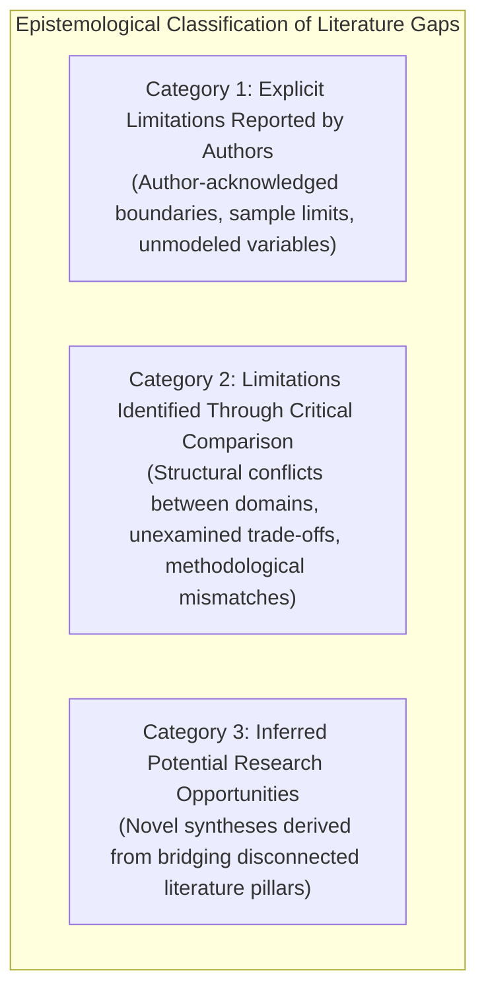
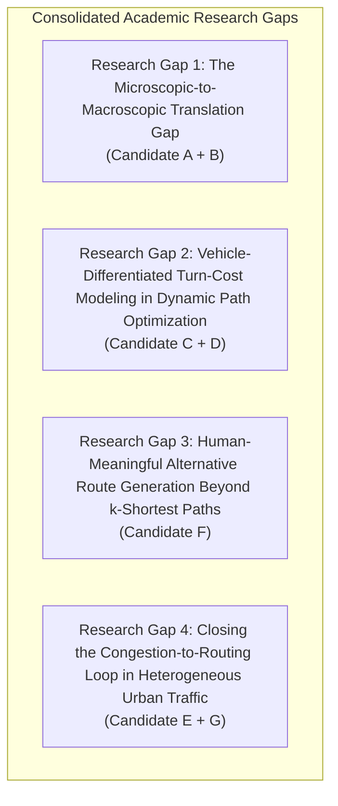

# Systematic Research Gap Analysis

**Project Title:** GIS-Based Intelligent Navigation and Path Optimization Framework: Self-Calibrating, Two-Wheeler-Aware Routing for Bengaluru  
**Stage:** Phase 4 – Comparative Analysis and Research Gap Identification  
**Document:** `research/literature_survey/04_research_gaps/research_gap_analysis.md`  
**Date:** 2026-11-03  
**Corpus Scope:** 16 Verified Research Papers ([1]–[16]) across 5 Thematic Pillars  

---

## 1. Introduction and Methodological Framework

The objective of this analysis is to identify, critically examine, and validate genuine research gaps in urban routing for motorized two-wheelers. In transportation informatics and intelligent transportation systems (ITS), academic positioning must be grounded in defensible literature evidence rather than speculative claims.

To ensure academic rigor, this analysis enforces three strict epistemological categories across all candidate research areas:

* **Category 1 (Explicit Limitations Reported by Authors):** Weaknesses, boundaries, or out-of-scope aspects explicitly documented by the researchers in their published manuscripts.
* **Category 2 (Limitations Identified Through Critical Comparison):** Inconsistencies, blind spots, or structural failures that emerge when contrasting one literature pillar against another (e.g., comparing microscopic traffic kinematics against macroscopic graph routing engines).
* **Category 3 (Potential Research Opportunities Inferred from Combined Literature):** Constructive synthesis opportunities where techniques from one domain (e.g., state-expanded A\*, via-node alternatives) can be adapted to solve persistent problems in another (e.g., two-wheeler navigation under Indian mixed traffic).

---

## 2. Critical Investigation of Candidate Research Areas (A–G)

We systematically examine candidate areas A through G without pre-judging whether they constitute genuine, addressable academic research gaps.

---

### Candidate Area A: Two-Wheeler-Specific Routing
*Core Question:* Are existing road-routing models sufficiently adapted to motorcycle and scooter characteristics?

* **Literature Inspection:**
  - Modern production-grade routing engines (OSRM by Luxen & Vetter [15], Contraction Hierarchies by Bast et al. [10], CRP by Delling et al. [8]) were engineered around passenger car dynamics. Their default cost metrics equate higher-tier functional road classifications (`motorway`, `trunk`, `primary`) with higher speeds and superior route utility.
  - In motorcycle routing literature, Asvial et al. (2020) [5] is one of the extremely rare works that ingests OpenStreetMap road networks specifically for motorcycles. However, Asvial et al. utilize standard node-to-node distance and static link capacity models, failing to incorporate vehicle-specific maneuvers, turn delays, or surface conditions.
  - Fadilah et al. (2024) [4] demonstrate through discrete choice modeling in Indonesia that motorcycle commuters exhibit fundamentally different route choices than car drivers: they actively avoid arterial vehicle queues and choose secondary roads even when total trip distance increases.
* **Critical Evaluation & Evidence Classification:**
  - *Explicit Limitation:* Asvial et al. [5] explicitly acknowledge that their evaluation was limited to static simulation across only 6 OD pairs in Jakarta and did not model intersection delays.
  - *Comparative Limitation:* Modern routing engines ([8], [10], [15]) operate under the assumption that vehicle speed is an intrinsic property of road class. In heterogeneous Asian traffic ([2], [3]), car speeds collapse on primary arterials during peak hours due to queue spillbacks, whereas two-wheelers retain mobility by filtering or taking secondary links.
* **Conclusion:** **Genuine Research Gap.** Conventional automobile-oriented routing models fail to capture the operational envelope, queue-avoidance preferences, and road suitability criteria of motorized two-wheelers.

---

### Candidate Area B: Microscopic-to-Macroscopic Modelling
*Core Question:* Can empirical motorcycle movement characteristics, filtering behaviour, and lateral clearance be translated into graph-level routing costs?

* **Literature Inspection:**
  - Microscopic empirical studies ([1], [2], [3]) have produced detailed physical and statistical measurements of two-wheeler movement in developing Asian countries:
    - Promraksa et al. (2022) [1] establish that motorcyclists require a lateral clearance of 0.75m–0.90m to filter between stationary passenger car queues at signalized junctions, filtering at speeds of 12–25 km/h.
    - Kotagi et al. (2020) [2] show that in Bangalore and Mangalore, motorized two-wheelers occupy small lateral buffers (0.3m–0.6m) and dynamically exploit gaps in opposing traffic on undivided urban roads.
    - Das & Maurya (2019) [3] prove on Mumbai corridors that two-wheelers achieve 35%–48% higher average speeds than passenger cars under congested conditions due to continuous lane-filtering.
  - However, all three works ([1], [2], [3]) terminate at microscopic trajectory kinematics or localized segment-level regression. None provides a mathematical translation mechanism to convert clearance distributions or filtering speed differentials into edge-weight multipliers on a macroscopic transportation graph $G=(V, E)$.
* **Critical Evaluation & Evidence Classification:**
  - *Explicit Limitation:* Promraksa et al. [1] explicitly note their study was confined to 4 physical junctions in Khon Kaen; Das & Maurya [3] explicitly state their cellular automata model models single corridor sections without network route choice.
  - *Inferred Opportunity:* A direct translation function can be formulated: junctions with multiple lanes ($\ge 2$ lanes) can be awarded a filtering discount factor ($F_{discount} < 1.0$) reflecting queue-skipping capability, while congested single-lane corridors receive heavy penalties.
* **Conclusion:** **Genuine Research Gap.** A significant methodological divide exists between microscopic two-wheeler empirical kinematics and macroscopic network-level routing cost functions. Bridging this divide provides an academically rigorous foundation for mode-specific edge weighting.

---

### Candidate Area C: Turn-Aware Routing
*Core Question:* How effectively do existing turn-aware algorithms incorporate vehicle-specific turn preferences and penalties?

* **Literature Inspection:**
  - The theoretical foundation of turn-cost modeling is established by Winter (2002) [6] and Geisberger & Vetter (2011) [7]. Winter proves that node-weighted shortest-path algorithms produce unrealistic zigzag routes unless incoming edge state $(e_{in})$ is maintained. Geisberger & Vetter introduce edge-based contraction hierarchies to handle turn prohibitions and delays in sub-2 ms queries.
  - However, both works ([6], [7]) and subsequent surveys ([10]) calibrate turn costs strictly for passenger cars (modeling vehicle turning radii, signalized left/right turn prohibitions, and lane queuing).
  - For motorized two-wheelers, turn dynamics exhibit an inverse characteristic:
    - Two-wheelers have negligible physical turning radii and can easily navigate narrow 90° residential street corners that would stall large automobiles.
    - Conversely, making right-hand turns across multi-lane, non-signalized opposing traffic streams in Indian cities (left-hand driving) represents an extreme collision hazard and significant waiting delay.
    - In the only motorcycle-specific routing study on OSM, Asvial et al. [5] completely ignore turn penalties ($\text{turn cost} = 0$).
* **Critical Evaluation & Evidence Classification:**
  - *Explicit Limitation:* Winter [6] explicitly acknowledges the memory explosion of line graphs; Geisberger & Vetter [7] explicitly note that Edge-Based CH fixes turn costs statically at pre-computation time, preventing dynamic personalization.
  - *Comparative Limitation:* Applying car-centric turn penalties to two-wheelers over-penalizes tight secondary street turns while under-penalizing hazardous major arterial intersections.
* **Conclusion:** **Genuine Research Gap.** Existing turn-aware routing algorithms either ignore turn costs entirely in motorcycle profiles ([5]) or enforce rigid, car-centric turn models ([6], [7]) that fail to reflect two-wheeler maneuverability and risk profiles in mixed traffic.

---

### Candidate Area D: Multi-Criteria Route Optimization
*Core Question:* Can a customizable route cost function better represent the practical preferences of two-wheeler commuters than distance-only or time-only optimization?

* **Literature Inspection:**
  - Bast et al. (2016) [10] provide an exhaustive survey of multi-criteria path optimization. They prove that computing the full Pareto-optimal set across multiple objectives (e.g., distance, time, turns, cost) is NP-hard, with the number of Pareto-optimal paths growing exponentially with network size.
  - Delling et al. (2017) [8] in Customizable Route Planning (CRP) resolve this by separating metric-independent topology from query-time customizable cost functions, advocating linear scalarization of multiple attributes ($c(e) = \mathbf{w} \cdot \mathbf{a}(e)$).
  - In urban two-wheeler commuting, riders do not optimize for travel time alone. Stated and revealed preference surveys by Fadilah et al. [4] show that riders weigh queue stress, safety, and road predictability. Commuters readily accept slight distance detours if they can bypass bumper-to-bumper car queues. Furthermore, road surface quality and narrow alley negotiability directly affect two-wheeler stability.
* **Critical Evaluation & Evidence Classification:**
  - *Explicit Limitation:* Bast et al. [10] explicitly state that full Pareto multi-criteria search is computationally intractable for interactive web queries.
  - *Inferred Opportunity:* A dynamically customizable scalar cost function combining road hierarchy penalties, time-of-day peak multipliers, road surface quality, and turn deflection angles can be solved in polynomial time via state-expanded A\*, granting riders real-time control over their navigation trade-offs.
* **Conclusion:** **Genuine Research Gap.** While theoretical multi-criteria routing is computationally prohibitive, existing consumer engines offer rigid "one-size-fits-all" paths. A locally controlled, customizable scalar impedance function tailored to two-wheeler operational priorities is a viable and defensible contribution.

---

### Candidate Area E: Bengaluru-Specific Urban Routing
*Core Question:* Are existing routing and traffic models sufficiently representative of Indian heterogeneous traffic conditions?

* **Literature Inspection:**
  - Indian urban traffic is fundamentally heterogeneous and non-lane-based (Kotagi et al. [2], Das & Maurya [3]). Vehicles of widely varying sizes and speeds share the roadway, overtaking from both sides and exploiting lateral clearances.
  - Kumar et al. (2025) [16] provide direct empirical traffic modeling in Bengaluru, demonstrating that key radial corridors (Hosur Road, MG Road / Trinity Circle, Anil Kumble Road, Yeshwanthpur) reach 100% volume saturation during peak hours, with delays exacerbated by weather events.
  - However, commercial navigation engines and open-source models (OSRM [15], OSMnx [14]) apply static lane-based speed hierarchies calibrated for North American or European cities. They assume that primary arterials maintain higher effective travel speeds than secondary streets, which completely collapses in central Bengaluru during peak commute periods.
* **Critical Evaluation & Evidence Classification:**
  - *Explicit Limitation:* Kumar et al. [16] explicitly state their predictive model is evaluated on four arterial corridors in Bengaluru and does not generate alternative paths or vehicle-specific rerouting.
  - *Comparative Limitation:* Western-derived routing models assume lane discipline and speed scaling that are invalid in Bengaluru, directing two-wheelers into the very arterial bottlenecks identified by Kumar et al. [16].
* **Conclusion:** **Genuine Research Gap.** Bengaluru's unique traffic environment requires routing algorithms that invert traditional road hierarchy biases during peak hours, directing two-wheelers through parallel secondary and tertiary networks.

---

### Candidate Area F: Alternative Route Generation
*Core Question:* How can route diversity be evaluated beyond simply generating multiple shortest paths?

* **Literature Inspection:**
  - In route planning literature, providing multiple route choices is essential to prevent bottleneck concentrating and to satisfy user preference diversity.
  - Yen's classic $k$-shortest paths algorithm (as utilized by Asvial et al. [5]) is proven by Abraham et al. (2013) [9] to fail fundamentally in urban street grids. In a dense grid, the 2nd, 3rd, and $k$-th shortest paths share 95%–99% of edges with the 1st path, deviating by only a single block before re-merging.
  - Abraham et al. [9] formalize mathematical criteria for alternative route quality:
    1. *Limited Sharing:* Overlap with the primary route must not exceed a fraction $\gamma$ (typically $\le 70\%$).
    2. *Bounded Detour:* Alternative path length must not exceed $(1 + \epsilon)$ times the optimal distance (typically $\le 20\%–25\%$).
    3. *Local Optimality:* Every sub-path must be free of trivial loops and detours.
  - Abraham et al. propose the Via-Node Plateau and Penalty methods for European highways. However, in dense Asian urban grids, highway plateaus do not exist for secondary street networks.
* **Critical Evaluation & Evidence Classification:**
  - *Explicit Limitation:* Asvial et al. [5] acknowledge that their entropy routing relies on standard $k$-shortest paths which suffers from high edge sharing and was evaluated on only 6 routes.
  - *Inferred Opportunity:* Instead of unguided plateau searches, perpendicular lateral offset waypoints projected into adjacent secondary street corridors can systematically generate non-overlapping candidate paths satisfying Abraham et al.'s formal criteria.
* **Conclusion:** **Genuine Research Gap.** Yen's $k$-shortest paths is mathematically inadequate for urban two-wheeler routing, and highway via-node methods do not identify parallel neighborhood corridors. Synthesizing geometric perpendicular offset waypoints with formal diversity metrics represents a clear, defensible algorithmic gap.

---

### Candidate Area G: Congestion Prediction and Route Optimization
*Core Question:* Can traffic predictions be integrated into a locally controlled routing engine to dynamically influence route costs?

* **Literature Inspection:**
  - Urban traffic literature is dominated by machine learning and deep learning prediction models. Kumar et al. (2025) [16] use 1D CNNs, LSTMs, and SVR to predict traffic congestion in Bengaluru, achieving MAE = 6.02 across arterial corridors. Du et al. (2020) [12] decompose taxi GPS trajectories into recurrent and non-recurrent congestion components.
  - Abbas et al. (2020) [13] implement streaming graph analytics in Apache Flink, dynamically modulating edge weights to disperse traffic shockwaves on highway networks.
  - However, in almost all urban traffic prediction papers ([12], [16]), there is an **unclosed routing loop**: researchers train sophisticated deep learning models to predict traffic jams, but their systems terminate at the prediction stage. They never feed these predicted congestion states back into an operational path-finding engine.
* **Critical Evaluation & Evidence Classification:**
  - *Explicit Limitation:* Kumar et al. [16] explicitly state: *"Future work includes integrating the prediction model with a dynamic routing framework to recommend real-time detour paths."*
  - *Comparative Limitation:* Highway streaming systems like Abbas et al. [13] rely on dense inductive loop detectors that do not exist across secondary urban networks in developing countries.
* **Conclusion:** **Genuine Research Gap.** The disconnect between urban congestion modeling/prediction and vehicle-aware graph routing is an explicit, widely cited open challenge in the ITS literature.

---

## 3. Consolidation into 4 Defensible Research Gaps

Based on the critical evaluation above, the candidate areas are consolidated into **four primary, rigorously evidenced research gaps**:

### Gap 1: The Microscopic-to-Macroscopic Translation Gap for Two-Wheeler Routing
*Synthesis of Candidates A and B.*  
While microscopic transportation literature ([1], [2], [3]) has established empirical evidence of two-wheeler filtering clearances (0.75m–0.90m), non-lane lateral buffers (0.3m–0.6m), and peak-hour speed differentials (35%–48% over cars), existing graph-based routing engines ([8], [10], [15]) operate exclusively on car-centric speed hierarchies and lane-discipline assumptions. The only notable motorcycle routing model on OSM ([5]) relies on static link capacities and ignores microscopic filtering mechanics. There is a complete lack of a validated mathematical bridge translating empirical microscopic filtering dynamics into macroscopic graph-level edge impedance functions.

### Gap 2: Vehicle-Differentiated Turn-Cost Modeling in Dynamic Multi-Criteria Route Optimization
*Synthesis of Candidates C and D.*  
Turn-aware routing theory ([6], [7]) proves that realistic urban navigation requires state-expanded search tracking incoming edges $(e_{in})$. However, existing turn-cost formulations are calibrated on automobile turn prohibitions and signal delays on continental highways. Motorized two-wheelers exhibit fundamentally different turning physics and commuter preferences ([4]): they easily negotiate tight secondary turns, but suffer extreme collision risk and delays when executing sharp turns across multi-lane opposing traffic. Existing motorcycle routing literature ([5]) completely omits turn penalties, while general multi-criteria routing ([10]) is computationally intractable for interactive web queries. A dynamic, vehicle-differentiated turn-cost model integrated into an admissible, interactive A\* engine remains absent in the literature.

### Gap 3: Human-Meaningful Alternative Route Generation for Motorcycle Commuters Beyond Yen's $k$-Shortest Paths
*Focus on Candidate F.*  
Commercial navigation apps channel all two-wheelers onto identical arterial corridors, worsening urban bottlenecks. The primary motorcycle routing study in the literature (Asvial et al. [5]) attempts to mitigate this using Yen's $k$-shortest paths with Shannon entropy. However, algorithmic theory (Abraham et al. [9]) proves that Yen's algorithm fails fundamentally in urban street grids, generating "spurious alternatives" that share 95%+ of edges. Although Abraham et al. established formal criteria for alternative route quality (limited sharing, bounded detour, local optimality) via highway plateaus, there is no established methodology to discover parallel secondary and residential corridors for two-wheelers in dense developing cities without highway hierarchies.

### Gap 4: Closing the "Congestion-to-Routing Loop" in Heterogeneous Urban Traffic
*Synthesis of Candidates E and G.*  
Recent urban traffic research in Bengaluru (Kumar et al. [16]) demonstrates that deep learning models can accurately forecast severe peak-hour congestion (reaching 100% saturation at Trinity Circle and Hosur Road). However, such studies explicitly stop at prediction, leaving an "unclosed loop" where congestion forecasts never inform dynamic routing. Conversely, existing dynamic routing engines ([13], [15]) either require dense sensor loop infrastructure absent in Indian cities or rely on static road hierarchies that direct two-wheelers directly into the gridlocked arterials identified by predictive studies. Closing this loop requires a locally controlled engine that dynamically translates peak-hour arterial congestion into real-time avoidance impedances and routes two-wheelers through viable secondary corridors.
