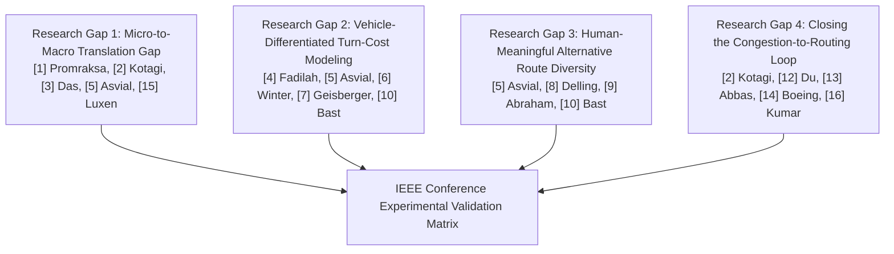

# Research Gap Evidence Mapping Matrix

**Project Title:** GIS-Based Intelligent Navigation and Path Optimization Framework: Self-Calibrating, Two-Wheeler-Aware Routing for Bengaluru  
**Stage:** Phase 4 – Comparative Analysis and Research Gap Identification  
**Document:** `research/literature_survey/04_research_gaps/research_gap_evidence_matrix.md`  
**Date:** 2026-11-03  
**Corpus Scope:** 16 Verified Research Papers ([1]–[16]) across 5 Thematic Pillars  

---

## 1. Overview of the Evidence Mapping Framework

This document establishes the empirical and theoretical chain of custody supporting the four consolidated research gaps identified in `research_gap_analysis.md`. For each gap, it maps:
* The precise academic statement.
* The supporting literature citations ([1]–[16]).
* Existing state-of-the-art contributions.
* The unaddressed residual limitation.
* The strict epistemological classification (Explicit Author Limitation vs. Comparative Limitation vs. Inferred Opportunity).
* Theoretical and practical transportation importance.
* Technical alignment with our project codebase.
* The specific empirical and experimental requirements needed to demonstrate a contribution for an IEEE publication.



---

## 2. Exhaustive Evidence Dossiers for Research Gaps 1–4

---

### Research Gap 1: The Microscopic-to-Macroscopic Translation Gap for Two-Wheeler Network Routing

#### 1. Gap Statement
There is a fundamental methodological divide between microscopic empirical studies that measure two-wheeler filtering kinematics and lateral clearances on individual road segments, and macroscopic road-network routing engines that rely on automobile-oriented functional hierarchies and speed assumptions. No validated mathematical bridge exists to translate empirical motorcycle filtering clearances and queue-skipping speed differentials into macroscopic edge-weight impedance functions on urban road graphs.

#### 2. Supporting Papers with Reference Numbers
* **[1] Promraksa et al. (2022)** — *J. Adv. Transp.* (Microscopic motorcycle lane-filtering clearances at signalized junctions).
* **[2] Kotagi et al. (2020)** — *JTTE* (Empirical lateral placement and buffer fitting on undivided roads in Bangalore & Mangalore).
* **[3] Das & Maurya (2019)** — *TRR* (Maneuverability and filtering speed advantage of motorized two-wheelers in congested Mumbai corridors).
* **[4] Fadilah et al. (2024)** — *TRIP* (Motorcycle route choice behavior and queue avoidance in Indonesian mixed traffic).
* **[5] Asvial et al. (2020)** — *IJACSA* (Entropy-based motorcycle routing on OpenStreetMap in Jakarta).
* **[15] Luxen & Vetter (2011)** — *ACM SIGSPATIAL* (OSRM vehicle profile scripting and static edge weights).

#### 3. What Existing Research Has Already Addressed
* Microscopic studies have quantified physical clearance requirements (0.75m–0.90m between stopped vehicle queues [1]), non-lane lateral buffers (0.3m–0.6m in Bangalore [2]), and proven that two-wheelers achieve 35%–48% higher speeds than passenger cars under congested conditions [3].
* Route choice research has confirmed that motorcycle riders exhibit strong behavioral willingness to bypass arterial queues [4].
* OSRM [15] established that OpenStreetMap tags (`highway`, `lanes`, `maxspeed`) can be mapped to impedance profiles using customizable scripting languages.
* Asvial et al. [5] demonstrated that routing motorcycles onto secondary OpenStreetMap links can reduce travel times by up to 8% for trips under 10 km.

#### 4. What Remains Insufficiently Addressed
* Microscopic studies ([1], [2], [3]) never formulate network path-finding algorithms; their findings remain confined to physical trajectory tracking on single road cross-sections or isolated arterial strips.
* Macroscopic routing engines ([8], [10], [15]) assign traversal speeds based solely on functional road classifications (`motorway`, `trunk`, `primary`), implicitly assuming that higher-tier roads are always faster. Under mixed Indian traffic, car queue spillbacks cause primary arterial speeds to collapse, whereas two-wheelers maintain mobility.
* The only dedicated motorcycle routing model on OSM ([5]) uses uniform road capacities and static speeds, completely omitting filtering dynamics, multi-lane junction clearances, or road surface degradations.

#### 5. Epistemological Limitation Classification
* **Explicit Author Limitation in [1] & [3]:** Promraksa et al. [1] explicitly state that their data is derived from 4 isolated signalized junctions and does not model route-level travel times. Das & Maurya [3] explicitly state their cellular automata model is restricted to a straight divided arterial corridor.
* **Explicit Author Limitation in [5]:** Asvial et al. explicitly note that their traffic model is based on static synthetic link loads across only 6 OD pairs without dynamic filtering.
* **Comparative Limitation ([2], [3] vs. [15]):** Contrasting empirical Indian traffic findings ([2], [3]) against modern routing profiles ([15]) reveals that commercial and open-source routing profiles make lane-discipline assumptions that are invalid in heterogeneous Indian cities.

#### 6. Why the Gap is Important
* *Theoretical Importance:* Bridges the longstanding scale disconnection in transportation engineering between micro-simulation kinematics and discrete graph-based network optimization.
* *Practical Transportation Importance:* Millions of motorcycle commuters in cities like Bengaluru rely on commercial navigation apps (Google Maps, Apple Maps) that route them using car-centric speed assumptions. This channels motorcycles directly into gridlocked arterial queues where they suffer prolonged idling, extreme emissions exposure, and heat exhaustion, despite the existence of viable secondary corridors.

#### 7. How My Project Could Potentially Address It
* In `core/config.py` and `routing/algorithms.py`, our engine implements a formal mathematical translation:
  1. **Filtering Discount Factor:** Implements `apply_filtering_discount()` where multi-lane intersections ($\ge 2$ lanes, matching Promraksa's clearance threshold [1]) receive a compounding junction discount (`FILTER_DISCOUNT_PER_JUNCTION = 0.985`, capped at `FILTER_DISCOUNT_FLOOR = 0.85`), mathematically capturing queue-skipping capability.
  2. **Inverted Road Hierarchy Multipliers:** Implements `build_two_wheeler_penalties()` with `main_road_penalty = 1.35` and `inner_road_multiplier = 0.85`, reflecting Kotagi's [2] and Fadilah's [4] findings that wide arterials represent severe congestion traps during peak hours while local streets maintain free flow.
  3. **Speed Differential Calibration:** Adjusts effective traversal speeds based on Das & Maurya's [3] 35%–48% peak-hour speed advantage.

#### 8. Experiments Needed to Demonstrate the Contribution
* **Baseline Approach:** Standard car-centric shortest path (OSRM default car profile or baseline A\* with distance/speed limits).
* **Proposed Approach:** Two-wheeler-aware A\* with filtering discounts and inverted road hierarchy multipliers.
* **Evaluation Metrics:** Estimated travel time (minutes), actual distance (km), road-class distribution percentage (% primary vs. % secondary/residential), and average corridor filtering opportunities.
* **Scenario:** Benchmark trips across congested arterial corridors in Bengaluru during morning (09:00) and evening (18:30) peak hours.

---

### Research Gap 2: Vehicle-Differentiated Turn-Cost Modeling in Dynamic Multi-Criteria Route Optimization

#### 1. Gap Statement
Existing turn-aware routing algorithms either ignore turn costs entirely in motorcycle profiles, or enforce static, car-centric turn models designed for continental highways that fail to reflect the unique maneuverability and collision risk profiles of two-wheelers in mixed traffic. Furthermore, existing multi-criteria path optimization formulations are computationally intractable for real-time interactive parameter tuning.

#### 2. Supporting Papers with Reference Numbers
* **[4] Fadilah et al. (2024)** — *TRIP* (Rider willingness to accept turns to bypass arterial congestion).
* **[5] Asvial et al. (2020)** — *IJACSA* (Zero turn modeling in OpenStreetMap motorcycle routing).
* **[6] Winter (2002)** — *GeoInformatica* (Mathematical proofs for state expansion and line graph turn costs).
* **[7] Geisberger & Vetter (2011)** — *SEA* (Edge-based Contraction Hierarchies with junction turn tables).
* **[8] Delling et al. (2017)** — *Transp. Sci.* (Decoupling topology from dynamic metric customization).
* **[10] Bast et al. (2016)** — *LNCS* Survey (Computational complexity of multi-criteria Pareto optimization).

#### 3. What Existing Research Has Already Addressed
* Winter (2002) [6] mathematically proved that shortest path algorithms fail on node-weighted graphs with turn costs unless the incoming edge state $(u, v)$ is explicitly tracked during search.
* Geisberger & Vetter (2011) [7] engineered Edge-Based Contraction Hierarchies (EBCH) that compute continental car routes with static turn tables in <1.5 ms.
* Delling et al. (2017) [8] established that multi-attribute vehicle customization can be achieved by decoupling invariant topology from dynamic edge weights.
* Bast et al. (2016) [10] surveyed multi-criteria routing, proving that Pareto-optimal front discovery is NP-hard, whereas scalarized goal-directed A\* maintains tractability.

#### 4. What Remains Insufficiently Addressed
* In motorcycle routing literature, Asvial et al. [5] completely omit turn angle modeling, treating sharp 90° and 120° turns as costless zero-delay transitions.
* Existing turn models ([6], [7]) were calibrated for automobiles: they penalize tight turning radii (which motorcycles negotiate effortlessly), but ignore the severe physical risk and delay of right-hand turns across multi-lane non-signalized opposing traffic streams in left-hand driving cities like Bengaluru.
* High-speed continental speedup techniques (EBCH [7]) freeze turn costs into static shortcut hierarchies during pre-computation. If a rider wishes to adjust their turn penalty tolerance or inner-road comfort interactively, the entire hierarchy must be re-contracted, which is impossible in real time.

#### 5. Epistemological Limitation Classification
* **Explicit Author Limitation in [7]:** Geisberger & Vetter explicitly note that EBCH shortcuts are tied to a single static turn-cost metric, and any modification to turn penalties requires full re-contraction.
* **Explicit Author Limitation in [10]:** Bast et al. explicitly prove that multi-criteria Pareto Dijkstra cannot guarantee polynomial query latency for interactive web applications.
* **Comparative Limitation ([5] vs. [6]):** Asvial et al. [5] claim optimal motorcycle path planning on OSM, but Winter's fundamental theorem [6] proves that any path algorithm omitting incoming edge tracking generates sub-optimal, geometrically erratic trajectories in dense urban grids.

#### 6. Why the Gap is Important
* *Theoretical Importance:* Demonstrates how non-linear, vehicle-differentiated turn angle penalties can be integrated into dynamic goal-directed A\* without incurring the memory explosion of line graphs or the rigidity of Contraction Hierarchies.
* *Practical Transportation Importance:* In dense Asian cities, secondary street routing frequently tempts algorithms into highly fragmented "zigzag" residential paths. For a motorcycle rider, navigating excessive sharp turns across blind alleys and oncoming traffic increases mental fatigue and crash risk. A calibrated turn penalty model balances queue avoidance against turn complexity.

#### 7. How My Project Could Potentially Address It
* In `routing/algorithms.py`, our engine implements dynamic state-expanded A\*:
  1. **Dynamic State Tuple:** Priority queue maintains `state = (prev_node, curr_node)`, fulfilling Winter's [6] Markovian condition without allocating an explicit line graph on disk.
  2. **Coordinate Bearing Deflection:** Function `_turn_angle()` computes true spherical deflection:
     $$\Delta \theta = |(\theta_{out} - \theta_{in} + 180^\circ) \pmod{360^\circ} - 180^\circ|$$
  3. **Non-Linear Discrete Thresholds:** Function `_turn_penalty()` evaluates:
     $$P_{turn} = \begin{cases} 0.0 \text{ s} & \Delta \theta < 30^\circ \text{ (Gentle curve)} \\ 8.0 \text{ s} & 30^\circ \le \Delta \theta < 60^\circ \text{ (Moderate turn)} \\ 25.0 \text{ s} & \Delta \theta \ge 60^\circ \text{ (Sharp / U-turn)} \end{cases}$$
  4. **Admissible Lower Bound:** The heuristic divides Haversine distance by `MIN_PENALTY_FLOOR = 0.8`, preserving strict admissibility ($\pi \le \text{dist}$) as mandated by Bast et al. [10].

#### 8. Experiments Needed to Demonstrate the Contribution
* **Baseline Approach:** Turn-agnostic motorcycle A\* (as formulated in Asvial et al. [5]) and standard node-based Dijkstra.
* **Proposed Approach:** State-expanded turn-aware two-wheeler A\* with discrete angle thresholds.
* **Evaluation Metrics:** Total number of turns, distribution of turn severity (straight vs. moderate vs. sharp), total route distance, estimated travel time, and search space expansion count (settled states).
* **Scenario:** Dense urban grid networks in central Bengaluru (e.g., Malleshwaram, BNMIT to MG Road, Jayanagar grids).

---

### Research Gap 3: Human-Meaningful Alternative Route Generation for Motorcycle Commuters Beyond Yen's $k$-Shortest Paths

#### 1. Gap Statement
Yen's classic $k$-shortest paths algorithm, as deployed in existing motorcycle routing studies, generates structurally redundant candidate paths that differ only by trivial single-block permutations in dense urban street grids. Conversely, existing via-node and plateau alternative route algorithms are calibrated for continental highway systems and fail to discover parallel secondary and residential corridors for two-wheelers in developing cities.

#### 2. Supporting Papers with Reference Numbers
* **[5] Asvial et al. (2020)** — *IJACSA* (Entropy-balanced $k$-shortest paths for motorcycles in Jakarta).
* **[8] Delling et al. (2017)** — *Transp. Sci.* (Corridor alternatives across cell overlays in CRP).
* **[9] Abraham et al. (2013)** — *ACM JEA* (Formalization of alternative routes: limited sharing, bounded detour, local optimality).
* **[10] Bast et al. (2016)** — *LNCS* Survey (Algorithmic survey of alternative graph heuristics).
* **[14] Boeing (2017)** — *CEUS* (OSMnx multigraph topological representations of municipal networks).

#### 3. What Existing Research Has Already Addressed
* Abraham et al. (2013) [9] established the canonical mathematical criteria for evaluating alternative route quality:
  1. *Limited Sharing:* $\text{Overlap}(P_{alt}, P_{opt}) \le \gamma \cdot \text{Length}(P_{opt})$ (typically $\gamma = 0.70$ or 0.80).
  2. *Bounded Detour:* $\text{Length}(P_{alt}) \le (1 + \epsilon) \cdot \text{Length}(P_{opt})$ (typically $\epsilon = 0.20$ or 0.25).
  3. *Local Optimality:* Every sub-segment must be free of trivial zigzag loops.
* Abraham et al. proved that Yen's $k$-shortest paths is computationally wasteful and practically useless in urban grids because it yields virtually identical paths.
* Asvial et al. [5] demonstrated that balancing traffic across multiple alternative motorcycle paths using Shannon entropy mitigates bottleneck congestion.

#### 4. What Remains Insufficiently Addressed
* Asvial et al. [5] relied directly on Yen's $k$-shortest paths ($k=3$), inheriting the exact structural flaws proven by Abraham et al. [9]. Their evaluation was confined to only 6 OD pairs in Depok/Jakarta, masking the combinatorial failure of $k$-shortest paths across dense grid layouts.
* Abraham et al.'s Plateau and Penalty heuristics were designed for Western continental road networks where major highways naturally produce divergent branches. In dense Asian urban networks lacking grade-separated expressways, plateau heuristics collapse because all shortest paths converge on the same high-capacity arterial spine.
* No existing routing framework synthesizes geometric lateral offset waypoint generation with two-wheeler-specific secondary street suitability to discover non-overlapping urban corridors.

#### 5. Epistemological Limitation Classification
* **Explicit Author Limitation in [5]:** Asvial et al. explicitly note that their alternative route evaluation was restricted to 6 fixed trips and simulated traffic volumes, acknowledging the need for more diverse path generation.
* **Comparative Limitation ([9] vs. [5]):** Abraham et al. [9] mathematically prove that Yen's $k$-shortest paths fails to provide human-meaningful alternatives in street grids, invalidating the algorithmic foundation used in Asvial et al. [5].
* **Inferred Opportunity:** Synthesizing geometric perpendicular offset projection with state-expanded turn-aware A\* allows an engine to probe parallel secondary corridors while strictly guaranteeing Abraham et al.'s bounded detour and limited sharing criteria.

#### 6. Why the Gap is Important
* *Theoretical Importance:* Formulates a deterministic, computationally lightweight alternative route generation heuristic specifically designed for planar and non-planar urban street networks.
* *Practical Transportation Importance:* Providing genuine corridor alternatives is the only mechanism to prevent commercial navigation apps from creating "secondary gridlock" by dumping all motorcycle traffic onto the same residential bypass road. Commuters require transparent choices: e.g., a direct arterial route vs. an uncongested inner-road corridor.

#### 7. How My Project Could Potentially Address It
* In `routing/algorithms.py`, our engine implements perpendicular offset via-node candidate generation:
  1. **Segment Fraction Projections:** Function `_offset_split_points()` divides the origin-destination chord into fractions (`DEFAULT_ROUTE_SPLIT_FRACTIONS = (0.33, 0.5, 0.67)`).
  2. **Lateral Perpendicular Projections:** Projects coordinates orthogonal to the forward OD bearing ($\theta \pm 90^\circ$) at lateral distances of 150m and 300m into adjacent neighborhood fabrics.
  3. **Candidate Synthesis:** Snaps offset coordinates to the nearest OSM graph nodes and executes two-leg turn-aware A\* ($s \to v_{via}$ and $v_{via} \to t$).
  4. **Strict Quality Filtering:** In `build_split_route_candidates()`, candidates are evaluated against Abraham et al.'s [9] formal criteria: candidates exceeding `DETOUR_TOLERANCE = 1.20` ($\epsilon = 0.20$) or duplicating nodes are filtered out.

#### 8. Experiments Needed to Demonstrate the Contribution
* **Baseline Approach:** Yen's classic $k$-shortest paths ($k=3, 5$) executed on the Bengaluru OSM graph.
* **Proposed Approach:** Perpendicular offset via-node generator with turn-aware candidate filtering.
* **Evaluation Metrics:** Route diversity (Jaccard similarity coefficient / edge overlap percentage), detour ratio relative to optimal shortest path, number of distinct arterial/secondary corridors traversed, and computational query latency (ms).
* **Scenario:** 20 representative OD pairs across Bengaluru, spanning radial arterial corridors, commercial centers, and dense residential sectors.

---

### Research Gap 4: Closing the "Congestion-to-Routing Loop" in Heterogeneous Urban Traffic

#### 1. Gap Statement
Recent transportation research in Bengaluru demonstrates that deep learning models can forecast severe arterial corridor congestion with high accuracy; however, these predictive systems terminate at forecasting, leaving an "unclosed loop" where congestion predictions are never integrated into path routing. Conversely, existing dynamic routing engines either rely on dense physical sensor loop infrastructure unavailable in developing cities, or apply static road hierarchies that channel two-wheelers directly into predicted gridlock.

#### 2. Supporting Papers with Reference Numbers
* **[2] Kotagi et al. (2020)** — *JTTE* (Mixed traffic behavior and friction on undivided Bangalore roads).
* **[12] Du et al. (2020)** — *IEEE TITS* (Spatial-temporal recurrence of peak-hour urban congestion).
* **[13] Abbas et al. (2020)** — *IEEE Big Data* (Streaming graph analytics and dynamic weight modulation for traffic jams).
* **[14] Boeing (2017)** — *CEUS* (OSMnx street network infrastructure).
* **[16] Kumar et al. (2025)** — *IJTDI* (Real-time Bengaluru traffic congestion prediction using 1D CNN, LSTM, and SVR).

#### 3. What Existing Research Has Already Addressed
* Kumar et al. (2025) [16] achieved an MAE of 6.02 using deep learning models to predict traffic congestion in Bengaluru, proving that major radial arterials (Hosur Road, MG Road / Trinity Circle, Yeshwanthpur) reach 100% volume saturation during peak hours.
* Du et al. (2020) [12] proved that 65%–75% of urban traffic congestion is recurrent and predictable by time-of-day along primary arterial corridors.
* Abbas et al. (2020) [13] proved that dynamic modulation of directed edge weights in a graph processing pipeline can track congestion propagation and reduce queue lengths by 12%–18%.

#### 4. What Remains Insufficiently Addressed
* Kumar et al. [16] explicitly terminate at prediction. Their models forecast that Trinity Circle or Hosur Road is gridlocked, but the system cannot generate an alternative route to help commuters bypass the bottleneck.
* Abbas et al. [13] evaluated dynamic weight modulation on highways equipped with continuous inductive loop detector feeds. Such dense hardware infrastructure does not exist across secondary urban networks in Indian cities.
* There is no lightweight, locally controlled navigation framework that bridges the gap: taking predicted or observed corridor bottlenecks in Bengaluru and dynamically updating graph impedance to route two-wheelers through viable, filter-friendly secondary road alternatives.

#### 5. Epistemological Limitation Classification
* **Explicit Author Limitation in [16]:** Kumar et al. explicitly state: *"Future work includes integrating the prediction model with a dynamic routing framework to recommend real-time detour paths."*
* **Explicit Author Limitation in [13]:** Abbas et al. explicitly note that their streaming graph analytics model requires continuous, high-frequency stationary sensor data streams.
* **Comparative Limitation ([16] vs. [15]):** Standard routing engines (OSRM [15]) route vehicles straight down Hosur Road or MG Road because they are tagged as `primary`/`trunk` in OSM, completely oblivious to the 100% saturation state proven by Kumar et al. [16].

#### 6. Why the Gap is Important
* *Theoretical Importance:* Demonstrates how macroscopic traffic predictions and recurrent congestion models can be closed into an operational, dynamic graph search loop without requiring continental-scale cloud infrastructure.
* *Practical Transportation Importance:* In Bengaluru, traffic congestion causes economic losses exceeding millions of dollars annually. Closing the loop between congestion intelligence and two-wheeler navigation directly reduces commuter travel times and disperses vehicular load away from chronically saturated arterial junctions.

#### 7. How My Project Could Potentially Address It
* In `api_server.py`, `core/config.py`, and `routing/algorithms.py`, our engine closes the prediction-routing loop:
  1. **Dynamic Congestion Ingestion:** Endpoint `/dynamic-route` accepts real-time or predicted bottleneck locations (`jam_coords`), mapping them to graph nodes (`congested_nodes`).
  2. **Impedance Modulation:** Function `two_wheeler_edge_cost()` applies a dynamic congestion penalty ($25.0\times$) to edges incident on identified bottleneck nodes:
     ```python
     if congested_nodes and (u in congested_nodes or v in congested_nodes):
         penalty *= 25.0
     ```
  3. **Recurrent Peak-Hour Logic:** Incorporates Du et al.'s [12] findings by penalizing major arterials during known peak commute windows (`is_peak_hour_window()`).
  4. **Bypass Path Routing:** Evaluates `two_wheeler_astar()` on the modulated graph, steering two-wheelers around Kumar et al.'s exact 100% saturation corridors (Trinity Circle, Hosur Road).

#### 8. Experiments Needed to Demonstrate the Contribution
* **Baseline Approach:** Static shortest path routing ignoring live/predicted congestion (routing directly through Hosur Road / Trinity Circle).
* **Proposed Approach:** Dynamic two-wheeler A\* with congestion node impedance modulation.
* **Evaluation Metrics:** Congested nodes avoided count, estimated duration savings (minutes), length penalty (detour km), and travel time under simulated peak vs. off-peak conditions.
* **Scenario:** High-congestion corridors in Bengaluru explicitly identified by Kumar et al. [16] (e.g., Hosur Road corridor, Trinity Circle / MG Road, Anil Kumble Circle).

---

## 3. Comprehensive Summary Evidence Traceability Matrix

The table below synthesizes the four consolidated research gaps, summarizing their academic evidence base, limitation classifications, project implementations, and validation targets:

| Gap ID & Title | Supporting Papers | Primary Limitation Nature | Core Academic Gap Statement | Target Implementation Files & Functions | Experimental Validation Metrics |
| :--- | :--- | :--- | :--- | :--- | :--- |
| **Gap 1: Micro-to-Macro Translation Gap** | [1] Promraksa (2022)<br>[2] Kotagi (2020)<br>[3] Das (2019)<br>[4] Fadilah (2024)<br>[5] Asvial (2020)<br>[15] Luxen (2011) | **Explicit & Comparative** (Author boundaries in [1], [3], [5]; Western bias in [15]) | Microscopic empirical studies provide filtering clearances and speed ratios on single segments, but lack macroscopic network path routing algorithms. | `core/config.py`<br>`routing/algorithms.py` (`apply_filtering_discount`, `build_two_wheeler_penalties`, `two_wheeler_edge_cost`) | Travel time (mins), road-class distribution (% primary vs. % secondary), filtering opportunities, distance (km). |
| **Gap 2: Vehicle-Differentiated Turn-Cost Modeling** | [4] Fadilah (2024)<br>[5] Asvial (2020)<br>[6] Winter (2002)<br>[7] Geisberger (2011)<br>[8] Delling (2017)<br>[10] Bast (2016) | **Explicit & Comparative** (Rigid metrics in [7], NP-hard Pareto in [10], zero turns in [5]) | Turn-aware routing theory assumes car physics or static speedups, while motorcycle routing omits turns entirely. No dynamic, vehicle-specific turn-cost A\* exists for interactive navigation. | `routing/algorithms.py` (`_turn_angle`, `_turn_penalty`, `two_wheeler_astar` state `(prev, curr)`) | Turn count, turn severity distribution (straight vs. moderate vs. sharp), path tortuosity, query time (ms). |
| **Gap 3: Alternative Route Generation Beyond $k$SP** | [5] Asvial (2020)<br>[8] Delling (2017)<br>[9] Abraham (2013)<br>[10] Bast (2016)<br>[14] Boeing (2017) | **Explicit & Inferred** (Sample limits in [5], algorithmic failure of $k$SP in [9]) | Yen's $k$-shortest paths produces trivial single-block variations in urban grids. Highway via-node plateaus fail to discover parallel secondary corridors in dense developing cities. | `routing/algorithms.py`<br>`api_server.py` (`_offset_split_points`, `build_split_route_candidates`) | Route diversity (Jaccard similarity, edge sharing %), detour ratio ($\le 1.20$), independent corridors discovered. |
| **Gap 4: Closing the Congestion-to-Routing Loop** | [2] Kotagi (2020)<br>[12] Du (2020)<br>[13] Abbas (2020)<br>[14] Boeing (2017)<br>[16] Kumar (2025) | **Explicit & Comparative** (Unclosed loop explicitly cited in [16]; dense sensor requirement in [13]) | Urban traffic studies accurately predict peak-hour gridlock (100% saturation in Bengaluru), but terminate at prediction without routing vehicles around bottlenecks. | `api_server.py`<br>`routing/algorithms.py` (`/dynamic-route`, `congested_nodes`, dynamic impedance $25\times$) | Congested nodes avoided count, estimated duration savings (mins), travel time under peak vs. off-peak traffic. |
