# Literature Review: Intelligent Path Optimization and Navigation Frameworks for Motorized Two-Wheelers in Heterogeneous Urban Traffic

**Provisional Paper Title:** A Two-Wheeler-Aware Path Optimization Framework: Bridging Microscopic Filtering Dynamics and Turn-Cost Modeling in Heterogeneous Urban Traffic  
**Target Publication Scope:** IEEE Conference on Intelligent Transportation Systems (ITSC) / IEEE Transactions on Intelligent Transportation Systems  
**Document:** `research/literature_survey/05_literature_review/literature_review_draft.md`  
**Date:** 2026-11-03  

---

## 1. Two-Wheeler Movement Characteristics in Heterogeneous Urban Traffic

Urban transportation in developing South Asian and Southeast Asian economies is characterized by extreme vehicular heterogeneity and non-lane-based traffic operations. Unlike Western traffic streams dominated by standardized passenger automobiles operating under strict lateral lane discipline, traffic flow in cities such as Bengaluru, Mumbai, and Bangkok consists of motorized two-wheelers (MTWs), auto-rickshaws, light commercial vehicles, buses, and private cars sharing unsegmented roadway space. Within this mixed environment, motorized two-wheelers exhibit kinematic behaviors fundamentally distinct from four-wheeled vehicles, driven by their narrow physical dimensions, high power-to-weight ratios, and superior lateral maneuverability.

Microscopic empirical studies have progressively quantified these operational characteristics. Promraksa et al. [1] investigated the lane-filtering behavior of motorcycle riders through stationary and decelerating vehicle queues at four signalized urban intersections in Khon Kaen, Thailand. Utilizing an instrumented motorcycle equipped with high-precision GPS, LIDAR distance sensors, and synchronized video cameras, the authors measured the lateral clearances accepted by riders when traversing between stopped automobile rows. Their multilevel linear regression analysis established that motorcyclists maintain mean lateral clearances between $0.75\text{ m}$ and $0.90\text{ m}$ while filtering at operational speeds ranging between $12\text{ km/h}$ and $25\text{ km/h}$. The study demonstrated that filtering speed is constrained by available lateral gaps and queue length, confirming that multi-lane approaches offer physical corridors through which two-wheelers can bypass stopped vehicular queues rather than accumulating behind car row shockwaves. However, the scope of [1] remained strictly microscopic and localized to physical clearance measurements across four isolated signalized junctions, offering no network-level routing algorithms.

Complementing junction-level observations, Kotagi et al. [2] conducted empirical videographic surveys on urban undivided roads under mixed traffic conditions in Bangalore and Mangalore, India. The authors analyzed vehicle placement across cross-sectional road transects, fitting probability density functions to transverse clearance distributions. Their findings demonstrate that motorized two-wheelers occupy substantially smaller lateral buffers ($0.3\text{ m}$ to $0.6\text{ m}$) compared to passenger cars and frequently exploit dynamic gaps within oncoming traffic streams to perform mid-block overtaking maneuvers on undivided corridors. The authors observed that on wide, undivided roadways, heavy vehicle friction and unorganized vehicular swerving induce lateral friction, deteriorating vehicular speeds across all categories. While [2] provides rigorous empirical evidence of non-lane lateral movement in Indian traffic, its modeling was confined to segment-level cross-sectional placement, without examining network-level route choice.

On multi-lane divided corridors, Das and Maurya [3] investigated the maneuverability and filtering speed differentials of motorized two-wheelers along congested urban corridors on the Western Express Highway in Mumbai, India. Using video trajectory tracking of over 2,400 vehicles coupled with cellular automata microscopic simulation, the authors analyzed longitudinal speed variations across traffic density regimes. Their empirical data demonstrated that under severe vehicular congestion (characterized by passenger car speeds falling below $15\text{ km/h}$), motorized two-wheelers maintained operational speeds of $20\text{ km/h}$ to $28\text{ km/h}$, representing a context-specific speed advantage of 35% to 48% over passenger cars along the observed corridor. Das and Maurya attributed this speed differential directly to the capability of two-wheelers to perform continuous oblique transitions across virtual longitudinal lanes formed between queued four-wheelers. It is critical to recognize, however, that this 35% to 48% speed advantage represents context-specific empirical evidence on a multi-lane divided arterial corridor and cannot be assumed as a universal motorcycle speed advantage across all urban road classes or intersection topologies. Furthermore, the cellular automata model in [3] was restricted to a one-dimensional roadway strip without intersection controls or alternative path selection.

Collectively, the microscopic literature ([1], [2], [3]) establishes that motorized two-wheelers possess physical clearance envelopes, lateral placement flexibility, and queue-filtering capabilities that allow them to maintain forward progress during traffic queue conditions that immobilize passenger automobiles. Nonetheless, these microscopic kinematic studies remain isolated from macroscopic road network analysis. The reviewed literature does not establish or validate a mathematical bridge to translate empirical filtering clearances, lateral placement distributions, and context-specific speed differentials into graph-level edge traversal costs. Bridging this translation gap requires examining how motorcycle riders perceive the urban road network and select routes when confronted with traffic congestion.

---

## 2. Motorcycle Route Choice and Road Suitability

The unique kinematic capabilities of motorized two-wheelers directly shape rider behavior and route selection preferences in congested urban networks. Conventional route assignment models grounded in Wardropian equilibrium or user equilibrium assume that commuters minimize a generalized cost function dominated by travel time and distance, treating road functional classification as a monotonic proxy for travel speed. However, behavioral research indicates that motorcycle commuters evaluate path utility through a different set of road suitability criteria.

Fadilah et al. [4] investigated the route choice behavior of motorcycle commuters under mixed traffic conditions in Denpasar, Bali, Indonesia. Combining stated preference (SP) and revealed preference (RP) surveys across 650 commuters with discrete choice modeling integrated into microscopic traffic simulation (VISSIM), the authors estimated mixed logit utility functions for two-wheeler travel. Their empirical findings revealed that motorcycle riders exhibit a strong behavioral preference for avoiding arterial vehicular queues. When primary arterials experienced severe queue spillbacks, riders actively diverted onto secondary and residential street networks, demonstrating a statistical willingness to accept additional turns and marginal distance detours in exchange for continuous vehicle movement and reduced queuing delay. The authors observed that the psychological discomfort of idling within high-density vehicular exhaust and the physical exertion of repeated stop-and-go clutch-and-brake cycles on heavy motorcycles create an aversion to stationary traffic queues that exceeds simple travel time penalties. Nevertheless, the methodology of [4] was evaluated within a closed microscopic simulation environment driven by survey questionnaires, rather than deployed as an operational path-finding algorithm on a metropolitan road graph.

The problem of exploiting secondary road networks for two-wheeler routing was addressed at a macroscopic level by Asvial et al. [5]. The authors developed an Entropy-Balanced $k$ Shortest-Path (EBkSP) routing framework for motorcycles in South Jakarta and Depok, Indonesia, utilizing road network data extracted from OpenStreetMap. Recognizing that commercial navigation applications tend to concentrate all vehicular modes onto identical primary arterial spines—thereby inducing bottleneck congestion—Asvial et al. formulated a capacity-balancing mechanism using Shannon entropy to disperse motorcycle traffic across alternative candidate paths. Their simulated evaluation across six real-world origin-destination (OD) pairs (ranging from 4 km to 14 km) indicated potential travel time reductions of up to 8% for trips under 10 km by utilizing secondary and tertiary street links. However, the study in [5] exhibited notable methodological limitations: the traffic volume variations were synthetic rather than empirically measured, the sample size was restricted to six fixed routes, and most critically, the routing model relied on standard node-to-node shortest paths that completely ignored intersection turning costs and geometric delays.

Synthesizing [4] and [5] illustrates that while secondary and residential street networks offer viable corridors for two-wheelers to bypass arterial congestion, routing engines cannot treat these roads as frictionless conduits. Secondary streets in Asian cities frequently introduce narrow roadway geometries, pedestrian activity, unpaved surfaces, speed inhibitors, and frequent intersections. Thus, an operational two-wheeler routing engine requires accurate geospatial representations of urban road infrastructure that capture physical attributes, functional classifications, and connectivity constraints.

---

## 3. Graph-Based Road Network Representation and OpenStreetMap

The mathematical foundation of urban route planning relies on spatial network representations that abstract complex physical infrastructure into computable graph data structures. In modern transportation informatics, OpenStreetMap (OSM) has emerged as the premier open-access geospatial data source, providing rich topological connectivity, directional restrictions, lane counts, and detailed functional road hierarchies.

The computational extraction, topological cleaning, and programmatic manipulation of OSM street networks was systematically formalized by Boeing [14] through the development of OSMnx. Boeing established methods to ingest raw OpenStreetMap XML/Overpass data into non-planar directed multigraphs $G=(V, E, k)$, where vertices $V$ represent street intersections or dead-ends, directed edges $E$ represent road segments, and multigraph keys $k$ accommodate parallel non-coincident edges between identical node pairs (such as divided dual carriageways). A foundational contribution of [14] was the formalization of topological graph simplification: raw OSM networks contain numerous intermediate degree-2 vertices that define physical road curvature rather than genuine decision intersections. Boeing formulated graph-theoretic algorithms to consolidate paths of degree-2 vertices into single directed edges while preserving true great-circle lengths, spatial line geometries, and associated metadata tags (e.g., `highway`, `oneway`, `lanes`, `maxspeed`). This simplification reduces graph vertex cardinality by 50% to 75%, significantly reducing the search space for shortest-path algorithms while maintaining geometric fidelity. However, as noted in [14], OSMnx is primarily an analytical and visualization toolkit; its native path-finding capabilities rely on standard NetworkX routines that do not scale to sub-millisecond production queries or support dynamic, edge-aware turning delays.

For high-performance production routing, Luxen and Vetter [15] developed the Open Source Routing Machine (OSRM), demonstrating that continental-scale road networks extracted from OpenStreetMap can support sub-millisecond point-to-point queries. OSRM processes OSM planet dumps into a compact, edge-based directed graph representation. A key architectural insight of [15] is the utilization of extensible Lua scripting profiles to parse raw OSM tags and generate mode-specific edge traversal speeds. The default vehicle profiles in OSRM establish an automobile-centric speed hierarchy: higher functional classes (`motorway`, `trunk`, `primary`) are assigned high baseline speeds ($50\text{ km/h}$ to $110\text{ km/h}$), whereas intermediate and residential classes (`tertiary`, `residential`, `living_street`) receive low traversal speeds ($15\text{ km/h}$ to $30\text{ km/h}$). Furthermore, OSRM parses OSM relation tables to extract explicit turn restrictions (e.g., `only_straight_on`, `no_left_turn`).

While [15] validates OpenStreetMap as an enterprise-grade routing substrate, its core architecture is fundamentally tuned to automobile dynamics in structured road environments. In cities characterized by mixed, non-lane-based traffic, the static road hierarchy embedded in standard OSRM-style profiles breaks down during peak hours: primary arterials frequently experience severe queue spillbacks that reduce actual vehicular speeds to a crawl, whereas two-wheelers can maintain mobility on secondary and tertiary links. Moreover, OSRM couples its profile parsing to static graph speedup techniques that restrict runtime cost modifications. Evaluating paths on road networks with realistic intersection delays requires examining the mechanics of shortest-path search and turn-cost modeling.

---

## 4. Shortest-Path Algorithms and Turn-Aware Routing

The algorithmic core of transportation navigation involves finding optimal paths over directed graphs. The theoretical landscape of route planning in road networks was comprehensively surveyed by Bast et al. [10]. Classic Dijkstra search explores graph vertices radially in order of increasing distance from the source $s$, incurring a worst-case computational complexity of $O(|E| + |V| \log |V|)$ using Fibonacci heaps. To accelerate point-to-point queries, the goal-directed A\* algorithm incorporates a potential function heuristic $\pi(u)$ that estimates the remaining cost from current vertex $u$ to target $t$, directing the search frontier along an ellipsoidal beam toward the destination. Bast et al. emphasized that A\* guarantees mathematical optimality if and only if the potential function is strictly admissible—meaning it never overestimates the true remaining distance:
$$\pi(u) \le \text{dist}(u, t) \quad \forall u \in V$$
and consistent (monotonic), satisfying the triangle inequality:
$$\pi(u) \le \ell(u, v) + \pi(v) \quad \forall (u, v) \in E$$
where $\ell(u, v)$ is the edge traversal cost. On spherical planetary surfaces, dividing the great-circle Haversine distance by the maximum permissible network traversal speed $v_{max}$ yields a strictly admissible and consistent lower bound.

However, standard node-based shortest-path formulations assume the Markovian property: the cost of traversing directed edge $(v, w)$ depends exclusively on the attributes of $(v, w)$ and is independent of the preceding edge $(u, v)$ through which vertex $v$ was reached. In urban road networks, this assumption is demonstrably false. Intersections introduce turning delays, deceleration and acceleration cycles, and vehicular queuing that depend directly on the maneuver angle between incoming and outgoing road segments. Winter [6] formalized the mathematical modeling of turn costs in route planning, demonstrating that shortest-path algorithms executed on standard node-weighted graphs produce sub-optimal and geometrically erratic "zigzag" routes when turn costs are ignored. Winter proved that because the cost of transitioning across vertex $v$ depends on the ordered edge pair $((u, v), (v, w))$, the search space must track incoming edge state. Winter evaluated two formal representations:
1. Transforming the original graph $G=(V, E)$ into an explicit dual line graph $L(G)=(E, T)$, where original edges become vertices and permissible turn transitions $T$ become directed arcs.
2. Expanding the search state space dynamically during priority queue traversal.

While the line graph transformation enables standard Dijkstra execution, Winter highlighted that it causes an explosion in graph cardinality, as $|V_{dual}| = |E|$ and $|E_{dual}| = \sum \text{deg}^-(v) \cdot \text{deg}^+(v)$, resulting in up to a five- to tenfold increase in memory consumption on disk and in memory.

To achieve scalable query performance in the presence of complex turn costs, Geisberger and Vetter [7] introduced Edge-Based Contraction Hierarchies (EBCH). Contraction Hierarchies (CH) operate in two phases: an offline preprocessing phase that iteratively removes (contracts) vertices and inserts shortcut edges to preserve shortest-path distances, followed by an online bidirectional query that traverses only upward edges in the hierarchy, achieving continental query latencies under $1.5\text{ ms}$. In [7], Geisberger and Vetter extended CH to handle turn restrictions and turn costs by associating compact turn tables with graph vertices and contracting edge-to-edge transitions rather than simple nodes. Their edge-based formulation eliminated the memory explosion of full line graphs while supporting non-linear turn penalties.

Despite their computational efficiency, both the line graph approach of Winter [6] and the edge-based contraction hierarchies of Geisberger and Vetter [7] exhibit critical limitations when applied to urban two-wheeler routing:
* First, the turn cost models in [6] and [7] were calibrated for automobiles, penalizing tight physical turning radii and signalized lane prohibitions. For motorized two-wheelers, physical turning radius is negligible; two-wheelers can easily negotiate sharp 90-degree corners into narrow residential lanes. However, making right-hand turns across multi-lane, non-signalized opposing traffic streams in left-hand driving environments (such as India) carries severe collision risk and extended waiting delays.
* Second, and most decisively, Edge-Based Contraction Hierarchies freeze edge and turn costs statically during the offline contraction phase. As Geisberger and Vetter [7] explicitly noted, any runtime modification to vehicle weights, road penalties, or turn parameters invalidates the shortcut hierarchy, requiring complete re-contraction.
* Third, in the only dedicated motorcycle routing study on OSM, Asvial et al. [5] completely omitted turn costs ($P_{turn} = 0$).

Therefore, incorporating vehicle-specific turn penalties into an interactive two-wheeler routing engine requires state-expanded search techniques that evaluate deflection angles dynamically while preserving metric flexibility.

---

## 5. Multi-Criteria Route Optimization and Customizable Edge Costs

Commuter route choice is inherently multi-objective. Motorcycle riders do not optimize for distance or theoretical travel time in isolation; they balance travel duration, physical comfort, queue avoidance, surface roughness, and intersection maneuver risks. Mathematically, multi-criteria route planning seeks to find paths that optimize a vector of cost functions $\mathbf{c}(e) = (c_1(e), c_2(e), \dots, c_k(e))$ over each edge $e \in E$.

Bast et al. [10] surveyed the theoretical tractability of multi-criteria path optimization, focusing on multi-criteria Pareto Dijkstra algorithms. A path $P$ is Pareto-optimal if no alternative path $P'$ exists that is strictly better in at least one criterion without being worse in another. While Pareto search provides a complete picture of trade-offs, Bast et al. emphasized that multi-criteria Pareto optimization is fundamentally NP-hard: the number of non-dominated Pareto paths grows exponentially with the number of criteria and the topological diameter of the network. Empirical evaluations cited in [10] indicate that computing Pareto-optimal sets across three or more criteria on regional road graphs requires query times ranging from several seconds to minutes, making it entirely impractical for real-time navigation engines.

To resolve this trade-off between metric flexibility and query efficiency, Delling et al. [8] developed Customizable Route Planning (CRP). Designed for continental highway networks, CRP decouples the invariant graph topology from dynamic vehicle cost profiles through a three-stage architecture:
1. A metric-independent graph partitioning stage (using PUNCH) that recursively divides the graph into localized cells with small vertex separators.
2. A fast customization phase that computes metric-specific overlay edges across cell boundaries whenever edge weights change.
3. An online query phase executed over the contracted overlay graph.

Delling et al. demonstrated that CRP supports arbitrary linear combinations of edge attributes—including vehicle-specific height/weight restrictions, road classification penalties, and dynamic traffic updates—customizing continental networks in under one second and serving queries in under $2.5\text{ ms}$.

The architectural principle articulated by Delling et al. [8]—decoupling immutable road geometry from dynamic, query-time edge cost computation—is directly relevant to two-wheeler navigation. Rather than attempting intractable Pareto optimization, practical multi-criteria routing can be achieved through linear scalarization of edge impedance:
$$c_{total}(e) = \text{length}(e) \cdot \prod_{i} M_i(e) + P_{turn}$$
where $M_i(e)$ represents mode-specific impedance multipliers (such as road classification penalties, surface roughness factors, and peak-hour queue avoidance modifiers), and $P_{turn}$ represents discrete turn maneuver penalties.

However, it must be emphasized that the reviewed literature does not establish or validate the specific translation proposed in our project—namely, converting empirical microscopic queue-filtering clearances into macroscopic edge impedance multipliers. Furthermore, the parameter values utilized in such formulations (e.g., junction filtering discount factors, road-class penalty weights, surface quality penalties, and turn angle thresholds) must be treated as proposed implementation parameters requiring systematic experimental calibration and sensitivity analysis. While scalarized multi-criteria weighting provides personalized paths, a single deterministic path remains vulnerable to unmodeled road conditions, motivating the generation of alternative routes.

---

## 6. Alternative Route Generation and Route Diversity

Providing commuters with multiple route choices is a critical requirement in urban navigation systems. Offering distinct alternative routes accommodates unmodeled rider preferences, provides resilience against localized blockages, and distributes vehicular load across parallel corridors to prevent navigation-induced bottlenecking (as noted by Asvial et al. [5]). However, generating computationally efficient and practically useful alternative paths represents a major algorithmic challenge.

The classical approach to alternative path computation is Yen's $k$-shortest paths algorithm, which iteratively identifies the 1st, 2nd, ..., $k$-th shortest paths by systematically branching from sub-paths of previously discovered routes. Asvial et al. [5] utilized Yen's algorithm ($k=3$) coupled with Shannon entropy capacity balancing to generate alternative motorcycle routes in Jakarta. However, algorithmic research by Abraham et al. [9] demonstrated that Yen's $k$-shortest paths algorithm fails fundamentally when applied to urban road networks. In a dense street grid, the mathematical 2nd and 3rd shortest paths represent "spurious alternatives"—paths that share 95% to 99% of their directed edges with the primary shortest path, deviating by only a single street block before re-merging onto the same arterial corridor. Such minor block-level permutations provide zero genuine corridor diversity to commuters while incurring heavy computational overhead ($O(k \cdot |V|(|E| + |V| \log |V|))$).

To formalize what constitutes a human-meaningful alternative route, Abraham et al. [9] formulated three canonical quality criteria:
1. **Limited Sharing:** An alternative path $P_{alt}$ must not share more than a fraction $\gamma$ of its total length with the primary optimal path $P_{opt}$:
   $$\text{Length}(P_{alt} \cap P_{opt}) \le \gamma \cdot \text{Length}(P_{opt})$$
   where $\gamma$ typically ranges between 0.70 and 0.80.
2. **Bounded Detour:** The total length of $P_{alt}$ must not exceed the optimal path length by more than a predefined detour factor $\epsilon$:
   $$\text{Length}(P_{alt}) \le (1 + \epsilon) \cdot \text{Length}(P_{opt})$$
   where $\epsilon$ is typically bounded between 0.20 and 0.25 (i.e., a 20% to 25% maximum distance penalty).
3. **Local Optimality:** Every sub-segment of $P_{alt}$ of length up to a threshold $T$ must be a true shortest path, ensuring that the alternative route is free of obvious irrational detours, U-turns, or trivial zigzag loops.

To generate alternative routes satisfying these criteria on continental European networks, Abraham et al. [9] developed heuristic via-node methods, including the Plateau Method and the Iterative Penalty Method. The Plateau method identifies candidate intermediate vertices $v_{via}$ where forward shortest-path trees from source $s$ and backward shortest-path trees from target $t$ intersect and form continuous overlapping "plateaus" of zero slack. Concatenating the shortest paths $(s \to v_{via})$ and $(v_{via} \to t)$ yields candidate routes that naturally diverge along major highway branches.

While via-node heuristics successfully identify divergent highway corridors on continental networks, their application to dense urban street grids in developing cities faces structural limitations. Western road networks feature distinct hierarchical levels (motorways, dual carriageways) that naturally produce well-defined shortest path plateaus. In dense South Asian cities, highway hierarchies are frequently absent or saturated, causing forward and backward search trees to collapse onto the same congested arterial spine.

To discover parallel secondary and residential street corridors for two-wheelers, alternative path generation can synthesize geometric perpendicular offset waypoints projected laterally from the primary origin-destination chord into adjacent neighborhood networks. However, the geometric parameters governing this approach—such as lateral offset distances (e.g., $150\text{ m}$ to $300\text{ m}$), chord split fractions (e.g., 0.33, 0.50, 0.67), and detour thresholds ($\epsilon \le 0.20$)—are proposed implementation parameters that require empirical sensitivity analysis and calibration. The practical utility of these alternative corridors is closely tied to urban traffic patterns and localized congestion dynamics.

---

## 7. Urban Congestion Modelling and Bengaluru Traffic Context

Urban traffic congestion exhibits distinct spatial and temporal structures that dictate the effectiveness of routing interventions. Understanding these patterns is essential for contextualizing two-wheeler navigation within specific metropolitan environments such as Bengaluru.

Du et al. [12] investigated the spatial-temporal distribution of traffic congestion across large-scale urban road networks in Shenzhen and Wuhan, China, utilizing massive floating taxi GPS trajectory datasets. By formulating a Link Performance Index (LPI) based on mid-link travel speed degradation relative to free-flow velocity, the authors decomposed urban congestion into two distinct regimes: recurrent congestion and non-recurrent congestion. Their empirical findings revealed that between 65% and 75% of total urban traffic delays stem from recurrent congestion, which follows highly predictable diurnal patterns concentrated along major radial corridors during morning and evening peak commute windows. Non-recurrent congestion, arising from random traffic collisions, construction events, or localized weather disruptions, accounted for the remaining 25% to 35% of delays. The authors demonstrated that because recurrent congestion is temporally periodic and spatially concentrated on primary arterials, route planning systems can anticipate bottleneck formation using time-of-day cost multipliers rather than relying exclusively on real-time reactive probe feeds. However, as noted in [12], floating car data from commercial taxi fleets heavily under-samples secondary and residential road networks, where two-wheelers predominantly operate.

To address real-time traffic jam dynamics on road graphs, Abbas et al. [13] developed a distributed streaming graph analytics pipeline using Apache Flink. Ingesting continuous vehicular speed and density measurements from stationary inductive loop detectors on urban highway corridors, the authors modeled traffic shockwave propagation via streaming connected components. When traffic density exceeded critical thresholds on the fundamental traffic flow diagram ($q$-$k$ curve), the system dynamically modulated directed edge weights on the graph, applying congestion penalties to upstream links to divert traffic around expanding shockwaves. Abbas et al. demonstrated that dynamic streaming weight modulation achieved query latencies under $250\text{ ms}$ and reduced simulated queue lengths by 12% to 18%. Nevertheless, the architecture in [13] relied on continuous, high-density inductive loop sensor infrastructure—a physical surveillance prerequisite that does not exist across secondary road networks in developing nations.

Corridor-level movement analysis can also be informed by trajectory mining frameworks. Lee et al. [11] formalized TRACLUS (Trajectory Clustering), a partition-and-group framework for discovering common movement patterns from vehicular trajectory datasets. TRACLUS employs the Minimum Description Length (MDL) principle to partition complex, non-linear trajectories into linear directed sub-segments, followed by density-based clustering (an adaptation of DBSCAN) using three geometric distance metrics: perpendicular distance, parallel distance, and angular distance. While [11] operates in continuous Euclidean space without topological road network snapping, its geometric distance formulation provides a theoretical foundation for grouping vehicular flows and isolating continuous corridors of traffic degradation.

The specific operational realities of urban congestion in Bengaluru, Karnataka, India, have been investigated in recent literature. As documented by Kotagi et al. [2], Bengaluru's road network accommodates extreme vehicular heterogeneity operating within undivided, non-lane-based street fabrics. More recently, Kumar et al. [16] investigated real-time traffic congestion prediction across key commercial arterial corridors in Bengaluru—specifically evaluating Hosur Road, MG Road / Trinity Circle, Anil Kumble Circle, and Yeshwanthpur Junction. Using deep learning architectures optimized over 50 epochs, the authors compared 1D Convolutional Neural Networks (CNN), Long Short-Term Memory (LSTM) recurrent networks, and Support Vector Regression (SVR). Their LSTM models achieved a Mean Absolute Error (MAE) of 6.02, successfully forecasting vehicular traffic volume and congestion severity across multi-hour horizons.

A critical academic distinction must be maintained when evaluating the findings of Kumar et al. [16]: the authors reported **predicted traffic saturation levels** derived from deep learning models trained on sensor feeds and historical Bengaluru Traffic Police data, establishing that central arterial corridors routinely reach 100% volume saturation during peak commute hours. These predicted saturation states must be clearly distinguished from measured ground-truth traffic conditions across every network link. Most importantly, Kumar et al. [16] exhibited what can be characterized as an **unclosed routing loop**: their framework terminated strictly at traffic volume and congestion forecasting. The authors developed sophisticated deep learning models to predict that corridors like Hosur Road and Trinity Circle would experience complete vehicular saturation, but provided zero routing or path-optimization mechanism to assist commuters in bypassing these predicted bottlenecks.

This disconnect highlights a major research opportunity: connecting empirical and predicted corridor congestion intelligence with a locally controlled, two-wheeler-aware routing engine capable of dynamically evaluating viable bypass paths through secondary road networks.

---

## 8. Synthesis of Existing Research and Motivation for the Proposed Framework

The comprehensive review of the 16 literature pillars reveals a clear, structured progression across five domains of transportation informatics, accompanied by critical unresolved boundaries:

```mermaid
flowchart TD
    subgraph S1 ["1. Kinematic Foundations"]
        K1["Empirical Microscopic Studies<br/>[1] Promraksa et al. (2022)<br/>[2] Kotagi et al. (2020)<br/>[3] Das & Maurya (2019)"]
        K2["Evidence: 0.75m filtering clearance;<br/>context-specific speed advantage in queues.<br/>Limitation: Segment-level only; no graph routing."]
    end

    subgraph S2 ["2. Route Choice & OpenStreetMap"]
        R1["Behavior & GIS Infrastructure<br/>[4] Fadilah et al. (2024)<br/>[5] Asvial et al. (2020)<br/>[14] Boeing (2017)<br/>[15] Luxen & Vetter (2011)"]
        R2["Evidence: Commuters avoid queues on local roads;<br/>OSM provides rich topology.<br/>Limitation: Car-centric speed hierarchies;<br/>motorcycle models omit turn costs."]
    end

    subgraph S3 ["3. Graph Search & Turn Costs"]
        T1["Algorithmic Search & State Expansion<br/>[6] Winter (2002)<br/>[7] Geisberger & Vetter (2011)<br/>[8] Delling et al. (2017)<br/>[10] Bast et al. (2016)"]
        T2["Evidence: Turn costs require edge tracking (u, v);<br/>A* admissibility via Haversine bounds.<br/>Limitation: Continental speedups freeze metrics;<br/>turn models reflect car radius, not motorcycle risk."]
    end

    subgraph S4 ["4. Alternatives & Congestion Context"]
        A1["Diversity & Empirical Validation<br/>[9] Abraham et al. (2013)<br/>[11] Lee et al. (2007)<br/>[12] Du et al. (2020)<br/>[13] Abbas et al. (2020)<br/>[16] Kumar et al. (2025)"]
        A2["Evidence: kSP fails in grids (Abraham et al.);<br/>Bengaluru arterials hit 100% saturation.<br/>Limitation: Unclosed prediction loop;<br/>no secondary corridor alternative generator."]
    end

    S1 --> S2 --> S3 --> S4
    S4 --> Proposed["Proposed Two-Wheeler-Aware Path Optimization Framework"]
```

### 8.1 Methodological Convergence and Identified Gaps
1. **The Translation Gap:** Microscopic studies ([1], [2], [3]) rigorously demonstrate that motorized two-wheelers possess unique physical clearance requirements and queue-filtering capabilities. However, the reviewed literature does not establish or validate the specific translation proposed in our project to convert these empirical behaviors into macroscopic graph-level edge traversal costs.
2. **The Turn-Aware Modeling Gap:** Algorithmic graph theory ([6], [7]) proves that realistic urban navigation requires state-expanded search tracking incoming edges $(u, v)$. However, existing turn-aware routing engines are calibrated for passenger cars, while existing motorcycle routing models on OpenStreetMap ([5]) completely ignore turn angles, producing erratic, zigzag trajectories in secondary street grids.
3. **The Alternative Diversity Gap:** While Asvial et al. [5] attempted motorcycle alternative routing using Yen's $k$-shortest paths, Abraham et al. [9] proved that Yen's algorithm fails fundamentally in urban grids due to single-block sharing. There is no established methodology to discover parallel secondary road corridors for two-wheelers that satisfy formal limited sharing ($\gamma \le 70\%$) and bounded detour ($\epsilon \le 20\%$) criteria.
4. **The Unclosed Congestion-Routing Loop:** Urban congestion studies in Bengaluru ([16]) accurately predict severe arterial bottleneck saturation, but stop at forecasting without generating dynamic detour paths.

### 8.2 Motivation and Scope of the Proposed Framework
Motivated by these gaps, this research develops a locally controlled, two-wheeler-aware path optimization framework designed specifically for heterogeneous urban traffic environments like Bengaluru. The academic contributions are structured as follows:

* **Primary Contribution:** A mode-specific edge impedance framework that incorporates two-wheeler movement characteristics into graph-based routing costs on OpenStreetMap networks, formulating a compounding junction filtering discount for multi-lane approaches and an inverted road hierarchy during peak commute hours.
* **Secondary Contribution 1:** A dynamic, state-expanded goal-directed A\* algorithm that tracks incoming edge orientation `state = (prev_node, curr_node)` to evaluate spherical turn deflection angles on-the-fly, penalizing sharp, hazardous turns without incurring the memory explosion of line graphs ([6]) or the metric rigidity of Contraction Hierarchies ([7]).
* **Secondary Contribution 2:** A deterministic perpendicular offset via-node heuristic that projects lateral waypoints into adjacent neighborhood street fabrics, discovering diverse, non-overlapping secondary road corridors that satisfy formal bounded detour and limited sharing criteria ([9]).

In strict adherence to academic rigor, we do not claim that the proposed algorithms outperform existing approaches until experimental results establish this. Furthermore, the operational parameters of the framework—including the junction filtering discount factor, road-class penalties, discrete turn thresholds, lateral offset distances, and route diversity bounds—are treated as proposed implementation parameters requiring rigorous experimental calibration and sensitivity analysis. Finally, full dynamic integration with live deep learning traffic prediction pipelines is identified as an important future research extension.
