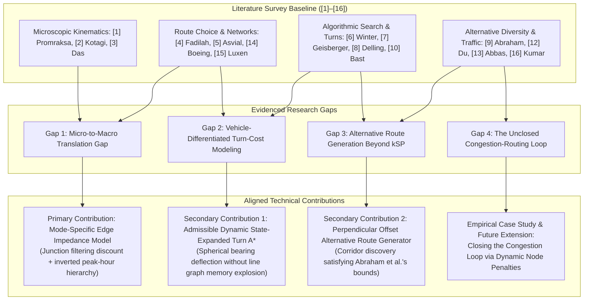

# Research Problem, Gaps, and Contributions Alignment Summary

**Project Title:** GIS-Based Intelligent Navigation and Path Optimization Framework: Self-Calibrating, Two-Wheeler-Aware Routing for Bengaluru  
**Stage:** Phase 5 – Literature Review Synthesis and Report Writing  
**Document:** `research/literature_survey/05_literature_review/research_positioning_summary.md`  
**Date:** 2026-11-03  
**Target Publication Scope:** IEEE Conference on Intelligent Transportation Systems (ITSC) / IEEE Transactions on Intelligent Transportation Systems  

---

## 1. Executive Summary

This document summarizes the strategic academic positioning of the conference research paper provisionally titled:

> **"A Two-Wheeler-Aware Path Optimization Framework: Bridging Microscopic Filtering Dynamics and Turn-Cost Modeling in Heterogeneous Urban Traffic"**

It connects the theoretical and empirical findings from the 16-paper literature review ([1]–[16]) to our experimental routing engine designed for Bengaluru, ensuring clear alignment between identified research gaps and claimed technical contributions.

---

## 2. Formal Research Problem Statement

> **Formal Research Problem Statement:**  
> Urban road navigation systems have historically been engineered around passenger automobile kinematics, assuming strict lateral lane discipline, vehicular homogeneity, and direct scaling between functional road classifications and travel speeds. In rapidly developing South Asian metropolitan areas like Bengaluru, India, motorized two-wheelers operate within a highly heterogeneous, non-lane-based traffic environment. Under chronic peak-hour arterial gridlock—where radial corridors reach severe vehicular saturation—conventional automobile-oriented routing models fail: they channel two-wheelers into stationary automobile queues while under-utilizing viable, filter-friendly secondary and residential street networks.  
>  
> Furthermore, while microscopic traffic literature documents two-wheeler filtering clearances and context-specific speed differentials, the reviewed literature does not establish or validate a mathematical bridge translating these empirical movement dynamics into graph-level routing costs. Existing turn-aware routing engines are calibrated for passenger cars, while existing motorcycle routing models omit turn angles entirely, generating erratic zigzag trajectories in secondary street grids. Finally, existing alternative route algorithms either generate redundant single-block variations (Yen's $k$-shortest paths) or rely on continental highway hierarchies that fail to discover parallel neighborhood corridors.  
>  
> There is a distinct need for an open-source, locally controlled, two-wheeler-aware path optimization framework that bridges empirical microscopic filtering characteristics into macroscopic graph impedances, incorporates dynamic state-expanded turn penalties, and synthesizes diverse, human-meaningful alternative routes across complex urban street networks.

---

## 3. Identified Literature Gaps and Contribution Alignment

The literature survey conducted across Phases 1 through 5 identifies four core research gaps, directly motivating our proposed framework:

### 3.1 Gap 1 $\rightarrow$ Primary Research Contribution

* **The Academic Gap (Microscopic-to-Macroscopic Translation Gap):**  
  Microscopic empirical studies ([1], [2], [3]) have measured two-wheeler lane-filtering clearances ($0.75\text{ m}–0.90\text{ m}$ [1]), non-lane lateral buffers ($0.3\text{ m}–0.6\text{ m}$ in Bangalore [2]), and context-specific peak-hour speed advantages (35%–48% along divided corridors in Mumbai [3]). However, the reviewed literature does not establish or validate a mathematical formulation to translate these empirical movement characteristics into macroscopic edge-weight impedance functions on urban road graphs.
* **Our Primary Technical Contribution:**  
  **A Mode-Specific Edge Impedance Framework Translating Two-Wheeler Movement Characteristics into Graph-Based Routing Costs.**  
  We formulate an edge impedance function on OpenStreetMap directed graphs that incorporates:
  1. *Compounding Multi-Lane Junction Filtering Discount:* Multi-lane junction approaches ($\ge 2$ lanes, matching Promraksa's clearance threshold [1]) receive a compounding junction discount (`FILTER_DISCOUNT_PER_JUNCTION = 0.985`, capped at `FILTER_DISCOUNT_FLOOR = 0.85`), mathematically capturing queue-skipping capability.
  2. *Inverted Road Hierarchy Multipliers:* Reverses traditional automobile hierarchies during peak commute windows, penalizing car-congested primary arterials (`main_road_penalty = 1.35`) while promoting secondary and residential corridors (`inner_road_multiplier = 0.85`).
  *(Note: All multiplier values and discount floors are proposed implementation parameters requiring experimental calibration and sensitivity analysis.)*

---

### 3.2 Gap 2 $\rightarrow$ Secondary Research Contribution 1

* **The Academic Gap (Vehicle-Differentiated Turn-Cost Modeling):**  
  Turn-aware routing theory ([6], [7]) proves that realistic urban navigation requires tracking incoming edge state $(u, v)$ to avoid erratic zigzag routes. However, existing turn-cost formulations are calibrated on automobile turning radii and signal prohibitions on continental highways. Motorized two-wheelers exhibit fundamentally different turning physics ([4]): they negotiate tight residential corners effortlessly, but face severe collision risk and waiting delays when executing sharp turns across multi-lane, non-signalized opposing traffic streams in left-hand driving cities. Existing motorcycle routing models ([5]) completely omit turn costs, while Contraction Hierarchies ([7], [15]) freeze turn metrics at pre-computation time, preventing dynamic personalization.
* **Our Secondary Technical Contribution 1:**  
  **Dynamic State-Expanded Turn-Cost Modeling Tailored for Two-Wheeler Maneuverability.**  
  We implement an admissible goal-directed A\* algorithm that maintains dynamic search state `state = (prev_node, curr_node)` in the priority queue, calculating spherical coordinate bearing deflections on-the-fly via spherical trigonometry:
  $$\Delta \theta = |(\theta_{out} - \theta_{in} + 180^\circ) \pmod{360^\circ} - 180^\circ|$$
  Discrete, non-linear motorcycle penalties are applied:
  $$P_{turn} = \begin{cases} 0.0\text{ s} & \Delta \theta < 30^\circ \text{ (Straight / Gentle curve)} \\ 8.0\text{ s} & 30^\circ \le \Delta \theta < 60^\circ \text{ (Moderate turn)} \\ 25.0\text{ s} & \Delta \theta \ge 60^\circ \text{ (Sharp turn / Crossing opposing flow)} \end{cases}$$
  Admissibility is preserved by dividing Haversine distance by the minimum penalty floor ($0.8$). This achieves exact turn-cost evaluation without the 5×–10× RAM explosion of line graphs ([6]) or the static rigidity of Contraction Hierarchies ([7]).  
  *(Note: Turn angle thresholds and penalty seconds are proposed implementation parameters requiring calibration.)*

---

### 3.3 Gap 3 $\rightarrow$ Secondary Research Contribution 2

* **The Academic Gap (Alternative Route Diversity Beyond Yen's $k$-Shortest Paths):**  
  Providing alternative routes is critical to prevent commercial navigation platforms from concentrating all traffic onto a single corridor ([5]). However, Yen's classic $k$-shortest paths algorithm is proven by Abraham et al. [9] to fail fundamentally in urban grids, generating redundant paths sharing >95% of edges with minor single-block permutations. Highway via-node plateau heuristics ([9]) collapse in dense South Asian cities where grade-separated expressway hierarchies do not exist.
* **Our Secondary Technical Contribution 2:**  
  **A Deterministic Perpendicular Offset Via-Node Heuristic for Human-Meaningful Alternative Route Discovery.**  
  We engineer an alternative route generator that projects lateral search waypoints orthogonal to the forward origin-destination chord ($\theta_{OD} \pm 90^\circ$) at controlled chord fractions ($f \in \{0.33, 0.50, 0.67\}$) and lateral offset distances ($d_{lat} \in \{150\text{ m}, 300\text{ m}\}$). Candidates are synthesized via two-leg turn-aware A\* and filtered against Abraham et al.'s [9] formal quality criteria: bounded detour ($\epsilon \le 0.20$) and limited sharing ($\gamma \le 0.70$).  
  *(Note: Lateral offset distances and split fractions are proposed implementation parameters requiring sensitivity analysis.)*

---

### 3.4 Gap 4 $\rightarrow$ Empirical Case Study & Future Research Extension

* **The Academic Gap (The Unclosed Congestion-to-Routing Loop):**  
  Recent urban traffic studies in Bengaluru (Kumar et al. 2025 [16]) use deep learning models (1D CNN, LSTM, SVR; MAE = 6.02) to forecast traffic volumes, establishing that central arterial corridors routinely reach predicted 100% saturation during peak hours. However, these systems terminate at forecasting without providing route optimization. Conversely, streaming graph systems (Abbas et al. [13]) require continuous inductive loop detectors that do not exist across secondary urban networks in India.
* **Our Positioning (Empirical Case Study & Future Extension):**  
  Rather than claiming a novel deep learning predictive engine, our paper positions this work as an **empirical case study**: we utilize Kumar et al.'s [16] documented bottleneck corridors (Hosur Road, MG Road / Trinity Circle, Yeshwanthpur) as ground-truth testbed inputs. Our engine ingests these bottleneck locations into [`/dynamic-route`](file:///C:/Users/comps/Desktop/Final Year Project/BLRMap_Prototype/api_server.py#L103-L165), dynamically modulating incident edge impedance ($25.0\times$ penalty) to evaluate how effectively our two-wheeler-aware engine discovers secondary bypass corridors around saturated junctions. Full real-time integration with live deep learning traffic streaming is framed as a future research extension.

---

## 4. Defensible Novelty Claim and Explicit Boundaries

To maintain strict academic integrity and avoid rejection from IEEE reviewers, the novelty boundary is demarcated as follows:

> **Defensible Academic Novelty Statement:**  
> *"While prior literature has investigated microscopic two-wheeler kinematics on isolated road corridors [1]–[3], scalable turn-cost routing on continental highway networks [6], [7], and traffic congestion forecasting in Bengaluru [16], this paper presents a unified, locally controlled, OpenStreetMap-based routing engine that translates empirical two-wheeler movement characteristics into macroscopic graph impedance, incorporates dynamic state-expanded turn-angle penalties without line graph memory explosion, and generates human-meaningful alternative secondary corridors via perpendicular offset waypoints. We demonstrate how our framework addresses the limitations of automobile-oriented routing under peak-hour arterial saturation while maintaining interactive query efficiency."*

### Explicit Delimitations (What We Do NOT Claim):
1. We do not claim to have invented the A\* search algorithm or the theoretical principle of state expansion (which originates from Hart et al. 1968 and Winter 2002 [6]).
2. We do not claim that our proposed parameters (filtering discount factor, turn penalties, lateral offset distances) are already proven optimal; they are proposed implementation parameters requiring systematic experimental calibration.
3. We do not claim that the proposed algorithms outperform existing approaches until empirical experimental results establish this.
4. We do not claim to have collected new primary videographic trajectory data in Bengaluru; our behavioral assumptions are grounded in the published findings of Kotagi et al. [2] and Das & Maurya [3].
5. We do not claim a novel deep learning architecture for traffic prediction; we utilize published saturation findings from Kumar et al. [16] as an empirical baseline to test our dynamic bypass routing.
