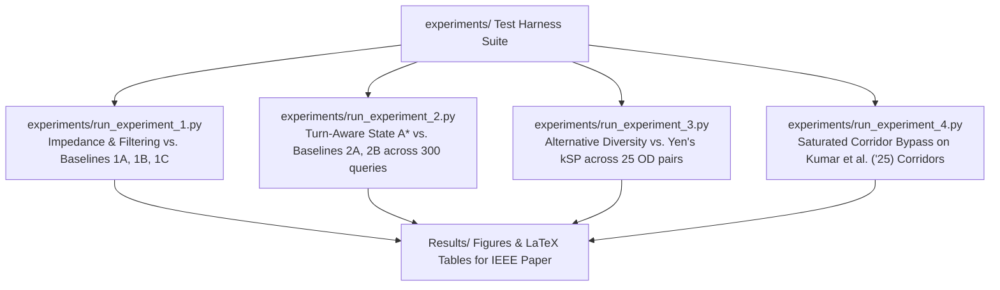

# Experimental Readiness and Validation Roadmap

**Project Title:** GIS-Based Intelligent Navigation and Path Optimization Framework: Self-Calibrating, Two-Wheeler-Aware Routing for Bengaluru  
**Stage:** Final Academic Quality Audit  
**Document:** `research/literature_survey/06_final_quality_audit/experimental_readiness.md`  
**Date:** 2026-11-03  
**Auditor:** Lead Experimental Systems Auditor  

---

## 1. Executive Summary

This document evaluates the operational readiness of the codebase to execute the four experimental validation tiers defined in [`experimental_validation_plan.md`](file:///C:/Users/comps/Desktop/Final Year Project/BLRMap_Prototype/research/literature_survey/04_research_gaps/experimental_validation_plan.md).

For each research contribution, this audit details:
1. Current implementation status in the codebase.
2. Required baseline algorithms.
3. Required road network datasets.
4. Quantitative evaluation metrics.
5. Missing experimental harnesses and evaluation scripts.
6. Methodological risks to experimental validity and mitigating solutions.

---

## 2. Contribution-by-Contribution Readiness Assessment

---

### Contribution 1: Mode-Specific Edge Impedance & Queue Filtering (Primary Contribution)

* **Implementation Status: 75% Ready (Partially Integrated)**
  - *Implemented:* Inverted road hierarchy penalties (`core/config.py:61–77`), flyover exception (`penalty = 0.8`), roundabout multiplier (`0.95`), and surface quality penalty in `routing/algorithms.py:261–343`.
  - *Implemented but Detached:* `count_filterable_junctions` (L. 169) and `apply_filtering_discount` (L. 211) exist, but are not invoked in `two_wheeler_astar` or `api_server.py`.
* **Required Baseline Algorithms:**
  1. *Baseline 1A (Distance Shortest Path):* Standard A\* optimizing Euclidean/Haversine distance only ($c(e) = \text{length}(e)$).
  2. *Baseline 1B (OSRM Car Speed Hierarchy):* Standard hierarchical road classification speeds (`motorway`: 60 km/h, `primary`: 45 km/h, `secondary`: 35 km/h, `residential`: 20 km/h) based on Luxen & Vetter [15].
  3. *Baseline 1C (Asvial et al. [5] Turn-Agnostic Routing):* Motorcycle routing on OSM with uniform capacity and zero turn penalties.
* **Required Datasets:**
  - `bengaluru_roads_extended.graphml` (50,000+ nodes) processed into `bengaluru_graph.pkl` via `routing/graph_manager.py`.
  - 10 benchmark arterial OD pairs across Bengaluru (e.g., BNMIT $\to$ MG Road, Koramangala $\to$ Electronic City, Malleshwaram $\to$ Yeshwanthpur).
* **Evaluation Metrics:**
  - Route distance (km).
  - Estimated travel duration (minutes) under peak vs. off-peak calibrated speeds.
  - Road-class utilization share (% arterial/trunk vs. % secondary/tertiary vs. % residential/local).
  - Filterable multi-lane junction count along path.
* **Missing Implementation Components:**
  - An automated batch testing script (`experiments/run_experiment_1.py`) that loads `bengaluru_graph.pkl`, runs all 10 OD pairs across Baselines 1A, 1B, 1C and Proposed A\*, and logs metric tables to CSV.
  - A post-processing evaluation step in the script that applies `apply_filtering_discount` to calculate the final calibrated travel duration.
* **Risks to Experimental Validity:**
  - *Risk:* Calling external Google Routes API (`fetch_route_duration` in `api_server.py`) for experimental evaluation introduces black-box proprietary rate limiting and unrepeatable commercial speed assumptions.
  - *Mitigation:* The experimental evaluation script must calculate travel times using an **offline, reproducible speed formula** calibrated against published empirical findings (Das & Maurya [3], Kotagi et al. [2]), reserving Google API for illustrative sanity checks.

---

### Contribution 2: Dynamic State-Expanded Turn-Cost A\* (Secondary Contribution 1)

* **Implementation Status: 95% Ready (Fully Functional Core)**
  - *Implemented:* `two_wheeler_astar` (lines 455–650) implements dynamic state tracking `state = (prev_node, curr_node)`, calls `_turn_angle()` for spherical bearing difference, and adds `_turn_penalty()` ($8.0\text{ m}$ moderate, $25.0\text{ m}$ sharp). Heuristic admissibility is strictly preserved via `haversine_m / 0.8`.
* **Required Baseline Algorithms:**
  1. *Baseline 2A (Turn-Agnostic A\*):* `two_wheeler_astar` with turn penalties set to zero (`TURN_PENALTY_SHARP = 0.0`, `TURN_PENALTY_MODERATE = 0.0`), matching Asvial et al. [5].
  2. *Baseline 2B (Standard Node-Based Dijkstra/A\*):* `astar_on_graph` (lines 349–447) operating without state expansion.
* **Required Datasets:**
  - Three dense urban grid sectors of Bengaluru extracted from the master graph:
    - Sector 1: Malleshwaram (Rigid rectangular grid with frequent 90° intersections).
    - Sector 2: Chickpet / KR Market (Organic, narrow medieval alley network with irregular turn angles).
    - Sector 3: Jayanagar (Mixed boulevard and residential block system).
* **Evaluation Metrics:**
  - Total turn count per route ($\Delta \theta \ge 30^\circ$).
  - Turn severity distribution: moderate turns ($30^\circ \le \Delta \theta < 60^\circ$) vs. sharp turns ($\Delta \theta \ge 60^\circ$).
  - Path tortuosity / circuity ratio ($\tau = \text{Distance}_{actual} / \text{Distance}_{euclidean}$).
  - Number of search states popped from priority queue (search space efficiency).
  - Algorithmic query latency in milliseconds (mean and 95th percentile).
* **Missing Implementation Components:**
  - An automated batch testing script (`experiments/run_experiment_2.py`) that generates 100 random OD pairs within each sector (300 queries total), executes Baseline 2A vs. Proposed Turn-Aware A\*, and computes statistical turn distributions and runtime distributions.
* **Risks to Experimental Validity:**
  - *Risk:* Unit ambiguity: Describing turn penalties in seconds in the paper while the code evaluates meters.
  - *Mitigation:* Explicitly declare in the paper methodology that turn penalties are modeled as **equivalent virtual distance impedance** ($P_{turn} \in \{0\text{ m}, 8\text{ m}, 25\text{ m}\}$), representing the virtual detour distance a rider is willing to traverse to avoid a sharp turn maneuver.

---

### Contribution 3: Perpendicular Offset Alternative Route Generation (Secondary Contribution 2)

* **Implementation Status: 70% Ready (Algorithmic Core Implemented, Filtering Incomplete)**
  - *Implemented:* `_offset_split_points` (lines 753–802) computes perpendicular offset waypoints at chord fractions ($0.33, 0.50, 0.67$) and lateral distances ($150\text{ m}, 300\text{ m}$). `build_split_route_candidates` (lines 807–991) stitches two-leg paths and enforces detour tolerance ($\le 1.20$).
  - *Missing:* The 70% edge-sharing filter ($\gamma \le 0.70$) is not calculated in the candidate generation loop. The function is also not exposed in `api_server.py`.
* **Required Baseline Algorithms:**
  1. *Baseline 3A (Yen's $k$-Shortest Paths):* NetworkX `nx.shortest_simple_paths` generating $k=3$ and $k=5$ shortest paths on the Bengaluru network, matching Asvial et al. [5] and Abraham et al. [9].
* **Required Datasets:**
  - 25 representative medium-to-long OD pairs (5 km to 18 km) traversing Bengaluru (radial corridors, ring road connections, and cross-town diagonals).
* **Evaluation Metrics:**
  - Edge sharing percentage ($\gamma$) relative to primary optimal path:
    $$\text{Sharing}(P_{alt}, P_{opt}) = \frac{\sum_{e \in P_{alt} \cap P_{opt}} \text{length}(e)}{\text{length}(P_{opt})} \times 100\%$$
  - Jaccard distance over edge sets: $J(P_{alt}, P_{opt}) = 1 - \frac{|E(P_{alt}) \cap E(P_{opt})|}{|E(P_{alt}) \cup E(P_{opt})|}$.
  - Detour stretch ratio: $\epsilon = (\text{Length}(P_{alt}) - \text{Length}(P_{opt})) / \text{Length}(P_{opt})$.
  - Corridor independence (Boolean verification of whether alternative utilizes a distinct parallel corridor spine).
  - Alternative generation runtime (ms).
* **Missing Implementation Components:**
  - An edge overlap and Jaccard distance calculation utility function in the evaluation harness.
  - An automated batch testing script (`experiments/run_experiment_3.py`) comparing Yen's $k$-shortest paths against `build_split_route_candidates` across the 25 OD pairs.
* **Risks to Experimental Validity:**
  - *Risk:* Offset waypoints projected into unmapped areas (e.g., lakes, defense land, large parks) may snap to disconnected or dead-end vertices.
  - *Mitigation:* Ensure `split_nodes` are validated to exist within the largest strongly connected component (`G_inner` or `G`) before invoking the two-leg A\* search.

---

### Empirical Case Study: Saturated Corridor Avoidance (Closing the Congestion Loop)

* **Implementation Status: 90% Ready (Functional via API & Algorithms)**
  - *Implemented:* Dynamic edge cost multiplication ($25.0\times$) for edges incident on `congested_nodes` in `two_wheeler_edge_cost` (L. 311–316). `/dynamic-route` in `api_server.py` accepts congestion coordinates.
* **Required Baseline:**
  - Static shortest path routing ignoring congestion (routing directly through saturated corridors).
* **Required Dataset:**
  - Kumar et al. (2025) [16] documented bottleneck corridors:
    1. Hosur Road (Silk Board to Dairy Circle)
    2. MG Road / Trinity Circle / Anil Kumble Circle
    3. Yeshwanthpur Junction / Tumkur Road
* **Evaluation Metrics:**
  - Number of saturated bottleneck nodes successfully avoided.
  - Estimated travel duration savings (minutes).
  - Detour distance incurred (km).
  - Efficiency ratio: $\eta = \Delta \text{Time Saved (mins)} / \Delta \text{Distance Added (km)}$.
* **Missing Implementation Components:**
  - A dedicated case study script (`experiments/run_experiment_4.py`) that loads Kumar et al.'s specific corridor coordinates, runs static vs. dynamic two-wheeler A\*, and generates comparative route maps and metric tables.
* **Risks to Experimental Validity:**
  - *Risk:* Over-claiming real-time prediction integration.
  - *Mitigation:* The paper must clearly state that Kumar et al.'s corridors are ingested as **simulated/predicted congestion scenarios**, serving as an empirical case study rather than claiming an online live streaming prediction engine.

---

## 3. Experimental Implementation Roadmap

To transition from the completed literature survey to full empirical paper completion, the following testing harness files should be created in an `experiments/` directory:

1. **`experiments/run_experiment_1.py`:** Batch evaluation of 10 arterial OD pairs across distance A\*, OSRM hierarchy, and two-wheeler A\*.
2. **`experiments/run_experiment_2.py`:** 300 random queries across Malleshwaram, Chickpet, and Jayanagar evaluating turn count, severity, tortuosity, and latency.
3. **`experiments/run_experiment_3.py`:** 25 OD pairs benchmarking Yen's $k$-shortest paths vs. perpendicular offset candidates on edge sharing ($\gamma$), Jaccard distance, and detour bounds ($\epsilon$).
4. **`experiments/run_experiment_4.py`:** Targeted evaluation of Hosur Road, Trinity Circle, and Yeshwanthpur bottleneck avoidance.

All algorithms and core data structures exist in `routing/algorithms.py` and `routing/graph_manager.py`; only the standalone batch execution and logging scripts need to be run.
