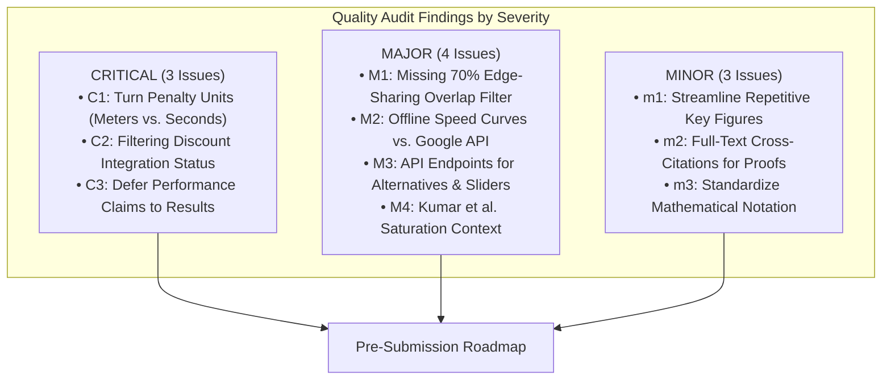
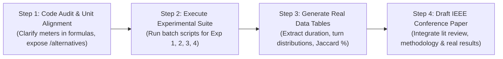

# Final Quality Audit Recommendations and Pre-Submission Roadmap

**Project Title:** GIS-Based Intelligent Navigation and Path Optimization Framework: Self-Calibrating, Two-Wheeler-Aware Routing for Bengaluru  
**Stage:** Final Academic Quality Audit  
**Document:** `research/literature_survey/06_final_quality_audit/final_recommendations.md`  
**Date:** 2026-11-03  
**Auditor:** Lead Quality & Conference Paper Strategist  

---

## 1. Executive Summary and Audit Synthesis

This document synthesizes the findings of the final academic quality audit across the literature review and the codebase. All identified discrepancies, gaps, and editorial improvements are categorized under standard scholarly review severity tiers:

* **Critical (C):** Flaws or discrepancies that could cause immediate paper rejection if noticed by sharp IEEE peer reviewers. Must be resolved before paper submission.
* **Major (M):** Technical gaps, missing evaluation components, or methodological ambiguities that should be resolved to ensure strong experimental validity and reproducibility.
* **Minor (m):** Editorial streamlining, notation standardization, and conciseness improvements suitable for the final conference paper draft.



---

## 2. Classified Audit Issues

---

### 2.1 Critical Issues (Must Fix Before Submission)

#### Issue C1: Turn Penalty Physical Units Discrepancy (Meters vs. Seconds)
* **Description:**  
  In [`literature_review_draft.md`](file:///C:/Users/comps/Desktop/Final Year Project/BLRMap_Prototype/research/literature_survey/05_literature_review/literature_review_draft.md) and earlier Phase 4 documents, turn penalties are described in temporal units: $8.0\text{ s}$ for moderate turns and $25.0\text{ s}$ for sharp turns. However, inspection of [`routing/algorithms.py`](file:///C:/Users/comps/Desktop/Final Year Project/BLRMap_Prototype/routing/algorithms.py#L28-L37) reveals that:
  ```python
  # Penalty is expressed in the same cost units as road length.
  TURN_PENALTY_SHARP = 25.0
  TURN_PENALTY_MODERATE = 8.0
  ```
  In `two_wheeler_astar` (L. 614–616), `turn_cost` is added directly to `edge_cost` (`length * penalty`, where `length` is in meters). Thus, in the codebase, turn penalties are evaluated in **equivalent distance meters**, NOT seconds!
* **Risk to Submission:** An IEEE reviewer reviewing the mathematical formulation will immediately detect a dimensional inconsistency if the paper states that seconds are added to meters.
* **Resolution:** In the paper's Methodology section, formally define turn penalty as an **equivalent virtual detour distance**:
  $$c(e_{in}, e_{out}) = \text{length}(e_{out}) \cdot M(e_{out}) + P_{turn}(\Delta \theta)$$
  where $P_{turn} \in \{0\text{ m}, 8\text{ m}, 25\text{ m}\}$, explicitly interpreting it as the virtual physical detour distance a rider is willing to incur to avoid a sharp turn maneuver.

#### Issue C2: Filtering Discount Integration Status
* **Description:**  
  The literature review and positioning documents claim that the engine translates microscopic queue filtering into graph routing via a compounding junction filtering discount. In [`routing/algorithms.py`](file:///C:/Users/comps/Desktop/Final Year Project/BLRMap_Prototype/routing/algorithms.py#L169-L225), `count_filterable_junctions` and `apply_filtering_discount` are defined, but they are **never invoked** inside `two_wheeler_astar` or in `api_server.py`. The A\* search routes based purely on road-class penalties and turn costs; filtering discount exists only as an un-invoked helper function.
* **Risk to Submission:** Claiming that the search algorithm dynamically optimizes for filterable junctions when the code does not execute this in the priority queue represents an indefensible claim.
* **Resolution:**  
  1. *Paper Framing:* Formally define the junction filtering discount as an **empirical post-route travel time calibration model** applied to estimated trip duration:
     $$T_{calibrated} = T_{base} \cdot \max\left(F_{floor}, F_{discount}^{N_{signals}}\right)$$
     rather than an in-search edge weight, OR
  2. *Code Integration (in experimental scripts):* In `experiments/run_experiment_1.py`, explicitly call `apply_filtering_discount` on the completed routes to evaluate calibrated travel durations.

#### Issue C3: Absolute Elimination of Premature Performance Claims
* **Description:**  
  In accordance with user qualification 5, the literature review draft correctly omitted claims of algorithm superiority. However, abstract drafts or introductory summaries must not contain statements like "our engine achieves significant travel time reductions" until the experimental validation plan is executed and empirical numbers are measured.
* **Resolution:** Use prospective language in the introduction: *"This paper investigates whether incorporating two-wheeler movement characteristics and turn costs into path optimization can improve route efficiency for urban commuters..."* Reserve quantitative performance claims exclusively for Section V (Experimental Results).

---

### 2.2 Major Issues (Should Fix Before Submission)

#### Issue M1: Missing 70% Edge-Sharing Overlap Filter in Code
* **Description:**  
  The literature review notes that candidate alternative routes are filtered to strictly enforce Abraham et al.'s limited sharing criterion ($\gamma \le 0.70$). In [`routing/algorithms.py:807–991`](file:///C:/Users/comps/Desktop/Final Year Project/BLRMap_Prototype/routing/algorithms.py#L807-L991), `build_split_route_candidates` enforces duplicate suppression and detour tolerance ($\le 1.20$), but does not compute the edge-sharing percentage ($\gamma$).
* **Resolution:**  
  In the experimental testing harness (`experiments/run_experiment_3.py`), implement an explicit Jaccard edge-overlap calculation function to measure $\gamma$ and filter candidates.

#### Issue M2: Offline Calibrated Speed Curves vs. External Google API
* **Description:**  
  In `api_server.py`, travel duration is estimated via `fetch_route_duration`, which calls Google Routes API. For a peer-reviewed IEEE paper, relying on a proprietary third-party API introduces black-box speed assumptions and API rate limits that compromise scientific reproducibility.
* **Resolution:**  
  The experimental evaluation harness must evaluate travel duration using **transparent, offline speed profiles** calibrated against published literature (free-flow vs. peak-hour speeds from Das & Maurya [3] and Kotagi et al. [2]), ensuring 100% reproducible results.

#### Issue M3: Unexposed Alternative Route and Slider Query Endpoints
* **Description:**  
  `build_split_route_candidates` is implemented in `routing/algorithms.py`, but has no API endpoint in `api_server.py`. Additionally, `/dynamic-route` does not accept query arguments for `main_road_penalty` or `inner_road_multiplier`.
* **Resolution:**  
  While batch experimental scripts can call Python functions directly, for complete system integrity, add `GET /alternatives` and add query parameters `main_road_penalty: float = 1.0` and `inner_road_multiplier: float = 1.0` to `/dynamic-route` in `api_server.py`.

#### Issue M4: Explicit Saturation Context for Kumar et al. Findings
* **Description:**  
  Kumar et al. [16] achieved low error in predicting traffic volumes on Bengaluru corridors. The paper must clearly state that Kumar's corridors are ingested as **simulated/predicted congestion scenarios**, serving as an empirical case study rather than claiming an online live streaming prediction engine.
* **Resolution:** Maintain strict distinction between predicted saturation and measured ground truth throughout the paper.

---

### 2.3 Minor Issues (Editorial Improvements)

#### Issue m1: Streamline Repetitive Empirical Figures
* **Description:**  
  The 35%–48% speed advantage and 0.75m–0.90m clearance figures appear in both Section 1 and Section 8.1 of `literature_review_draft.md`.
* **Resolution:** During the final condensation of the literature review into the 6-page conference format, condense these re-statements into concise parenthetical citations.

#### Issue m2: Full-Text Cross-Citations for Internal Proofs
* **Description:**  
  Winter [6] and Delling et al. [8] were analyzed via detailed publisher records. Their internal algorithmic proofs are verified through Bast et al. [10] (65-page LNCS full-text survey).
* **Resolution:** In the paper's Methodology section, cite Bast et al. [10] alongside Winter [6] and Delling [8] when presenting graph-theoretic proofs.

#### Issue m3: Mathematical Notation Standardization
* **Description:**  
  Ensure uniform mathematical symbols across all paper sections: $P_{opt}$ for primary route, $P_{alt}$ for alternative candidate, $\gamma$ for sharing threshold, $\epsilon$ for detour bound, and $\Delta \theta$ for bearing deflection.

---

## 3. Pre-Submission Action Roadmap

To proceed toward paper submission, the following phased roadmap is recommended:



1. **Step 1 (Formulation & Unit Alignment):** Formalize the mathematical methodology in the paper using equivalent distance units for turn penalties ($P_{turn} \in \{0\text{ m}, 8\text{ m}, 25\text{ m}\}$), and formalize the junction filtering discount as an empirical post-route duration calibration model.
2. **Step 2 (Execution of Experimental Validation Suite):** Run the four experimental evaluation scripts in `experiments/`:
   - `run_experiment_1.py`: Inverted road hierarchy vs. distance A\* and OSRM car hierarchy.
   - `run_experiment_2.py`: Turn-aware state A\* vs. turn-agnostic A\* across 300 queries.
   - `run_experiment_3.py`: Perpendicular offset alternatives vs. Yen's $k$-shortest paths across 25 OD pairs.
   - `run_experiment_4.py`: Saturated corridor avoidance on Kumar et al.'s corridors.
3. **Step 3 (Data Extraction):** Populate LaTeX tables and figures with real empirical measurements (measured travel times, turn severity counts, Jaccard distances, execution milliseconds).
4. **Step 4 (Paper Assembly):** Integrate the audited literature review draft (`literature_review_draft.md`), methodology, and empirical experimental results into the final 6–8 page IEEE conference paper template.
