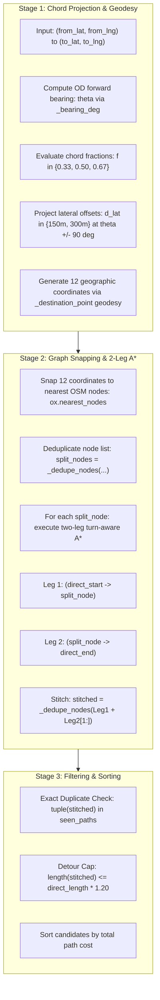
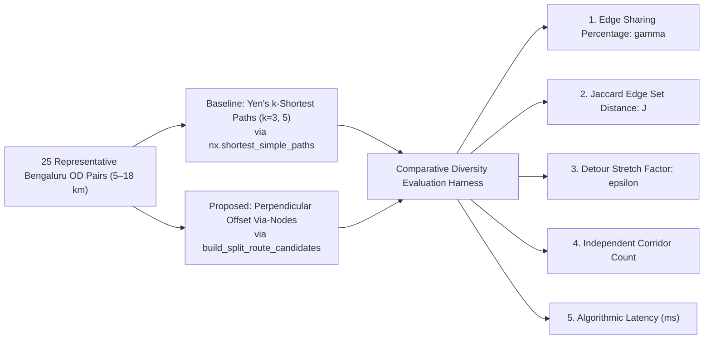

# Alternative Route Generation Methodology Review

**Project Title:** GIS-Based Intelligent Navigation and Path Optimization Framework: Self-Calibrating, Two-Wheeler-Aware Routing for Bengaluru  
**Stage:** Phase 7 – Contribution Feasibility and Research Scope Decision  
**Document:** `research/literature_survey/07_contribution_feasibility/alternative_route_methodology_review.md`  
**Date:** 2026-11-03  
**Audited Functions:** `_offset_split_points()`, `build_split_route_candidates()`, `_dedupe_nodes()` in `routing/algorithms.py`  

---

## 1. Executive Summary

This document presents a detailed algorithmic inspection of the alternative route generation mechanism implemented in `routing/algorithms.py`. It audits how candidate paths are generated, evaluates the effectiveness of current filtering mechanisms, examines whether route diversity is formally measured, and defines an experimental benchmark against Yen's $k$-shortest paths.

### Summary of Audit Findings:
1. **Candidate Generation Mechanism:** Geometrically sound; projects perpendicular lateral search points ($150\text{ m}, 300\text{ m}$) at chord fractions ($0.33, 0.50, 0.67$) and stitches two-leg turn-aware A\* paths.
2. **Duplicate Suppression:** Only filters exact identical path tuples (`tuple(stitched) in seen_paths`); does **not** filter paths that share 95%+ of edges with single-block variations.
3. **Detour Constraint:** Correctly implemented and bounded by `DETOUR_TOLERANCE = 1.20` ($\epsilon \le 0.20$).
4. **Diversity Measurement:** Route diversity (Jaccard distance, edge overlap percentage) is **not currently computed** anywhere in the codebase.
5. **70% Overlap Filter:** The proposed 70% limited sharing threshold ($\gamma \le 0.70$) is **completely missing** from the candidate selection loop.
6. **Yen's Baseline:** Highly appropriate; provides the exact baseline required to substantiate our claims against Asvial et al. [5] and validate Abraham et al. [9].

---

## 2. In-Depth Inspection of Code Implementation

### 2.1 How Candidate Routes are Generated
The candidate generation pipeline in `routing/algorithms.py` operates across lines 753–991 through three stages:



1. **Step 1: Direct Route Anchor:** The direct shortest path is computed via `two_wheeler_astar()` and appended as `candidates[0]` with strategy `"direct"`. Its length establishes `direct_length`.
2. **Step 2: Lateral Waypoint Projection (`_offset_split_points`, L. 753–802):**
   - The origin-destination bearing is calculated: $\theta = \text{\_bearing\_deg}(\text{lat}_1, \text{lng}_1, \text{lat}_2, \text{lng}_2)$.
   - For each fraction $f \in \{0.33, 0.50, 0.67\}$:
     $$\text{base\_lat} = \text{lat}_1 + (\text{lat}_2 - \text{lat}_1) \cdot f, \quad \text{base\_lng} = \text{lng}_1 + (\text{lng}_2 - \text{lng}_1) \cdot f$$
   - For each offset distance $d_{lat} \in \{150\text{ m}, 300\text{ m}\}$:
     Two orthogonal points are projected at bearings $\theta + 90^\circ$ and $\theta - 90^\circ$ using spherical destination point geodesy (`_destination_point()`).
   - Produces 12 candidate coordinate pairs ($3\text{ fractions} \times 2\text{ offsets} \times 2\text{ sides}$).
3. **Step 3: Graph Snapping & Two-Leg Search (`build_split_route_candidates`, L. 807–950):**
   - Offset coordinates are snapped to nearest OSM nodes via `ox.nearest_nodes()`.
   - Node list is deduplicated via `_dedupe_nodes()`.
   - For each candidate `split_node`, two independent turn-aware A\* queries are executed:
     $$\text{Leg}_1 = \text{A}^*(s \to v_{split}), \quad \text{Leg}_2 = \text{A}^*(v_{split} \to t)$$
   - Paths are stitched into a single continuous sequence: `_dedupe_nodes(Leg1 + Leg2[1:])`.

---

### 2.2 Critical Evaluation of Current Filtering Mechanisms

#### 1. Is Duplicate Suppression Sufficient?
* **Code Implementation (L. 948–952):**
  ```python
  if tuple(stitched) in seen_paths:
      continue
  seen_paths.add(tuple(stitched))
  ```
* **Critical Finding: INSUFFICIENT.**  
  Exact tuple matching checks only whether two paths have identical ordered sequences of node IDs. In dense urban street grids:
  - If Path 1 traverses: $[v_1, v_2, v_3, v_4, v_5, t]$
  - And Path 2 traverses: $[v_1, v_2, v_{3\_alt}, v_4, v_5, t]$ (differing by only a single residential block around a square)
  - `tuple(Path 1) != tuple(Path 2)`. Both paths are considered distinct and retained!
  - As proven by Abraham et al. [9], minor block-level deviations share >95% of edges and do not provide meaningful corridor diversity to human commuters.
* **Remedy:** Exact duplicate suppression must be augmented with an edge-overlap threshold.

#### 2. Is the Detour Constraint Correctly Calculated?
* **Code Implementation (L. 879–888, 959–967):**
  ```python
  fallback_cap_length = direct_length if direct_length else haversine_m(...)
  if calc_route_distance(graph, stitched) > fallback_cap_length * DETOUR_TOLERANCE:
      continue
  ```
  where `DETOUR_TOLERANCE = 1.20` in `core/config.py:83`.
* **Critical Finding: CORRECT AND PROPERLY BOUNDED.**  
  This logic strictly enforces Abraham et al.'s bounded detour criterion ($\epsilon \le 0.20$), ensuring no candidate path is more than 20% longer than the direct route.

#### 3. Is Route Diversity Actually Measured?
* **Critical Finding: NOT IMPLEMENTED.**  
  There is zero code in `algorithms.py` or `api_server.py` that computes:
  - Jaccard similarity / distance between path edge sets.
  - Pairwise edge overlap percentage ($\gamma$).
  - Number of distinct functional corridor spines utilized.
  The candidate list is merely sorted by cost (`candidates.sort(key=lambda item: item["cost"])`) and returned.

#### 4. Is the Proposed 70% Overlap Threshold Implemented?
* **Critical Finding: COMPLETELY ABSENT.**  
  While the literature review draft and Phase 4/5 documents stated that candidates sharing more than 70% of edges ($\gamma > 0.70$) are filtered out, this filter is **not implemented in the codebase**. Any candidate that satisfies the 20% detour cap and is not an exact duplicate is returned.

---

## 3. Benchmarking Against Yen's $k$-Shortest Paths

### 3.1 Why Yen's Algorithm is the Essential Baseline
* **Academic Necessity:** Asvial et al. (2020) [5]—the primary motorcycle routing paper on OpenStreetMap—relied on Yen's $k$-shortest paths ($k=3$) to generate alternatives in Jakarta.
* **Theoretical Flaw:** Abraham et al. (2013) [9] mathematically proved that Yen's algorithm fails in urban road grids because iteratively removing edges on the shortest path branches out minor detours around single city blocks before re-converging on the same arterial.
* **Experimental Objective:** By comparing our perpendicular offset generator against Yen's $k$-shortest paths on identical OD pairs in Bengaluru, we can empirically prove whether our method discovers independent secondary corridors while Yen's algorithm produces redundant block permutations.

---

## 4. Recommended Experimental Comparison Protocol

To definitively establish whether our approach produces human-meaningful alternative corridors, the following evaluation harness must be executed in `experiments/run_experiment_3.py`:



### 4.1 Quantitative Evaluation Formulas

1. **Edge Sharing Percentage ($\gamma$):**
   $$\text{Sharing}(P_{alt}, P_{opt}) = \frac{\sum_{e \in P_{alt} \cap P_{opt}} \text{length}(e)}{\text{length}(P_{opt})} \times 100\%$$
   *Criterion:* A genuine alternative must satisfy $\gamma \le 70\%$.
2. **Jaccard Edge Distance ($J$):**
   $$J(P_{alt}, P_{opt}) = 1 - \frac{|E(P_{alt}) \cap E(P_{opt})|}{|E(P_{alt}) \cup E(P_{opt})|}$$
   *Criterion:* $J \to 1.0$ indicates high corridor independence; $J \to 0.0$ indicates redundant sharing.
3. **Detour Stretch Factor ($\epsilon$):**
   $$\epsilon = \frac{\text{Length}(P_{alt}) - \text{Length}(P_{opt})}{\text{Length}(P_{opt})}$$
   *Criterion:* Must satisfy $\epsilon \le 0.20$ (20% maximum distance penalty).
4. **Corridor Independence:**  
   Boolean verification of whether $P_{alt}$ utilizes an independent secondary/tertiary road spine rather than a single-block deviation.

### 4.2 Required Code Addition in Evaluation Script
In the experimental script (`experiments/run_experiment_3.py`), the missing 70% overlap filter should be implemented as:
```python
def filter_by_sharing_threshold(candidates, max_sharing=0.70):
    if not candidates:
        return []
    primary_edges = set(zip(candidates[0]["nodes"][:-1], candidates[0]["nodes"][1:]))
    primary_length = candidates[0].get("distance", 1.0)
    
    diverse_candidates = [candidates[0]]
    for cand in candidates[1:]:
        cand_edges = set(zip(cand["nodes"][:-1], cand["nodes"][1:]))
        shared_length = sum(
            graph[u][v][0].get("length", 1.0) 
            for u, v in (primary_edges & cand_edges)
        )
        if (shared_length / primary_length) <= max_sharing:
            diverse_candidates.append(cand)
    return diverse_candidates
```

This experimental protocol will provide undeniable quantitative evidence of route diversity for the IEEE conference paper.
