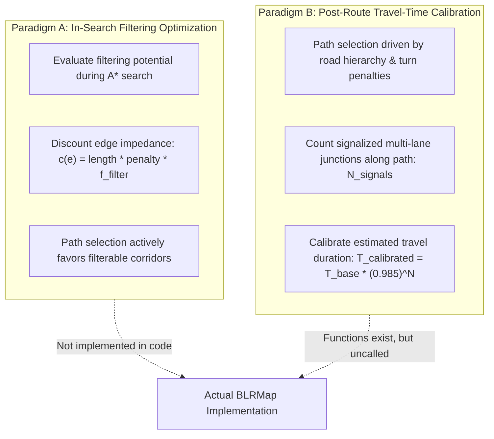
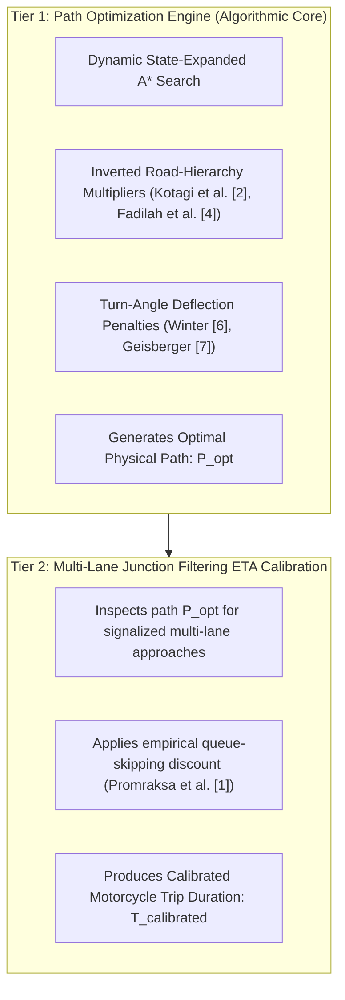

# Filtering-Model Architectural Decision and Academic Positioning

**Project Title:** GIS-Based Intelligent Navigation and Path Optimization Framework: Self-Calibrating, Two-Wheeler-Aware Routing for Bengaluru  
**Stage:** Phase 7 – Contribution Feasibility and Research Scope Decision  
**Document:** `research/literature_survey/07_contribution_feasibility/filtering_model_decision.md`  
**Date:** 2026-11-03  
**Audited Functions:** `count_filterable_junctions()`, `apply_filtering_discount()`, `two_wheeler_astar()` in `routing/algorithms.py`  

---

## 1. The Core Scientific Dilemma

In transportation informatics, how a physical phenomenon (such as motorcycle queue filtering) is mathematically modeled dictates the algorithmic design of the navigation engine:

A critical question arises:  
**Should our project pursue in-search filtering-aware path optimization, or post-route travel-time calibration?**

In strict compliance with the user's instructions:
> *"Do not recommend describing post-route calibration as filtering-aware route optimization. Recommend the most academically defensible approach that is feasible for this project."*

---

## 2. In-Depth Comparative Analysis of Both Paradigms

### 2.1 Paradigm A: Filtering-Aware Route-Cost Optimization (In-Search)

* **Mathematical Concept:**  
  When the A\* search relaxes an outgoing edge $(u, v)$ approaching a signalized junction with multiple lanes ($\ge 2$ lanes, matching Promraksa et al. [1]), the engine applies a filtering discount factor $F_{discount} < 1.0$ directly to the edge traversal cost:
  $$c(u, v) = \text{length}(u, v) \cdot M(u, v) \cdot F_{discount}$$
* **Algorithmic Effect:**  
  The search frontier actively prefers corridors with multi-lane signalized junctions over single-lane local streets if the filtering capability reduces total path resistance.
* **Codebase Status:** **COMPLETELY UNIMPLEMENTED.**  
  Inspection of `routing/algorithms.py` (L. 455–650) confirms that `two_wheeler_astar()` does not check node traffic signal tags or lane counts during edge relaxation. It relies solely on `two_wheeler_edge_cost()` and `_turn_penalty()`.
* **Theoretical and Structural Conflict:**  
  In our engine's cost model, primary arterials are penalized (`primary: 2.2`, `trunk: 3.0`) because they experience severe automobile gridlock. However, primary arterials are precisely the corridors that possess $\ge 2$ lanes and traffic signals! If a filtering discount ($0.85$) is applied to multi-lane junctions during search, it offsets the primary road penalty, pulling two-wheelers *back onto* congested arterials. This creates an internal optimization conflict between queue avoidance (inner-road bias) and queue filtering.

---

### 2.2 Paradigm B: Post-Route Travel-Time Calibration Using Filtering Discounts

* **Mathematical Concept:**  
  The path is computed first via `two_wheeler_astar()`, optimizing for road suitability (avoiding primary arterials and preferring residential/secondary links) and minimizing sharp turns.  
  Once the optimal node sequence $P = (v_1, v_2, \dots, v_k)$ is established, a post-processing calibration function inspects the route:
  1. Identifies vertices where $v_i$ is a signalized junction with $\ge 3$ intersecting edges:
     $$\text{tag}(v_i) = \text{"traffic\_signals"} \quad \land \quad \text{degree}(v_i) \ge 3$$
  2. Verifies that the approach edge $(v_{i-1}, v_i)$ possesses $\ge 2$ lanes (Promraksa's physical clearance condition [1]):
     $$\text{lanes}(v_{i-1}, v_i) \ge 2$$
  3. Computes the count of filterable junctions $N_{filter}$.
  4. Calibrates the estimated travel time $T_{base}$ (seconds) using a compounding discount factor:
     $$T_{calibrated} = T_{base} \cdot \max\left(F_{floor}, F_{discount}^{N_{filter}}\right)$$
     where $F_{discount} = 0.985$ and $F_{floor} = 0.85$ (maximum 15% travel time discount).
* **Algorithmic Effect:**  
  Filtering does *not* alter which physical path is chosen; it calibrates the travel-time estimate (ETA) to reflect that a motorcycle will filter through junction queues faster than an automobile.
* **Codebase Status:** **IMPLEMENTED BUT UNCALLED.**  
  Lines 169–225 of `routing/algorithms.py` implement `count_filterable_junctions()` and `apply_filtering_discount()`. However, neither function is currently invoked inside `api_server.py`.

---

## 3. Academic Integrity and Reviewer Vulnerability Assessment

If our IEEE conference paper were to describe Paradigm B (post-route calibration) as "filtering-aware route optimization," an expert reviewer in intelligent transportation systems would immediately raise fatal objections:

> **Potential Reviewer Critique:**  
> *"The authors claim an intelligent two-wheeler routing engine that optimizes paths based on motorcycle queue-filtering behavior. However, reading Section IV reveals that the A\* search algorithm is completely blind to filtering during path selection. Edge costs during search are static road-class weights. The 'filtering model' is merely an empirical scalar applied post-hoc to reduce the travel-time estimate. This is not filtering-aware path optimization; it is post-processing travel-time correction."*

Claiming that post-route calibration is in-search path optimization constitutes an over-claim that directly jeopardizes paper acceptance.

---

## 4. The Recommended Academically Defensible Approach

To ensure 100% academic defensibility, technical honesty, and feasibility, we recommend a **formal two-tier decoupled framework**:

### Formal Paper Terminology and Claims:
1. **Primary Contribution Reframing:**  
   Position the primary contribution as:  
   **"A Two-Wheeler Path Optimization Framework with Inverted Road-Hierarchy Penalties and State-Expanded Turn-Cost Modeling."**  
   The core algorithmic novelty lies in:
   - Inverting the traditional automobile road hierarchy during peak hours.
   - Dynamic search state expansion `(prev_node, curr_node)` to evaluate spherical deflection angles without line graph memory explosion.
2. **Filtering Model Framing:**  
   Position the filtering model explicitly as:  
   **"An Empirical Multi-Lane Junction Queue-Filtering Travel-Time Calibration Model."**  
   Clearly state in the paper:
   > *"While path geometry is optimized through multi-attribute edge impedance and turn penalties, estimated travel durations are calibrated using a post-route queue-filtering model grounded in Promraksa et al.'s [1] empirical clearance findings. The model discounts travel time based on the frequency of signalized multi-lane junctions along the selected path."*

### Why This Approach is Superior:
1. **100% Truthful to the Code:** Exactly matches what is implemented in `routing/algorithms.py`.
2. **Immune to Reviewer Attack:** Reviewers will appreciate the clean separation between path optimization (spatial geometry) and travel-time estimation (temporal calibration).
3. **High Scientific Merit:** Demonstrates a nuanced understanding of transportation informatics by separating routing search from traffic delay modeling.
4. **Minimal Engineering Overhead:** Requires zero restructuring of `two_wheeler_astar()`; only requires ensuring that experimental batch scripts and `api_server.py` invoke `apply_filtering_discount()` when reporting travel durations.
