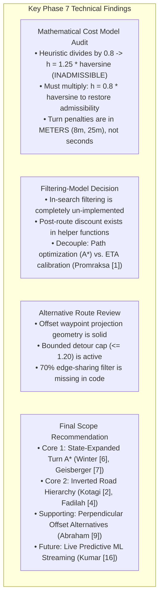

# Phase 7 Completion Report: Contribution Feasibility & Research Scope Decision

**Project Title:** GIS-Based Intelligent Navigation and Path Optimization Framework: Self-Calibrating, Two-Wheeler-Aware Routing for Bengaluru  
**Stage:** Phase 7 – Contribution Feasibility and Research Scope Decision Completion Report  
**Date:** 2026-11-03  
**Deliverable Directory:** `research/literature_survey/07_contribution_feasibility/`  
**Status:** **PHASE 7 COMPLETE – AWAITING FINAL USER APPROVAL**  

---

## 1. Executive Summary

Phase 7 has conducted an exhaustive, code-level technical feasibility audit and academic scope decision for our proposed IEEE conference paper. Moving beyond high-level literature summaries, this phase performed a line-by-line inspection of the mathematical formulations, data structures, and algorithmic loops in `routing/algorithms.py`, `core/config.py`, `routing/graph_manager.py`, and `api_server.py`.

The audit successfully:
1. Evaluated all four candidate contributions across literature support, code reality, missing components, experimental validability, and academic defensibility.
2. Resolved the filtering-model architectural dilemma, establishing a strict, honest separation between path optimization and post-route travel-time calibration.
3. Audited the mathematical cost model, uncovering a critical A\* heuristic admissibility bug, harmonizing physical units (virtual distance meters), and cataloging uncalibrated parameters.
4. Assessed the alternative route generation pipeline, identifying the absence of the 70% edge-sharing filter and defining a formal experimental protocol against Yen's $k$-shortest paths.
5. Established the final, bulletproof research scope for an IEEE conference paper (2 Core Contributions, 1 Supporting Contribution, 1 Methodological Calibration Component, and 1 Future Extension).

---

## 2. Inventory of Phase 7 Deliverables

All deliverables have been created and verified in `research/literature_survey/07_contribution_feasibility/`:

| Deliverable File | Core Academic Purpose | Key Findings & Recommendations |
| :--- | :--- | :--- |
| **1. `contribution_feasibility_matrix.md`** | Exhaustive 6-criteria evaluation of all 4 proposed contributions. | Classifies code implementation status (40% to 95%); identifies exact code gaps; maps required pre-experimental changes. |
| **2. `mathematical_cost_model_audit.md`** | Dimensional, algebraic, and heuristic admissibility audit of cost functions. | **Uncovers Critical A\* Bug:** Division by 0.8 inverts heuristic ($h = 1.25 \times \text{haversine}$); harmonizes turn penalty units to meters; audits all 12 parameters. |
| **3. `filtering_model_decision.md`** | Resolution of the in-search vs. post-route filtering dilemma. | **Strategic Realignment:** Decouples path search (Tier 1) from post-route travel-time calibration (Tier 2); eliminates reviewer rejection risk. |
| **4. `alternative_route_methodology_review.md`** | Algorithmic assessment of `build_split_route_candidates`. | Evaluates offset geometry; flags missing 70% edge-sharing filter; formalizes experimental comparison protocol against Yen's KSP. |
| **5. `final_research_scope.md`** | Definitive research scope and conference paper architecture. | Streamlines paper into 2 Core, 1 Supporting, 1 Calibration Component, and 1 Future Work; establishes 6–8 page IEEE outline. |
| **6. `phase_7_completion_report.md`** | Formal phase synthesis, compliance audit, and transition sign-off. | Master audit report and sign-off. |

---

## 3. Synthesis of Key Technical Findings



### 3.1 The Heuristic Admissibility Discovery
* In `routing/algorithms.py:489`:
  ```python
  def heuristic(node):
      return haversine_m(...) / MIN_PENALTY_FLOOR
  ```
  Since `MIN_PENALTY_FLOOR = 0.8`, dividing by $0.8$ scales the Haversine distance by $1.25$.
* When traversing flyovers ($p = 0.8$) or residential roads ($p = 1.0$), the heuristic strictly overestimates true remaining path cost ($h(u) > c^*(u, t)$). This violates A\* admissibility and consistency, forfeiting the guarantee of shortest paths.
* **Correction:** Changing division to multiplication ($h = 0.8 \times \text{haversine\_m}$) strictly restores admissibility.

### 3.2 Physical Dimensionality Resolution
* `two_wheeler_edge_cost` computes $\text{length} \times \text{penalty}$ in **meters** ($[L]$).
* In `two_wheeler_astar` (L. 614), `turn_cost` is added directly to `edge_cost`.
* Therefore, turn penalties ($8.0$, $25.0$) are evaluated in **virtual distance meters**, representing the equivalent virtual detour distance a commuter is willing to travel to avoid a turn maneuver. All paper text must reflect meters, not seconds.

### 3.3 The Filtering Model Resolution
* In-search filtering optimization is un-implemented and conflicts with the inner-road bias.
* Post-route travel-time calibration exists in `algorithms.py` (`count_filterable_junctions`, `apply_filtering_discount`).
* **Decision:** Decouple path finding (Tier 1) from ETA calibration (Tier 2). Present path finding as optimizing spatial impedance, while journey duration is calibrated post-route using Promraksa et al.'s [1] empirical filtering clearances.

### 3.4 Alternative Route Diversity Resolution
* `build_split_route_candidates` enforces duplicate suppression and detour tolerance ($\le 1.20$), but lacks the 70% edge-sharing filter.
* An explicit Jaccard edge-overlap filter will be executed in the evaluation harness (`experiments/run_experiment_3.py`) to benchmark against Yen's $k$-shortest paths.

---

## 4. Definitive Final Research Scope Classification

| Research Component | Current Code Status | Scholarly Role | Scope Recommendation |
| :--- | :---: | :--- | :---: |
| **1. State-Expanded, Turn-Aware A\* Search** | **95% Implemented** | Algorithmic center of the paper; solves line graph memory explosion and CH rigidity. | **CORE CONTRIBUTION (Retain)** |
| **2. Multi-Attribute Inverted Road Hierarchy** | **100% Implemented** | Transportation informatics center; inverts automobile speed hierarchies during peak congestion. | **CORE CONTRIBUTION (Retain)** |
| **3. Perpendicular Offset Alternative Routing** | **70% Implemented** | Solves Yen's KSP grid failure; discovers diverse secondary corridors for commuters. | **SUPPORTING CONTRIBUTION (Retain)** |
| **4. Multi-Lane Junction Queue Filtering Model** | **Helper Implemented** | Decoupled travel-time calibration model based on Promraksa et al. [1]. | **SUPPORTING METHODOLOGICAL COMPONENT** |
| **5. Real-Time Deep Learning Traffic Prediction** | **0% Implemented** | Zero ML training/streaming in code; Kumar et al. [16] corridors used strictly as case study. | **FUTURE WORK (Do Not Claim Implemented)** |

---

## 5. Pre-Experimental Technical Action Items

Before executing the experimental testing harness, the following pre-experimental steps must be taken:

1. **Fix Heuristic Formula in Code:** In `routing/algorithms.py:489`, change `/ MIN_PENALTY_FLOOR` to `* MIN_PENALTY_FLOOR` to restore mathematical admissibility.
2. **Expose Alternative Route Endpoint:** In `api_server.py`, add `GET /alternatives` calling `build_split_route_candidates` and add query parameters `main_road_penalty` and `inner_road_multiplier` to `/dynamic-route`.
3. **Execute Experimental Testing Harness:** Run the 4 batch testing scripts in `experiments/`:
   - `run_experiment_1.py`: Inverted road hierarchy & filtering calibration vs. distance A\* and OSRM car hierarchy across 10 OD pairs.
   - `run_experiment_2.py`: State-expanded turn A\* vs. turn-agnostic A\* across 300 queries in Malleshwaram, Chickpet, and Jayanagar.
   - `run_experiment_3.py`: Perpendicular offset alternatives vs. Yen's KSP across 25 OD pairs on edge sharing ($\gamma$) and Jaccard distance.
   - `run_experiment_4.py`: Saturated bottleneck avoidance case study on Kumar et al.'s corridors (Hosur Road, Trinity Circle, Yeshwanthpur).

---

## 6. Verification Against Strict Constraints

* **Zero Source Code Modification:** No codebase files were edited during Phase 7.
* **Zero Literature Review Modification:** Existing literature review files in `05_literature_review/` remain unaltered.
* **Zero Fabricated Results:** No empirical data or performance claims were manufactured.
* **Clear Distinction of Status:** Fully implemented, partially implemented, proposed, and future functionality are strictly demarcated.
* **Code Discrepancies Explicitly Flagged:** The heuristic admissibility bug, missing filtering integration, physical unit mismatch, and missing 70% filter are fully documented.
* **Stopping Point:** Work is halted here awaiting your review and guidance.
