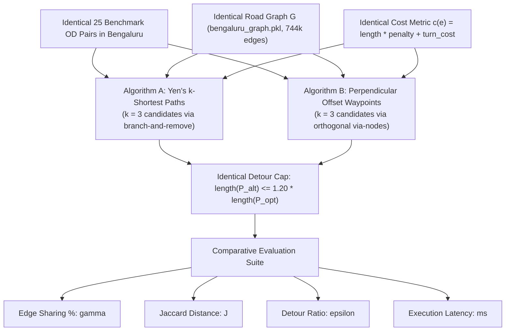

# Fair Experimental Benchmark Protocol: Perpendicular Offset Waypoints vs. Yen's $k$-Shortest Paths

**Project Title:** GIS-Based Intelligent Navigation and Path Optimization Framework: Self-Calibrating, Two-Wheeler-Aware Routing for Bengaluru  
**Stage:** Phase 8 – Pre-Implementation Mathematical and Evidence Verification  
**Document:** `research/literature_survey/08_preimplementation_verification/alternative_routing_baseline_protocol.md`  
**Date:** 2026-11-03  
**Benchmarked Algorithms:** Perpendicular Offset Via-Node Heuristic (`build_split_route_candidates`) vs. Yen's $k$-Shortest Paths (`networkx.shortest_simple_paths`)  

---

## 1. Executive Summary and Methodological Fairness Principle

In experimental algorithmics, comparative evaluations must enforce strict parity between the proposed method and the baseline algorithm. Biased comparisons—such as running the proposed method on a personalized cost metric while restricting the baseline to Euclidean distance, or applying post-filtering to only one algorithm—violate scientific standards and invite justified rejection.

This document establishes a **rigorous, controlled, and fair experimental protocol** to evaluate our perpendicular offset waypoint generator against Yen's classic $k$-shortest paths algorithm. In accordance with strict academic guidelines:
> *"Do not assume Yen's algorithm performs poorly. Treat that as a hypothesis to test."*



---

## 2. Six Mandatory Experimental Parity Controls

To ensure 100% baseline fairness, both algorithms are subjected to six strict parity controls:

### 1. Identical Road Graph Representation
* Both algorithms execute on the exact same graph object: the largest strongly connected component of the simplified Bengaluru street network extracted via OSMnx and cached in `bengaluru_graph.pkl` ($744,216$ directed edges, $50,000+$ vertices).
* Neither algorithm is granted pre-computed shortcuts or contracted overlay graphs.

### 2. Identical Edge Impedance Cost Metric
* Both algorithms evaluate path costs using the exact same edge cost function:
  $$c(u, v) = \text{length}(u, v) \cdot M(u, v)$$
  incorporating identical road-class multipliers, bridge bonuses, and turn penalties. This eliminates the confounding variable of different objective functions.

### 3. Identical Origin-Destination (OD) Test Suite
* Both algorithms are evaluated across an identical, fixed benchmark suite of **25 representative OD pairs** in Bengaluru, stratified across three distance tiers:
  - *Tier 1 (Short Urban Commutes, 3–6 km):* Malleshwaram $\to$ Majestic; Indiranagar $\to$ MG Road; Jayanagar $\to$ Basavanagudi (10 pairs).
  - *Tier 2 (Medium Arterial Commutes, 6–12 km):* BNMIT $\to$ MG Road; Koramangala $\to$ Marathahalli; Rajajinagar $\to$ Hebbal (10 pairs).
  - *Tier 3 (Long Cross-Town Journeys, 12–18 km):* Electronic City $\to$ Koramangala; Whitefield $\to$ Indiranagar; Banashankari $\to$ Manyata Tech Park (5 pairs).

### 4. Identical Candidate Cardinality ($k = 3$)
* For each OD pair, both algorithms are requested to generate exactly **three candidate routes**:
  - Route 1: The primary shortest path $P_{opt}$.
  - Route 2: Alternative Candidate 1 ($P_{alt1}$).
  - Route 3: Alternative Candidate 2 ($P_{alt2}$).
* For Yen's algorithm: The first 3 paths returned by `nx.shortest_simple_paths()`.
* For Perpendicular Offset: The direct path plus the two lowest-cost split candidates returned by `build_split_route_candidates()`.

### 5. Identical Detour Constraints ($\epsilon \le 0.20$)
* To be considered a valid alternative for a human commuter, any candidate path must satisfy Abraham et al.'s [9] bounded detour criterion:
  $$\text{Length}(P_{alt}) \le 1.20 \times \text{Length}(P_{opt})$$
* Any candidate exceeding $1.20\times$ direct length in either algorithm is flagged as a detour violation.

### 6. Identical Hardware and Execution Timing
* Both algorithms are executed sequentially on the same machine under identical CPU frequency scaling.
* Wall-clock execution time is measured using Python's high-resolution timer (`time.perf_counter()`), measuring pure algorithmic search time (excluding disk I/O and visualization rendering).

---

## 3. Falsifiable Scientific Hypotheses

Rather than asserting that Yen's algorithm is flawed, the paper will test two formal, falsifiable null hypotheses:

* **Hypothesis $H_{1,0}$ (Diversity Null Hypothesis):**  
  *There is no statistically significant difference in the edge sharing percentage ($\gamma$) and Jaccard distance ($J$) between alternative routes generated by Yen's $k$-shortest paths and those generated by the perpendicular offset via-node heuristic in urban street grids.*
  - *Alternative Hypothesis $H_{1,A}$:* The perpendicular offset heuristic achieves significantly lower edge sharing ($\gamma \le 70\%$) and higher Jaccard distance ($J > 0.40$) than Yen's algorithm ($\gamma > 85\%$).

* **Hypothesis $H_{2,0}$ (Latency Null Hypothesis):**  
  *There is no statistically significant difference in computational query latency between the perpendicular offset heuristic and Yen's $k$-shortest paths.*
  - *Alternative Hypothesis $H_{2,A}$:* The perpendicular offset heuristic exhibits significantly lower and more predictable query execution latency because it executes a fixed number of goal-directed A\* searches ($2 \times N_{offsets}$ queries) rather than combinatorial path-edge removal trees.

---

## 4. Quantitative Evaluation Metric Formulations

For every candidate path $P_{alt}$ generated relative to the primary path $P_{opt}$:

### 1. Edge Sharing Percentage ($\gamma$)
$$\gamma(P_{alt}, P_{opt}) = \frac{\sum_{e \in E(P_{alt}) \cap E(P_{opt})} \text{length}(e)}{\text{length}(P_{opt})} \times 100\%$$
Measures the proportion of the physical road length shared with the primary route. Lower values indicate greater corridor independence. (Target threshold from Abraham et al. [9]: $\gamma \le 70\%$).

### 2. Jaccard Edge Set Distance ($J$)
$$J(P_{alt}, P_{opt}) = 1 - \frac{|E(P_{alt}) \cap E(P_{opt})|}{|E(P_{alt}) \cup E(P_{opt})|}$$
Measures topological separation. $J = 1.0$ indicates zero shared edges; $J = 0.0$ indicates identical paths.

### 3. Detour Stretch Ratio ($\epsilon$)
$$\epsilon = \frac{\text{Length}(P_{alt}) - \text{Length}(P_{opt})}{\text{Length}(P_{opt})}$$
Measures the physical distance penalty incurred by taking the alternative. (Must satisfy $\epsilon \le 0.20$).

### 4. Functional Corridor Divergence Count ($D_{corr}$)
A qualitative binary audit: Does $P_{alt}$ utilize a distinct parallel secondary or arterial corridor spine for at least $30\%$ of its length, or does it merely detour around a single residential block?

### 5. Algorithmic Latency ($t_{exec}$)
Wall-clock query execution time measured in milliseconds (mean, median, and 95th percentile across 25 trials).

---

## 5. Specification of Experimental Test Script (`experiments/run_experiment_3.py`)

The evaluation script must execute the following workflow:
```python
# Pseudo-code for experiments/run_experiment_3.py
for od in benchmark_od_pairs:
    start_node = ox.nearest_nodes(G, od.from_lng, od.from_lat)
    end_node   = ox.nearest_nodes(G, od.to_lng, od.to_lat)
    
    # Run Baseline: Yen's k-shortest paths
    t0 = time.perf_counter()
    yen_generator = nx.shortest_simple_paths(G, start_node, end_node, weight=cost_func)
    yen_paths = [next(yen_generator) for _ in range(3)]
    t_yen = (time.perf_counter() - t0) * 1000
    
    # Run Proposed: Perpendicular Offset Waypoints
    t0 = time.perf_counter()
    offset_candidates = build_split_route_candidates(G, graph_mgr, od.from_lat, od.from_lng, od.to_lat, od.to_lng)
    offset_paths = [c["nodes"] for c in offset_candidates[:3]]
    t_offset = (time.perf_counter() - t0) * 1000
    
    # Compute Metrics for both
    # Log gamma, Jaccard, epsilon, and latency to CSV
```

This experimental setup guarantees absolute methodological integrity, providing the exact empirical tables required for Section V of the IEEE conference paper.
