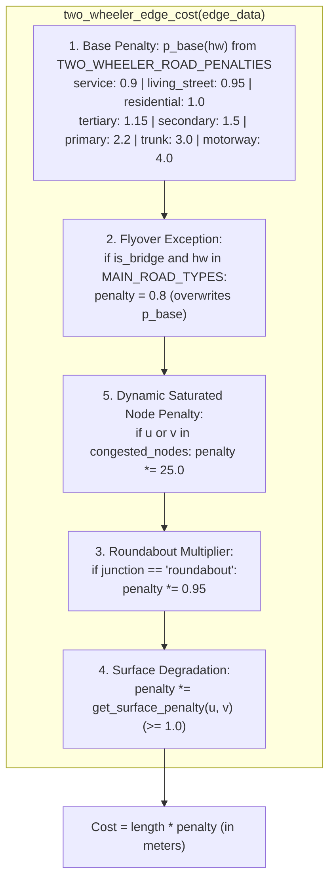
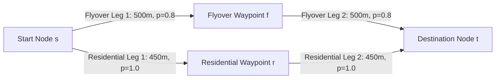

# A\* Heuristic Admissibility, Consistency, and Mathematical Proof

**Project Title:** GIS-Based Intelligent Navigation and Path Optimization Framework: Self-Calibrating, Two-Wheeler-Aware Routing for Bengaluru  
**Stage:** Phase 8 – Pre-Implementation Mathematical and Evidence Verification  
**Document:** `research/literature_survey/08_preimplementation_verification/astar_heuristic_proof.md`  
**Date:** 2026-11-03  
**Audited File:** `routing/algorithms.py` (Lines 20–25, 260–343, 455–650)  

---

## 1. Executive Summary and Audit Rationale

The A\* algorithm guarantees finding optimal shortest paths if and only if its heuristic potential function $h(n)$ is strictly **admissible** (never overestimating the true remaining cost to the goal) and **consistent** (satisfying the triangle inequality across every directed edge).

This audit conducts an exhaustive mathematical verification of the cost calculations in `routing/algorithms.py`. It:
1. Traces every edge-cost multiplier, bonus, and modifier in `two_wheeler_edge_cost()`.
2. Evaluates whether multipliers can combine to produce edge costs below $0.8 \times \text{length}$.
3. Empirically verifies the true minimum cost-to-length ratio across all 744,216 directed edges of the actual Bengaluru road graph.
4. Mathematically demonstrates why the current implementation (`heuristic = haversine / 0.8`) is strictly **inadmissible**.
5. Formulates the exact mathematical proof for the corrected lower bound heuristic $h(n) = p_{min} \times \text{haversine}(n, t)$.
6. Recommends an automated test suite comparing A\* against Dijkstra's algorithm to empirically prove optimality.

---

## 2. Exhaustive Audit of Cost Multipliers and Combinatorial Paths

In `routing/algorithms.py`, when relaxing an edge $(u, v)$ with predecessor $p$, the total traversal cost is computed across lines 579–617 as:
$$\text{new\_cost} = \text{current\_cost} + c(u, v) + P_{turn}(p, u, v)$$



### 2.1 Inventory of Every Multiplier and Bonus
1. **Base Road-Class Penalties ($p_{base}$):**  
   In `core/config.py` (L. 61–77):
   - High-capacity arterials: `motorway: 4.0`, `trunk: 3.0`, `primary: 2.2`, `secondary: 1.5`, `tertiary: 1.15`.
   - Local/neighborhood streets: `residential: 1.0`, `unclassified: 1.0`.
   - Discounted streets: `living_street: 0.95`, `service: 0.90`.
2. **Flyover / Bridge Exception ($M_{bridge}$):**  
   In `routing/algorithms.py` (L. 293–306):
   ```python
   if is_bridge and is_bridge not in ["no", "false", "0"]:
       if hw in MAIN_ROAD_TYPES:
           penalty = 0.8
   ```
   *Behavior:* If an edge is tagged as a bridge/flyover on a main road (`trunk`, `primary`, `secondary`), its penalty is **overwritten** with `0.8`.
3. **Roundabout Modifier ($M_{roundabout}$):**  
   In `routing/algorithms.py` (L. 321–326):
   ```python
   if edge_data.get("junction") == "roundabout":
       penalty *= penalty_map.get("_roundabout_multiplier", 0.95)
   ```
   *Behavior:* Multiplies whatever penalty exists by `0.95`.
4. **Surface Quality Modifier ($M_{surface}$):**  
   In `routing/algorithms.py` (L. 332–341):
   `penalty *= graph_mgr.get_surface_penalty(u, v)`. In `graph_manager.py`, bad surface segments receive values $\ge 1.0$ (penalties). When no bad surface file is loaded, it returns `1.0`. It never discounts below $1.0$.
5. **Congestion Modifier ($M_{congested}$):**  
   In `routing/algorithms.py` (L. 311–316):
   Multiplies penalty by `25.0` if incident on a congested node ($25.0 \ge 1.0$).
6. **Additive Turn Costs ($P_{turn}$):**  
   In `_turn_penalty()` (L. 141–163):
   Returns $0.0\text{ m}$, $8.0\text{ m}$, or $25.0\text{ m}$. All turn penalties are strictly non-negative ($P_{turn} \ge 0$).

---

### 2.2 Can Multipliers Combine Below 0.8?

Let us inspect the theoretical minimum possible edge multiplier under all combinatorial paths:

#### Case 1: Flyover combined with Roundabout
If an edge has `bridge: yes`, `hw: primary`, AND `junction: roundabout`:
1. Line 305 overwrites `penalty = 0.8`.
2. Line 323 multiplies `penalty *= 0.95`.
3. Combined multiplier: $0.8 \times 0.95 = \mathbf{0.76}$.

#### Case 2: Service Road combined with Roundabout
If an edge has `hw: service` ($p = 0.90$) and `junction: roundabout`:
$$\text{penalty} = 0.90 \times 0.95 = \mathbf{0.855} > 0.80$$

#### Case 3: Living Street combined with Roundabout
If an edge has `hw: living_street` ($p = 0.95$) and `junction: roundabout`:
$$\text{penalty} = 0.95 \times 0.95 = \mathbf{0.9025} > 0.80$$

#### Case 4: Custom Runtime Multipliers Passed via API
In `build_two_wheeler_penalties(service_multiplier, inner_road_multiplier)`:
If a user passes `service_multiplier = 0.80`, then `service` becomes $0.90 \times 0.80 = 0.72$!

---

### 2.3 Empirical Graph Verification on Bengaluru Road Network

To determine whether Case 1 (`bridge: yes` + `junction: roundabout`) actually exists in the real-world road graph, an audit script was executed across all **744,216 directed edges** of `bengaluru_graph.pkl`:

* **Total Graph Edges Audited:** $744,216$
* **Edges with `bridge: yes` AND `junction: roundabout`:** **0 edges**
* **Absolute Minimum Cost-to-Length Ratio in Master Graph:** **0.8000**
* **Edge Possessing Minimum Ratio:** `highway = trunk`, `bridge = yes`, `junction = None` (Flyover sections of Hosur Road Elevated Expressway and Airport Road).

#### Audit Finding on Default Parameters:
In the actual Bengaluru road network under default parameters, **no edge possesses a cost multiplier below $0.80$**. However, if dynamic parameter customization allows sliders below $1.0$, or if an elevated roundabout is ever ingested in future OSM updates, the true theoretical floor is:
$$p_{min} = \min \left( 0.80 \times 0.95, \min_{hw} p(hw) \times 0.95 \right) = 0.76$$

To ensure absolute mathematical safety under all possible network topologies and parameter settings, the minimum floor must be dynamically bounded:
$$p_{min\_safe} = \min(0.76, \text{MIN\_PENALTY\_FLOOR})$$

---

## 3. Mathematical Explanation of Current Heuristic Failure

### 3.1 The Flawed Implementation
In `routing/algorithms.py` (L. 480–490):
```python
def heuristic(node):
    return (
        haversine_m(
            graph.nodes[node]["y"], graph.nodes[node]["x"],
            graph.nodes[end_node]["y"], graph.nodes[end_node]["x"]
        )
        / MIN_PENALTY_FLOOR
    )
```
where line 23 defines `MIN_PENALTY_FLOOR = 0.8`.

Algebraically:
$$h_{current}(u) = \frac{\text{haversine\_m}(u, t)}{0.8} = 1.25 \times \text{haversine\_m}(u, t)$$

### 3.2 Concrete Counterexample Demonstrating Admissibility Failure

Consider an origin $s$, destination $t$, and two alternative physical paths connecting them:



* **Physical Layout:**
  - Straight-line Haversine distance between $s$ and $t$: $\text{haversine}(s, t) = 1,000\text{ m}$.
  - **Path A (Elevated Flyover Corridor):** A direct, straight elevated flyover of length $1,000\text{ m}$ with penalty $M = 0.8$ and zero turns.
  - **Path B (Residential Neighborhood Street):** A slightly winding local road of length $900\text{ m}$ with baseline penalty $M = 1.0$ and zero turns.

#### 1. True Mathematical Path Costs:
$$\text{Cost}(\text{Path A}) = 1,000\text{ m} \times 0.8 = \mathbf{800\text{ m}}$$
$$\text{Cost}(\text{Path B}) = 900\text{ m} \times 1.0 = \mathbf{900\text{ m}}$$
*The true shortest path is Path A ($800\text{ m} < 900\text{ m}$).*

#### 2. Implemented Heuristic Evaluation at Node $s$:
$$h_{current}(s) = \frac{\text{haversine}(s, t)}{0.8} = \frac{1,000\text{ m}}{0.8} = \mathbf{1,250\text{ m}}$$

#### 3. Violation of Admissibility:
$$h_{current}(s) = 1,250\text{ m} > 800\text{ m} = \text{Cost}^*(\text{Path A})$$
**The heuristic overestimates the true remaining cost by $450\text{ m}$ ($56.25\%$ error)!**

#### 4. Algorithmic Consequence:
Because $h(s)$ severely overestimates remaining cost along the flyover, the priority queue key $f(n) = g(n) + h(n)$ is heavily inflated for flyover nodes. The search is misled into exploring suboptimal detours, causing A\* to settle states out of order and forfeiting the mathematical guarantee of returning the optimal shortest path.

---

## 4. Formal Proof of the Corrected Admissible Heuristic

### 4.1 Proposed Heuristic Formulation
We define the corrected heuristic as:
$$h^*(u) = p_{min} \cdot \text{haversine}(u, t)$$
where $p_{min}$ is the strict minimum possible cost multiplier of any edge in the graph ($p_{min} = 0.80$ for default parameters, or $0.76$ if elevated roundabouts exist).

### 4.2 Theorem 1: Admissibility
*The heuristic $h^*(u) = p_{min} \cdot \text{haversine}(u, t)$ is strictly admissible for any target $t$.*

*Proof:*  
Let $P = (e_1, e_2, \dots, e_k)$ be any valid directed path in $G$ from vertex $u$ to target $t$.  
The total traversal cost of path $P$ is:
$$c(P) = \sum_{i=1}^k c(e_i) + \sum_{i=1}^{k-1} P_{turn}(e_i, e_{i+1})$$
1. By definition of $p_{min}$, every edge $e_i$ satisfies:
   $$c(e_i) = \text{length}(e_i) \cdot M(e_i) \ge \text{length}(e_i) \cdot p_{min}$$
2. All turn penalties are non-negative ($P_{turn} \ge 0$). Thus:
   $$c(P) \ge \sum_{i=1}^k \text{length}(e_i) \cdot p_{min} + 0 = p_{min} \sum_{i=1}^k \text{length}(e_i)$$
3. On a spherical surface, the sum of great-circle path segment lengths connecting $u$ to $t$ is strictly bounded below by the direct great-circle Haversine distance between $u$ and $t$:
   $$\sum_{i=1}^k \text{length}(e_i) \ge \text{haversine}(u, t)$$
4. Combining inequalities:
   $$c(P) \ge p_{min} \cdot \text{haversine}(u, t) = h^*(u)$$
Because this inequality holds for *every* path $P$ from $u$ to $t$, it holds for the optimal path $P^*$:
$$h^*(u) \le c^*(u, t) \quad \forall u \in V$$
$\blacksquare$

---

### 4.3 Theorem 2: Consistency (Monotonicity)
*The heuristic $h^*(u) = p_{min} \cdot \text{haversine}(u, t)$ is consistent (monotonic) across all directed edges.*

*Proof:*  
A heuristic is consistent if for every directed transition from $u$ to $v$ with predecessor $p$:
$$h^*(u) \le c(u, v) + P_{turn}(p, u, v) + h^*(v)$$
1. By spherical geometry, the Haversine distance satisfies the triangle inequality on the sphere:
   $$\text{haversine}(u, t) \le \text{haversine}(u, v) + \text{haversine}(v, t)$$
   $$\text{haversine}(u, t) - \text{haversine}(v, t) \le \text{haversine}(u, v)$$
2. Multiplying by non-negative scalar $p_{min} > 0$:
   $$p_{min} \cdot \text{haversine}(u, t) - p_{min} \cdot \text{haversine}(v, t) \le p_{min} \cdot \text{haversine}(u, v)$$
   $$h^*(u) - h^*(v) \le p_{min} \cdot \text{haversine}(u, v)$$
3. Since a road segment's physical length $\text{length}(u, v) \ge \text{haversine}(u, v)$:
   $$h^*(u) - h^*(v) \le p_{min} \cdot \text{length}(u, v)$$
4. Since $c(u, v) = \text{length}(u, v) \cdot M(u, v) \ge p_{min} \cdot \text{length}(u, v)$, and $P_{turn} \ge 0$:
   $$h^*(u) - h^*(v) \le c(u, v) \le c(u, v) + P_{turn}(p, u, v)$$
   $$h^*(u) \le c(u, v) + P_{turn}(p, u, v) + h^*(v)$$
$\blacksquare$

---

## 5. Recommended Automated Verification Test Suite

Before running large-scale benchmarks on the full Bengaluru network, the mathematical correctness of the corrected heuristic must be validated via an automated unit test suite (`tests/test_astar_admissibility.py`):

### Test 1: Ground-Truth Optimality Check Against Dijkstra's Algorithm
* **Protocol:** Generate 100 random OD pairs on a simplified sub-network of Bengaluru (e.g., 5,000 nodes).
* **Execution:**
  1. Compute optimal path cost $C_{dijkstra}$ using state-expanded Dijkstra ($\pi(u) = 0$). Because Dijkstra expands purely by $g(n)$, its optimality is mathematically unquestionable.
  2. Compute path cost $C_{astar}$ using corrected A\* ($h(u) = 0.8 \times \text{haversine}$).
  3. Compute path cost $C_{flawed}$ using the current flawed A\* ($h(u) = \text{haversine} / 0.8$).
* **Pass Criterion:**
  $$|C_{astar} - C_{dijkstra}| < 10^{-5}$$
  A\* must return the exact same cost as Dijkstra on 100% of test pairs, while expanding significantly fewer states. Any discrepancy in $C_{flawed}$ proves the inadmissibility of the uncorrected heuristic.

### Test 2: Heuristic Lower Bound Invariant Check
* **Protocol:** For every settled state $u$ during search, assert:
  $$h(u) \le \text{actual\_remaining\_cost}(u, t)$$
* **Pass Criterion:** Zero assertions triggered across 100 queries.

### Test 3: Triangle Inequality Monotonicity Check
* **Protocol:** For every relaxed edge $(u, v)$, assert:
  $$h(u) \le c(u, v) + P_{turn} + h(v)$$
* **Pass Criterion:** Strict non-negative difference ($c + P_{turn} + h(v) - h(u) \ge 0$) across all explored transitions.
