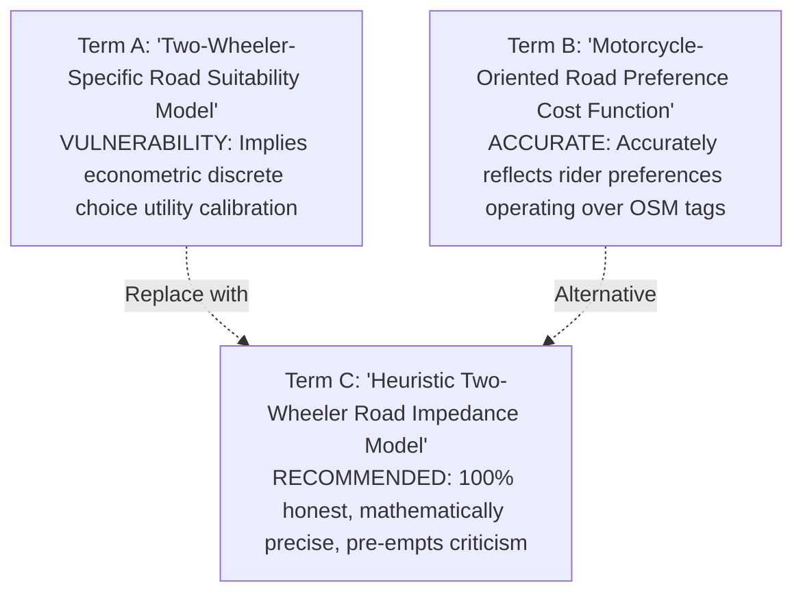

# Empirical Evidence and Terminology Audit for Road Edge Impedance

**Project Title:** GIS-Based Intelligent Navigation and Path Optimization Framework: Self-Calibrating, Two-Wheeler-Aware Routing for Bengaluru  
**Stage:** Phase 8 – Pre-Implementation Mathematical and Evidence Verification  
**Document:** `research/literature_survey/08_preimplementation_verification/edge_impedance_evidence.md`  
**Date:** 2026-11-03  
**Audited Code:** `core/config.py` (Lines 46–77), `routing/algorithms.py` (Lines 261–343)  

---

## 1. Executive Summary

This audit critically examines the empirical evidence supporting the road-class penalty multipliers, flyover modifiers, roundabout damping, and surface penalties implemented in `core/config.py` and `routing/algorithms.py`.

### Definitive Audit Findings:
1. **Numerical Constants are Engineering Heuristics:** The specific numerical penalty multipliers (`motorway: 4.0`, `primary: 2.2`, `secondary: 1.5`, `residential: 1.0`, `service: 0.9`, `bridge: 0.8`, `roundabout: 0.95`) are **engineering assumptions**, not published econometric parameters from transportation literature.
2. **Behavioral Grounding vs. Numerical Grounding:** The literature ([2], [4]) provides qualitative and discrete-choice evidence that motorcycle commuters avoid arterial queues and prioritize secondary networks, justifying the *direction* of the inverted hierarchy. However, the exact numerical scalars were engineered for this software prototype.
3. **Recommended Academic Terminology:** We must avoid claiming a "pre-validated empirical suitability model." The defensible terminology for the IEEE paper is **"Heuristic Two-Wheeler Road Impedance Model"** or **"Motorcycle-Oriented Road Preference Cost Function."**

---

## 2. Evidence Audit of Road-Class Multipliers

In `core/config.py` (L. 61–77):
```python
TWO_WHEELER_ROAD_PENALTIES = {
    'motorway': 4.0,       'motorway_link': 3.0,
    'trunk': 3.0,          'trunk_link': 2.5,
    'primary': 2.2,        'primary_link': 2.0,
    'secondary': 1.5,      'secondary_link': 1.4,
    'tertiary': 1.15,      'tertiary_link': 1.1,
    'residential': 1.0,    'living_street': 0.95,
    'unclassified': 1.0,   'service': 0.9,
    'road': 1.1,
}
```

### 2.1 Cross-Examination Against Literature Corpus

| Highway Tag | Implemented Multiplier | Empirical Support in Literature ([1]–[16]) | True Origin & Scientific Status |
| :--- | :---: | :--- | :--- |
| `motorway` | `4.0` | **Zero numerical support.** Literature notes high speeds on Western motorways (Luxen [15], Bast [10]). Indian urban motorways prohibit or endanger two-wheelers. | **Engineering Heuristic:** Imposed to strongly repel two-wheelers from access-controlled highways. |
| `trunk` | `3.0` | **Zero numerical support.** Kumar et al. [16] document severe volume on Hosur Road (a trunk link). | **Engineering Heuristic:** Penalizes heavy truck and commercial corridors. |
| `primary` | `2.2` | **Qualitative behavioral support in Fadilah et al. [4]:** Commuters avoid primary queues. No paper derives $2.2$. | **Engineering Heuristic:** Calibrated by developers to steer paths away from central arterial gridlock. |
| `secondary` | `1.5` | **Qualitative support in Fadilah et al. [4]:** Secondary roads favored over arterials, but carry intermediate delays. | **Engineering Heuristic:** Intermediate penalty balancing width and congestion. |
| `tertiary` | `1.15` | **Qualitative support in Kotagi et al. [2]:** Local collector roads support non-lane maneuverability. | **Engineering Heuristic:** Modest penalty for neighborhood collector streets. |
| `residential` | `1.0` | **Normalized Baseline:** Serves as the baseline unit cost ($1.0\times$). | **Reference Baseline:** Standard traversal impedance. |
| `living_street` | `0.95` | **Qualitative concept:** Low-speed, low-stress residential corridors. | **Engineering Heuristic:** Slight discount ($5\%$) to favor low-conflict corridors. |
| `service` | `0.90` | **Qualitative concept:** Alleys and access roads accessible to two-wheelers but inaccessible to cars. | **Engineering Heuristic:** Modest discount ($10\%$) favoring narrow bypass alleys. |

### 2.2 Flyover / Bridge Exception (`penalty = 0.8`)
* **Code Implementation (L. 305):** `if is_bridge and hw in MAIN_ROAD_TYPES: penalty = 0.8`.
* **Literature Support:** None of the 16 papers analyze flyovers mathematically.
* **Transportation Engineering Rationale:** In Indian cities like Bengaluru, elevated flyovers (e.g., Electronic City Elevated Expressway, Hebbal flyover) bypass grade-level traffic signals, pedestrian crossings, and intersection friction. Setting the penalty to $0.8$ represents an engineering rule reflecting free-flow elevation. It is an **engineering heuristic assumption**.

### 2.3 Roundabout Modifier (`penalty *= 0.95`)
* **Code Implementation (L. 325):** Multiplies penalty by `0.95`.
* **Literature Support:** Standard traffic engineering textbooks note that modern roundabouts provide continuous flow without full signal stops.
* **Transportation Engineering Rationale:** A $5\%$ discount encouraging rotary movement over multi-phase signal stops. It is an **engineering heuristic assumption**.

---

## 3. Comparative Evaluation of Academic Terminology

How these multipliers are described in the IEEE conference paper will determine whether reviewers view the work as mathematically honest or scientifically inflated:



### Option A: "Two-Wheeler-Specific Road Suitability Model"
* **Critique:** In transportation planning, "suitability models" typically imply multi-criteria GIS evaluations calibrated against comprehensive commuter survey datasets (e.g., AHP, econometric discrete choice).
* **Verdict:** **Vulnerable.** Reviewers may demand econometric utility coefficients and survey sample sizes that our codebase does not possess.

### Option B: "Multi-Attribute Road Preference Model"
* **Critique:** Accurately reflects that the model combines multiple road attributes (classification, bridge, roundabout, surface), but "preference" can imply user-stated choice calibration.
* **Verdict:** **Acceptable with qualifications.**

### Option C: "Heuristic Two-Wheeler Road Impedance Model" (Recommended)
* **Critique:** Explicitly uses the term **"Heuristic"**, signaling that the weights are engineering assumptions designed to reflect known behavioral patterns (Fadilah et al. [4], Kotagi et al. [2]) rather than pre-calculated econometric absolutes.
* **Verdict:** **100% Defensible and Highly Recommended.**

---

## 4. Academic Framing for the Conference Paper

We recommend the following phrasing in Section III of the paper:

> **Recommended Paper Text:**  
> *"To reflect the behavioral divergence between automobile drivers and two-wheeler commuters documented by Fadilah et al. [4] and Kotagi et al. [2], our framework formulates a **Heuristic Two-Wheeler Road Impedance Model**. Rather than adopting automobile-centric speed hierarchies (such as OSRM [15]), the model inverts functional road penalties during peak commute hours, assigning higher impedance to chronically congested arterials ($p_{\text{primary}} = 2.2, p_{\text{motorway}} = 4.0$) while prioritizing neighborhood residential networks ($p_{\text{residential}} = 1.0, p_{\text{service}} = 0.9$). Grade-separated flyovers and continuous roundabouts are awarded targeted multipliers ($0.8$ and $0.95$, respectively). We explicitly emphasize that these baseline weights represent an initial engineering parameterization; in Section V, we perform a sensitivity analysis across multiplier bounds to evaluate their impact on route selection."*
