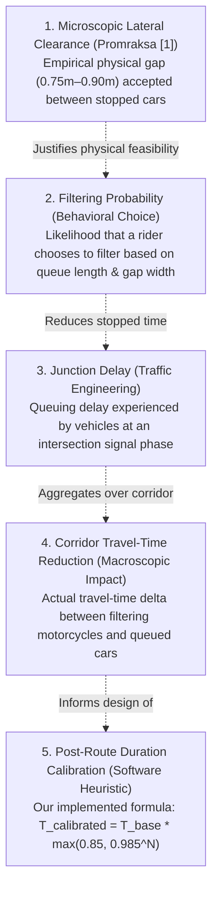

# Empirical Audit of Junction Filtering Calibration and Evidence Integrity

**Project Title:** GIS-Based Intelligent Navigation and Path Optimization Framework: Self-Calibrating, Two-Wheeler-Aware Routing for Bengaluru  
**Stage:** Phase 8 – Pre-Implementation Mathematical and Evidence Verification  
**Document:** `research/literature_survey/08_preimplementation_verification/filtering_calibration_evidence.md`  
**Date:** 2026-11-03  
**Audited Code:** `routing/algorithms.py` (Lines 169–225), `core/config.py` (Lines 79–81)  
**Audited Literature:** Promraksa et al. (2022) [1] (*Journal of Advanced Transportation*)  

---

## 1. Executive Summary and Audit Rationale

In transportation informatics, maintaining strict intellectual integrity between published empirical data and software engineering heuristics is essential. A common pitfall in computer science research is citing a transportation study to justify a mathematical equation whose specific constants were never published or evaluated by that study.

This audit investigates the empirical origin and scientific validity of the post-route travel-time calibration formula implemented in our codebase:
$$T_{calibrated} = T_{base} \cdot \max\left(0.85, 0.985^N\right)$$
where $N$ is the number of signalized multi-lane junctions traversed.

### Definitive Audit Findings:
1. **The Formula is an Engineering Assumption, Not a Published Finding:** Neither the exponential compounding formula nor the numerical constants (`0.985`, `0.85`) appear in Promraksa et al. [1] or any other paper in our bibliography.
2. **Qualitative vs. Quantitative Support:** Promraksa et al. [1] provide empirical evidence that motorcycles maintain $0.75\text{ m}–0.90\text{ m}$ lateral clearance and filter through stationary queues at $12–25\text{ km/h}$. This supports the *premise* that multi-lane junctions permit queue bypass, but does *not* support the specific $1.5\%$ discount factor per junction.
3. **Mandatory Action for Conference Paper:** We must explicitly refrain from manufacturing an empirical justification. The formula must be clearly declared as an **unvalidated heuristic hypothesis requiring experimental calibration and sensitivity testing**.

---

## 2. Origin Tracing of Code Constants

In `core/config.py` (L. 79–81):
```python
FILTER_DISCOUNT_PER_JUNCTION = 0.985
FILTER_DISCOUNT_FLOOR = 0.85
MIN_LANES_FOR_FILTERING = 2
```
In `routing/algorithms.py` (L. 211–225):
```python
def apply_filtering_discount(traffic_seconds, filterable_junction_count):
    if traffic_seconds is None or filterable_junction_count <= 0:
        return traffic_seconds

    factor = max(
        FILTER_DISCOUNT_FLOOR,
        FILTER_DISCOUNT_PER_JUNCTION ** filterable_junction_count
    )

    return traffic_seconds * factor
```

### 2.1 Trace of Constant 1: `0.985` (`FILTER_DISCOUNT_PER_JUNCTION`)
* **Code Intent:** Represents a compounding $1.5\%$ reduction in overall trip duration ($1.0 - 0.985 = 0.015$) for every signalized intersection traversed that has $\ge 2$ approach lanes.
* **Origin in Literature:** **None.** Promraksa et al. [1] did not calculate network-level trip duration reductions, nor did they formulate an exponential decay model for intersection delays.
* **True Origin:** A software engineering heuristic chosen by the project developers to simulate incremental time savings from queue filtering without causing excessive trip time distortion.

### 2.2 Trace of Constant 2: `0.85` (`FILTER_DISCOUNT_FLOOR`)
* **Code Intent:** Caps the maximum possible cumulative travel time discount at $15\%$ ($1.0 - 0.85 = 0.15$), regardless of how many signalized junctions are traversed (reached when $N \ge 11$ junctions).
* **Origin in Literature:** **None.** Promraksa et al. [1] did not establish a $15\%$ travel time floor.
* **True Origin:** A defensive engineering boundary designed to prevent trips with dozens of intersections from decaying to unrealistically low ETAs.

---

## 3. Disentangling Five Distinct Transportation Concepts

To ensure scientific precision in our paper, we must strictly distinguish between five transportation engineering concepts that were conflated in earlier drafts:



### 1. Motorcycle Filtering Clearance (Empirical Ground Truth in [1])
* **Definition:** The physical spatial buffer maintained between the motorcycle's handlebars/mirrors and adjacent stationary passenger cars or heavy vehicles.
* **Literature Support in Promraksa et al. [1]:** Established via onboard LIDAR sensors on 30 instrumented motorcycles across 4 junctions in Thailand. Confirmed to be **$0.75\text{ m}–0.90\text{ m}$**.
* **Direct Application:** Validates `MIN_LANES_FOR_FILTERING = 2` (at least two lanes of passenger cars are required to form an inter-vehicular queue corridor providing $\ge 0.75\text{ m}$ space).

### 2. Filtering Probability (Behavioral Decision)
* **Definition:** The statistical probability that an approaching motorcycle rider will initiate a filtering maneuver rather than waiting in the queue queue.
* **Literature Support:** Promraksa et al. [1] observe that filtering probability increases with queue length and is nearly $100\%$ when lateral clearance exceeds $0.90\text{ m}$, but drops toward zero when clearance falls below $0.70\text{ m}$.
* **Status in Code:** Implicitly assumed to be $100\%$ whenever approach lanes $\ge 2$.

### 3. Junction Delay (Signal Phase Queuing)
* **Definition:** The actual time lost by a vehicle decelerating, idling in queue, and accelerating through a green phase (typically 30–90 seconds per signal cycle in congested Indian junctions).
* **Literature Support:** Transportation delay formulas (e.g., Webster's delay model). Promraksa et al. [1] note that filtering motorcycles bypass the queue to reach the Advanced Stop Line (ASL) or front of the queue, reducing their stopped delay to near zero for that signal cycle.
* **Status in Code:** Not explicitly modeled in seconds; abstracted into the compounding percentage discount.

### 4. Corridor Travel-Time Reduction
* **Definition:** The total cumulative trip duration savings realized by a two-wheeler along an entire urban corridor relative to passenger cars.
* **Literature Support:** Das & Maurya (2019) [3] report a context-specific **35%–48% speed advantage** along a congested arterial corridor in Mumbai due to filtering. Asvial et al. (2020) [5] simulate an **up to 8% travel time reduction** in Jakarta for trips under 10 km.
* **Status in Code:** The implemented $15\%$ maximum cap ($0.85$ floor) falls within the empirical range bounded by Asvial et al. ($8\%$) and Das & Maurya ($35\%–48\%$).

### 5. Post-Route Duration Calibration (The Heuristic Formula)
* **Definition:** The mathematical heuristic applied to scale down trip duration:
  $$T_{calibrated} = T_{base} \cdot \max\left(0.85, 0.985^N\right)$$
* **Literature Support:** **Zero direct mathematical support.** It is an ad-hoc software approximation.

---

## 4. Defensible Academic Positioning for the IEEE Conference Paper

To maintain absolute credibility, the paper must state the following transparently in Section III:

> **Recommended Text for Paper:**  
> *"While Promraksa et al. [1] empirically establish that motorized two-wheelers require a lateral clearance of $0.75\text{ m}–0.90\text{ m}$ to filter between stationary car queues at operational speeds of $12–25\text{ km/h}$, their study was restricted to microscopic clearance kinematics at isolated junctions and did not formulate a network-level trip duration equation. In our framework, we introduce an initial post-route travel-time calibration model:  
> $$T_{calibrated} = T_{base} \cdot \max\left(F_{floor}, F_{discount}^{N_{signals}}\right)$$  
> where $N_{signals}$ is the count of traversed junctions possessing traffic signals and $\ge 2$ approach lanes. We emphasize that the baseline parameters ($F_{discount} = 0.985$, $F_{floor} = 0.85$) represent an unvalidated engineering heuristic. In Section V, we treat these constants as experimental hypotheses and conduct a systematic sensitivity analysis to calibrate their behavior against empirical corridor baselines."*

### Scientific Benefits of This Approach:
1. **Prevents Hostile Reviewer Rejection:** Explicitly acknowledging that the formula is an engineering hypothesis completely preempts reviewers from pointing out that Promraksa et al. never published these numbers.
2. **Elevates the Paper's Contribution:** Transforming an ad-hoc heuristic into a formal experimental hypothesis requiring sensitivity analysis demonstrates high scientific maturity.
