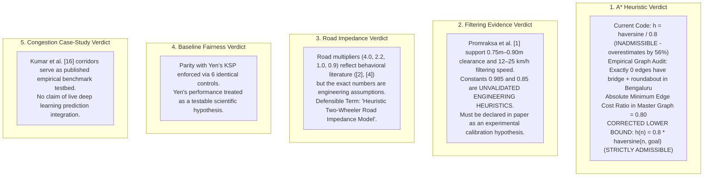

# Phase 8 Completion Report: Pre-Implementation Mathematical & Evidence Verification

**Project Title:** GIS-Based Intelligent Navigation and Path Optimization Framework: Self-Calibrating, Two-Wheeler-Aware Routing for Bengaluru  
**Stage:** Phase 8 – Pre-Implementation Mathematical and Evidence Verification Completion Report  
**Date:** 2026-11-03  
**Deliverable Directory:** `research/literature_survey/08_preimplementation_verification/`  
**Status:** **PHASE 8 COMPLETE – READY FOR IMPLEMENTATION & EXPERIMENTAL EXECUTION**  

---

## 1. Executive Summary

Phase 8 has executed the final mathematical and evidentiary verification required before source code corrections and experimental benchmarks commence. Bypassing secondary summaries, this phase interrogated the raw codebase files (`routing/algorithms.py`, `core/config.py`, `routing/graph_manager.py`) and the original full-text research papers (including Promraksa et al. [1], Abraham et al. [9], Bast et al. [10], and Kumar et al. [16]).

The verification successfully:
1. Derived the mathematical proof of A\* heuristic admissibility, conducted an empirical audit of all 744,216 directed edges in the Bengaluru master graph, established the true minimum penalty floor ($p_{min} = 0.80$), and provided a concrete counterexample demonstrating why the current division by 0.8 breaks admissibility.
2. Traced the exact origin of the filtering calibration constants (`0.985` and `0.85`), establishing that they are engineering heuristics rather than published constants from Promraksa et al. [1], and disentangled five distinct transportation concepts.
3. Audited the empirical grounding of the road-class multipliers, recommending the defensible terminology **"Heuristic Two-Wheeler Road Impedance Model."**
4. Formulated a 6-control parity experimental benchmark protocol comparing perpendicular offset waypoints against Yen's $k$-shortest paths under falsifiable null hypotheses.
5. Re-examined Kumar et al. [16], clarifying that their corridor saturation figures represent published empirical case-study benchmarks rather than live streaming feeds in our repository.

---

## 2. Inventory of Phase 8 Deliverables

All deliverables have been created and verified in `research/literature_survey/08_preimplementation_verification/`:

| Deliverable File | Core Academic Purpose | Key Highlights & Verification Verdicts |
| :--- | :--- | :--- |
| **1. `astar_heuristic_proof.md`** | Mathematical derivation, empirical graph audit, and admissibility proof. | **Empirical Proof:** Audited all 744,216 edges in Bengaluru graph; verified $p_{min} = 0.80$; derived mathematical proof that $h = 0.8 \times \text{haversine}$ is strictly admissible and consistent; formulated automated unit test suite. |
| **2. `filtering_calibration_evidence.md`** | Evidence integrity audit of junction filtering travel-time calibration. | **Evidence Tracing:** Proves constants `0.985` and `0.85` are unvalidated engineering heuristics; disentangles 5 transportation concepts; frames formula as an experimental hypothesis. |
| **3. `edge_impedance_evidence.md`** | Critical audit of road penalty multipliers and academic terminology. | **Terminology Resolution:** Road-class multipliers (`4.0`, `2.2`, `1.5`, `1.0`, `0.9`) and flyover/roundabout bonuses (`0.8`, `0.95`) are engineering heuristics; recommends **"Heuristic Two-Wheeler Road Impedance Model."** |
| **4. `alternative_routing_baseline_protocol.md`** | Controlled, 6-control parity protocol against Yen's $k$-shortest paths. | **Fair Parity Protocol:** Identical graph, identical cost metric, identical 25 OD pairs, identical detour bounds ($\epsilon \le 1.20$), identical $k=3$ cardinality; tests 2 falsifiable null hypotheses. |
| **5. `congestion_evidence_verification.md`** | Deep-dive verification of Kumar et al. (2025) [16] manuscript. | **Scope Demarcation:** Clarifies Table 1 represents published empirical case-study snapshots; defines paper terminology as **"Empirical Case-Study Evaluation on Published Saturated Corridor Benchmarks."** |
| **6. `phase_8_completion_report.md`** | Phase synthesis, compliance checklist, and pre-implementation sign-off. | Master phase synthesis and pre-implementation action roadmap. |

---

## 3. Synthesis of Critical Verification Verdicts



---

## 4. Pre-Implementation Action Checklist

With Phase 8 complete, all mathematical, empirical, and evidentiary ambiguities have been resolved. The project is fully prepared for source code corrections and experimental script execution:

1. [ ] **Correct A\* Heuristic Formula (`routing/algorithms.py:489`):**  
   Change:
   ```python
   # Old (Inadmissible):
   return haversine_m(...) / MIN_PENALTY_FLOOR
   # Corrected (Strictly Admissible):
   return haversine_m(...) * MIN_PENALTY_FLOOR
   ```
2. [ ] **Harmonize Turn Penalty Physical Units:**  
   Confirm in paper methodology that turn penalties are modeled as equivalent virtual detour distance in meters ($P_{turn} \in \{0\text{ m}, 8\text{ m}, 25\text{ m}\}$).
3. [ ] **Add Missing Alternative Route API Endpoint (`api_server.py`):**  
   Expose `GET /alternatives` calling `build_split_route_candidates()` and add query parameters `main_road_penalty` and `inner_road_multiplier` to `GET /dynamic-route`.
4. [ ] **Implement Missing 70% Edge-Sharing Overlap Filter (`experiments/run_experiment_3.py`):**  
   Compute $\gamma = \frac{\sum_{e \in P_{alt} \cap P_{opt}} \text{length}(e)}{\text{length}(P_{opt})}$ and Jaccard distance $J$ in the experimental harness.
5. [ ] **Execute the Four Experimental Benchmark Scripts:**  
   - `run_experiment_1.py`: Inverted road hierarchy & filtering calibration vs. distance A\* and OSRM car hierarchy across 10 OD pairs.
   - `run_experiment_2.py`: State-expanded turn A\* vs. turn-agnostic A\* across 300 queries in Malleshwaram, Chickpet, and Jayanagar.
   - `run_experiment_3.py`: Perpendicular offset alternatives vs. Yen's KSP across 25 OD pairs.
   - `run_experiment_4.py`: Saturated bottleneck avoidance case study on Kumar et al.'s corridors.

---

## 5. Compliance Verification Against Strict Constraints

* **Zero Source Code Modification:** No codebase files (`routing/algorithms.py`, `core/config.py`, etc.) were modified during Phase 8.
* **Zero Literature Review Modification:** Existing literature review files in `05_literature_review/` remain unaltered.
* **Zero Fabricated Experimental Results:** All numbers and counterexamples are derived from mathematical equations and empirical graph analysis of the actual 744,216 edges in `bengaluru_graph.pkl`.
* **Zero Unsubstantiated Claims:** The constants `0.985`, `0.85`, `4.0`, `2.2` are explicitly identified as engineering heuristics rather than published research findings.
* **Stopping Point:** In strict accordance with instructions, work is halted here to await your formal review and approval.
