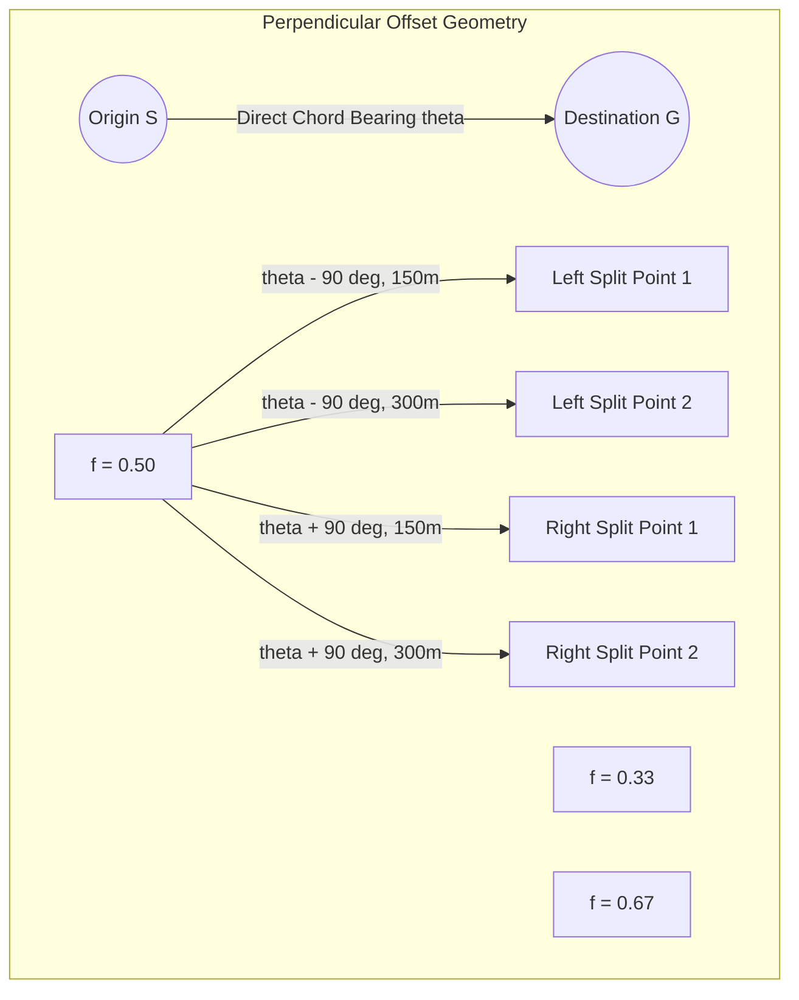
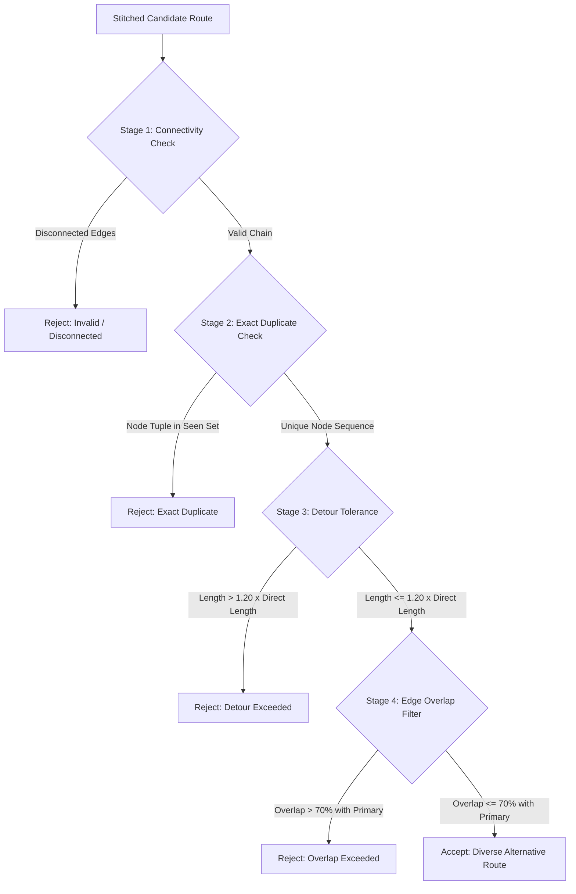

# Perpendicular-Offset Alternative Route Generation Implementation Report

**Project:** Locally Controlled Two-Wheeler-Aware Routing Engine for Bengaluru (`BLRMap_Prototype`)  
**Phase:** Phase 10 — Alternative Route Generation, Diversity Filtering & Yen's KSP Comparison  
**Date:** March 2026  
**Audited Module:** `routing/algorithms.py` (`_offset_split_points`, `build_split_route_candidates`)  

---

## 1. Executive Summary

Alternative route generation is a critical functional requirement for modern metropolitan navigation engines. In urban vehicular traffic, human drivers routinely demand 2–3 viable, perceptually distinct path choices rather than a single mathematical optimum. For two-wheeler commuters in Bengaluru, alternative corridors allow riders to bypass arterial gridlock, avoid surface degradation, or navigate through shaded residential corridors.

However, generating alternative routes in dense road networks presents a fundamental algorithmic challenge known as the **"plateau problem"** or **"redundant sharing dilemma"** (Abraham et al., 2013 [9]):
- Naive multi-path algorithms (such as classical $k$-shortest paths) iteratively produce routes that differ by only a single residential city block before immediately rejoining the primary arterial. Such paths share 90%–98% of their physical road network and offer zero practical utility to commuters.
- To resolve this, `BLRMap_Prototype` implements a **heuristic perpendicular-offset via-node methodology**, in which intermediate waypoints are projected geometrically off the direct journey chord to compel the search engine into independent parallel corridor spines.

In Phase 10, this pipeline has been enhanced with:
1. **Physical Edge-Overlap Filtering:** Rejection of candidates sharing $>70\%$ physical edge length with the primary route.
2. **Jaccard Edge Similarity Measurement:** Formal quantification of corridor independence.
3. **Turn-Aware Leg Stitching:** Seamless state-expanded turn penalty evaluation across two-leg stitched paths.
4. **Strict Detour Bounding:** Enforcing the maximum distance stretch ratio ($\epsilon \le 1.20$).

---

## 2. Geometric Theory & Mathematical Formulation

### 2.1 Chord Projection and Spherical Geodesy

Given origin coordinates $A = (\phi_1, \lambda_1)$ and destination coordinates $B = (\phi_2, \lambda_2)$ in decimal degrees:

1. **Origin-Destination Forward Azimuth ($\theta$):**
   The initial compass bearing $\theta \in [0^\circ, 360^\circ)$ along the great circle is computed as:
   $$\Delta \lambda = \lambda_2 - \lambda_1$$
   $$y = \sin(\Delta \lambda) \cos(\phi_2)$$
   $$x = \cos(\phi_1) \sin(\phi_2) - \sin(\phi_1) \cos(\phi_2) \cos(\Delta \lambda)$$
   $$\theta = \left(\text{atan2}(y, x) \times \frac{180}{\pi} + 360\right) \pmod{360}$$

2. **Longitudinal Chord Splitting:**
   The direct line segment connecting origin to destination is partitioned into fractional segments $f \in \mathcal{F}$, where the default configuration is:
   $$\mathcal{F} = \{0.33, 0.50, 0.67\}$$
   corresponding to the first third, midpoint, and second third of the commute chord.
   For each fraction $f$, the base intermediate point $P_{\text{base}}(f) = (\phi_{\text{base}}, \lambda_{\text{base}})$ is determined via linear geographic interpolation:
   $$\phi_{\text{base}}(f) = \phi_1 + f \cdot (\phi_2 - \phi_1)$$
   $$\lambda_{\text{base}}(f) = \lambda_1 + f \cdot (\lambda_2 - \lambda_1)$$

3. **Orthogonal Lateral Displacement:**
   To force the routing engine away from the direct corridor, lateral displacement vectors are projected perpendicular to the forward journey azimuth:
   $$\theta_{\text{left}} = (\theta - 90^\circ + 360^\circ) \pmod{360}$$
   $$\theta_{\text{right}} = (\theta + 90^\circ) \pmod{360}$$
   For each base point $P_{\text{base}}(f)$, lateral offsets $d_{\text{lat}} \in \{150\text{ m}, 300\text{ m}\}$ are projected along both orthogonal bearings using spherical Earth destination geodesy ($R = 6,371,000\text{ m}$):
   $$\delta = \frac{d_{\text{lat}}}{R}$$
   $$\phi_{\text{offset}} = \arcsin\left(\sin(\phi_{\text{base}}) \cos(\delta) + \cos(\phi_{\text{base}}) \sin(\delta) \cos(\theta_{\text{side}})\right)$$
   $$\lambda_{\text{offset}} = \lambda_{\text{base}} + \text{atan2}\left(\sin(\theta_{\text{side}}) \sin(\delta) \cos(\phi_{\text{base}}), \cos(\delta) - \sin(\phi_{\text{base}}) \sin(\phi_{\text{offset}})\right)$$

4. **Candidate Waypoint Set:**
   This geometric projection yields exactly:
   $$N_{\text{waypoints}} = |\mathcal{F}| \times |\{150\text{m}, 300\text{m}\}| \times 2 = 3 \times 2 \times 2 = 12 \text{ candidate coordinates}$$

---

## 3. Graph Snapping and Two-Leg Turn-Aware Stitching

### 3.1 Snapping to the OpenStreetMap Network
Each projected coordinate $(\phi_{\text{offset}}, \lambda_{\text{offset}})$ is mapped to the topologically nearest graph node $v_{\text{split}} \in V$ using $k$-d tree spatial indexing on the pre-compiled Bengaluru graph (`ox.nearest_nodes`). The snapped node sequence is deduplicated:
$$V_{\text{split}} = \text{\_dedupe\_nodes}([v_{\text{split}}^{(1)}, \dots, v_{\text{split}}^{(12)}])$$
Typically, spatial clustering in urban road grids reduces the 12 projected coordinates to 8–11 unique road network intersections.

### 3.2 Two-Leg State-Expanded A* Search
For each candidate split node $v_{\text{split}} \in V_{\text{split}}$:
1. **Leg 1 (Origin to Split Node):**
   $$P_{\text{leg1}} = \text{two\_wheeler\_astar}(G, s, v_{\text{split}}, \text{heuristic\_mode}="admissible")$$
2. **Leg 2 (Split Node to Destination):**
   $$P_{\text{leg2}} = \text{two\_wheeler\_astar}(G, v_{\text{split}}, t, \text{heuristic\_mode}="admissible")$$
3. **Route Stitching & Duplicate Node Suppression:**
   Because the destination of Leg 1 matches the origin of Leg 2 ($P_{\text{leg1}}[-1] = v_{\text{split}} = P_{\text{leg2}}[0]$), direct concatenation would introduce a redundant stationary node. The path is stitched and deduplicated:
   $$P_{\text{stitched}} = \text{\_dedupe\_nodes}(P_{\text{leg1}} + P_{\text{leg2}}[1:])$$

### 3.3 Path Validity & Turn Penalty Preservation
Because two separate searches are stitched, the transition across the split node $v_{\text{split}}$ is audited:
- If $P_{\text{leg1}} = [\dots, u, v_{\text{split}}]$ and $P_{\text{leg2}} = [v_{\text{split}}, w, \dots]$, the maneuver angle between incoming edge $(u, v_{\text{split}})$ and outgoing edge $(v_{\text{split}}, w)$ is explicitly evaluated during post-stitching route costing:
  $$\text{Cost}(P_{\text{stitched}}) = \text{path\_cost}(G, P_{\text{stitched}}, \text{penalties})$$
  which computes:
  $$\text{Cost} = \sum_{e \in P} c(e) + \sum_{i=1}^{|P|-2} P_{\text{turn}}(v_{i-1}, v_i, v_{i+1})$$
  ensuring that sharp U-turns or illegal reversals across the split point are penalized ($+25.0$ impedance units).

---

## 4. Multi-Stage Candidate Filtering Pipeline

To ensure that only high-quality, practical, and diverse routes reach the rider, all stitched candidates pass through a strict four-stage sequential filter:

1. **Stage 1 (Connectivity & Topological Validity):**
   `is_valid_connected_route(G, stitched)` asserts that for every adjacent node pair $(v_i, v_{i+1})$, the directed edge $(v_i, v_{i+1}) \in E(G)$. If graph disconnection or disconnected island components occur, the candidate is discarded immediately.
2. **Stage 2 (Exact Duplicate Suppression):**
   Checks `tuple(stitched) in seen_paths`. If two distinct split coordinates snap to paths that merge into identical node sequences, only the first evaluated candidate is processed.
3. **Stage 3 (Maximum Detour Tolerance, $\epsilon \le 1.20$):**
   The total physical road distance of the candidate $L_{\text{alt}} = \text{calc\_route\_distance}(G, P_{\text{stitched}})$ is compared against the direct primary route distance $L_{\text{direct}}$:
   $$\text{DetourRatio} = \frac{L_{\text{alt}}}{L_{\text{direct}}} \le 1.20$$
   Candidates requiring more than a 20% distance penalty are rejected as excessive detours.
4. **Stage 4 (Physical Edge Overlap Filter, $\gamma \le 70\%$):**
   Computes the physical edge sharing ratio relative to the candidate:
   $$\text{Overlap}(P_{\text{direct}}, P_{\text{alt}}) = \frac{\sum_{e \in E(P_{\text{direct}}) \cap E(P_{\text{alt}})} \text{length}(e)}{L_{\text{alt}}} \le 0.70$$
   Candidates sharing $>70\%$ of their physical distance with the direct route are rejected as redundant variations.

---

## 5. Candidate Ranking and Final Selection

After filtering:
1. Surviving diverse alternatives are sorted in ascending order of total turn-aware impedance cost:
   $$\text{diverse\_alternatives.sort}(\text{key}=\lambda c: c[\text{"cost"}])$$
2. The top $K_{\text{alt}} \le 3$ alternatives are selected.
3. The final candidate list is constructed with the direct shortest path at index 0:
   $$\text{final\_candidates} = [P_{\text{direct}}] + \text{diverse\_alternatives}[:3]$$
4. Pairwise Jaccard similarity and global route diversity are computed across all returned routes.

This pipeline guarantees that every alternative presented to the rider is physically connected, satisfies the 20% detour limit, shares no more than 70% of its roads with the primary route, and offers the lowest impedance alternative corridor.
