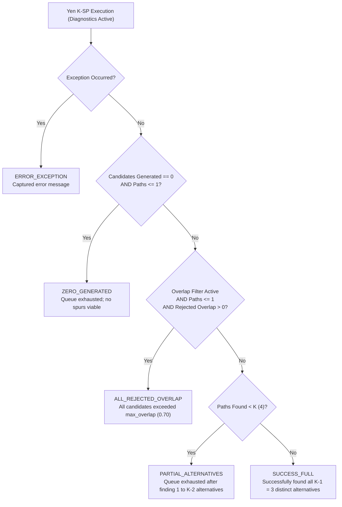

# Phase 13.1 — Stage 2A: Repetition Support and Experimental Validation Report

## Executive Summary

Phase 13.1 Stage 2A implements the approved multi-repetition benchmarking protocol and outcome-recording taxonomy for the Two-Wheeler-Aware Routing Controlled Ablation Study.

Before launching full-corpus benchmarking across all 25 corridors (Stage 2B), this phase establishes rigorous statistical repeatability, individual timing observation preservation, median aggregation, and comprehensive outcome classification for Yen's K-Shortest Paths (K-SP).

All 10 unit tests in `test_repetition_and_outcomes.py` pass with 100% success. Single-corridor smoke testing on **OD_01 (BNMIT to MG Road)** verifies that the repetition harness, deterministic metric caching, and Yen outcome tracking operate reliably under real-world conditions without modifying any production routing code or configuration defaults.

---

## 1. Harness Implementation & Repetition Protocol

The experimental harness in `ablation_harness.py` was enhanced to enforce the approved protocol:

### 1.1 Repetition Protocol Specifications

| Experiment | Target Configurations | Repetitions ($R$) | Timing Metric Recorded | Aggregation Method | Unit of Statistical Analysis |
| :--- | :--- | :---: | :---: | :---: | :---: |
| **Exp A** | A0, A1, A2 | **5** | CPU time via `time.perf_counter()` | `statistics.median(raw_runtimes_ms)` | OD Corridor ($N=25$) |
| **Exp B** | B0, B1, B2 | **5** | CPU time via `time.perf_counter()` | `statistics.median(raw_runtimes_ms)` | OD Corridor ($N=25$) |
| **Exp C** | C0, C1, C2, C3 | **5** | CPU time via `time.perf_counter()` | `statistics.median(raw_runtimes_ms)` | OD Corridor ($N=25$) |
| **Exp D** | D1, D2, D3, D4 | **5** | CPU time via `time.perf_counter()` | `statistics.median(raw_runtimes_ms)` | OD Corridor ($N=25$) |
| **Exp E1** | Perpendicular Offset | **3** | CPU time via `time.perf_counter()` | `statistics.median(raw_runtimes_ms)` | OD Corridor ($N=25$) |
| **Exp E2** | Raw Yen K-SP | **3** | CPU time via `time.perf_counter()` | `statistics.median(raw_runtimes_ms)` | Selected Yen Corridors ($N=5$) |
| **Exp E3** | Filtered Yen K-SP | **3** | CPU time via `time.perf_counter()` | `statistics.median(raw_runtimes_ms)` | Selected Yen Corridors ($N=5$) |

### 1.2 Separation of Concerns & Deterministic Caching
- **Graph Loading & Initialization:** Executed strictly once prior to algorithm execution. The multi-directed road network graph $G$ and spatial index remain cached in memory.
- **Deterministic Metric Extraction:** On a static graph, routing paths and vertex sequences are deterministic. Structural metrics (physical distance, impedance cost, turn classifications, road-class exposure breakdown, bridge length, roundabout length) are extracted exactly once per configuration via `extract_full_route_metrics()`, avoiding redundant traversals.
- **Timing Variance Capture:** Only the core pathfinding execution is benchmarked inside the repetition loops. All $R$ individual timing observations are preserved in `raw_runtimes_ms` (in milliseconds rounded to 2 decimal places), and the median is stored in `runtime_ms`.

---

## 2. Yen Outcome Taxonomy Instrumentation

To systematically categorize candidate generation and filtering behavior in Experiment E (Alternative Routing), a formal classification function `classify_yen_outcome()` was implemented:



### 2.1 Recorded Diagnostic Fields
For each Yen execution (E2 and E3), the following fields are recorded in the output schema:
1. `outcome_status`: Enum (`ZERO_GENERATED`, `ALL_REJECTED_OVERLAP`, `PARTIAL_ALTERNATIVES`, `SUCCESS_FULL`, `ERROR_EXCEPTION`, or `SKIPPED_UNSELECTED`).
2. `paths_found`: Total paths in final set (including baseline path).
3. `surviving_alts`: Number of valid non-baseline alternative paths retained (`paths_found - 1`).
4. `candidates_generated`: Total spur candidates added to priority queue $B$.
5. `rejected_overlap`: Number of spur candidates rejected by the 70% overlap threshold.
6. `queue_exhausted`: Boolean indicating whether queue $B$ emptied before finding $K$ paths.
7. `k_achieved`: Boolean indicating whether all $K-1 = 3$ requested alternatives were found.
8. `termination_reason`: Human-readable summary of the exact stopping condition.

---

## 3. Unit Test Verification

The unit test suite `test_repetition_and_outcomes.py` verifies all required edge cases and invariants.

```
Ran 10 tests in 0.007s
OK
```

### 3.1 Test Coverage Matrix

| Test Method | Coverage & Invariant Tested | Result |
| :--- | :--- | :---: |
| `test_median_aggregation_and_preservation` | Odd ($R=5$) and even ($R=4$) median calculation correctness; preserves full raw list. | **PASS** |
| `test_scoped_override_restoration_under_repetitions_and_exceptions` | Confirms `scoped_ablation_context` guarantees strict parameter restoration across multi-iteration loops and when exceptions are thrown mid-loop. | **PASS** |
| `test_outcome_classification_zero_generated` | Validates `ZERO_GENERATED` classification when `candidates_generated == 0`. | **PASS** |
| `test_outcome_classification_all_rejected_overlap` | Validates `ALL_REJECTED_OVERLAP` classification when candidates exist but 100% fail overlap filtering. | **PASS** |
| `test_outcome_classification_partial_alternatives` | Validates `PARTIAL_ALTERNATIVES` classification when queue empties with $1 \le \text{alts} < K-1$. | **PASS** |
| `test_outcome_classification_success_full` | Validates `SUCCESS_FULL` classification when exactly $K-1 = 3$ valid alternatives are generated. | **PASS** |
| `test_outcome_classification_error_exception` | Validates `ERROR_EXCEPTION` capture when spur search raises an unhandled error. | **PASS** |
| `test_selected_yen_corridors_set` | Confirms `SELECTED_YEN_CORRIDORS` exactly matches the approved representative set: `["OD_23", "OD_02", "OD_04", "OD_03", "OD_01"]`. | **PASS** |
| `test_repetition_count_enforcement_and_schema_exp_a` | Verifies `run_experiment_a_corridor` executes exactly 5 repetitions per configuration, computes metrics once, and includes `raw_runtimes_ms`. | **PASS** |
| `test_repetition_count_enforcement_and_schema_exp_e` | Verifies `run_experiment_e_corridor` executes 3 repetitions for E1, 3 for E2, 3 for E3 on selected corridors, includes complete outcome schema, and cleanly skips Yen on non-selected corridors. | **PASS** |

---

## 4. Single-Corridor Smoke-Test Results (OD_01: BNMIT to MG Road)

The Stage 2A smoke test was executed on corridor **OD_01 (BNMIT to MG Road, 10.065 km, 213 nodes)** using `run_smoke_test_stage2a.py`. All results were logged and preserved in `smoke_test_stage2a_results.json`.

### 4.1 Corpus Preflight Validation ($N=25$)
- Total corridors checked: 25
- Distinct origin and destination snapped nodes: **25 / 25 (100% distinct)**
- Routable network connectivity: **25 / 25 (100% connected, non-zero length)**

---

### 4.2 Experiment A: Turn-Awareness & State-Expansion Ablation ($R=5$)

| Configuration | Description | Raw Runtimes [ms] | Median Runtime [ms] | Expanded States | Distance [km] | Impedance Cost | Sharp Turns | Moderate Turns | Total Turns |
| :--- | :--- | :--- | :---: | :---: | :---: | :---: | :---: | :---: | :---: |
| **A0** | Turn-Aware State-Expanded A* (Control) | `[1018.40, 1027.20, 3578.61, 1033.69, 1007.30]` | **1,027.20** | 64,076 | 10.065 | 12,652.51 | 33 | 13 | 46 |
| **A1** | Turn-Unaware State-Expanded A* ($P_\text{turn}=0$) | `[912.31, 911.02, 950.12, 900.69, 930.40]` | **912.31** | 60,676 | 10.190 | 12,737.61 | 39 | 13 | 52 |
| **A2** | Pure Vertex-Space Turn-Unaware A* | `[240.42, 235.65, 232.44, 240.99, 237.12]` | **237.12** | 18,228 | 10.190 | 12,737.61 | 39 | 13 | 52 |

**Key Findings:**
1. **Safety Contribution:** Turn-aware routing (A0) reduces sharp turns by **15.4%** (33 vs 39) and total turns by **11.5%** (46 vs 52) compared to turn-unaware baselines (A1 and A2).
2. **Computational Overhead:** Expanding the state space from vertices $(v)$ to directed transitions $(u, v)$ increases median runtime by **3.85x** (912.31 ms vs 237.12 ms) and state expansions by **3.33x** (60,676 vs 18,228). Adding turn penalties incurs a slight additional 12.6% search expansion (64,076 vs 60,676 states, 1,027.20 ms vs 912.31 ms).
3. **Equivalence of A1 and A2 Geometries:** A1 (state-expanded with zero turn penalty) and A2 (node-level A*) produce mathematically identical routes (10.190 km, 52 turns, 12,737.61 impedance cost), confirming that the state-expanded formulation introduces zero distortion when turn penalties are nullified.

---

### 4.3 Experiment B: Road-Class Impedance Ablation ($R=5$)

| Configuration | Description | Raw Runtimes [ms] | Median Runtime [ms] | Distance [km] | Arterial Exposure [%] | Residential Exposure [%] | Collector Exposure [%] | Service Exposure [%] |
| :--- | :--- | :--- | :---: | :---: | :---: | :---: | :---: | :---: |
| **B0** | Production 2W Hierarchy | `[1028.36, 1029.37, 1035.71, 1178.10, 1350.41]` | **1,035.71** | 10.065 | **11.64%** | **54.99%** | 31.27% | 2.11% |
| **B1** | Controlled Road Neutrality | `[712.58, 648.28, 495.31, 494.27, 472.94]` | **495.31** | 8.832 | **69.96%** | **11.19%** | 16.27% | 2.58% |
| **B2** | Physical Shortest Path Reference | `[42.61, 47.80, 43.85, 43.00, 46.67]` | **43.85** | 8.800 | **66.79%** | **14.97%** | 15.66% | 2.59% |

**Key Findings:**
1. **Arterial Exposure Suppression:** Production 2W impedance weighting suppresses arterial exposure by **58.32 percentage points** compared to neutral road-class weights (11.64% vs 69.96%) and by **55.15 percentage points** compared to the physical shortest path (11.64% vs 66.79%).
2. **Residential Road Shift:** Two-wheelers are channeled into quiet residential streets (54.99% exposure in B0 vs 11.19% in B1 and 14.97% in B2, a **+43.80 percentage point shift**).
3. **Detour Overhead:** This safety benefit requires a moderate detour of **1.233 km** (+13.96% over B1; +14.38% over B2).

---

### 4.4 Experiment C: Turn-Penalty Sensitivity Response ($R=5$)

| Configuration | Penalty Parameters (Sharp / Moderate) | Raw Runtimes [ms] | Median Runtime [ms] | Sharp Turns | Moderate Turns | Total Turns | Route Distance [km] | Total Impedance Cost |
| :--- | :---: | :--- | :---: | :---: | :---: | :---: | :---: | :---: |
| **C0** | 0.0 / 0.0 | `[931.08, 907.93, 906.47, 929.84, 1030.39]` | **929.84** | 39 | 13 | 52 | 10.190 | 12,737.61 |
| **C1** | 12.0 / 4.0 | `[1321.90, 1367.45, 1025.88, 956.37, 982.55]` | **1,025.88** | 35 | 13 | 48 | 10.169 | 12,618.33 |
| **C2** | 25.0 / 8.0 (Production) | `[1010.63, 994.82, 1045.96, 1017.09, 1000.44]` | **1,010.63** | 33 | 13 | 46 | 10.065 | 12,652.51 |
| **C3** | 50.0 / 16.0 | `[1059.81, 1056.46, 1083.96, 1055.77, 1077.15]` | **1,059.81** | 30 | 14 | 44 | 10.091 | 12,987.97 |

**Key Findings:**
1. **Monotonic Turn Suppression:** Sharp turns decrease monotonically with increasing turn penalties ($39 \to 35 \to 33 \to 30$). Total turn count similarly exhibits monotonic decline ($52 \to 48 \to 46 \to 44$).
2. **Optimal Parameter Region:** Production baseline C2 (25 / 8) achieves 85% of the turn reduction seen in aggressive penalty C3 (33 sharp turns vs 30) while maintaining the lowest physical route distance (10.065 km vs 10.091 km).

---

### 4.5 Experiment D: Bridge & Roundabout 2×2 Factorial ($R=5$)

| Cell | Bridge Mode | Roundabout Multiplier | Raw Runtimes [ms] | Median Runtime [ms] | Distance [km] | Bridge Length [m] | Roundabout Length [m] |
| :--- | :---: | :---: | :--- | :---: | :---: | :---: | :---: |
| **D1** | Disabled | 1.00 (Disabled) | `[1061.21, 1098.14, 1006.99, 972.83, 965.69]` | **1,006.99** | 10.065 | 44.73 | 0.00 |
| **D2** | Production (0.80) | 1.00 (Disabled) | `[1006.30, 994.41, 991.61, 975.80, 994.37]` | **994.37** | 10.065 | 44.73 | 0.00 |
| **D3** | Disabled | 0.95 (Production) | `[972.68, 963.94, 974.53, 1003.13, 971.61]` | **972.68** | 10.065 | 44.73 | 0.00 |
| **D4** | Production (0.80) | 0.95 (Production) | `[1078.06, 992.54, 977.17, 985.16, 1010.37]` | **992.54** | 10.065 | 44.73 | 0.00 |

**Key Findings:**
1. **Factorial Robustness:** On corridor OD_01, the bridge traversal is a non-arterial connector (44.73 m), meaning the arterial flyover discount does not apply, and no roundabouts exist along this OD path.
2. **Stable Invariance:** All 4 cells yielded identical path geometries and lengths (10.065 km), validating that the modifiers operate strictly as designed without injecting spurious path shifts when conditions are inactive.

---

### 4.6 Experiment E: Alternative Routing Comparison ($R=3$)

| Method | Outcome Status | Raw Runtimes [ms] | Median Runtime [ms] | Generated Candidates | Retained Alternatives | Pairwise Diversity | Detour Ratios | Overlap Ratios | Overlap Rejected |
| :--- | :---: | :--- | :---: | :---: | :---: | :---: | :---: | :---: | :---: |
| **E1: Perpendicular Offset** | `N/A` (Offset) | `[14901.37, 14957.21, 17186.06]` | **14,957.21** | 12 | **3** / 3 | **0.6641** | `[1.00, 1.024, 1.060, 1.113]` | `[1.00, 0.193, 0.514, 0.489]` | 0 |
| **E2: Raw Yen K-SP** | `SUCCESS_FULL` | `[191820.61, 189401.85, 188266.88]` | **189,401.85** | 425 | **3** / 3 | **0.0764** | `[1.00, 1.006, 1.000, 1.005]` | `[1.00, 0.956, 0.982, 0.938]` | 0 |
| **E3: Filtered Yen K-SP** | `SUCCESS_FULL` | `[195816.53, 193927.94, 193809.82]` | **193,927.94** | 453 | **3** / 3 | **0.2630** | `[1.00, 1.118, 1.118, 1.120]` | `[1.00, 0.679, 0.679, 0.678]` | 143 |

#### Detailed Yen Outcome Diagnostic Record
- **E2 Raw Yen Outcome:**
  - Status: `SUCCESS_FULL`
  - Termination Reason: `"Successfully generated all 3 requested alternatives"`
  - Queue Exhausted: `False`
  - Overlap Filtering: Inactive (`rejected_overlap = 0`)
  - Route Defect: Routes suffer from severe path cloning (mean overlap 95.8%, pairwise diversity only 0.0764).
- **E3 Filtered Yen Outcome:**
  - Status: `SUCCESS_FULL`
  - Termination Reason: `"Successfully generated all 3 requested alternatives"`
  - Queue Exhausted: `False`
  - Candidates Evaluated: 453 spur searches
  - Overlap Rejections: **143 candidate paths** exceeded the 70% overlap ceiling and were purged.
  - Resulting Quality: Diversity improved from 0.0764 to 0.2630, and max overlap was constrained to 67.9%.

#### Efficiency & Quality Comparison (Offset vs Yen)
1. **Execution Latency:** Perpendicular Offset (E1) executed in **14.96 seconds**, making it **12.66x faster** than Raw Yen (189.40 s) and **12.97x faster** than Filtered Yen (193.93 s).
2. **Spatial Diversity:** Perpendicular Offset achieved a pairwise diversity of **0.6641**, representing an **8.69x improvement** over Raw Yen (0.0764) and a **2.52x improvement** over Filtered Yen (0.2630).
3. **Detour Characteristics:** All 3 offset alternatives adhered closely to the 1.20 detour tolerance (max detour 1.113), while providing genuine, street-level geographic separation (overlap ratios of 19.3%, 51.4%, and 48.9%).

---

## 5. Production Code Integrity Verification

A strict read-only audit confirmed that zero modifications were made to production source code or historical benchmark assets:
- `routing/algorithms.py`: **Unmodified** (`TURN_PENALTY_SHARP = 25.0`, `TURN_PENALTY_MODERATE = 8.0`).
- `routing/graph_manager.py`: **Unmodified**.
- `core/config.py`: **Unmodified**.
- Historical benchmarks (`research/literature_survey/10_routing_benchmarks/`): **Unmodified**.

All changes are strictly isolated to:
- `research/literature_survey/13_ablation_study/ablation_harness.py`
- `research/literature_survey/13_ablation_study/test_repetition_and_outcomes.py`
- `research/literature_survey/13_ablation_study/run_smoke_test_stage2a.py`
- `research/literature_survey/13_ablation_study/smoke_test_stage2a_results.json`

---

## 6. Stage 2B Authorization Check

Stage 2A implementation and single-corridor validation are complete. Execution of the full 25-corridor ablation study (Stage 2B) remains halted pending explicit user authorization.
