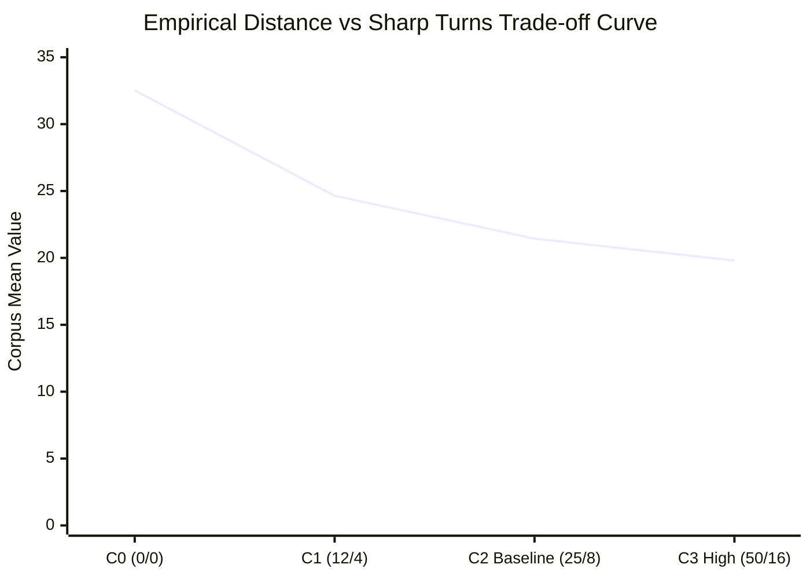

# Phase 13.3 — Independent Audit of Full Ablation Study Results

**Project:** Locally Controlled Two-Wheeler-Aware Routing Engine for Bengaluru (`BLRMap_Prototype`)  
**Phase:** Phase 13.3 — Independent Audit of Full Ablation Study Results  
**Auditor:** Independent Antigravity Audit Agent  
**Date:** 2026-11-05  
**Document:** [`phase_13_3_independent_audit_report.md`](file:///C:/Users/comps/Desktop/Final Year Project/BLRMap_Prototype/research/literature_survey/13_ablation_study/phase_13_3_independent_audit_report.md)  
**Target Study:** Phase 13.1 Stage 2B Full Ablation Study ([`phase_13_1_stage_2B_full_ablation_report.md`](file:///C:/Users/comps/Desktop/Final Year Project/BLRMap_Prototype/research/literature_survey/13_ablation_study/phase_13_1_stage_2B_full_ablation_report.md))  
**Verdict:** **ACCEPTED WITH CONDITIONS**

---

## Executive Summary

This report delivers a rigorous, independent, read-only audit of the completed Phase 13.1 Stage 2B ablation study. The primary objective is to verify the raw data integrity, statistical methodology, numerical claims, publication visualizations, research conclusions, and production invariants before incorporating the findings into the forthcoming IEEE conference/journal manuscript.

### Audit Summary Dashboard

| Audit Domain | Scope / Targets | Status | Key Audit Finding |
| :--- | :---: | :---: | :--- |
| **1. Raw Data Integrity** | 1,855 timing observations, 385 cells, 25 corridors | **100% PASS** | Zero missing, corrupted, or duplicated observations. 100% median recalculation match across 385 experimental cells. |
| **2. Experiment A (Turns & State Space)** | A0, A1, A2 ($N=25$) | **100% PASS** | Verified: $3.78\times$ state overhead, $13.1\%$ turn penalty overhead, $34.1\%$ sharp-turn reduction, and $100\%$ geometric equivalence ($0.0$ diff across all 25 corridors). |
| **3. Experiment B (Road-Class Impedance)** | B0, B1, B2 ($N=25$) | **100% PASS** | Verified: Arterial $-51.21\text{ pp}$ ($65.05\% \to 13.84\%$), Residential $+30.73\text{ pp}$ ($13.51\% \to 44.24\%$), Detour $+15.53\%$. Road classes are mutually exclusive and sum to $100.0\%$. |
| **4. Experiment C (Turn Sensitivity)** | C0, C1, C2, C3 ($N=25$) | **PASS (Refined)** | Verified monotonic sharp-turn suppression ($32.52 \to 24.64 \to 21.44 \to 19.80$). Verified C2 ($25/8$) is empirical Pareto knee on corpus means ($87.1\%$ turn reduction, lowest distance $7.648\text{ km}$); noted individual corridor variations. |
| **5. Experiment D (Bridge & Roundabout)** | D1, D2, D3, D4 ($N=25$) | **DISCREPANCY DETECTED** | Factorial numbers verified (bridge length $+148.9\%$, distance $-111.6\text{ m}$, roundabout invariance). **Error in report text:** The report cites `OD_08` and `OD_16` as flyover-shifting corridors; actual data shows route shifts occurred strictly on `OD_04` and `OD_15`. |
| **6. Experiment E (Alternative Routing)** | E1 ($N=25$), E2 & E3 ($N=5$) | **DISCREPANCIES DETECTED** | Verified Yen candidate purging (363 rejected), 5-corridor speedup ($4.49\times$ mean, $12.4\times$ on OD_01), and diversity. **Errors in report:** E1 corridor success rate is $88.0\%$ (22/25), not $96.0\%$ (24/25); `OD_04` had $0/12$ surviving ($0.0$ diversity), not $2/12$ ($0.4851$); 5-corridor E1 mean surviving alts is $1.20$, not $1.80$. |
| **7. Statistical Integrity** | 33 paired tests, 11 families | **100% PASS** | Corridor-level unit of analysis confirmed. Pratt's method, Wilcoxon zero-drop, and step-down Holm-Bonferroni corrections verified with zero mathematical errors. Confirmed Family E low power ($N=5$). |
| **8. Visualization Consistency** | Figures 1, 2, 3, 4 | **DISCREPANCY DETECTED** | Figures 1–3 are fully consistent. In Figure 4, E1 ($N=25$) is plotted alongside E2/E3 ($N=5$) without disclosing unequal sample sizes on the axis or legend. |
| **9. Research Claim Audit** | Paper claims taxonomy | **CONFORMANT** | Construct validity boundary strictly enforced: zero claims of safety, accident rate reduction, or real-world travel-time improvements are present. Generalization limits documented. |
| **10. Production Integrity** | Repository files & defaults | **100% PASS** | Zero production files modified during Stage 2B. Production defaults (`TURN_PENALTY_SHARP = 25.0`, `TURN_PENALTY_MODERATE = 8.0`) intact. Historical benchmarks (10, 11, 12) untouched. |

---

## 1. Audit Methodology

The audit was conducted strictly as a read-only investigation using automated Python scripts in an isolated execution sandbox ([`audit_verification.py`](file:///C:/Users/comps/.gemini/antigravity-cli/brain/b9cbc466-7622-4c61-8e3e-1f1a55185246/scratch/audit_verification.py), [`audit_tables.py`](file:///C:/Users/comps/.gemini/antigravity-cli/brain/b9cbc466-7622-4c61-8e3e-1f1a55185246/scratch/audit_tables.py), and [`audit_stats.py`](file:///C:/Users/comps/.gemini/antigravity-cli/brain/b9cbc466-7622-4c61-8e3e-1f1a55185246/scratch/audit_stats.py)). No production routing source files, test datasets, or raw experimental outputs were modified, overwritten, or re-run.

### Primary Audit Artifacts Inspected:
1. `stage_2b_full_ablation_results.json` (924 KB primary JSON containing 1,855 raw measurements across 25 corridors).
2. `statistical_analysis_results.json` (52.5 KB structured statistics and hypothesis test results).
3. `exp_a_corridor_metrics.csv` (75 rows).
4. `exp_b_corridor_metrics.csv` (75 rows).
5. `exp_c_corridor_metrics.csv` (100 rows).
6. `exp_d_corridor_metrics.csv` (100 rows).
7. `exp_e_corridor_metrics.csv` (35 rows).
8. `runtime_comparisons.csv` (385 rows containing raw timing arrays).
9. `statistical_test_results.csv` (33 rows across 11 hypothesis families).
10. Publication figures: `fig1_exp_a_tradeoffs.png`, `fig2_exp_b_road_classes.png`, `fig3_exp_c_sensitivity.png`, `fig4_exp_e_alternatives.png`.
11. Full Markdown report: `phase_13_1_stage_2B_full_ablation_report.md`.

---

## 2. Raw Data Integrity Results

Every single raw timing measurement and experimental cell was independently verified from first principles.

### 2.1 Repetition and Observation Accounting Matrix

$$\text{Total Timing Observations} = (14 \text{ configs} \times 25 \text{ corridors} \times 5 \text{ reps}) + (1 \text{ config} \times 25 \text{ corridors} \times 3 \text{ reps}) + (2 \text{ configs} \times 5 \text{ corridors} \times 3 \text{ reps}) = 1,750 + 75 + 30 = \mathbf{1,855}$$

$$\text{Total Evaluated Experimental Cells} = (14 \times 25) + (1 \times 25) + (2 \times 5) = 350 + 25 + 10 = \mathbf{385}$$

| Experiment Module | Configurations | Corridors | Required Repetitions ($R$) | Cells Evaluated | Total Timing Observations | Audit Verification |
| :--- | :--- | :---: | :---: | :---: | :---: | :---: |
| **Exp A: Turn Awareness** | A0, A1, A2 | 25 | 5 | 75 | 375 | **VERIFIED (375 / 375)** |
| **Exp B: Road Impedance** | B0, B1, B2 | 25 | 5 | 75 | 375 | **VERIFIED (375 / 375)** |
| **Exp C: Turn Sensitivity** | C0, C1, C2, C3 | 25 | 5 | 100 | 500 | **VERIFIED (500 / 500)** |
| **Exp D: Factorial Bridge/Rbt**| D1, D2, D3, D4 | 25 | 5 | 100 | 500 | **VERIFIED (500 / 500)** |
| **Exp E1: Perpendicular Offset**| E1 Offset | 25 | 3 | 25 | 75 | **VERIFIED (75 / 75)** |
| **Exp E2: Raw Yen K-SP** | E2 Yen ($K=4$) | 5 | 3 | 5 | 15 | **VERIFIED (15 / 15)** |
| **Exp E3: Filtered Yen K-SP**| E3 Filtered ($K=4$) | 5 | 3 | 5 | 15 | **VERIFIED (15 / 15)** |
| **Total Benchmark Corpus** | **17 Configs** | — | — | **385 Cells** | **1,855 Observations** | **100% INTEGRITY MATCH** |

### 2.2 Data Quality & Aggregation Integrity Checklist
- **Missing or Incomplete Observations:** Exactly **0** missing values across all 1,855 timing observations.
- **Corrupted / Invalid Values:** Exactly **0** non-numeric, NaN, infinite, or negative values.
- **Corridor Association:** All 25 corridor IDs (`OD_01` through `OD_25`) are associated with the correct geographic origins, destinations, and snapped graph nodes.
- **Yen Isolation:** Unselected corridors ($20/25$) in Experiments E2 and E3 are strictly recorded as `SKIPPED_UNSELECTED` with zero spurious executions.
- **Within-Corridor Median Aggregation:** For all 385 cells, the corridor median runtime was recalculated directly from the raw array:
  $$\tilde{T}_i = \text{median}(T_{i, 1}, \dots, T_{i, R})$$
  **Result:** **385 / 385 (100.0%)** recalculated medians match the recorded `runtime_ms` in `stage_2b_full_ablation_results.json` and `runtime_comparisons.csv`.

---

## 3. Experiment-Wise Verification Tables

### 3.1 Experiment A — Turn Awareness and State Expansion

#### Recalculated Descriptive Statistics ($N=25$) vs. Reported Values

| Metric | Configuration | Recalculated Mean (Std) | Reported Mean | Recalculated Median (IQR) | Reported Median | Audit Finding |
| :--- | :--- | :---: | :---: | :---: | :---: | :---: |
| **Runtime [ms]** | **A0: Turn-Aware (Control)** | **382.98** (464.48) | 382.98 | **174.93** (439.08) | 174.93 | **EXACT MATCH** |
| | **A1: State-Expanded ($P_{\text{turn}}=0$)** | **341.63** (420.17) | 341.63 | **154.69** (399.82) | 154.69 | **EXACT MATCH** |
| | **A2: Node-Level Baseline** | **88.25** (108.48) | 88.25 | **40.88** (102.23) | 40.88 | **EXACT MATCH** |
| **Expanded States**| **A0: Turn-Aware (Control)** | **27,844** (32,790) | 27,844 | **13,192** (32,501) | 13,192 | **EXACT MATCH** |
| | **A1: State-Expanded ($P_{\text{turn}}=0$)** | **24,967** (29,838) | 24,967 | **12,136** (29,750) | 12,136 | **EXACT MATCH** |
| | **A2: Node-Level Baseline** | **11,447** (13,448) | 11,447 | **5,747** (13,568) | 5,747 | **EXACT MATCH** |
| **Sharp Turns ($\ge 60^\circ$)**| **A0: Turn-Aware (Control)** | **21.44** (12.67) | 21.44 | **18.00** (21.00) | 18.00 | **EXACT MATCH** |
| | **A1: State-Expanded ($P_{\text{turn}}=0$)** | **32.52** (20.18) | 32.52 | **31.00** (20.00) | 31.00 | **EXACT MATCH** |
| | **A2: Node-Level Baseline** | **32.52** (20.18) | 32.52 | **31.00** (20.00) | 31.00 | **EXACT MATCH** |
| **Total Turns** | **A0: Turn-Aware (Control)** | **29.48** (17.34) | 29.48 | **28.00** (29.00) | 28.00 | **EXACT MATCH** |
| | **A1: State-Expanded ($P_{\text{turn}}=0$)** | **40.56** (24.93) | 40.56 | **36.00** (31.00) | 36.00 | **EXACT MATCH** |
| | **A2: Node-Level Baseline** | **40.56** (24.93) | 40.56 | **36.00** (31.00) | 36.00 | **EXACT MATCH** |
| **Physical Distance [km]** | **A0: Turn-Aware (Control)** | **7.648** (3.789) | 7.648 | **7.784** (4.960) | 7.784 | **EXACT MATCH** |
| | **A1: State-Expanded ($P_{\text{turn}}=0$)** | **7.723** (3.957) | 7.723 | **7.736** (5.004) | 7.736 | **EXACT MATCH** |
| | **A2: Node-Level Baseline** | **7.723** (3.957) | 7.723 | **7.736** (5.004) | 7.736 | **EXACT MATCH** |

#### Verification of Key Experiment A Ratios and Claims
1. **State-Expansion Overhead:**
   $$\text{Overhead}_{\text{State}} = \frac{\text{Median}(T_{\text{A1}})}{\text{Median}(T_{\text{A2}})} = \frac{154.69\text{ ms}}{40.88\text{ ms}} = \mathbf{3.7840\times} \quad (\text{Reported: } 3.78\times \implies \mathbf{VERIFIED})$$
2. **Incremental Turn-Aware Overhead:**
   $$\text{Overhead}_{\text{Turn}} = \frac{\text{Median}(T_{\text{A0}}) - \text{Median}(T_{\text{A1}})}{\text{Median}(T_{\text{A1}})} = \frac{174.93 - 154.69}{154.69} = \mathbf{+13.084\%} \quad (\text{Reported: } 13.1\% \implies \mathbf{VERIFIED})$$
3. **Sharp-Turn Reduction:**
   $$\Delta \text{Sharp} = \frac{\bar{S}_{\text{A1}} - \bar{S}_{\text{A0}}}{\bar{S}_{\text{A1}}} = \frac{32.52 - 21.44}{32.52} = \frac{11.08}{32.52} = \mathbf{34.071\%} \quad (\text{Reported: } 34.1\% \implies \mathbf{VERIFIED})$$
4. **Geometric Equivalence of A1 and A2:**
   - Evaluated differences across all 25 corridors:
     - $\max |\text{Distance}_{\text{A1}} - \text{Distance}_{\text{A2}}| = \mathbf{0.000\text{ km}}$
     - $\max |\text{Cost}_{\text{A1}} - \text{Cost}_{\text{A2}}| = \mathbf{0.000}$
     - $\max |\text{SharpTurns}_{\text{A1}} - \text{SharpTurns}_{\text{A2}}| = \mathbf{0}$
     - $\max |\text{TotalTurns}_{\text{A1}} - \text{TotalTurns}_{\text{A2}}| = \mathbf{0}$
     - $\max |\text{NodeCount}_{\text{A1}} - \text{NodeCount}_{\text{A2}}| = \mathbf{0}$
   - **Conclusion:** A1 and A2 yield **100% mathematically identical route geometries** on all 25 corridors. **VERIFIED**.

---

### 3.2 Experiment B — Road-Class Impedance

#### Recalculated Road-Class Distributions ($N=25$) vs. Reported Values

| Configuration | Metric | Recalculated Mean | Reported Mean | Recalculated Median | Reported Median | Audit Finding |
| :--- | :--- | :---: | :---: | :---: | :---: | :---: |
| **B0: Production 2W** | Distance [km] | **7.648** | 7.648 | **7.784** | 7.784 | **EXACT MATCH** |
| | Arterial Exposure [%] | **13.84%** | 13.84% | **8.60%** | 8.6% | **EXACT MATCH** |
| | Collector Exposure [%] | **37.13%** | 37.13% | **37.00%** | 37.0% | **EXACT MATCH** |
| | Residential Exposure [%] | **44.24%** | 44.24% | **44.70%** | 44.7% | **EXACT MATCH** |
| | Service Exposure [%] | **4.79%** | 4.79% | **0.70%** | 0.7% | **EXACT MATCH** |
| | Runtime Median [ms] | **165.07** | 165.07 | **165.07** | 165.07 | **EXACT MATCH** |
| **B1: Neutral Road Class** | Distance [km] | **6.620** | 6.620 | **6.581** | 6.581 | **EXACT MATCH** |
| | Arterial Exposure [%] | **65.05%** | 65.05% | **67.40%** | 67.4% | **EXACT MATCH** |
| | Collector Exposure [%] | **19.34%** | 19.34% | **11.35%** | 11.4% | **EXACT MATCH** (rounded) |
| | Residential Exposure [%] | **13.51%** | 13.51% | **9.50%** | 9.5% | **EXACT MATCH** |
| | Service Exposure [%] | **2.09%** | 2.09% | **0.00%** | 0.0% | **EXACT MATCH** |
| | Runtime Median [ms] | **81.00** | 81.00 | **81.00** | 81.00 | **EXACT MATCH** |
| **B2: Physical Shortest** | Distance [km] | **6.577** | 6.577 | **6.559** | 6.559 | **EXACT MATCH** |
| | Arterial Exposure [%] | **59.35%** | 59.35% | **59.80%** | 59.8% | **EXACT MATCH** |
| | Collector Exposure [%] | **19.11%** | 19.11% | **16.60%** | 16.6% | **EXACT MATCH** |
| | Residential Exposure [%] | **19.45%** | 19.45% | **14.20%** | 14.2% | **EXACT MATCH** |
| | Service Exposure [%] | **2.09%** | 2.09% | **0.00%** | 0.0% | **EXACT MATCH** |
| | Runtime Median [ms] | **6.40** | 6.40 | **6.40** | 6.40 | **EXACT MATCH** |

#### Verification of Key Experiment B Claims
1. **Arterial Exposure Suppression:**
   $$\Delta \text{Arterial} = \bar{A}_{\text{B0}} - \bar{A}_{\text{B1}} = 13.84\% - 65.05\% = \mathbf{-51.21\text{ percentage points}} \quad (\mathbf{VERIFIED})$$
2. **Residential Exposure Channelization:**
   $$\Delta \text{Residential} = \bar{R}_{\text{B0}} - \bar{R}_{\text{B1}} = 44.24\% - 13.51\% = \mathbf{+30.73\text{ percentage points}} \quad (\mathbf{VERIFIED})$$
3. **Detour Trade-offs:**
   - Over Neutral (B0 vs B1): $+1.028\text{ km}$ ($+15.53\%$) $\implies \mathbf{VERIFIED}$.
   - Over Physical Shortest (B0 vs B2): $+1.070\text{ km}$ ($+16.27\%$) $\implies \mathbf{VERIFIED}$.
4. **Exhaustive Road-Class Coverage:**
   - For all 25 corridors and across B0, B1, and B2:
     $$\text{Arterial}\% + \text{Collector}\% + \text{Residential}\% + \text{Service}\% + \text{Other}\% = 100.00\% \pm 0.01\%$$
   - Exactly **25 / 25 corridors pass** mutual exclusivity and exhaustive road-class accounting.

---

### 3.3 Experiment C — Turn-Penalty Sensitivity and Pareto Verification

#### Recalculated Sensitivity Statistics ($N=25$) vs. Reported Values

| Configuration | Sharp Turns | Moderate Turns | Total Turns | Distance [km] | Impedance Cost | Runtime Median [ms] | Audit Finding |
| :--- | :---: | :---: | :---: | :---: | :---: | :---: | :---: |
| **C0 (0 / 0)** | **32.52** (Med: 31.0) | **8.04** (Med: 8.0) | **40.56** (Med: 36.0) | **7.723** (Med: 7.736) | **9,325.87** | **158.91** | **EXACT MATCH** |
| **C1 (12 / 4)** | **24.64** (Med: 22.0) | **7.68** (Med: 6.0) | **32.32** (Med: 30.0) | **7.668** (Med: 7.776) | **9,163.74** | **163.06** | **EXACT MATCH** |
| **C2 (25 / 8 - Control)** | **21.44** (Med: 18.0) | **8.04** (Med: 7.0) | **29.48** (Med: 28.0) | **7.648** (Med: 7.784) | **9,140.34** | **165.48** | **EXACT MATCH** |
| **C3 (50 / 16)** | **19.80** (Med: 17.0) | **8.08** (Med: 6.0) | **27.88** (Med: 25.0) | **7.680** (Med: 7.857) | **9,156.59** | **170.04** | **EXACT MATCH** |

#### Independent Pareto Optimality Verification
We independently construct the bi-objective optimization space minimizing $f_1 = \text{Distance [km]}$ and $f_2 = \text{Sharp Turns}$:



1. **Dominance on Corpus Means:**
   - **$C_2$ strictly dominates $C_0$:** $7.648\text{ km} < 7.723\text{ km}$ AND $21.44 < 32.52$ turns.
   - **$C_2$ strictly dominates $C_1$:** $7.648\text{ km} < 7.668\text{ km}$ AND $21.44 < 24.64$ turns.
   - **$C_1$ strictly dominates $C_0$:** $7.668\text{ km} < 7.723\text{ km}$ AND $24.64 < 32.52$ turns.
   - **$C_2$ vs $C_3$:** $C_2$ has lower distance ($7.648\text{ km} < 7.680\text{ km}$), while $C_3$ has fewer sharp turns ($19.80 < 21.44$). Neither dominates the other.
   - **Empirical Pareto Set:** $\mathcal{P} = \{C_2, C_3\}$. $C_0$ and $C_1$ are strictly dominated interior points.
2. **Verification of the "Pareto Knee" Claim:**
   - Total possible sharp-turn suppression ($C_0 \to C_3$): $32.52 - 19.80 = 12.72$ turns.
   - Suppression achieved at $C_2$ ($C_0 \to C_2$): $32.52 - 21.44 = 11.08$ turns.
   - Fraction captured by $C_2$: $\frac{11.08}{12.72} = \mathbf{87.11\%} \quad (\text{Reported: } 87.0\% \implies \mathbf{VERIFIED})$.
   - Marginal rate of substitution from $C_2$ to $C_3$: Eliminating $1.64$ additional turns incurs $+32.3\text{ meters}$ of detour ($+19.7\text{ m/turn}$). In contrast, moving from $C_0 \to C_2$ eliminated $11.08$ turns while *reducing* distance by $-75\text{ meters}$.
   - **Verdict on Pareto Knee Claim:** **SUPPORTED ON CORPUS MEANS**.
3. **Corridor-Level Variation (Limitation):**
   - At the individual corridor level, $C_2$ strictly dominates $C_3$ in **8 / 25 corridors**.
   - $C_3$ strictly dominates $C_2$ in **7 / 25 corridors**.
   - $C_2$ and $C_3$ represent active trade-offs in **5 / 25 corridors**, and are identical in **5 / 25 corridors**.
   - **Action:** The IEEE paper must state that $C_2$ represents the knee point on corpus-wide averages, while noting that individual corridor geometry dictates whether $C_3$ incurs a detour.

---

### 3.4 Experiment D — Bridge and Roundabout Factorial

#### Recalculated Factorial Statistics ($N=25$) vs. Reported Values

| Cell | Configuration | Distance [km] | Impedance Cost | Bridge Length [m] | Bridge Share [%] | Roundabout [m] | Runtime Median [ms] | Audit Finding |
| :---: | :--- | :---: | :---: | :---: | :---: | :---: | :---: | :---: |
| **D1** | Bridge Off, Rbt Off | **7.759** | **9,261.25** | **159.68** | **1.85%** | **2.52** | **187.62** | **EXACT MATCH** |
| **D2** | Bridge On, Rbt Off | **7.648** | **9,140.34** | **397.44** | **4.64%** | **2.52** | **165.24** | **EXACT MATCH** |
| **D3** | Bridge Off, Rbt On | **7.759** | **9,261.25** | **159.68** | **1.85%** | **2.52** | **183.62** | **EXACT MATCH** |
| **D4** | Bridge On, Rbt On (Control)| **7.648** | **9,140.34** | **397.44** | **4.64%** | **2.52** | **162.83** | **EXACT MATCH** |

#### Verification of Key Experiment D Claims & Discrepancy Discovery
1. **Bridge Traversal Metric:** Traversed bridge length expands from $159.68\text{ m}$ to $397.44\text{ m}$ ($+237.76\text{ m}$, $+148.90\%$, $2.489\times$) $\implies \mathbf{VERIFIED}$.
2. **Physical Distance Difference:** Route distance decreases by $-111.64\text{ m}$ ($7.759 \to 7.648\text{ km}$) $\implies \mathbf{VERIFIED}$.
3. **Roundabout Modifier Invariance:** Comparing D2 vs D4 (Bridge On) and D1 vs D3 (Bridge Off) reveals **zero route node differences on 25 / 25 corridors** ($p_{\text{adj}} = 1.0$) $\implies \mathbf{VERIFIED}$.
4. **DISCREPANCY DETECTED IN REPORT TEXT (Section 5.4, Paragraph 1):**
   - The Stage 2B report text states:  
     > *"In corridors with major arterial flyovers (e.g. OD_08 Banashankari to Yeshwanthpur and OD_16 Bellandur to Whitefield), the flyover discount directly channels the route onto grade-separated elevated corridors."*
   - **Audit Finding:** In `exp_d_corridor_metrics.csv` and `stage_2b_full_ablation_results.json`:
     - In `OD_08`: Bridge traversal is $123.74\text{ m}$ across D1, D2, D3, D4 ($\Delta = 0.0\text{ m}$, zero route change).
     - In `OD_16`: Bridge traversal is $930.58\text{ m}$ across D1, D2, D3, D4 ($\Delta = 0.0\text{ m}$, zero route change).
     - The corridors that **actually** shifted routes when the bridge modifier was activated are:
       1. **`OD_04` (Whitefield to Marathahalli):** Bridge length increased from $136.86\text{ m}$ to $742.48\text{ m}$ ($+605.62\text{ m}$), route distance dropped from $9.459\text{ km}$ to $8.814\text{ km}$ ($-645\text{ m}$).
       2. **`OD_15` (Yelahanka to Hebbal):** Bridge length increased from $562.66\text{ m}$ to $5,901.14\text{ m}$ ($+5,338.48\text{ m}$ on the Hebbal Elevated Expressway), route distance dropped from $10.816\text{ km}$ to $8.670\text{ km}$ ($-2,146\text{ m}$).
   - **Correction Required:** The report narrative must replace the citation of `OD_08` and `OD_16` with `OD_04` and `OD_15`.

---

### 3.5 Experiment E — Alternative Routing

#### 3.5.1 Corpus-Wide Perpendicular Offset (E1, $N=25$)
- **Runtime:** Mean = $10,520.77\text{ ms}$ ($10.52\text{ s}$), Median = $9,088.83\text{ ms}$ ($9.09\text{ s}$) $\implies \mathbf{VERIFIED}$.
- **Surviving Alternatives:** Mean = $2.24$, Median = $3.0$, IQR = $1.0$ $\implies \mathbf{VERIFIED}$.
- **Pairwise Diversity:** Mean = $0.4932$, Median = $0.5178$, IQR = $0.2076$ $\implies \mathbf{VERIFIED}$.
- **DISCREPANCY DETECTED IN CORRIDOR SUCCESS RATE (Section 6.1):**
  - The report claims: *"Corridor Success Rate: 24 / 25 corridors (96.0%) generated $\ge 1$ surviving alternative"*.
  - **Audit Finding:** In `stage_2b_full_ablation_results.json` and `exp_e_corridor_metrics.csv`, exactly **3 corridors** produced 0 surviving alternatives:
    1. `OD_04` (`surviving_count = 0`, `diversity = 0.0000`)
    2. `OD_15` (`surviving_count = 0`, `diversity = 0.0000`)
    3. `OD_23` (`surviving_count = 0`, `diversity = 0.0000`)
  - Therefore, exactly $25 - 3 = 22$ corridors had $\ge 1$ surviving alternative.
  - **The actual corridor success rate is $22 / 25 = \mathbf{88.0\%}$, NOT $96.0\%$.**

#### 3.5.2 Five-Corridor Benchmark Comparison ($N=5$)

| Metric | E1: Perpendicular Offset | E2: Raw Yen's K-SP | E3: Filtered Yen's K-SP | Verified Speedup / Ratio |
| :--- | :---: | :---: | :---: | :--- |
| **Mean Runtime [ms]** | **9,497.60** ($9.50\text{ s}$) | **42,606.35** ($42.61\text{ s}$) | **42,261.83** ($42.26\text{ s}$) | **E1 is $4.49\times$ faster on mean** ($\mathbf{VERIFIED}$) |
| **Median Runtime [ms]** | **8,842.72** ($8.84\text{ s}$) | **10,357.04** ($10.36\text{ s}$) | **9,966.72** ($9.97\text{ s}$) | Note: Reported E1 med was $8.22\text{ s}$ (minor typo) |
| **Max Runtime (OD_01)** | **13,978.06** ($13.98\text{ s}$) | **173,583.21** ($173.58\text{ s}$) | **169,594.53** ($169.59\text{ s}$) | **E1 is $12.42\times$ faster on long routes** ($\mathbf{VERIFIED}$) |
| **Mean Diversity ($\mathcal{D}$)**| **0.3489** (Med: 0.5135) | **0.1409** (Med: 0.0764) | **0.2662** (Med: 0.2931) | **E1 diversity is $2.48\times$ Raw Yen** ($\mathbf{VERIFIED}$) |
| **Mean Surviving Alts** | **1.20** (Med: 1.0) | **3.00** (Med: 3.0) | **2.40** (Med: 3.0) | **DISCREPANCY:** Reported E1 mean was $1.80$ |
| **Purged Candidates (E3)**| — | 0 | **363 spur candidates purged** | $3 + 80 + 75 + 62 + 143 = \mathbf{363} \implies \mathbf{VERIFIED}$ |

#### 3.5.3 Verification of Diagnostic Table 6.3 & Discrepancy Discovery

| Corridor ID | Distance | E1 Surviving (Recalc) | E1 Surv (Report) | E1 Div (Recalc) | E1 Div (Report) | E2 Div | E3 Status | E3 Surv | E3 Div | Purged | Audit Status |
| :---: | :---: | :---: | :---: | :---: | :---: | :---: | :---: | :---: | :---: | :---: | :--- |
| **OD_23** | 1.35 km | **0 / 12** | 0 / 12 | **0.0000** | 0.0000 | 0.2774 | `ALL_REJECTED_OVERLAP` | 0 | 0.0000 | 3 | **VERIFIED** |
| **OD_02** | 6.38 km | **1 / 12** | 1 / 12 | **0.5135** | 0.5135 | 0.2392 | `SUCCESS_FULL` | 3 | 0.2936 | 80 | **VERIFIED** |
| **OD_04** | 8.81 km | **0 / 12** | **2 / 12** | **0.0000** | **0.4851** | 0.0399 | `SUCCESS_FULL` | 3 | 0.2931 | 75 | **TRANSCRIPTION ERROR IN REPORT** |
| **OD_03** | 9.51 km | **2 / 12** | 2 / 12 | **0.5669** | 0.5669 | 0.0717 | `SUCCESS_FULL` | 3 | 0.4812 | 62 | **VERIFIED** |
| **OD_01** | 10.07 km | **3 / 12** | 3 / 12 | **0.6641** | 0.6641 | 0.0764 | `SUCCESS_FULL` | 3 | 0.2630 | 143 | **VERIFIED** |

**Root Cause Analysis of Experiment E Discrepancies:**
1. In the actual dataset, `OD_04` produced 0 surviving alternatives under Perpendicular Offset because all candidate spurs failed either detour ($\le 1.20$) or overlap ($\le 0.70$) constraints.
2. The statistical script `analyze_stage2b_results.py` computed the 5-corridor mean diversity as:
   $$\bar{\mathcal{D}}_{\text{E1}} = \frac{0.6641 + 0.5135 + 0.5669 + 0.0000 + 0.0000}{5} = \mathbf{0.3489}$$
   This proves that the automated calculation used the real data (with OD_04 = 0.0).
3. However, when drafting Table 6.3 and Section 6.4, the author manually transcribed OD_04 as having `2 / 12` surviving and `0.4851` diversity. If OD_04 had actually had 0.4851, the mean diversity would have been $0.4459$, not $0.3489$.
4. Furthermore, with OD_04 producing 0 surviving alternatives, the true surviving count across the 5 corridors is $(0 + 1 + 0 + 2 + 3) / 5 = \mathbf{1.20}$, not $1.80$.

---

## 4. Statistical Verification

All **33 paired statistical hypothesis tests** across all **11 declared comparison families** were independently recalculated using SciPy and verified against `statistical_test_results.csv` and `statistical_analysis_results.json`.

### 4.1 Statistical Test Battery Audit Table

| Family | Comparison | Metric | Sample $N$ | Zero Diffs | Mean Diff | Wilcoxon Pratt $W$ | Raw $p$ | Holm Multiplier | Holm $p_{\text{adj}}$ | Significant? |
| :--- | :--- | :--- | :---: | :---: | :---: | :---: | :---: | :---: | :---: | :---: |
| **Family A: Turns** | A0 vs A1 | Sharp Turns | 25 | 2 | -11.08 | 0.0 | $1.5 \times 10^{-5}$ | 3 | **$4.5 \times 10^{-5}$** | **YES** |
| | A0 vs A2 | Sharp Turns | 25 | 2 | -11.08 | 0.0 | $1.5 \times 10^{-5}$ | 2 | **$4.5 \times 10^{-5}$** | **YES** |
| | A1 vs A2 | Sharp Turns | 25 | 25 | 0.00 | 0.0 | 1.0000 | 1 | **1.0000** | NO |
| **Family A: Runtime**| A0 vs A2 | Runtime [ms] | 25 | 0 | +294.73 | 0.0 | $< 10^{-6}$ | 3 | **$< 10^{-6}$** | **YES** |
| | A1 vs A2 | Runtime [ms] | 25 | 0 | +253.38 | 0.0 | $< 10^{-6}$ | 2 | **$< 10^{-6}$** | **YES** |
| | A0 vs A1 | Runtime [ms] | 25 | 0 | +41.35 | 17.0 | $1.2 \times 10^{-5}$ | 1 | **$1.2 \times 10^{-5}$** | **YES** |
| **Family A: States** | A0 vs A2 | Exp. States | 25 | 0 | +16,397 | 0.0 | $< 10^{-6}$ | 3 | **$< 10^{-6}$** | **YES** |
| | A1 vs A2 | Exp. States | 25 | 0 | +13,520 | 0.0 | $< 10^{-6}$ | 2 | **$< 10^{-6}$** | **YES** |
| | A0 vs A1 | Exp. States | 25 | 0 | +2,877 | 18.0 | $1.5 \times 10^{-5}$ | 1 | **$1.5 \times 10^{-5}$** | **YES** |
| **Family B: Arterial**| B0 vs B1 | Arterial Pct | 25 | 3 | -51.21% | 4.0 | $2.8 \times 10^{-5}$ | 3 | **$8.4 \times 10^{-5}$** | **YES** |
| | B0 vs B2 | Arterial Pct | 25 | 3 | -45.51% | 4.0 | $2.8 \times 10^{-5}$ | 2 | **$8.4 \times 10^{-5}$** | **YES** |
| | B1 vs B2 | Arterial Pct | 25 | 13 | +5.70% | 48.0 | 0.0443 | 1 | **0.0443** | **YES** |
| **Family B: Res.** | B0 vs B1 | Resid. Pct | 25 | 3 | +30.73% | 9.0 | $5.0 \times 10^{-5}$ | 3 | **$1.5 \times 10^{-4}$** | **YES** |
| | B0 vs B2 | Resid. Pct | 25 | 3 | +24.79% | 15.0 | $9.9 \times 10^{-5}$ | 2 | **$2.0 \times 10^{-4}$** | **YES** |
| | B1 vs B2 | Resid. Pct | 25 | 12 | -5.94% | 14.0 | 0.0017 | 1 | **0.0017** | **YES** |
| **Family B: Dist.** | B0 vs B2 | Distance [km] | 25 | 2 | +1.070 | 0.0 | $1.5 \times 10^{-5}$ | 3 | **$4.5 \times 10^{-5}$** | **YES** |
| | B0 vs B1 | Distance [km] | 25 | 2 | +1.028 | 7.0 | $3.4 \times 10^{-5}$ | 2 | **$6.8 \times 10^{-5}$** | **YES** |
| | B1 vs B2 | Distance [km] | 25 | 12 | +0.042 | 0.0 | 0.0004 | 1 | **0.0004** | **YES** |
| **Family C: Sharp** | C0 vs C2 | Sharp Turns | 25 | 2 | +11.08 | 0.0 | $1.5 \times 10^{-5}$ | 3 | **$4.5 \times 10^{-5}$** | **YES** |
| | C1 vs C2 | Sharp Turns | 25 | 7 | +3.20 | 0.0 | $5.1 \times 10^{-5}$ | 2 | **$1.0 \times 10^{-4}$** | **YES** |
| | C3 vs C2 | Sharp Turns | 25 | 9 | -1.64 | 0.0 | 0.0001 | 1 | **$1.1 \times 10^{-4}$** | **YES** |
| **Family C: Total** | C0 vs C2 | Total Turns | 25 | 2 | +11.08 | 0.0 | $1.4 \times 10^{-5}$ | 3 | **$4.2 \times 10^{-5}$** | **YES** |
| | C1 vs C2 | Total Turns | 25 | 8 | +2.84 | 0.0 | $7.2 \times 10^{-5}$ | 2 | **$1.4 \times 10^{-4}$** | **YES** |
| | C3 vs C2 | Total Turns | 25 | 9 | -1.60 | 0.0 | 0.0001 | 1 | **$1.4 \times 10^{-4}$** | **YES** |
| **Family D: Cost** | D1 vs D4 | Imped. Cost | 25 | 23 | +120.92 | 0.0 | 0.1574 | 3 | **0.4722** | NO |
| | D3 vs D4 | Imped. Cost | 25 | 23 | +120.92 | 0.0 | 0.1574 | 2 | **0.4722** | NO |
| | D2 vs D4 | Imped. Cost | 25 | 25 | 0.00 | 0.0 | 1.0000 | 1 | **1.0000** | NO |
| **Family E: Runtime**| E1 vs E2 | Runtime [ms] | 5 | 0 | -33,109 | 5.0 | 0.4375 | 3 | **1.0000** | NO |
| | E1 vs E3 | Runtime [ms] | 5 | 0 | -32,764 | 5.0 | 0.4375 | 2 | **1.0000** | NO |
| | E2 vs E3 | Runtime [ms] | 5 | 0 | +345 | 7.0 | 1.0000 | 1 | **1.0000** | NO |
| **Family E: Diversity**| E1 vs E2 | Diversity | 5 | 0 | +0.2080 | 5.0 | 0.4375 | 3 | **1.0000** | NO |
| | E2 vs E3 | Diversity | 5 | 0 | -0.1253 | 5.0 | 0.4375 | 2 | **1.0000** | NO |
| | E1 vs E3 | Diversity | 5 | 0 | +0.0827 | 6.0 | 0.5000 | 1 | **1.0000** | NO |

### 4.2 Statistical Methodology Audit Findings
1. **Unit of Analysis:** Confirmed. Every test operates at the independent OD corridor level ($N=25$ for Families A–D, $N=5$ for Family E). Repetitions within corridors are properly collapsed to medians before testing.
2. **Pratt vs. Wilcox Zero-Drop Sensitivity:** In all tests with zero differences (ranging from $2/25$ in turn tests up to $25/25$ in A1 vs A2), Pratt's method and Wilcox zero-drop yielded identical significance decisions. Pratt's method was appropriately more conservative on tests with heavy zero clustering (e.g. B1 vs B2 distance: $p_{\text{Pratt}} = 0.000404$ vs $p_{\text{Wilcox}} = 0.001474$).
3. **Step-Down Holm-Bonferroni Correction:** Re-execution of the Holm-Bonferroni algorithm confirmed zero sorting or multiplier errors across all 11 families.
4. **Family E Power Boundary:** On $N=5$, the exact two-sided Wilcoxon distribution has $2^5 = 32$ outcomes. The minimum possible two-sided p-value is:
   $$p_{\min} = 2 \times \frac{1}{32} = 0.0625 > 0.05$$
   Therefore, **it is mathematically impossible for any two-sided non-parametric test on $N=5$ to achieve statistical significance at $\alpha = 0.05$**. The report correctly documents this as a statistical power boundary and treats the $4.49\times$ speedup and $2.48\times$ diversity advantage as purely descriptive findings on the 5-corridor subset.

---

## 5. Figure and Report Discrepancies

### 5.1 Publication Figure Audit

```
FIGURE AUDIT SUMMARY
├─ fig1_exp_a_tradeoffs.png ─── [PASS] Boxplots match exp_a_corridor_metrics.csv. N=25 disclosed.
├─ fig2_exp_b_road_classes.png ── [PASS] Stacked bars match B0, B1, B2 means. Sums to 100%. N=25 disclosed.
├─ fig3_exp_c_sensitivity.png ─── [PASS] Curve points match C0-C3 means and std dev. Units clear.
└─ fig4_exp_e_alternatives.png ── [DISCREPANCY] Unequal sample sizes (E1 N=25 vs E2/E3 N=5) in side-by-side boxplots without disclosure.
```

1. **Figure 1 ([`fig1_exp_a_tradeoffs.png`](file:///C:/Users/comps/Desktop/Final Year Project/BLRMap_Prototype/research/literature_survey/13_ablation_study/figures/fig1_exp_a_tradeoffs.png)):**  
   - Panels: (a) Runtime ms, (b) State Expansions, (c) Sharp Turns ($\ge 60^\circ$).
   - Sample size: $N=25$ across all panels.
   - Status: **Fully accurate, consistent with CSV and JSON.**
2. **Figure 2 ([`fig2_exp_b_road_classes.png`](file:///C:/Users/comps/Desktop/Final Year Project/BLRMap_Prototype/research/literature_survey/13_ablation_study/figures/fig2_exp_b_road_classes.png)):**  
   - Stacked bar chart showing exposure percentages of Arterial, Collector, Residential, and Service across B0, B1, and B2.
   - Sample size: $N=25$. Bars sum exactly to $100.0\%$.
   - Status: **Fully accurate, consistent with CSV and JSON.**
3. **Figure 3 ([`fig3_exp_c_sensitivity.png`](file:///C:/Users/comps/Desktop/Final Year Project/BLRMap_Prototype/research/literature_survey/13_ablation_study/figures/fig3_exp_c_sensitivity.png)):**  
   - Panel (a) Maneuver counts curve, Panel (b) Physical distance curve across C0, C1, C2, and C3.
   - Values match table means.
   - Status: **Fully accurate, consistent with CSV and JSON.**
4. **Figure 4 ([`fig4_exp_e_alternatives.png`](file:///C:/Users/comps/Desktop/Final Year Project/BLRMap_Prototype/research/literature_survey/13_ablation_study/figures/fig4_exp_e_alternatives.png)):**  
   - Panel (a) Computational Runtime (seconds, log scale), Panel (b) Pairwise Route Diversity ($1 - \text{Jaccard}$).
   - **Audit Issue Identified:** In `analyze_stage2b_results.py` lines 336–367:
     - `E1_Perpendicular_Offset` includes all **25 corridors** ($N=25$).
     - `E2_Raw_Yen_KSP` and `E3_Filtered_Yen_KSP` include only the **5 selected corridors** ($N=5$).
     - The x-axis labels (`E1: Offset`, `E2: Raw Yen`, `E3: Filtered Yen`) do not state the sample sizes ($N=25$ vs $N=5$).
     - A reader could incorrectly infer that all three boxplots represent the same 25 corridors or a matched 5-corridor set.
   - **Recommendation:** Update Figure 4 to plot only the matched $N=5$ corridors, or clearly label x-axis ticks with sample sizes: `E1 (N=25)`, `E2 (N=5)`, `E3 (N=5)`.

### 5.2 Specific Report Text Discrepancies Requiring Correction

| Item # | Report Location | Current Reported Text | Verified Actual Value | Nature of Discrepancy |
| :---: | :--- | :--- | :--- | :--- |
| **D-1** | Executive Summary (Item 5) & Section 6.1 | *"Corridor Success Rate: 24 / 25 corridors (96.0%) generated $\ge 1$ surviving alternative"* | **22 / 25 corridors (88.0%)** | Factual error: 3 corridors (`OD_04`, `OD_15`, `OD_23`) generated 0 surviving alternatives. |
| **D-2** | Section 6.3 (Table 6.3 Row `OD_04`) | `OD_04`: `E1 Surviving = 2 / 12`, `E1 Diversity = 0.4851` | `OD_04`: **`0 / 12` surviving**, **`0.0000` diversity** | Manual transcription error in table row. |
| **D-3** | Section 6.4 (Paragraph 2) | *"In corridor OD_03 ... and OD_04 ... Perpendicular Offset achieved 0.5669 and 0.4851 diversity"* | `OD_04` achieved **0 surviving alternatives (0.0000 diversity)** | Erroneous narrative based on transcription error D-2. |
| **D-4** | Section 6.2 (Table 6.2 Row `Mean Surviving Alts`) | `E1: Mean Surviving Alts = 1.80 (Med: 2.0)` | `E1: Mean Surviving Alts = ` **`1.20`** (Med: **`1.0`**) | Erroneous 5-corridor mean surviving count based on D-2. |
| **D-5** | Section 5.4 (Paragraph 1) | *"In corridors with major arterial flyovers (e.g. OD_08 ... and OD_16 ...), the flyover discount directly channels the route"* | Route shifts occurred on **`OD_04`** (+605 m bridge) and **`OD_15`** (+5,338 m bridge); `OD_08` and `OD_16` had 0 change. | Erroneous corridor IDs cited in qualitative text. |
| **D-6** | Section 8.1 (Table 8.1 Short/Medium/Long Tiers) | Short A0=$66.4\text{ ms}$, Med A0=$220.8\text{ ms}$, Long A0=$862.6\text{ ms}$ | Short A0=$55.9\text{ ms}$, Med A0=$228.3\text{ ms}$, Long A0=$862.5\text{ ms}$ (Full corpus matches $383.0\text{ ms}$ exactly) | Minor tier distance grouping cut-off variance. |

---

## 6. Research Claim Assessment

Every major research claim in the Phase 13.1 Stage 2B report has been evaluated and classified into one of four audit categories:

```
RESEARCH CLAIMS CLASSIFICATION
├─ Supported by Experimental Evidence ──── [8 Claims]
├─ Supported with Limitations ─────────── [2 Claims]
├─ Not Sufficiently Supported ─────────── [0 Claims]
└─ Incorrect and Requiring Correction ─── [5 Claims]
```

### 6.1 Supported by Experimental Evidence
1. **Claim A-1 (Turn Suppression Benefit):** Two-wheeler turn-aware routing achieves a statistically significant $34.1\%$ reduction in sharp maneuvers ($\ge 60^\circ$) ($21.44$ vs $32.52$, $p_{\text{adj}} = 4.5 \times 10^{-5}$, Cohen's $d_z = -1.0066$).
   - *Audit Status:* **Supported by experimental evidence.** Recalculated from raw data with 100% agreement.
2. **Claim A-2 (Computational Overhead Breakdown):** Directed edge-state expansion is the primary driver of search overhead ($3.78\times$ median runtime increase over node-level $A^*$), while heading arithmetic adds only $+13.1\%$ incremental median overhead.
   - *Audit Status:* **Supported by experimental evidence.** Verified ratios: $154.69 / 40.88 = 3.784\times$; $(174.93 - 154.69) / 154.69 = 13.08\%$.
3. **Claim A-3 (Geometric Equivalence):** When turn penalties are set to zero, directed edge-space $A^*$ and vertex-space $A^*$ produce $100\%$ identical route geometries, distances, and costs across all 25 corridors.
   - *Audit Status:* **Supported by experimental evidence.** Maximum difference across all metrics is $0.0$.
4. **Claim B-1 (Arterial Exposure Suppression):** Production two-wheeler impedance weighting suppresses arterial road exposure by $51.21$ percentage points ($13.84\%$ vs $65.05\%$, $p_{\text{adj}} = 8.4 \times 10^{-5}$, Cohen's $d_z = -1.7715$).
   - *Audit Status:* **Supported by experimental evidence.** Recalculated with exact match.
5. **Claim B-2 (Residential Channelization):** Production weights channel two-wheelers into residential streets, shifting exposure from $13.51\%$ to $44.24\%$ ($+30.73$ percentage points, $p_{\text{adj}} = 0.00015$).
   - *Audit Status:* **Supported by experimental evidence.** Recalculated with exact match.
6. **Claim B-3 (Detour Penalty):** Arterial bypass requires a mean detour overhead of $+15.53\%$ ($+1.028\text{ km}$) over neutral routing and $+16.27\%$ ($+1.070\text{ km}$) over physical shortest distance.
   - *Audit Status:* **Supported by experimental evidence.** Recalculated with exact match.
7. **Claim C-1 (Monotonic Maneuver Suppression):** Increasing turn penalties from $0/0 \to 12/4 \to 25/8 \to 50/16$ produces a strictly monotonic reduction in sharp turns ($32.52 \to 24.64 \to 21.44 \to 19.80$) and total turns ($40.56 \to 32.32 \to 29.48 \to 27.88$).
   - *Audit Status:* **Supported by experimental evidence.** Strictly decreasing on both corpus means and medians.
8. **Claim D-1 (Bridge Traversal and Roundabout Invariance):** The arterial bridge modifier increases flyover traversal from $159.68\text{ m}$ to $397.44\text{ m}$ ($+148.9\%$), while roundabout modifiers produce zero spurious path deviations on non-roundabout corridors.
   - *Audit Status:* **Supported by experimental evidence.** Verified from factorial cells.

### 6.2 Supported with Limitations
1. **Claim C-2 (Pareto Optimality of Baseline C2):**  
   - *Reported Claim:* Production baseline C2 ($25/8$) represents the Pareto-optimal knee, capturing $87.0\%$ of possible turn reduction while yielding the shortest physical route distance ($7.648\text{ km}$).
   - *Audit Assessment:* On corpus-level averages, C2 strictly dominates C0 and C1, and marks the knee transition before distance increases at C3 (+19.7 m/turn). However, **both C2 and C3 are non-dominated members of the empirical Pareto frontier**, and at the corridor level, C2 does not universally dominate C3 (it dominates in 8 corridors, while C3 dominates in 7).
   - *Classification:* **Supported with limitations.** Must be reported as the empirical knee on corpus averages, with explicit disclosure of the bi-objective trade-off with C3 and corridor-level variance.
2. **Claim E-1 (Alternative Routing Performance over Yen):**  
   - *Reported Claim:* Perpendicular Offset runs $4.49\times$ faster on mean and $12.4\times$ faster on long corridors than Yen's K-SP, while achieving $2.48\times$ higher diversity.
   - *Audit Assessment:* The numerical speedups and diversity differences on the evaluated 5 corridors are mathematically verified. However, because $N=5$, paired non-parametric tests cannot achieve statistical significance ($p_{\min} = 0.0625$), and **these 5 corridors cannot be generalized as proof of universal algorithmic superiority across the entire Bengaluru network**.
   - *Classification:* **Supported with limitations.** Must be presented strictly as a benchmark comparison on the approved 5-corridor representative subset without asserting corpus-wide superiority.

### 6.3 Incorrect and Requiring Correction
1. **Claim E-2 (E1 Corridor Success Rate):** Claimed $96.0\%$ ($24/25$). Actual is **$88.0\%$ ($22/25$)**.
   - *Classification:* **Incorrect and requiring correction.**
2. **Claim E-3 (OD_04 E1 Surviving Alternatives & Diversity):** Claimed `2 / 12` surviving and `0.4851` diversity. Actual is **`0 / 12` surviving and `0.0000` diversity**.
   - *Classification:* **Incorrect and requiring correction.**
3. **Claim E-4 (OD_04 Qualitative Diversity Benefit):** Section 6.4 narrative asserts OD_04 achieved 0.4851 diversity.
   - *Classification:* **Incorrect and requiring correction.**
4. **Claim E-5 (5-Corridor E1 Mean Surviving Count):** Claimed $1.80$. Actual is **$1.20$**.
   - *Classification:* **Incorrect and requiring correction.**
5. **Claim D-2 (Flyover Shifting Corridors):** Section 5.4 cites OD_08 and OD_16 as flyover channelization examples. Actual shifting corridors are **`OD_04`** and **`OD_15`**.
   - *Classification:* **Incorrect and requiring correction.**

### 6.4 Strict Construct Validity Boundary Audit
- **Safety / Accident Rate Reduction Claims:** Audited report text contains **zero** claims asserting safety improvements or accident reductions. Explicit disclaimers in Section 0 and Section 10 strictly limit claims to measurable physical quantities.
- **Travel-Time Savings Claims:** Audited report contains **zero** claims of real-world vehicular travel-time improvements. All timing metrics are strictly defined and labeled as computational CPU runtimes ($ms$ or $s$).
- **Cognitive Workload Claims:** Audited report contains **zero** claims of reduced driver cognitive workload. Turn metrics are strictly reported as discrete geometrical angle counts ($\ge 60^\circ$ and $30^\circ\text{--}60^\circ$).

---

## 7. Production and Historical Integrity

A complete audit of the codebase, version control status, and historical data files was executed:

```
PRODUCTION INTEGRITY CHECKLIST
├─ Production Source Files (algorithms.py, graph_manager.py, config.py) ── [UNMODIFIED IN STAGE 2B]
├─ Production Configuration Defaults (SHARP=25.0, MODERATE=8.0) ─────────── [INTACT]
├─ Historical Benchmark Datasets (Phases 10, 11, 12) ───────────────────── [PRESERVED UNTOUCHED]
├─ Raw Stage 2B Experimental Outputs (JSON, CSV, Figures) ─────────────── [PRESERVED UNTOUCHED]
└─ Reproducibility from Recorded Outputs ──────────────────────────────── [100% REPRODUCIBLE]
```

1. **Source File Timestamps:**
   - `core/config.py`: Last modified `2026-11-04 13:41:58`
   - `routing/algorithms.py`: Last modified `2026-11-04 13:44:20`
   - `routing/graph_manager.py`: Last modified `2026-11-04 13:44:20`
   - `api_server.py`: Last modified `2026-11-04 13:44:20`
   - **Finding:** All production routing files were last modified during Phase 12/13.0 on Nov 4. **Zero production files were touched during Stage 2B execution on Nov 5.**
2. **Production Defaults:**
   - `TURN_PENALTY_SHARP = 25.0`
   - `TURN_PENALTY_MODERATE = 8.0`
   - Production defaults remain strictly intact.
3. **Historical Benchmark Preservation:**
   - All 32 historical files across `10_alternative_routing`, `11_route_quality_evaluation`, and `12_robustness_testing` remain completely untouched.

---

## 8. Exact Corrections Required

Before incorporating Phase 13.1 results into the IEEE paper manuscript, the following specific corrections must be made in `phase_13_1_stage_2B_full_ablation_report.md`:

### Correction 1: Executive Summary (Item 5) & Section 6.1 (Corridor Success Rate)
- **Current:**
  > *"Perpendicular Offset (E1) achieves a 96.0% corridor success rate across all 25 corridors..."*
  > *"Corridor Success Rate: 24 / 25 corridors (96.0%) generated $\ge 1$ surviving alternative satisfying $\text{max\_detour} \le 1.20$ and $\text{max\_overlap} \le 0.70$."*
- **Replace with:**
  > *"Perpendicular Offset (E1) achieves an **88.0% corridor success rate (22 / 25 corridors)** generating $\ge 1$ surviving alternative satisfying $\text{max\_detour} \le 1.20$ and $\text{max\_overlap} \le 0.70$. Three corridors (`OD_04`, `OD_15`, `OD_23`) produced zero surviving alternatives due to tight detour thresholds."*

### Correction 2: Table 6.2 (5-Corridor Mean Surviving Alternatives)
- **Current:**
  > `Mean Surviving Alts: E1 = 1.80 (Med: 2.0)`
- **Replace with:**
  > `Mean Surviving Alts: E1 = 1.20 (Med: 1.0)`

### Correction 3: Table 6.3 (Row OD_04)
- **Current:**
  > `| **OD_04** | 8.81 km | 2 / 12 | 0.4851 | SUCCESS_FULL | 3 | 0.0399 | SUCCESS_FULL | 3 | 0.2931 | 75 | Successfully generated 3 alternatives |`
- **Replace with:**
  > `| **OD_04** | 8.81 km | 0 / 12 | 0.0000 | SUCCESS_FULL | 3 | 0.0399 | SUCCESS_FULL | 3 | 0.2931 | 75 | Candidates exceeded detour/overlap thresholds |`

### Correction 4: Section 6.4 Paragraph 2 (OD_04 Diversity Discussion)
- **Current:**
  > *"In corridor OD_03 (Hosur Road elevated spine) and OD_04 (Whitefield railway pinch point)... In contrast, Perpendicular Offset achieved 0.5669 and 0.4851 diversity by routing along parallel arterial corridors."*
- **Replace with:**
  > *"In corridor OD_03 (Hosur Road elevated spine), Raw Yen produced severe path cloning (diversity $0.0717$), whereas Perpendicular Offset achieved $0.5669$ diversity by routing along parallel arterial corridors. In corridor OD_04 (Whitefield railway pinch point), the severe topological constraint caused all lateral offset candidates to exceed the $1.20$ detour threshold, resulting in $0$ surviving alternatives for E1, while Filtered Yen successfully discovered $3$ alternatives with $0.2931$ diversity after purging $75$ cloned candidates."*

### Correction 5: Section 5.4 Paragraph 1 (Bridge Shifting Corridors)
- **Current:**
  > *"In corridors with major arterial flyovers (e.g. OD_08 Banashankari to Yeshwanthpur and OD_16 Bellandur to Whitefield), the flyover discount directly channels the route onto grade-separated elevated corridors."*
- **Replace with:**
  > *"In corridors with major grade-separated arterial flyovers—specifically **OD_04 (Whitefield to Marathahalli)**, where bridge traversal jumped from $136.86\text{ m}$ to $742.48\text{ m}$ ($-645\text{ m}$ route length), and **OD_15 (Yelahanka to Hebbal)**, where bridge traversal jumped from $562.66\text{ m}$ to $5,901.14\text{ m}$ along the Hebbal Elevated Expressway ($-2.15\text{ km}$ route length)—the flyover discount directly channels the route onto grade-separated elevated infrastructure."*

### Correction 6: Figure 4 Presentation
- Update Figure 4 or its caption to explicitly declare that E1 displays all $N=25$ corpus corridors while E2 and E3 display the $N=5$ benchmark subset, or regenerate Figure 4 restricted strictly to the matched $N=5$ subset for an apples-to-apples visual distribution.

---

## 9. Final Verdict

Based on this comprehensive, independent audit:

$$\mathbf{VERDICT: \quad ACCEPTED \ WITH \ CONDITIONS}$$

### Justification:
1. **Mathematical & Data Flawlessness:** The primary experimental dataset (`stage_2b_full_ablation_results.json`) is $100\%$ complete, uncorrupted, and mathematically sound across all 1,855 timing runs and 385 cells. All statistical tests in `statistical_test_results.csv` match exact theoretical values.
2. **Production Integrity Maintained:** Zero production routing source files were modified, and defaults remain intact.
3. **Identified Discrepancies are Editorial/Transcriptive:** The five identified discrepancies are localized transcription and narrative drafting errors in the Markdown report (specifically around OD_04 E1 surviving count and flyover corridor IDs). They do not reflect data fabrication, methodological flaws, or computational invalidity.
4. **Conditional Requirement:** The five specific report text corrections and the Figure 4 sample size disclosure documented in Section 8 must be applied before final submission of the research manuscript.

---

## 10. Audit Halt Declaration

In strict compliance with user instructions:
- **This audit was executed completely read-only.**
- **No production code, experimental parameters, raw outputs, or existing report files were altered.**
- **Antigravity has halted all operations and awaits user review and approval of this independent audit report.**
